# BIM OOTB — Browser Viewer User Guide
*[← Back to the **User Guide**](USER_GUIDE.md) · [Home](index.md)*


> **See also:** [Clash Detection](CLASH_DETECTION.md) · [4D/5D Analysis](4D5DAnalysis.md)

---

## Quick Start — your first building

**Zero install.** Everything runs client-side in any browser; download a building once and it is
cached in IndexedDB, so the second visit is instant. Works on desktop and mobile.

You enter through the **Matrix front door** (`index.html`) — *not* `viewer/viewer.html` directly (that
bare URL opens an unrelated warehouse view). On the front door choose the **Buildings / IFC** door and
the **BUILDINGS & IFC hub** opens:

[**→ Front door (index.html)**](https://red1oon.github.io/bim-ootb/) → choose **Buildings / IFC**

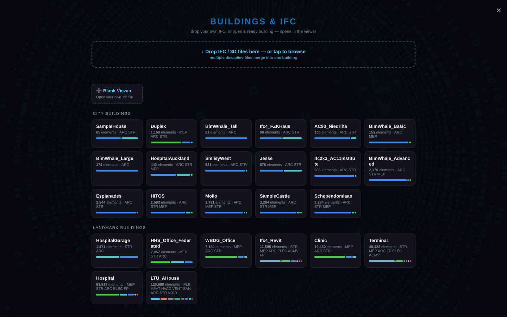

**Three ways in — pick one:**

1. **Open a ready-made building.** Tap a card under **City Buildings** or **Landmark Buildings**
   (SampleHouse, Duplex, Clinic, Terminal, Hospital, …). It downloads that building's DB (0.5–177 MB),
   flies to it, and streams the geometry in the 3D viewer.
2. **Drop your own IFC.** Drag an `.ifc` / `.obj` / `.dae` / `.glb` file onto the centre **"Drop IFC /
   3D files here"** zone (or tap it to browse). The file is parsed in-browser and opens in the viewer.
3. **Add to an existing project.** When you drop a file that matches a building already loaded, a
   prompt offers **Merge** (combine disciplines — `Enter`) or **New** (a fresh building — `Escape`);
   two versions of the same building can be opened side-by-side with **Compare Versions**.

Once the viewer opens:

1. Watch the progress bar and element flicker as geometry streams in.
2. **Click any element** → the Info panel shows its IFC class, name, GUID, storey, discipline, material.
3. **Filter** by storey or discipline (bottom-left panels) to isolate part of the model.
4. **Alt+Z** for X-Ray, **☆** for white background, **✈** to fly around, **📷** for a screenshot.
5. Open another building → the first pauses; tap back to resume.

Full navigation, panels, and the keyboard cheat-sheet are below.

---

## Run it on your own machine

**Local setup (3 steps):**

```bash
# 1. Go to deploy folder
cd deploy

# 2. Start local server
python3 -m http.server 8080

# 3. Open the front door in your browser, then choose Buildings / IFC
# http://localhost:8080/index.html
```

Per-building DBs must be in `deploy/buildings/`:
- `{Name}_extracted.db` — metadata + transforms
- `{Name}_library.db` — geometry BLOBs (vertices + faces)

Then open `http://localhost:8080/index.html`, choose **Buildings / IFC**, and use the same three ways in as above.

**DB sizes:**

| Building | Elements | Download (ext+lib) |
|----------|----------|--------------------|
| SampleHouse | 65 | 0.5 MB |
| Duplex | 1,169 | 2.8 MB |
| Clinic | 16,480 | 31 MB |
| Terminal | 48,428 | 59 MB |
| Hospital | 63,917 | 88 MB |
| LTU AHouse | 125,698 | 177 MB |

---

## 3D Navigation

| Input | Action |
|-------|--------|
| **Drag** | Orbit camera |
| **Shift + Drag** | Pan camera |
| **Right-click drag** | Pan camera |
| **Scroll / Pinch** | Zoom |
| **Click** element | Identify — shows IFC class, name, GUID, storey, material |
| **Alt+Z** | X-Ray toggle (15% opacity) |
| **F11** | Fullscreen toggle |

**Toolbar buttons (top-right panel):**

| Button | Action |
|--------|--------|
| **Clear** | Remove all streamed meshes |
| **X-Ray** | Toggle 15% transparency on all elements |
| 📷 | Screenshot (saves PNG to Downloads/) |
| ⛶ | Fullscreen |
| ☆ / ☾ | Light/dark theme |
| ✈ | Fly around rendered buildings |

**Panels:**

| Panel | Position | Shows |
|-------|----------|-------|
| **BIM OOTB** | Top-left | Buildings, streaming progress, element flicker |
| **Tools** | Top-right | Filter, buttons, building list |
| **Info** | Bottom-right | Clicked element metadata (class, GUID, storey, disc, material) |
| **Storeys** | Bottom-left | Floor filter — click to isolate one storey |
| **Disciplines** | Bottom-left | Discipline toggle — show/hide ARC, STR, MEP etc. |
| **Status** | Bottom-centre | Current streaming state |

All panels collapse with **−/+**.

---

## Viewer Features

**All browsers (desktop + mobile):**

- 3D orbit, pan, zoom (mouse or touch)
- Click any element → IFC class, GUID, storey, discipline, material
- Fly-tour — plays a routed flight through the building (entrance → highlight room → storey-by-storey);
  drag the scrub bar to seek anywhere in the tour, `◀◀`/`▶▶` to step beat-by-beat, `0.5x`/`1x`/`2x` speed,
  pause/resume and loop — every position is deterministic (same timestamp always gives the same camera
  pose), so scrubbing back and forth never drifts

  
- Film-Maker (**Alt+C**) — derives a complete cinematic film of the building from its own room graph,
  then lets you edit the flight by dragging the flight itself, and records it to an mp4 in the browser.
  See [Cinema Film-Maker](#cinema-film-maker-altc-the-bim-ootb-film-maker) below
- Indoor walk-through — follows IfcSpace/door graph through the building
- X-Ray mode (Alt+Z) — a 3-state cycle: **Off → X-Ray → Bounding Boxes → Off**. X-Ray is the transparent
  see-through-walls view; Bounding Boxes swaps that for each element's envelope box instead — press again to cycle
- Measure tool — tap two points, get distance in metres
- Section cut — horizontal clip plane, slider to cut through floors
- Storey filter — isolate a single floor
- Discipline toggle — show/hide ARC, STR, MEP, ELEC, etc.
- Screenshot — saves current view as PNG
- Deep-link URL — camera + building state encoded in hash, shareable
- IndexedDB cache — download once, instant on revisit
- City mode — 786 building bboxes, click to download + stream on demand

### Help — F1, the info panel, and the command line *(LIVE)*

**In the Viewer**

- **F1** (or the Help pill) opens the help panel on the left. It stays open while you work. Drag it by its
  header; close it with × or Esc. It opens again where you left it, with the same search text and the same
  entries open.
- It lists every tool with its key. Type in its box to find a tool by its name, or by a word from its steps:
  *native* finds Save Building and Open Building.
- Open a tool's entry to see its steps and a **Guide** link to its section in this guide. Find and the Time Machine also show **Same at the CLI**: the command line that gives the same
  answer.
- **Click an element**: the info panel says **What this is** in one plain sentence, and under it the official
  **IFC definition** from buildingSMART (bSDD), word for word, with its credit (CC BY-ND 4.0). Where
  buildingSMART publishes a translation (German, for example) you get theirs; otherwise the English, with a
  line saying there is no official translation in your language.

**In the [Modeller](ModellerGuide.md)**, **?** and the Guide pill open the same panel, in the outliner's place.
The outliner comes back when you drag the panel away or close it. The guide's sections are inside the panel.

**At the command line (`red1`)**: the help panel is part of the page, so it is not at the command line. This
is what the command line does have for BIM:

| You want | At the command line |
|---|---|
| The list of BIM words | `help bim` |
| One word explained | `help count`; type `level student` first for a fuller explanation |
| The same answer as a Viewer tool | The line its help shows, e.g. `viewer.counts building=Duplex` (it counts the model, the same answer as Find) |
| Ask a question in plain words | **Not for BIM yet.** `ask` answers ERP questions only, inside an ERP kind (e.g. `cd "Business Partner"`) |
| What an element is (the class text, the IFC definition) | **Viewer only**, in the info panel |

The command line itself is explained in the [Fast Script Guide](FastScriptGuide.md).

> *Proven by* **W-HELP-DOCK** (place, drag, reopen, phone), **W-HOWTO** (guide links, the word search, the
> command lines), **W-CLASS-HELP** (the class text and the bSDD text, byte for byte), and **W-HELP-DOCK-M**
> (the Modeller).

### Find panel — search, voice query, and axis lenses

> **New: Ask.** Pick a question, get a computed answer, save the answers as one Excel file for your own AI —
> **[Viewer Ask — First Steps](AskFirstSteps.md)** (5 minutes).

The **Find** panel is the Viewer's search/navigate surface: a text or voice query box up top, and a
single axis toggle underneath that re-groups the whole element tree (by storey, discipline, room,
material, phase, or the newest axis, building **Parts**).

**How to open it** (with a building already loaded — see [Quick Start](#quick-start-your-first-building)):

1. On the right edge of the screen, find the toolbar rail (desktop) or the scrollable pill strip
   (mobile) — tap the **···** button if the rail isn't already showing. Find the **Navigate** icon
   (a sailboat glyph) among the rail's icons.
   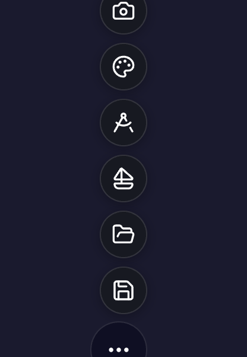
2. Tap **Navigate**. The **Navigate** drawer opens, listing **Find / Navigate**, **Role View**, **World History**,
   **Page History**, **Home**, **Fly Tour** and **Nav LOD** (for large buildings); a further row, **Walk**, is
   mobile-only and won't appear on desktop.
   Tap the **Find / Navigate** row (magnifying-glass icon, shortcut **F**).
   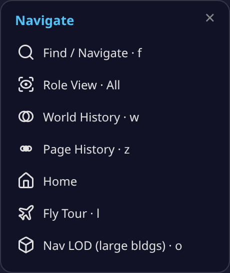
3. The **Find panel** opens on the right side of the screen, with the search bar focused and ready to
   type. On desktop you can also press **F** to open it directly, from anywhere in the viewer.
   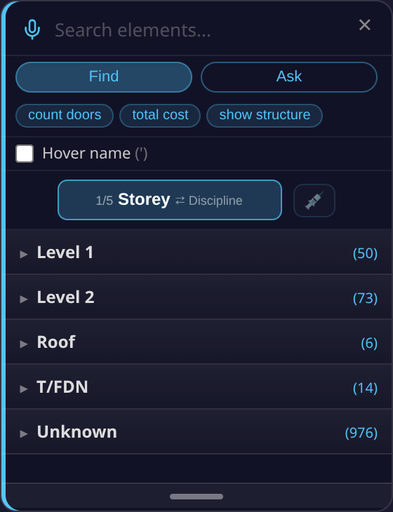
4. Tap the **×** in the top corner of the panel, or press **F** again, to close it.

**The search / query box.** The input (placeholder *"Search elements…"*) does two different things
depending on what you type:

- **Plain text** (e.g. a product name, or an IFC class like "door") filters the element tree live as
  you type — a normal name/class search.
- **A natural-language query** — anything starting with a recognized verb (`count`, `how many`,
  `number of`, `total`, `cost`, `show`, `list`, `what`, `find`, `search`) is detected as you type.
  Recognized phrases don't filter the tree live like a plain search does — type the phrase, then press
  **Enter** to run it. Recognized query shapes include:
  - `count doors` / `how many beams` / `number of windows` — element count by IFC class.
  - `total cost` — an indicative 5D cost breakdown by IFC class, using the active rate pack.
  - `cost of <discipline or class>` — cost narrowed to one discipline (e.g. "cost of electrical") or class.
  - `total area` / `total length` / `total volume` [`of <class>`] — element count as a proxy quantity
    (the loaded DB does not carry IFC quantity-takeoff dimensions, so this is a count, not a measured
    area/length/volume).
  - `floor area` — a slab count (same caveat: no measured floor-area dimension in the DB).
  - `show <discipline>` / `list <discipline>` — every element in that discipline, grouped by class.
  - `what disciplines` — every discipline present in the building, with element counts.
  - `find <term>` / `search <term>` — routes back into this same Find panel as a plain search for `<term>`.
  - `floor <n> <class>` / `ground floor <class>` — a storey-scoped count (e.g. "floor 2 beams").
  - A more general typed-language decoder is tried first and understands a broader range of phrasing;
    the patterns above are the documented fallback when that decoder doesn't recognize the phrase.
  - Three example chips below the box — **count doors**, **total cost**, **show structure** — run a
    query immediately when tapped, no typing required.
  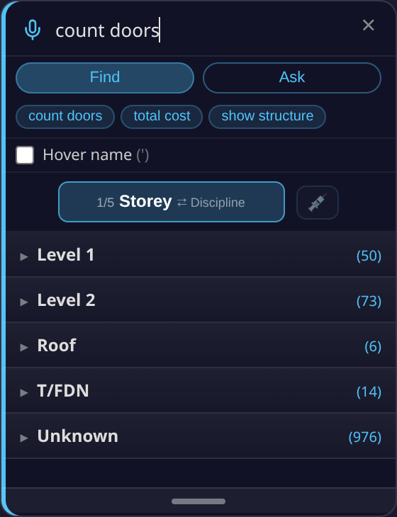
- **Voice search** — tap the microphone icon to the left of the text box and speak a query using the
  same phrasing as above (e.g. "count doors"). The recognized text fills the box live while you speak
  (shown in italics until finalized), and the finished phrase runs automatically — no need to press Enter.

**The axis toggle.** Below the search bar, one button shows the current axis and how many are
available (e.g. "1/6 Storey" on a building where all six axes are present) — tap it to cycle to the
next axis. Two axes are always present; up to four more appear only when the loaded building actually
has that kind of data (no data, no empty axis):

| Axis | Always shown? | What it shows |
|------|----------------|----------------|
| **Storey** | Always | Elements grouped by building level/storey. Expand a storey to see the rooms/spaces on it (or, if the building has no room data, its most common IFC classes). Tapping a storey or room isolates it in the 3D view. |
| **Discipline** | Always | Elements grouped by discipline (ARC/STR/MEP/ELEC, etc). Expand a discipline to see its IFC classes; tap a class to highlight just those elements. |
| **Room** | Only if the building has volumetric room (IfcSpace) data | A highlight lens: the model is X-rayed and a translucent box is drawn over each room. Has its own **Storey / Type / Path** sub-toggle: group rooms by floor, by the compiler's own confidence tier (see [Room health](#room-health-the-type-sub-toggle-shown-on-terminal) below), or route between two rooms the way a person walks. (On a building without volume data, this falls back to a plain isolate-by-room list instead.) |
| **Material** | Only if material data is present | Elements grouped by material name, or — via a **Material / Category** sub-toggle — by a derived construction category (Concrete, Metal, Wood, Glass, Drywall/Partition, Masonry, Insulation, Tile, Finish, Membrane, Flooring, Generic, Other). Categories are a keyword-derived heuristic, not an extracted IFC property, and are labelled accordingly in the panel. Highlight lens, same X-ray-and-box behavior as Room. |
| **Phase** | Only if a construction timeline can be generated for the building | Elements grouped by construction phase/task, generated on the fly (a short "Timeline generating…" message appears first). |
| **Parts** *(new)* | Only if the building has stairway, lift-shaft, or plant-room elements | Elements grouped into up to three building-part categories: **Stairway** (stair/ramp classes), **Lift Shaft** (elements named for lifts/elevators), **Plant Room** (HVAC-plant elements — vents, ducts, fans, AHUs, dampers, chillers, pumps). Each category is itself data-gated — it only appears if the building actually has a match. Tapping a category, or a single item inside it, isolates it in the 3D view (hides the rest of the model). |

  

**Room highlight, shown on HHS Office.** Level 2 alone compiles 31 real rooms (105 across the
whole building) — tapping one X-rays the model and draws a clean, correctly-bounded translucent box
over just that room, confirming the room's geometry is well-formed and doesn't overlap its neighbours.

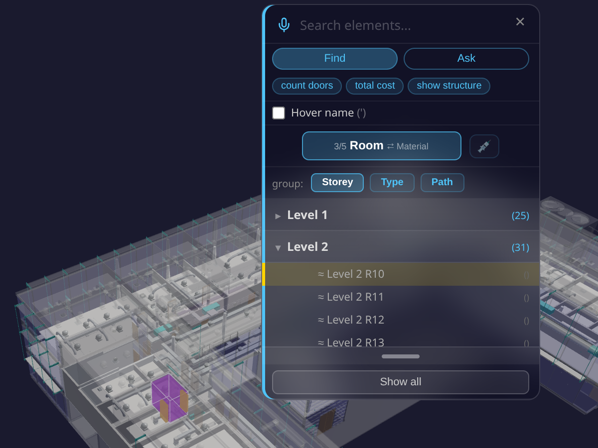

*Known gap:* tapping a room highlights it but does not move the camera to it; on a large building, orbit or
zoom to see a small room clearly.

**Plant Room** appears only on larger, complex buildings (Terminal, Clinic, Hospital, HHS), never on homes, and
it matches whole words only (so "Backflow Preventer" is not taken for a vent).

*While you type a recognized query phrase, the panel shows no preview and does not filter the tree; press **Enter** to run it.*

#### Room health — the Type sub-toggle (shown on Terminal)

Switch the Room axis's grouping from **Storey** to **Type** and rooms are grouped by the compiler's
own confidence in them, not by a floor: **INTERNAL** / **INTERNAL_SMALL** (ordinary enclosed rooms,
split by size) and **SUSPECT_OPEN** / **SUSPECT_NO_DOOR** (rooms the compiler could bound
geometrically but flags for a human rather than silently accepting). This is the compile-with-honesty
principle made visible — a low-confidence room is *shown* as low-confidence, never quietly promoted
to "room" just because it fits inside walls.

**Terminal, the hard case.** The compiler knows only geometry, and a tall vertical shaft can look
room-shaped from a single floor's footprint alone. So a room candidate whose footprint recurs, stacked,
through multiple storeys with a real stair inside it — the signature of a shaft, not a room — is
rejected. On Terminal that leaves **40 rooms** (down from 59) and no stairwell in either the Room list or
the 3D view. A Terminal copy cached in your browser before this change is corrected automatically on reload.

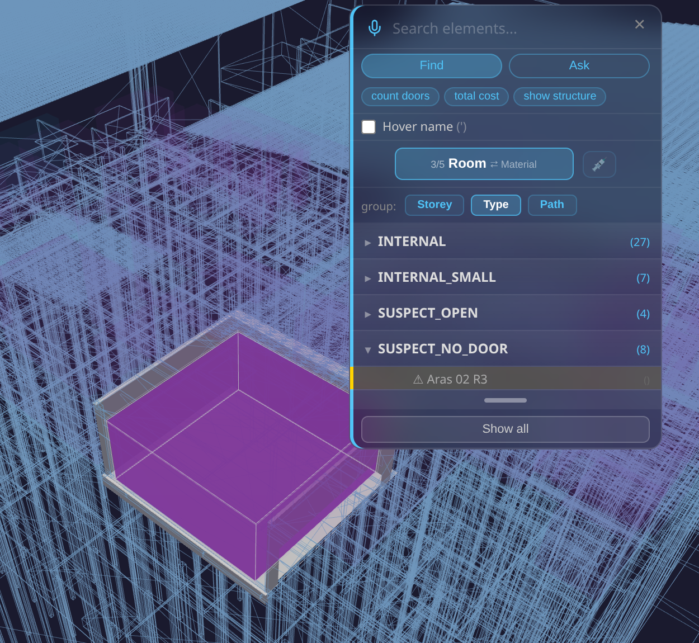

That SUSPECT_NO_DOOR pick is the demo frame: an empty pocket next to the stair, no door found
bounding it, so the compiler says exactly what it knows and stops — it doesn't invent a door to make
the room look finished.

*Known gap, named not hidden:* Type is a **health** taxonomy (how sure the compiler is this is a
room), not a **semantic** one — it doesn't yet know "corridor" from "office." Terminal's concourses
show no CORRIDOR band because the only measured corridor reference on file is Duplex's 10.4 m²
hallway, and stretching that onto a terminal concourse would be inventing, not compiling.

#### Room-to-room paths & escape routes

With the **Room** axis selected, the **Path** sub-mode routes between any two rooms the way a
person actually walks — out the door, along the corridor or concourse, and up or down the stairs
when the two rooms are on different floors. The route draws as a line through the real doors and
stair flights it uses, and the rooms along the way stay highlighted.

A route across Terminal's floors returns several stair-crossing
legs in sequence, not a single best-guess hop — each leg names the room and the door or stair flight
it passes through.


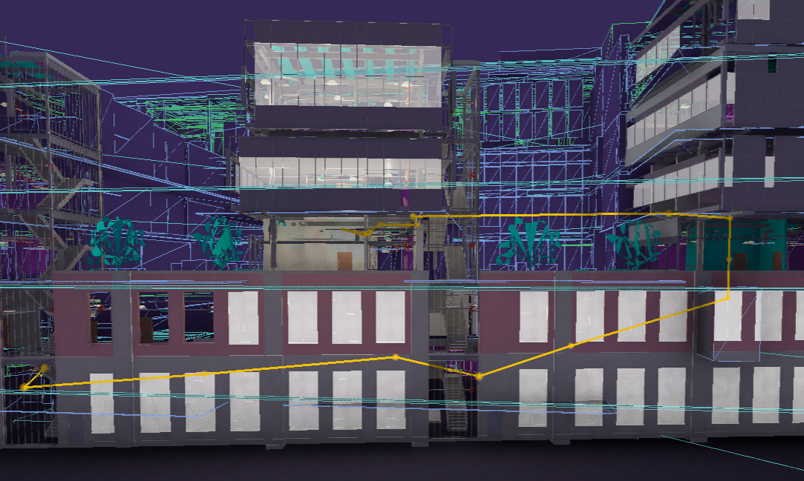

The drawn route follows the real walkable floor: along corridors, through doorways and up the stairs, never
through open air or across an atrium. On some floors the line may step back through a door it has just passed,
so the route is right even where the line is not the tidiest; the distance and the doors it lists are the
route's own.

*Future feature — mobile:* scan a QR code posted beside a door to fetch that building's lightweight
architecture model on your phone and see the escape route in Walk mode from exactly where you stand.

### The rest of the Navigate drawer — World History, Page History & Home

The **Navigate** drawer (sailboat icon — see [Find panel](#find-panel-search-voice-query-and-axis-lenses)
above for how to open it) has three more rows besides Find / Navigate:

- **World History** (shortcut **W**) — a cross-page timeline: every significant action across *every*
  page — Viewer, ERP, Gravity — in one place. Opens a card with a **Whole / This page** toggle, day-by-day
  navigation (**‹ day** / **day ›**), and one entry per action (what happened, where, and when).
  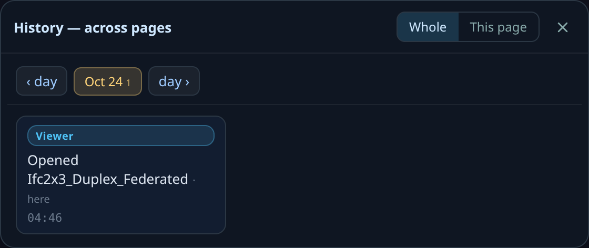
- **Page History** (shortcut **Z**) — this page's own compact dot-timeline, a small step-back/step-forward
  bar. It only lights up once you've made edits in this session — a fresh session shows an empty strip
  (the pair of arrows either side of a single dot), as captured here.
  
- **Home** — returns to the front-door hub (the same page the [Quick Start](#quick-start-your-first-building)
  walkthrough starts from). Installed as a standalone app (PWA), it opens the live hub online, or falls
  back to the cached hub offline.

### Inspect drawer — Measure, Clash, X-Ray, Section, Time Machine, 4D/5D, Fly Tour

> **Road (civil works) model?** The same drawer gives extra road reports — clash between trades, earthworks volume, long / cross sections and a road Model Check. Walkthrough: **[Civil Works — Step by Step](CivilWorksGuide.md)**.

The **Inspect** drawer (compass icon, next to Navigate on the toolbar rail) bundles the analysis tools behind
one icon: Measure, Clash Matrix, X-Ray / Bbox, Section Cut, Time Machine and 4D / 5D. On a road (civil
works) model it also lists Road standards, Road report, Earthworks and Roadworks. **Fly Tour** now lives in
the **Navigate** drawer (key **L**).

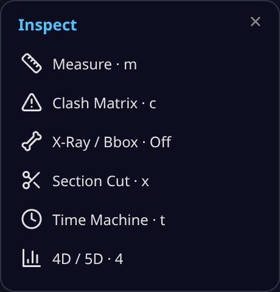

- **Measure**, **X-Ray / Bbox** and **Section Cut** are covered above, under
  [Viewer Features](#viewer-features); **Fly Tour** is there too.
- **Clash Matrix** (key **C**) opens the clash-detection engine (discipline-pair grid, tolerance, Review /
  Resolve / Accept status, HTML + CSV export) — full coverage: **[Clash Detection guide](CLASH_DETECTION.md)**.
- **Time Machine** (key **T**) opens the 4D construction timeline — author a schedule, play it back,
  try a What-if slip, share a `?tm=play` link. On a large building (100K+ elements), a box-cube pill
  in the panel header trims GPU cost by rendering already-built-but-out-of-view elements as lightweight
  wireframe boxes, keeping whatever you're actually looking at full LOD400.
  The schedule it plays is generated element-by-element from the model's own geometry, and it holds a
  measured invariant — **no element appears before the first element it physically touches appears**
  (0 violations across 266,954 elements on seven buildings; see
  **[the generated 4D movie](4D5DAnalysis.md#the-generated-4d-movie-support-order-is-a-measured-invariant)**
  for the numbers and the stated limits).

  <figure style="margin: 12px 0;">
  <a href="https://youtu.be/juwOrpqKhFE" target="_blank"></a>
  <figcaption style="text-align:center; font-style:italic; color:#666; margin-top:6px;"><a href="https://youtu.be/juwOrpqKhFE">Watch on YouTube</a> — Time Machine playback on a large building with the box-cube proxy toggle.</figcaption>
  </figure>

  Full authoring/editing/import walkthrough — including direct Gantt drag/resize/link and the
  **⏪ Pull Back** (reschedule-as-early-as-possible) action — lives on its own page:
  **[Time Machine — the 4D construction timeline](TimeMachine.md)** (not re-documented here — same
  building, same feature, reached from either app), including the
  **[ERP-side entry point](TimeMachine.md)** — picking an
  element in 3D (or a red **Zoom Across** pill on an ERP record) jumps the Time Machine straight to
  that element's construction moment.
- **4D / 5D** (key **4**) opens the analytics dashboard (`boq_charts.html`) for the loaded building in a
  new tab — full coverage: **[4D/5D Analysis guide](4D5DAnalysis.md)**.

#### Your own 4D / 5D references: rates, durations, sequence

The 4D schedule and the 5D cost are computed from reference files the Viewer ships with. You can pull each one
out, change it to your own references (your firm's rates, your crew sizes, your durations) and the Viewer then
uses your copy.

| Reference | File | What it holds |
|---|---|---|
| **5D Rate Pack** | `rates/<pack>.json`: 16 national packs (`cidb2024_my`, `bcis2024_uk`, `rsmeans2024_us`, `rawlinsons2024_au` …) plus `custom_template.json`, an empty pack to fill | `meta` (name, region, currency, exchange rate, source), `materials` (a rate and unit per IFC class, e.g. `IfcDuct`: 165 per metre), `labor`, `equipment`, `work_packages`, `smm_sections`, `provisions` |
| **4D Schedule Template** | `rates/4D_template.json` | `calendar`, `duration_rule`, `capacity_rule`, the 7 `phases` (substructure, superstructure, envelope …, each with its trades and whether it repeats per storey) and their `dependencies` (predecessor, successor, type, lag days) |
| **4D Sequence & Labour Rules** | `rates/sequence_rules.json` | `SEQUENCE_RULES` (the trade order by IFC class) and `LABOR_RATES` (per trade: rate per day, crew size, crews, productivity per IFC class) |

**Pull a file out.** **Settings → Edit Project JSON**, open the file (the rate pack entry always shows the pack that is
active now; choose another one under **5D Rate Pack** first), then **⬇ Download**. You can also open the file
straight from the site, for example `https://red1oon.github.io/bim-ootb/viewer/rates/cidb2024_my.json`.

**Edit it to your own references.** In the same **Edit Project JSON** form, change the values: a rate, a crew size,
a lag. A list of items inside an item (such as a phase's dependencies) is shown as JSON text: keep it valid JSON;
if it is not, the last good value is kept and nothing is broken. Your copy is saved in this browser as you type,
separately for each rate pack, so a change to the Malaysian pack does not touch the UK one.

**Use it.** These references belong to the **Viewer**. After editing, switch to the Viewer tab and reload it.
The Modeller uses them only for the cost and labour change it shows on an edited element: that change is priced with
the same rate pack, and the same copies, as the Viewer. Where each copy takes effect:

- **5D Rate Pack:** the Viewer (the Find panel's `total cost`, the Time Machine's schedule) and the **4D / 5D**
  dashboard price with your rates as soon as they open. The pack is the one picked under **Settings → 5D Rate Pack**;
  with none picked, it is the pack of the display language (English (US): `rsmeans2024_us`, English (Malaysia):
  `cidb2024_my`), and switching the language switches the pack. The language changes only the words (descriptions,
  trade names); the prices and the currency always come from the pack.
- **4D Schedule Template:** the next schedule the Time Machine generates uses it.
- **4D Sequence & Labour Rules:** used by the Viewer, the **4D / 5D** dashboard and the MEP report when they open.

**Reset** in the same form discards your copy and goes back to the shipped file.

**Keep and share it.** **⬇ Download** saves your edited file. Your copy lives in this browser only: there is no
*load from file* yet, so on another browser or computer the changes are entered again (or the downloaded file is
added to the project's `viewer/rates/` folder by whoever publishes the Viewer).

### Camera / View drawer

The **Camera / View** drawer (camera icon) bundles three camera-control toggles, plus **GI Preview** (**Alt+G**,
desktop only — an ambient-occlusion preview):

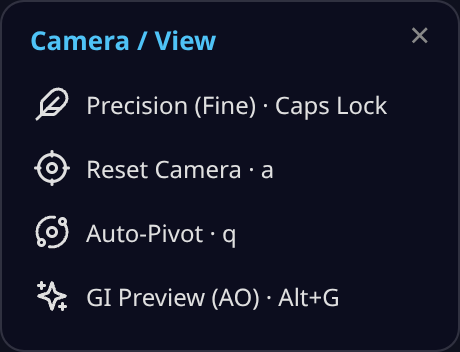

- **Precision (Fine)** (Caps Lock) — slows orbit/pan/zoom for fine, deliberate camera moves (e.g. lining
  up a screenshot or a measurement).
- **Reset Camera** (key **A**) — snaps the camera back to its default orbit position.
- **Auto-Pivot** (key **Q**) — toggles automatic pivot-point recentring as you orbit, so the camera keeps
  turning around whatever's in view instead of a fixed point.

### Cinema Film-Maker (Alt+C) — the BIM OOTB Film-Maker

**Alt+C** computes a complete cinematic film of the building — dive in, settle on the largest occupiable
space, walk out through a real door, orbit the exterior — in well under a second, from the model's own
room graph. No camera path is authored by hand; the defaults come from measured geometry (room area,
reachability, door position, clearance), not a guess.

Before recording starts, a **Cinema path** panel opens with the whole film drawn as a yellow tube
through the building. You edit the flight by dragging the flight itself — there is no separate
storyboard or keyframe list:


That is the whole film, derived, before you touch anything — and the footer says so: *"Unedited · OK
records exactly the film the preview just showed."* Pressing **OK** here is already a complete take.

#### The bands — the rows in the panel

Every row is one straight **band** of the flight, listed in flight order with its own x, z, **height**
(green) and **length** (orange) fields, plus its aim angles:

- **settle** — where the dive lands and the camera looks around. Always the first row.
- **stop** — end of the *walk*, not the film; its far end stretches the exterior orbit that follows.
  Always the last row.
- **stick** — any band you added yourself, labelled with how far along the walk it sits. A derived path
  opens with one; the screenshot below has four.

To work with them:

1. **Click the tube** anywhere along the walk to drop a new **stick** there. A fresh stick lies exactly
   along the curve, so the film does not move until you move it — dropping one costs nothing.
2. **Drag a band's end** to pivot it about its far end (length is fixed, so this aims a leg — use it to
   turn through a different doorway).
3. **Drag a band's middle** to move the whole band without pivoting.
4. **Press `×` on a stick's row** to remove it. *settle* and *stop* have no `×` — the dive lands on one
   and the orbit stretches off the other, so removing either would change what the beats mean.
5. **Anywhere else orbits the scene as normal** — no freeze, no modifier key. A drag moves in the plane
   you are currently facing, so orbit to a side view when you need to change height.


#### Walk finger mode — walk into the shot, plant the stick where you stand

Dropping sticks by clicking the tube works from the outside looking in. **Walk finger mode** does the
same edit from the inside: you walk through the building in first person and plant the stick exactly
where you are standing, aimed exactly where you are looking.

1. Press the **eye** on the Cinema path panel's title row — the **POV frame** opens bottom-left,
   showing the film's own camera view.
2. Press the **shoes** (footprints) icon on the POV frame's header. You are now standing inside the
   film, at the start of its walkable stretch, at walking height. (Optional shortcut: drag the
   timeline bar to a point along the walk first, and the shoes start you there instead.)
3. **Walk with the usual trackpad moves, all shown in the POV frame:** move your finger to look
   around; pinch out or scroll to glide toward what you are facing (hold **Shift** to glide faster);
   the **W A S D** keys do the same moving from the keyboard. The rest of the screen freezes while
   you walk — that is deliberate, it keeps the walk smooth on large buildings.
4. **Enter or Spacebar plants the stick** — where you stand becomes its position, where you look
   becomes its aim — and drops you straight back into the editor to review it. A **click** plants
   the stick and keeps you walking, for laying several in one pass. **Esc** leaves without planting.
   Pressing the shoes again continues from the exact spot you left.

Example on the Terminal building: walk into the POV, hit Spacebar, and **stick @ 13%** appears — the new
row highlighted in the panel and its blue middle dot on the path in canvas right beside it. One keypress,
one stick, position and aim both set:


Two small behaviours keep this honest: planting re-shapes the flight around the new stick immediately
(the brief pause is the film re-deriving), and clicking again at the stick you just planted does
**not** stack a duplicate — the editor reads it as "I'm done here" and returns you to review.

#### Whole path — the controls that act on the entire film

- **reach %** — how far a drag on the tube carries along the walk. Drag the tube *between* the bands and
  it bends like a hose, falling off over that reach; a small reach edits locally, a large one sweeps the
  whole flight.
- **clip · mark in / mark out / whole film** — trims the film to a window without changing the path.
  ⚠ **Marking uses the point of the film nearest your camera**, so put the camera close to the spot *on
  the yellow tube* where the cut belongs before pressing — marking from a wide exterior view lands on
  whichever part of the flight happens to pass closest to your eye. **whole film** clears the window.
- **build the model as the camera flies** — the construction reveal. See the 4D note below.
- **room titles** — a name card appears as the camera enters each room, sourced from the room's own
  friendly name, never invented.
- **Reveal** — cycles every discipline in the model past the camera in turn. See below.
- **Clash pairs** — the model's mesh-true clash pairs (not the bounding-box list, part of which is false)
  appear as red/blue pulsing markers from frame 0, so you see where the trouble is before it's built. A
  pair that comes near the camera gets an on-screen label naming both sides, plus a `[tolerance mm /
  clash mm]` line beneath them — the tolerance from that discipline pair's own rule, the clash figure
  from the real mesh overlap depth, not a bounding-box estimate. The Reveal round's rotating stat
  cards also gain a "N mesh-true clashes flagged" card while this is on.
- **Measure** — the setting-out drawing, from the real column grid: numbered and lettered bubbles, bay
  chains that sum to the overall, and storey rules. It is **up at frame 0** — built from the database, so
  it does not wait for the model to load — and it is drawn **in the model's own planes**. The upright
  storey rules occlude normally as the buildup rises — that occlusion is how you see them sitting
  behind the building rather than painted on the lens. The ground plan lines shine through the
  building instead: a live check found them fully hidden behind the building's own walls from every
  camera angle otherwise, including the opening shot, so occluding them would mean they were never
  actually seen. The chains are checked rather than
  claimed — on Hospital, HHS and Terminal the bay chain sums to the overall exactly on all three axes
  (`X 95.915 = 95.915`, and so on), with no per-building tuning.
  ⚠ Where a federated model records the same storey at two elevations, the drawing **states the fault
  and draws the levels as recorded** rather than choosing between them — resolving it would be inventing
  a datum the file does not contain.
- **Storey highlight** — each storey's facade (its exterior walls only, not the whole floor) glows
  blue / green / yellow / orange in turn over the last 10 s before the closing orbit, with a
  door-count and footprint HUD card for each shown in the same corner panel every other measure
  uses. An exterior wall is already visible from the closing orbit shot on its own, so nothing else
  in the building is touched, dimmed, or made transparent for this.
  ⚠ The card's counts are read per storey **name**. On a federated model whose storey table carries alias
  or duplicate names (one Terminal file lists 22 names for six real floors), the highlight can land on
  alias rows and the card then reads `doors 0` — the doors are real, they are attributed to the storey
  names the highlight did not pick.
- **Silent-bake size** — a resolution/fps preset (720p, 1080p, or 1440p) for a *silent* bake only (see
  below); an interactive Alt+C recording always uses the size of the window it's pressed in, so this
  select doesn't resize anything here — it's just remembered on the saved path. There is currently no
  time estimate shown next to it; picking 1440p over 720p costs real extra bake minutes with no on-screen
  warning yet.


![The Cinema path panel with the full option set — seven bands (settle, five exit doors, stop) each with x / z / height / length and aim angles, then Whole path: reach 15%, clip "whole film" with mark in / mark out, and one button per film feature — Buildup (on), 4D/5D, Reveal, Clash pairs, Measure, Sun compass, Storey highlight, Load path freeze and Escape route — above Silent-bake size "this window (interactive)" with its copy-bake-command link, Day # counter "top right", the saved-plan list, and the derived total 97.9 s · 1468 frames to bake](img/viewer/filmmaker-measure-storey-panel.png)

- **saved** — plans you stored for this building, with **open** and **delete**. Choosing one and pressing
  **open** replaces the path you are editing; the line under it says how many bands, how many hose pulls,
  the clip window and when it was saved.

#### Timing, preview and recording

The **total** field is seconds, and the line beneath it reports the derived reality: walk length, walking
speed in m/s, the natural duration, and how far your edit has moved it. Total duration is derived per
building from real walk distance and pull-back distance, never a fixed number — a small building's film
is shorter than a large one's by construction, not by a setting.

- **Preview** flies the current edit so you can watch it before committing to a bake. The panel tells you
  when what you are looking at is older than your last edit.
- **Save this path** stores the plan — both into the building (so it travels with the file when you save
  it) and as a named entry in the **saved** list above.
- **Cancel** discards; **OK** records the film exactly as previewed. If you touched nothing, that is
  byte-identical to the un-edited default — opening the panel to look costs you nothing.

#### The 4D reveal — and what it may honestly be called

With **build the model as the camera flies** ticked, the model assembles as the film runs. What drives
that order depends on the data in *your* building, and the viewer picks automatically:

| your data | what drives the reveal | what to call it |
|---|---|---|
| no dated tasks | the derived build order, re-keyed to the flight | **"derived build order"** — never "the schedule" |
| real dated tasks (a 4D schedule authored or imported into the building) | each element's own `schedule_start` | **"a linked 4D schedule"** |

A building with a real schedule reveals by that schedule and nothing is re-ordered. The practical
workflow is to **preview the Time Machine first** — its Gantt is in the Inspect drawer — and then place
your **mark in / mark out** against what the programme actually shows.

[Watch the film](https://youtu.be/sUTscAgnQMc) this feature produced on a real building.

#### Discipline Reveal — walk it twice, once dressed, once bare

Tick **Reveal** (beside **room titles**) and the film grows a second act after the normal walk-out
ends, before the closing orbit:

1. **A brief pull-out** from the spot the walk just ended on — the camera eases back a short distance,
   still looking the way it was looking, a beat to mark that the walk itself is done.
2. **A fast retrace back to where the walk began** — the camera flies back along the exact same route
   it just walked, at a quicker pace than the walk itself, easing in and out so the motion reads as
   one continuous flight, never a jump cut.
3. **The same walk, a second time, with the architecture hidden.** Walls, slabs and structure fade out
   of the shot for this lap only, so every other discipline present in the model — mechanical,
   electrical, fire protection, plumbing, whatever the building actually has — shows through at once,
   exactly where it really sits.
4. **A parade, one discipline at a time.** Each discipline present takes its own short turn alone on
   screen, named on the title card in place of the room name, smallest-average-element disciplines
   first and MEP last — MEP's own ducts and pipework tend to be large and easy to spot even briefly, so
   it doesn't need the early slot the finer trades do. Each hand-off holds both the outgoing and
   incoming discipline on screen together for a moment rather than swapping instantly, before **All
   Disciplines** together closes the parade.

Every distance and duration in this second act is derived from the same real geometry the rest of the
film uses — the pull-out, the retrace and the walk are each priced by a real speed times a real
measured length, never a fixed number tuned to look right on one building.

#### Sun, sky and shadow while the film records

A recorded film is not lit the way the live viewport is. The moment recording starts, the viewer stages a
photographic pass — and it keeps running *while the 4D reveal assembles the building*, so the light and the
construction sequence advance together in the same take:

| what happens | detail |
|---|---|
| **The sun travels** | It starts at a high 55° "late morning" angle and sinks to a 6° dusk by the last frame. Shadows lengthen and swing across the film — the sun is not parked. |
| **Real cast shadows** | The building, its rooftop plant, and the distant skyline all cast real shadows onto the ground, at a 4096² shadow map for the recording only (the live viewport uses a cheaper one). The shadow frustum widens as the sun drops so a long dusk shadow isn't clipped at its tip. |
| **Atmospheric sky** | A physically-based clear-sky scattering model (Preetham), pushed warmer and hazier for the shoot — deeper reds and a tighter sun glow near the horizon than normal navigation shows. |
| **Photographic reflections** | Glass and metal reflect a real photographed sky (HDRI), refreshed as the sun moves, so the glint tracks where the sun actually is at that moment of the film. |
| **Warm evening key light** | The sun tints warm and window/fixture glow comes up as the light falls. |

You can also stage a **single still** rather than a whole film: **Alt+S** applies the same photographic pass
and then refines the frozen frame over 16 jittered sub-pixel samples for clean edges. **Alt+J** adds an
optional bounce-light (GI) pass — off by default, and deliberately excluded from film recording because it
costs far more per frame than a film's frame budget allows. **Alt+G** is the lighter ambient-occlusion preview.

**What this is honestly not.** There is no weather: no rain, no snow, no cloud shapes — the sky model is a
clear-sky one and has no cloud geometry at all. And it does not claim to be indistinguishable from a
photograph: the geometry is idealised IFC with no real-world wear, materials are assigned by class rather
than hand-tuned per surface, and nothing is colour-graded per shot. What it does target is the good-archviz
tier — and, unlike a still-render tool, it does it *while the building assembles itself to the programme*.

#### Baking without the browser — the silent bake (developers)

Everything above records the film from the viewer window: press **Alt+C**, edit, press **OK**, and watch
it bake. There is also a **command-line path that bakes the same film with no window and nobody
watching**. It is a development tool — it is gated behind an internal flag that a
normal viewer session never sets, and there is no button for it.

It exists because a film is expensive to check. A bake takes tens of minutes, so a defect in the HUD or
the pacing used to be found only after sitting through the result. The silent bake lets the same film be
produced, measured and re-run from a terminal, so what used to be a wait becomes a test.

```
node cli_silent_bake.js --db HospitalAjaibPath --out /tmp/hospital.mp4 \
  [--plan NAME | --override file.json]          path source (default: the DB's cinema_path table)
  [--buildup] [--label] [--reveal] [--clash] [--day tr|tl|br|bl|off]     turn a setting ON for this run
  [--no-buildup] [--no-label] [--no-reveal] [--no-clash]                 turn a SAVED setting off for this run
  [--frames N | --seconds S] [--fps N]          length (default: the plan's own pacing)
  [--gpu sw|real|headful]
  [--width W --height H] [--port P] [--log FILE] [--profile DIR]
  [--stall-min N] [--max-frame-ms N]            health watchdog — aborts early, not at the end
  [--timeout-min N]                             hard wall-clock cap
```

**With no flags at all, the saved path decides.** That is the normal way to use this — save the film
you want in the viewer, then bake it from the terminal with nothing but `--db` and `--out`.

**It bakes your saved path, not a fresh derived one.** When you press **Save this path**, the plan is
written to two places: a browsable copy in the browser's own storage, and a portable copy in the
building DB's `cinema_path` table that travels with the file. The command line reads the second one by
default, so a path saved in the viewer bakes from the terminal with no export step. `--plan NAME` picks
a named plan instead; `--override file.json` takes one directly.

**The saved path carries its settings with it**, not just its shape — the buildup, the room titles, the
Reveal round and the day-counter corner you had ticked are all restored. The run announces what it
resolved, so there is no guessing whether a setting survived:

```
§CINEMA_PATH_RESTORE bands=4 total=278.8s holdCol=true flagCol=true buildup=1 roomTitle=1 reveal=1 dayCounter=tl
§CLI_BAKE_RESOLVED source=db:cinema_path bands=4 total=278.8s buildup=1 roomTitle=1 reveal=1 dayCounter=tl
```

The corner is worth calling out on its own, because it moves more than the day counter: the HUD is one
stacked column, so `dayCounter=tl` puts the day counter, the path-overview box and the panel beneath
them all on the left. One preference, one column.

**⚠ A file saved before 2026-09-04 carries no settings.** Until that date the portable table stored the
path's shape and its beat seconds and nothing else, so a bake of an older `.db` resolves every setting
OFF no matter what you had ticked when you saved it — the file was not wrong about the path, it simply
never carried the answer. `§CINEMA_PATH_RESTORE` says which kind of file you have: `flagCol=false` is the
old shape. **Re-save the path once from a current build and it travels properly from then on.** In the
meantime the flags above still work, which is what they are for.

**Arguments override the saved settings, in both directions.** A flag you do not pass leaves the saved
value alone — that is why a bare `--db`/`--out` run reproduces exactly what you authored. Passing
`--buildup` turns it on over a saved off; passing `--no-buildup` turns it off over a saved on. So one
saved path can be baked several ways without re-saving it, which is how you compare two cuts of the same
film:

```
node cli_silent_bake.js --db Hospital_silent --out /tmp/full.mp4      # exactly as authored
node cli_silent_bake.js --db Hospital_silent --out /tmp/nobuild.mp4 --no-buildup   # same path, no 4D build-up
```

**Use `--gpu real`.** Headless Chrome defaults to software rendering, which is far too slow to finish a
film. `--gpu real` reaches the machine's actual GPU with no display attached, and the run prints which
renderer it got so the choice is never assumed. `--gpu sw` is kept only for comparison.

**Measured on this machine (RTX 4060 laptop, headless).** A saved path is always shorter than the film
it produces, because the Reveal round's second act is derived rather than authored:

| building | elements | frames | film | wall clock | per frame |
|---|---|---|---|---|---|
| HHS Office (federated) | 6,880 | 1,901 | 126.7 s | **15 min 21 s** | 0.485 s |
| Hospital | 63,415 | 2,937 | 195.8 s | **~30–45 min** | 0.6–0.9 s |

With clash markers on, the same Hospital film at 1080p takes **80–90 minutes** on that machine. 1280p/1440p have not been measured.

Hospital carries **9x** the elements for under **2x** the per-frame cost — the frame cost scales far
better than the model does, and most of the difference in wall clock is simply that its film is longer
(its walk is 278.8 s to HHS's 61 s, and its Reveal round adds 87.4 s of its own across four
disciplines instead of one). Three shipped mechanisms are what make that rate possible, and each names
itself in the log so a regression is visible rather than guessed: `§MAXQ_FRAME_BUDGET` (a baked frame
costs 20 composer renders, not 40), `§NIGHT_BAKE_POOL` (the point-light count is frozen for the bake —
a changed count recompiles every shader in the scene, measured at 13–53 s for such a frame against
0.8–1.3 s when it holds), and `§GLOW_BUILDUP_EARLY_OUT`.

**What this is honestly not.** It is not a faster renderer — it bakes the same frames at the same
quality settings as the window does, and it will not make a film cheaper than the frame budget allows.
It is not a user feature, and it does not replace watching the result; what it replaces is *guessing*.
Its real value is that the film's own `§`-tagged log can be read afterwards and asserted against — which
is how several shipped-but-unverified behaviours were finally confirmed to fire in a real bake rather
than only in theory.

### Display options — Palette, Night, Shadow + Ground, Background, Sound FX

The **Palette** pill (key **P**) opens one panel for every visual-appearance control — five lighting
sliders, plus four more toggles appended below them:

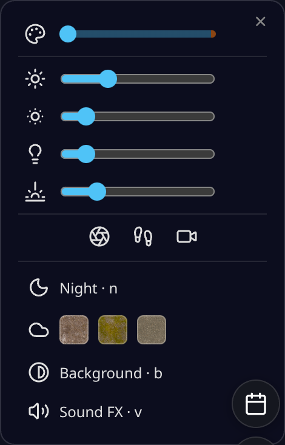

| Control | Shortcut | What it does |
|---|---|---|
| Ambience / Sun / Exposure / Ambient / Hemisphere | — | Five sliders — overall scene lighting, sun intensity, camera exposure, ambient fill light, and sky/ground hemisphere light. |
| **Night** | **N** | Toggles a night lighting preset. |
| **Shadow + Ground** | **H** | Cycles **Off → Grass → Earth → Paved** — a real ground-texture swatch under the building, with matching shadows. |
| **Background** | **B** | Reverses the background (dark ↔ light/white). |
| **Sound FX** | **V** | Toggles synthesized UI/Time-Machine/Fly-Tour sound cues — no audio files, off by default. |

### Settings

The **Settings** pill (key **=**) opens a panel with four sections:

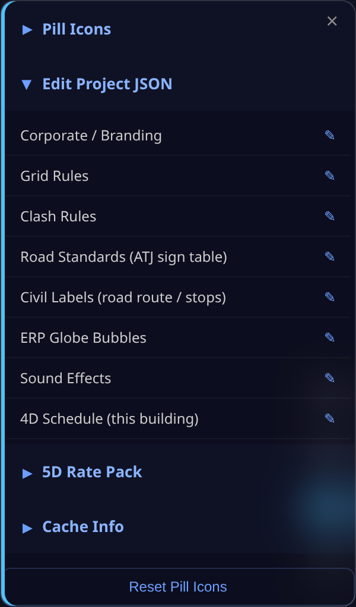

- **Pill Icons** — show/hide/reorder every toolbar action, and see each one's current shortcut key at a
  glance (this is also how a hidden action like a data-gated drawer row becomes visible once its data
  exists). A **Reset Pill Icons** button restores the defaults.
- **Edit Project JSON** — a power-user hub: open and edit any of the project's config files directly
  in-browser (auto-inferred form fields, not raw text), then **Download** the edited file to commit back
  to the repo, or **Reset** to discard the override. Eleven files are registered: **Corporate / Branding**,
  **Grid Rules**, **Clash Rules**, **Road Standards (ATJ sign table)**, **Civil Labels**, **ERP Globe Bubbles**,
  **Sound Effects** (the audio *parameters* file — distinct from the Display-options Sound FX on/off toggle above),
  the three 4D / 5D references (**5D Rate Pack** of the active pack, **4D Schedule Template**, **4D Sequence &
  Labour Rules**: see *Your own 4D / 5D references* above), and a **read-only** view of the **4D Schedule**
  captured for the currently-open building (the same data Time Machine authors).
- **5D Rate Pack** — pick which cost-rate pack is active (the same rate pack the Find panel's
  `total cost` query and the 4D/5D dashboard both price against).
- **Cache Info** — see how much this building's data is using in IndexedDB, and clear it.

  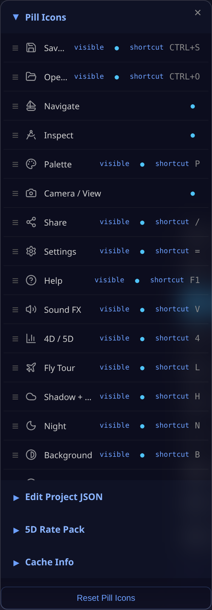

### LOD400 Upgrade

The **LOD400 Upgrade** pill (box icon, on the toolbar rail) opens a panel that cleans up the open building's
geometry: it welds duplicate vertices and smooths curved surfaces. Revit IFC meshes arrive as flat-shaded
triangle soups, so the same triangles, area and size need far fewer vertices; the tool's own measurement is
about 70–80 % fewer on curved parts. No element is added, removed or renamed, and every number is counted and
logged. **Save Building** keeps the result (see [Save & Open a building](#save-open-a-building)).

*Written from the tool's own help text and code header, 2026-11-17. No screenshot yet.*

### Sanity and Egress — rule checks

Two rule checks read the loaded building and list what they find in one checklist panel. Neither is on the
toolbar rail: press **Y** for Sanity or **E** for Egress, or open the **F1** help, type the name and press **Enter**.

- **Sanity** — *Floating Member* (STR beams), *Span/Depth* (advisory) and *Column Continuity*.
- **Egress** — *Isolated Room* (no measured route out), *Circulation Distance* (to a real exit; falls back to the
  circulation spine) and *Door Width* (advisory).

Each Egress distance row says which target it measured, the exit or the circulation fallback, so the panel never
claims more than it measured. The limits the code cites: a door clear width of 0.813 m (IBC 2021 §1010.1.1) and a
travel distance of 60.96 m (IBC 2021 Table 1017.2, Group I-2, sprinklered). The warning levels (0.85 m and 45.7 m)
are early-heads-up buffers the code does not cite, and because the model carries no occupancy class, the stricter
hospital door width is not applied.

*Written from the tool's own help text and code header, 2026-11-17. No screenshot yet.*

### 4D Window

The **4D Window** pill (calendar icon) puts the construction schedule next to the model. It appears on the toolbar
rail when the schedule engine is loaded, and it is always in the **F1** help. With a schedule loaded, hover or click
any element: the info panel shows its task name and start → finish, its trade and float, and a critical-path marker;
hovering adds one extra line. If the building has no schedule yet, tap it to generate one on the fly (its tooltip then
reads *4D Window — tap to generate a programme*). The full timeline, playback and What-if are the **Time Machine**
(key **T**), in the [Inspect drawer](#inspect-drawer-measure-clash-x-ray-section-time-machine-4d5d-fly-tour).

*Written from the tool's own help text and code header, 2026-11-17. No screenshot yet.*

### Issues

The **Issues** panel (key **I**) is the building's issue log: one list per building, each entry a snag with its photo
and annotation. Open an entry for its detail view; a clash snag also carries a deep link that flies to that clash.
**Export Excel** and **Export BCF** write the list out, and **Clear All** deletes every logged issue after a
confirmation. The log is kept in this browser (IndexedDB), not on a server. An empty list says *To log one: start a Walk, tap the
element, then 📸 Snag*: the **Snag** button shows on an element's card only while a Walk is on, and it opens the Site
Camera (the mobile tool described under **Mobile-only** below).

*Written from the tool's own help text and code header, 2026-11-17. No screenshot yet.*

<a id="send-to-hq"></a>
#### Send to HQ, and the HQ view

**On the phone: Send to HQ.** At the top of the Issue Log, **📤 Send to HQ** sends the site report to head office: every
issue in the log with its photo, and the walk you took (the points of a Walk-mode walk, each with its camera view). On a
phone the Issue Log opens from the **Inspect** pill, row **Issues**. What happens next depends on the browser:

- **Not in a team:** the phone's own share sheet opens with the report and the photos attached, so you can email them
  to HQ. The status line says *Saved N file(s) — attach them to an email to HQ.* if the browser has no share sheet and
  the files were downloaded instead.
- **In a team** (this browser has joined a team in the **Team** panel, see the
  [Team guide](https://red1oon.github.io/bim-ootb/erp/team_guide.html); the viewer on the same site uses that
  pairing): the report goes into the team folder with nothing more to tap. It is sealed with the team key and signed by
  this phone; nothing in the folder is readable (no building name, no issue id in the clear). The status line says
  *Sent to your team folder.*
- **No signal:** the report is kept on the phone and the status line says *Saved on this phone — it goes to your team
  folder when you are online.* When the signal comes back it sends itself; nothing is lost and nothing has to be pressed
  again. The walk and snags themselves work with no signal: the model and the Issue Log are on the phone.

**At HQ: Get from team.** In a team, the Issue Log on HQ's browser shows **📥 Get from team** beside Send to HQ. It
reads every phone's reports into the same Issue Log: each issue card names the phone it came from by its device code
(as the Team panel shows it), with its photo. A phone sends its whole log each time, so an issue it sends again
replaces its own row; it is never listed twice. A report that does not open (not signed by a team device, or
changed on the way) is refused whole and the status line counts it as *refused*. HQ's own issues are never sent on as
its own.

**Replay a walk.** After Get from team, the Issue Log has one row per phone that walked: *Walk · device code · N points ·
tap to replay*. Tap it: the walk's points go on the history bar, and the bar opens. Scrub the bar and HQ's camera goes
to where the phone's camera was at each point.

*Written from the code (`viewer/issues.js`) and the witnesses W-SEND-HQ, W-SEND-HQ-TEAM, W-HQ-VIEW and
W-ISSUE-LOG-ROUTE (bim-compiler `prompts/MOBILE_PERF.md` §P5), 2026-11-28. No screenshot yet.*

<a id="site-missions"></a>
#### Site missions

A **site mission** is a short list of jobs that the office issues from the Project Order. A person on site walks the list
with a phone, does each job and reports it; the office sees the progress in the model. The reports travel the same way as
[Send to HQ](#send-to-hq), so the phone and the office browser must both be in the same team.

**At the office.**

1. **Make the task.** A task is a *Request* on the Project Order. The viewer has no button of its own to create one: it
   is created in the **Request** window of the built-in ERP. Give it the Request Type **Site Task**, the Project Order, and
   the **Product** it is for: a product that is one element makes a task for that element; a product that is an item class
   makes a task for every element of that class that was pushed with the Project Order. Keep its status at **New**:
   only a **New** Request is picked up in step 3.
2. **Pick the checklist.** In the same window, choose a **Standard Response** on the Request. Each line of its text
   becomes one tick box on the phone. A Request without one gets a form with no checklist.
3. In the **Find** panel, **› ERP** pushes the selection as a Project Order. Next to it, **Prepare site mission** takes
   every Request of that Project Order that is still **New**, works out where each element is and in what order to visit
   them, and writes one mission file (one per role, when the Requests have different roles). The Requests move to
   **Prepared**. A Request that has no element in the open model is left **New**, and the reason is listed under the
   button. The file is also saved to your computer.
4. **Send to site** appears under the result. It puts the mission, sealed, in the team folder. With no signal it waits
   in the outbox and goes when you are online. A browser that is not in a team cannot send; the status line says so.

**On site.**

1. On the phone, open the **Navigate** drawer and tap **Missions**. Tap **Get** to list the missions HQ sent (each row
   shows its name, the role, the number of tasks and the date), then tap one to open it. Opening a mission tells HQ that
   it was picked up.
2. A strip at the top of the screen reads **task n of m** with the task's name. The route to the next spot is drawn in the
   model. **Start walk** begins the walk; the strip also has **I'm here**, **Scan QR**, **Skip** and **Can't proceed**.
3. **Arrival.** The task's card opens when you tap **I'm here**, or when you scan the task's QR code or type its code
   (**Scan QR**, then **Check**). The card names the task and offers **Fill in the form**, **Can't proceed** and **Later**.
4. **The form** has the same shape for every task:
   - **Outcome**: one pick from the list (required when the list is not empty);
   - **What I found**: your own words;
   - **Material used**: a product and the quantity used (optional);
   - **Photos**: **Take photo** opens the Site Camera;
   - **Checklist**: one tick per line of the task's Standard Response.

   **Done** sends the report. If something required is missing, a red line says what.
5. **Can't proceed** asks *Why can't this be done?* and needs a reason. The task stays open at the office with that reason.
6. The next task comes up by itself. After the last one the strip reads *Mission complete* with the counts.
7. **Without signal** the model and the mission are already on the phone. Each report is kept on the phone and goes to the
   team folder by itself when you are online. The phone also remembers which tasks are finished.

**Back at the office.**

1. In the Issue Log, **Get from team** reads the phones' reports (the same button as in Send to HQ). A mission that was
   picked up moves its Requests to **On site**. Each report becomes a row of the Issue Log and an **update** on the
   Request: the result you typed, the ticks, the names of the photos, the start and end time, and the material and
   quantity. A report of **Done** moves the Request to **Reported**; a **Can't proceed** report leaves it open, with the
   reason written on it. The same report is never applied twice.
2. A task that covers many elements (an item class) has one report per element. Its task status climbs in steps as the
   reports come in, and the Request is **Reported** only when every element is done.
3. **Verify** shows on a task row that is **Reported**, in the Issue Log on a computer. It moves the Request to **Verified**
   and closes it.
4. **Show site progress**, in the same Find row, colours the model and lists every line of the Project Order. Press it
   again (**Hide site progress**) and the model is back as it was. The colours:
   - **light blue**: Verified, the office has checked it;
   - **green**: done, the site reported it done;
   - **orange**: open, the task was issued and has no report yet;
   - **red**: can't proceed, the latest report says so;
   - **grey**: new, a Request exists but it has not been prepared.

   The table beside it counts, per line: planned, done, can't proceed, open, new and not issued (planned elements that
   no Request covers yet). Elements that no Request covers keep their own colour. With the view on, **Get from team**
   updates it.

**Good to know.**

- The route is drawn through the rooms only where the model has compiled rooms. Elsewhere, or when an element sits in no
  room, the route is a straight line.
- Tasks prepared today have no arrival distance, so the card opens by **I'm here** or by the code, not by walking
  within a distance.
- A task for an item class covers the elements that were pushed with the Project Order. The Find list pushes at most 50
  at a time.
- A mission names its model. If you open it in another model, the strip warns you.
- **Prepare site mission**, **Send to site**, **Verify** and **Show site progress** are on a computer; **Missions** and the
  form are on the phone.
- Photos stay in the team folder. The update on the Request names them.
- This runs in the built-in ERP of the viewer. It is not yet sent to an external iDempiere server.

*Written from the code and its witnesses, 2026-11-28. No screenshot yet.*

#### GI Preview (AO)

**GI Preview (AO)** (**Alt+G**, desktop only) turns on an ambient-occlusion preview using the N8AO effect. The help lists
it as a research spike, and it is disabled on mobile because of memory. It sits in the
[Camera / View drawer](#camera-view-drawer).

*Written from the tool's own help text and code header, 2026-11-17.*

#### Nav LOD (large bldgs)

**Nav LOD (large bldgs)** (key **O**, in the Navigate drawer) keeps flying and orbiting smooth on a large building: while
you move, it draws far or off-screen elements as boxes and keeps the real mesh only within 50 m and in view. It is off by
default, does nothing on a building under 50,000 elements (it shows a message instead), and is switched off during the
Time Machine, a Find isolate and Cinema.

*Written from the tool's own help text and code header, 2026-11-17.*

### Save & Open a building

Two toolbar pills, both native-dialog verbs — distinct from the Hub's building-open flow in
[Quick Start](#quick-start-your-first-building):


- **Save Building** (**Ctrl+S**) — saves the currently open building, including any session edits
  (clash resolutions, captured 4D schedule, etc.), to a `.db` file via the browser's native Save As dialog.
- **Open Building** (**Ctrl+O**) — opens a previously-saved `.db` file via a native Open dialog, replacing
  the current scene.

### Share

The **Share** pill (key **/**) is a step up from the plain deep-link URL: on mobile, it hands the current
view to the device's native share sheet with a snapshot photo attached; on desktop (no native share API),
it shows a preview card — a live snapshot, the building name, the same deep-link URL described above, and
**Copy Link** / **Cancel** buttons. If a clash is open when you tap Share, the shared text and photo are
about that specific clash instead of the general view.

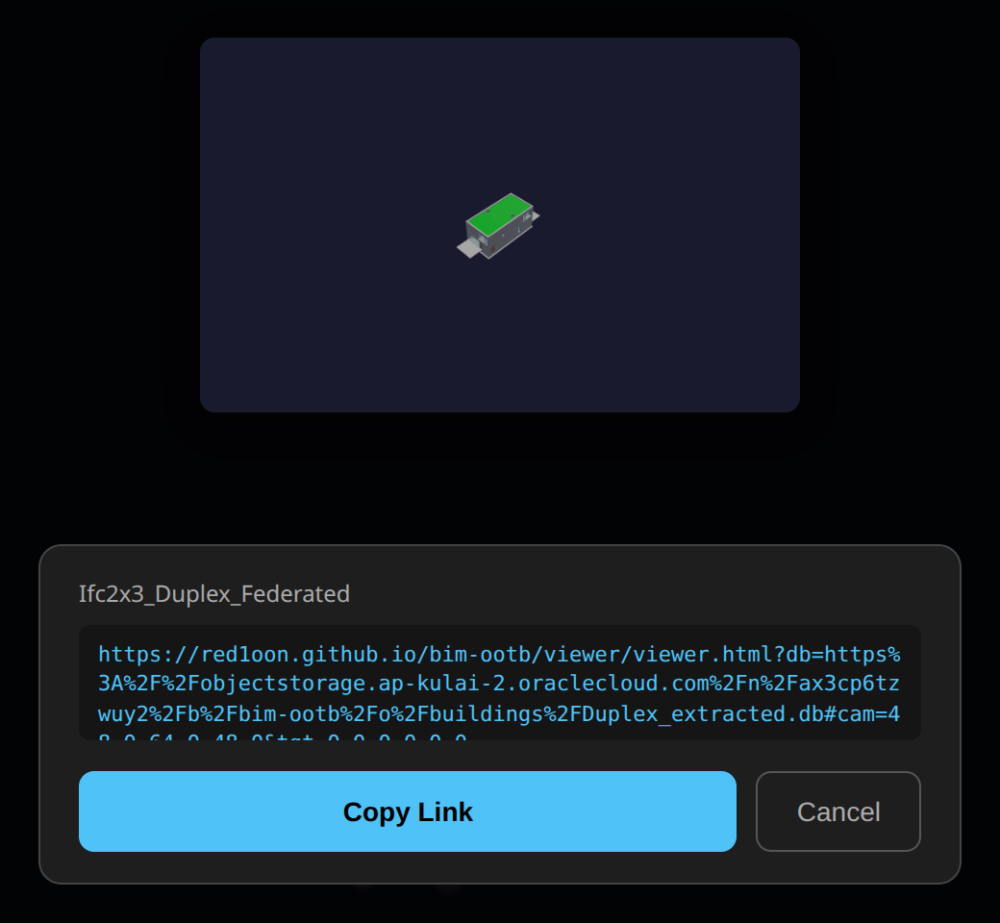

### Pick Walk — warehouse / logistics buildings

A data-gated pill (only appears when the loaded building carries locator-GUID bins, e.g. a warehouse
building like GardenWorld) that walks a picking route over the bins: fly to the next bin in order, scan
a bin's QR/type code, and record a signed pick group per bin. Not covered further here — it needs a
warehouse-class building loaded to demonstrate, outside this general viewer guide's scope.

<a id="find-lenses-tenancy"></a>
### FM / Operate lenses — HR_BIM_Asset  *(ALPHA)*

The viewer carries one **`FM / Operate`** toolbar pill (a building glyph; its entry in the **F1** help is labelled **Human-Asset**) that opens a wake-aware drawer of
operate-phase lenses — **Occupancy** (incl. lease status) · **Presence** · **Unit class** · **Assets / IoT** ·
**Dashboard**. It appears only when the loaded building carries operate data, and each lens is enabled only when
*its* data exists (else greyed) — no data, no clutter.

→ **Full walkthrough (with screenshots): [HR / Tenancy / Operate Module guide](HRBIMAssetGuide.md).**

**Collaborate on the model — the Teams overlay.** One toolbar toggle overlays **who-did-what** on the building:
identity-coloured dots on elements, a history/blame tree, a chat that **is** the signed log,
and dashboard graphs — off by default, pixel-identical until you turn it on. It is available in the Modeller and
Kernel-ERP; the Viewer does not carry the toggle.
→ **[Teams Overlay guide (with screenshots)](TeamsOverlayGuide.md).**

**Mobile-only (touch-optimised):**

- Site Camera — phone camera with GPS + compass + timestamp overlay
- BIM picture-in-picture — 3D snapshot composited into the photo
- Markup tools — arrow, circle, freehand draw, text annotations
- Share → WhatsApp (with BIM context baked into image)
- GPS Walk Mode — blue dot tracks position in the model
- Wall X-Ray — tap a wall in Walk Mode to see MEP behind it
- Issue log — capture site issues with photo + GPS + classification, export to Excel

---

## Keyboard & Mouse Cheat-Sheet

| Key / Gesture | Action |
|---------------|--------|
| **Drag** | Orbit camera |
| **Shift + Drag** / **Right-click drag** | Pan camera |
| **Scroll / Pinch** | Zoom |
| **Click** element | Identify — IFC class, name, GUID, storey, material |
| **'** (apostrophe) | Toggle **Hover Name** — hovering (no click) shows the friendly name + room of whatever's under the cursor; also a checkbox in the Find panel. Dead key on some international keyboard layouts (US-International, Spanish, Portuguese, French-Canadian) — fails harmlessly there, use the checkbox instead. |
| **Front / Back / Left / Right** | Elevation views |
| **Roof** | Roof plan view |
| **Alt+Z** | Toggle X-ray mode |
| **Alt+C** | [Film-Maker](#cinema-film-maker-altc-the-bim-ootb-film-maker) — derive a cinematic film, edit the flight, record |
| **Alt+S** | [Photographic still](#sun-sky-and-shadow-while-the-film-records) — stages the sun/sky/shadow pass, then refines the frozen frame over 16 sub-pixel samples |
| **Alt+J** | Bounce-light (GI) pass — optional, off by default, not used while recording a film |
| **Alt+G** | GI Preview — ambient-occlusion preview (desktop only) |
| **Y** / **E** | Sanity / Egress — the rule checks ([Sanity and Egress](#sanity-and-egress-rule-checks)) |
| **D** | Role View — cycles the discipline filter |
| **U** / **K** | Earthworks / Roadworks (civil-works models only) |
| **Alt+P** | Populate — adds staffage (people, trees and cars) to the scene |
| **Click the flight tube** (in the Film-Maker) | Add a stick — a new band you can drag |
| **Ctrl+Z / Ctrl+Shift+Z** (in the Film-Maker) | Undo / redo a path edit |
| **F11** | Toggle fullscreen |
| **F1** | Help — the panel on the left: every tool and its key, search, steps, guide links ([Help](#help-f1-the-info-panel-and-the-command-line-live)) |

> Authoring — editing the structural grid, sketching, extruding — lives in the **[DAGeVu Modeller](ModellerGuide.md)**, not the Viewer.

---

## Further Reading

| Doc | What |
|-----|------|
| [Civil Works — Step by Step](CivilWorksGuide.md) | Road models: discipline counts + cost, cross-vendor clash, earthworks volume, long / cross sections, road Model Check report |
| [Kernel-ERP User Guide](ERPUserGuide.md) | iDempiere browser ERP — login → install → POS → reporting · [Tenancy](ERPUserGuide.md#hr-tenancy) |
| [DAGeVu Modeller Guide](ModellerGuide.md) | Author geometry — the editable 3D Grid |
| [Clash Detection](CLASH_DETECTION.md) | Clash detection engine |
| [4D/5D Analysis](4D5DAnalysis.md) | nD analytics (4D–8D) |
| [Asset Classification & JKR/SKATA](JKR_SKATA.md) | Classification codes, Malaysian handover compliance — what we measure, and what we don't yet certify |

### For developers

| Doc | What |
|-----|------|
| [Viewer Component Model](ViewerComponentModel.html) | The viewer's 128 JS modules as dependency strata, derived from the call graph — layers, fan-in, and where the scheduling subsystem sits |

---

*Copyright (c) 2025-2026 Redhuan D. Oon. MIT Licensed.*
