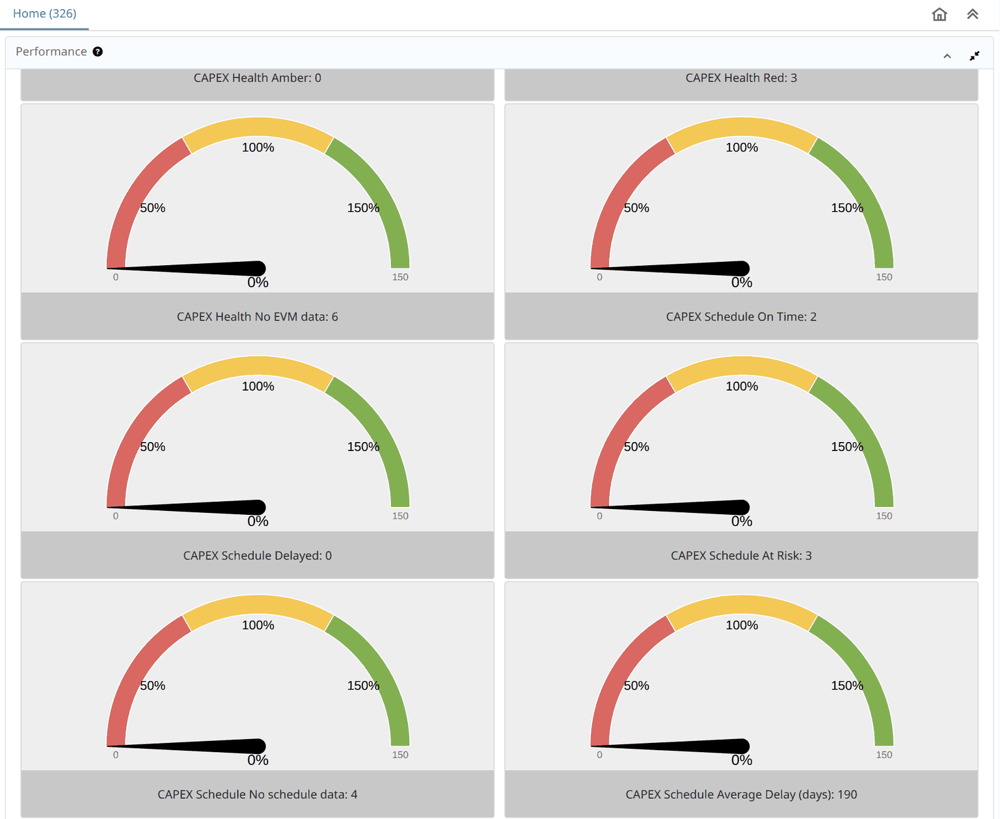

# CAPEX Dashboard — Guide for iDempiere Users

> **⚠ DEMONSTRATOR — NOT OFFICIAL.** Every screenshot and figure comes from a **local GardenWorld test server**
> (iDempiere 13) holding test projects, some of them repeat test runs. Treat every number as a sample
> (`SAMPLE — NOT OFFICIAL`). The health and schedule rules are provisional until a client confirms them.

**What this is.** A project and capital-spending dashboard made of **ordinary iDempiere Performance Goals**. It
appears in the stock **Performance** panel on your Home tab, and you change it in the stock windows. No new screen,
no Java, no plugin, no new table or column: only rows of data, added by migration scripts.

> **What it changes on your iDempiere:** no change to iDempiere's code or tables. The dashboard needs only setup data.
> Sending a Project Order *from a BIM model* into iDempiere is a separate thing: that is one standard plugin.

**Who reads what.** **Project manager:** *Reading the dashboard* and *What moves the numbers*.
**Administrator:** *Installing it* and *Changing it*. Everyone: *What it does not do yet* and *Troubleshooting*.

---

## If you know iDempiere

Nothing here is new to you. Each piece is the window you already have.

| Dashboard piece | iDempiere window | Menu |
|---|---|---|
| One number on the Home tab | **Performance Goal** | Performance Analysis and Accounting › Performance Measurement |
| What a goal measures | **Performance Measure** | same folder |
| The SQL behind it | **Performance Measure Calculation** | same folder |
| The dial's colours | **Performance Color Schema** | same folder |
| The panel on the Home tab | **Dashboard Content** (*Performance*, shown at login) | Organization Rules folder |

Search any of these by name in the box at the top left (Alt+G).

---

## Reading the dashboard

1. Log in as usual. Goals have no Role or User set, so **every user of the tenant** sees them.
2. On the **Home** tab, find the **Performance** panel. It is a narrow column at the far right.
3. Click the panel's **maximize** button (top right of the panel) to read it properly. Your stock goals come first, then the
   CAPEX goals.

**Read the caption, not the dial.** The CAPEX goals have **no target yet**, so every dial sits at **0%** on the red
end, whatever the number is. `CAPEX Total Projects: 12` is the value. A dial only means something once you set a target: see
*Set a target* below.

### The 27 goals

**Projects and money.** Money goals are **one per currency**, never added together. Today that means USD and BDT only.

| Goal | How it is worked out | Counts inactive projects? |
|---|---|---|
| Total Projects | All projects | Yes |
| Closed Projects | `Processed = Y` | Yes |
| Active Projects | `IsActive = Y` and `Processed = N` | No |
| Approved Budget (USD, BDT) | Sum of `PlannedAmt` | **Yes** |
| Actual Cost (USD, BDT) | Sum of `ProjectBalanceAmt` | **Yes** |
| Committed Cost (USD, BDT) | Sum of `CommittedAmt` | **Yes** |
| Invoiced (USD, BDT) | Sum of `InvoicedAmt` | **Yes** |
| Projects Completed this Year | `Processed = Y`, `DateFinish` in this year | Yes |
| Approval Pending | Workflow activities with `WFState = OS` and `Processed = N`, on **any** table | n/a |

The health, schedule and budget goals below count **active projects only**, using these amounts per project:

- **Due** = planned amount of phases whose End Date has passed.
- **Done** = planned amount of phases marked Complete.
- **Spent** = the project's `ProjectBalanceAmt`.

| Goal | A project counts here when |
|---|---|
| Health No EVM data | Nothing is due yet (or no phase has a date and an amount) |
| Health Green | Something is due, Done ≥ 90% of Due, and Spent is 0 or Done ≥ 90% of Spent |
| Health Amber | Something is due, Spent is above 0, and only one of those two tests passes |
| Health Red | Something is due, Done < 90% of Due, and Spent is 0 or Done < 90% of Spent |
| Schedule No schedule data | No phase has both a Start and End Date |
| Schedule At Risk | Has dated phases, something is due, and Done < 90% of Due |
| Schedule Delayed | Not At Risk, but an unfinished phase is past its End Date |
| Schedule On Time | Has dated phases, and neither At Risk nor Delayed |
| Schedule Average Delay (days) | Over At Risk and Delayed projects: the average of each one's largest overdue days |
| Budget Not started | Spent is 0 |
| Budget Within | Spent is not 0, and is at or below Planned |
| Budget Over | Spent is above Planned |
| Budget Actual Overrun (USD, BDT) | Total of Spent minus Planned over the Over projects |

The 90% is the one rule a client stated. The rest are our working definitions, and you can change any of them: see
*Change what a goal counts*.

---

## What moves the numbers

The dashboard only reads your project records. It fills up when these are filled in, in the **Project** window:

| You do this | On | Goals it moves |
|---|---|---|
| Add phases with Start Date and End Date | **Phase** tab | leaves *No schedule data* |
| Give phases a Planned Amount | **Phase** tab | Health and At Risk can be judged |
| Tick **Complete** when a phase finishes | **Phase** tab | Done rises |
| Issue material to the project | **Issue to Project** | Spent rises: Actual Cost, Budget goals |

**A measured example.** On the test server, ticking **Complete** on one phase of one project moved five goals:

| Goal | Before | After |
|---|---|---|
| Health Green | 0 | 1 |
| Health Red | 3 | 2 |
| Schedule On Time | 2 | 3 |
| Schedule At Risk | 3 | 2 |
| Schedule Average Delay (days) | 190 | 284 |

The average delay went **up** although a project improved: it left the average, and it had one of the shorter delays.
Read that goal beside the At Risk and Delayed counts, not on its own.

---

## Changing it

You need no developer for any of this.

### Set a target

1. Open **Performance Goal**. Find the goal with the arrows or search.
2. Enter **Measure Target**. Save.

Once there is a target, the caption and dial show a **percent** of it instead of the value.

!!! note "The first percent can be out of date"
    Saving a new target recalculates at once, but that first percent is scored against the **previous** target
    (standard iDempiere behaviour). The new target applies at the next refresh, see *Troubleshooting*.

### Show a goal to fewer people

In **Performance Goal**, set **Role** or **User/Contact**. To hide it, clear **Active**. Your four stock goals can be
hidden the same way if you want only the CAPEX goals on Home.

### Change what a goal counts

1. Open **Performance Measure Calculation** and find the row with the goal's name.
2. Edit **Sql WHERE** (or **Sql SELECT**). Save.

!!! warning "A broken SQL shows 0, not an error"
    iDempiere catches a measure's SQL error, logs it and returns 0. After any edit, check the number is what you
    expect. A sudden 0 may be your SQL.

To see a **narrower** population (one organization, for example), iDempiere offers the **Restriction** tab of Performance Goal. We have not tried it on these goals.

### Change the dial's colours

Goals use the stock schema **Red (50) - Yellow (100) - Green**: red up to 50%, yellow up to 100%, then green. Open
**Performance Color Schema** to read it.

This row belongs to the **System** tenant, so it is read-only for a tenant user. To use other marks, add a new
schema in your tenant, then pick it in the goal's **Color Schema** field.

### Add a goal

Add a row in **Performance Measure Calculation**, a **Performance Measure** that uses it, then a **Performance Goal** on that
measure. To add a currency, copy an existing pair and change `C_Currency_ID` in Sql WHERE. We have edited targets through these windows and tested that; adding a goal by hand is standard iDempiere, but we have not run it for this dashboard.

---

## Installing it

For an administrator with database access. On the test server these were applied with `psql`, in name order, followed by
`update_sequences`.

| Script | Adds |
|---|---|
| `202611031900_CAPEX-R0.sql` | The first measure: Approved Budget (USD) |
| `202611032000_CAPEX-G2.sql` | The count and sum measures |
| `202611032100_CAPEX-G3.sql` | A goal for each of them |
| `202611032200_CAPEX-G4.sql` | The health, schedule and budget measures, and their goals |

They are in the bim-ootb repository, under `capex/legacy/migration/iD13/postgresql/`, in iDempiere's own migration format.
The first statement of each registers it in the migration log. Most carry a `Restore` line at the top that removes what they
added.

!!! warning "These scripts are written for GardenWorld"
    They set `AD_Client_ID = 11` and the currencies USD (100) and BDT (322). **For your own tenant they need changing
    first.** A version that takes your tenant has not been built.

Goals calculate themselves the first time a Home tab shows them.

---

## What it does not do yet

| Topic | Today |
|---|---|
| Forecast Cost at Completion | Not there: no agreed formula |
| Project Stage pipeline | Not a goal: how stages map onto `C_Phase` is not agreed |
| Physical vs Spent, Last Updated, project lists | Not goals: only on the separate web page |
| Other currencies | No money goal covers them until you add one |
| Procurement risks, handover, payment progress | Not there: no agreed definition or source |

**Not yet seen working on real data.** These goals have read 0 on the test server, so we have not seen them count anything
on it: Closed Projects, Completed this Year, Committed Cost, Invoiced, Actual Cost and Overrun in BDT, Health Amber, Schedule Delayed, Budget Within. Health
Green was seen only during the example above, which was then undone.

**Check Approval Pending against your own meaning of "approval".** It counts every suspended workflow activity. On
the test server all 261 are on **Business Partner**, not on project documents.

---

## Under the hood

**The same rows also run outside iDempiere.** The product this comes from has a browser copy of iDempiere (the *twin*), and the
same goals appear on its Home tab. You do not need it to use this dashboard.

If you want that copy to show your site's figures, a small job beside your server reads the 8 tables through iDempiere's
standard web services and writes a file; the browser reads the file. That needs **read-only setup data** on your iDempiere: a
web-service read type per table and a user that can read them. It sends nothing back.

Compared on the test server: the browser copy held the same rows as iDempiere, and its Home matched iDempiere's own goals for the 15 goals with
a value (the other 12 were 0 on both). A real edit on iDempiere appeared there after the next job and reload.
Limits today: the read types are test-server scripts, not yet migration scripts. It has not been measured at a large site's
size. And if the job stops, the copy just goes quietly out of date.

---

## Troubleshooting

| You see | Why | What to do |
|---|---|---|
| Every dial at 0%, on red | No target set | Read the caption, or set a target |
| A number looks out of date | A goal recalculates only when a Home tab shows it **and** its value is over 30 minutes old. We saw one still showing 318.68 when the real figure was 334.62 | Wait, or set `ZK_DASHBOARD_PERFORMANCE_REFRESH_INTERVAL` (milliseconds, default 1800000) in System Configurator |
| I changed the SQL and nothing moved | Only saving a goal's target or scope recalculates at once | Wait for the refresh |
| A goal suddenly reads 0 | The SQL may be broken: errors show as 0 | Check Sql WHERE and the server log |
| Approved Budget is higher than the active projects add up to | It counts inactive projects too | Add `AND IsActive='Y'` to Sql WHERE if you want otherwise |
| A project is missing from every money goal | Its currency is not USD or BDT | Add a goal for that currency |
| The panel is hard to read | It is a narrow column | Use the panel's maximize button |

---

Related guides: [Kernel-ERP User Guide](ERPUserGuide.md) · [Distributed ERP](DistributedERP.md).
