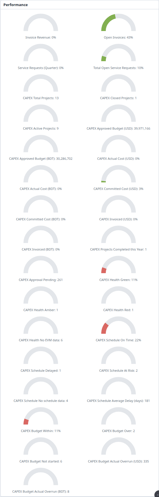
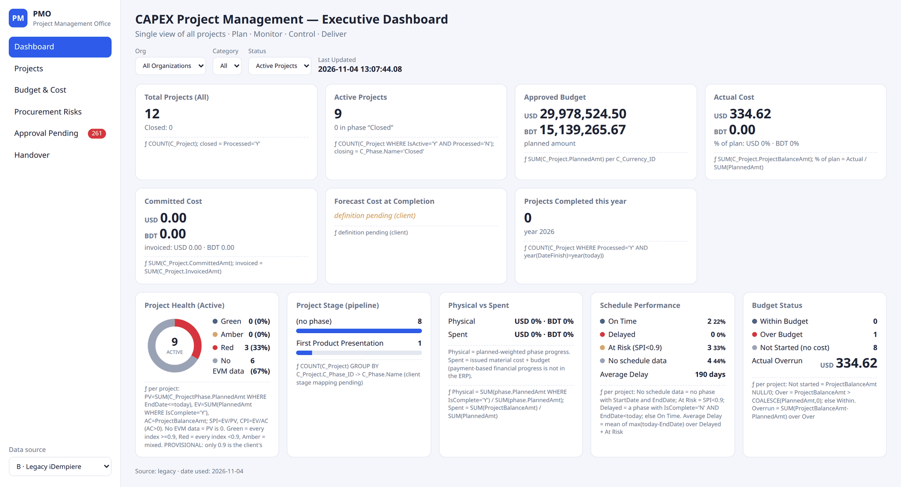
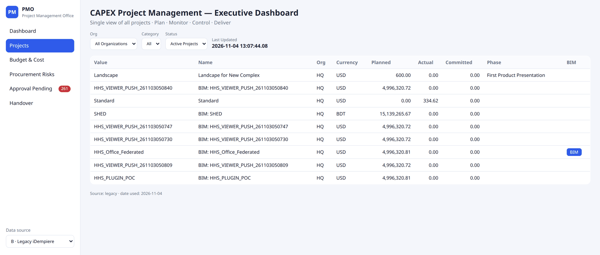
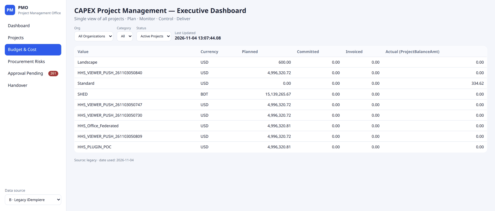
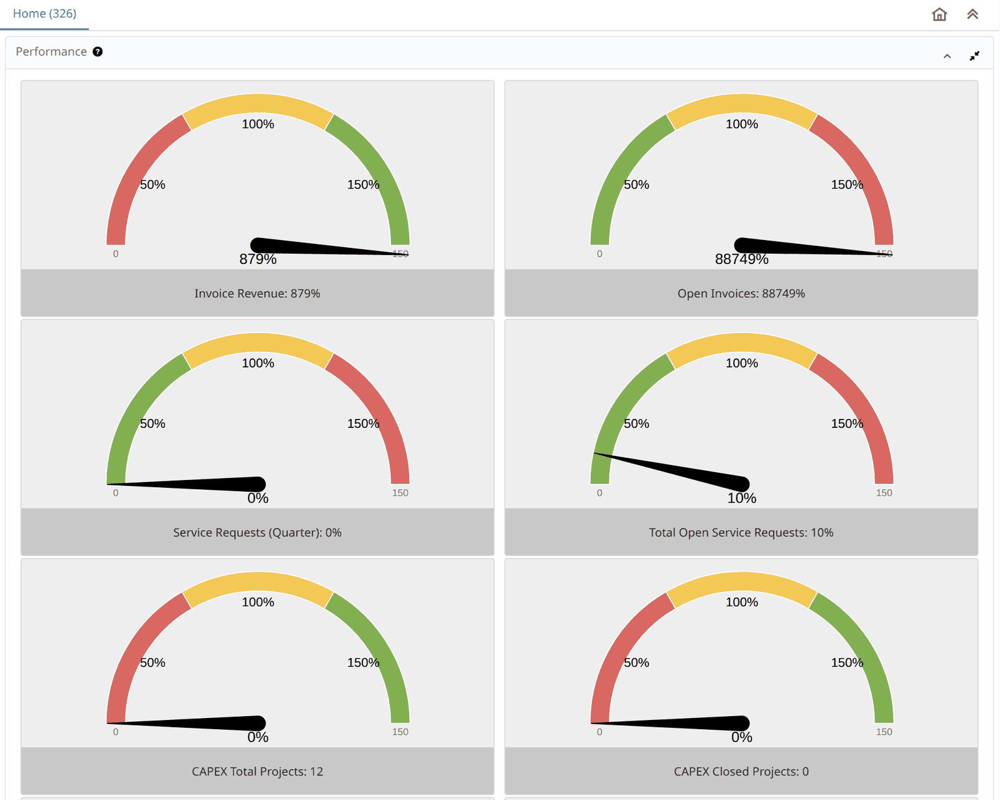
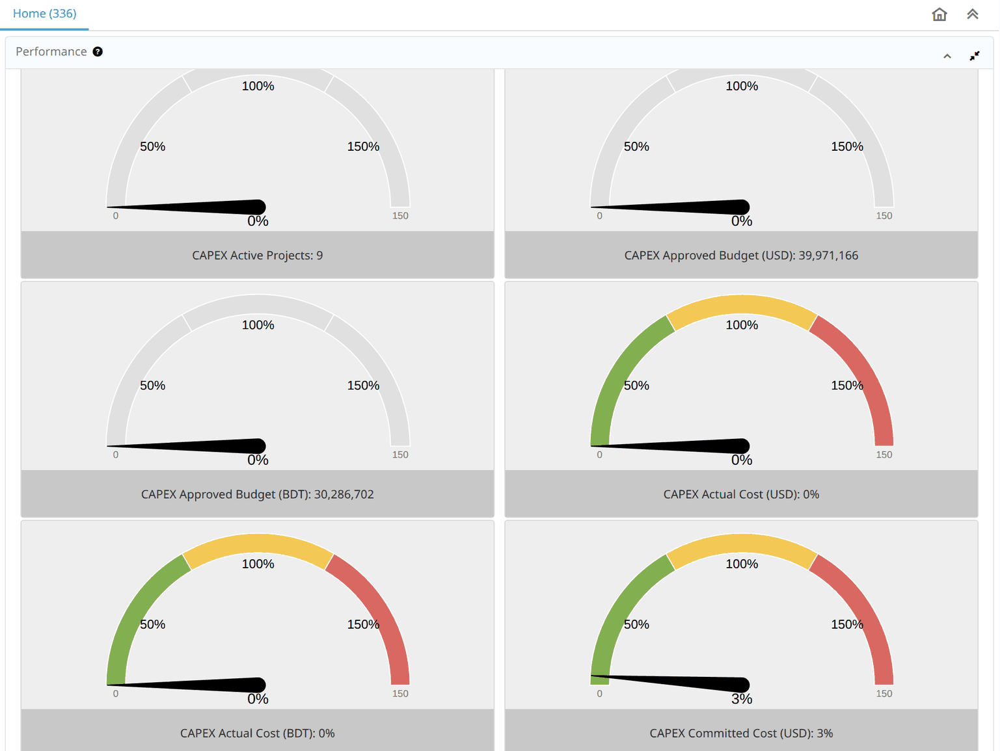
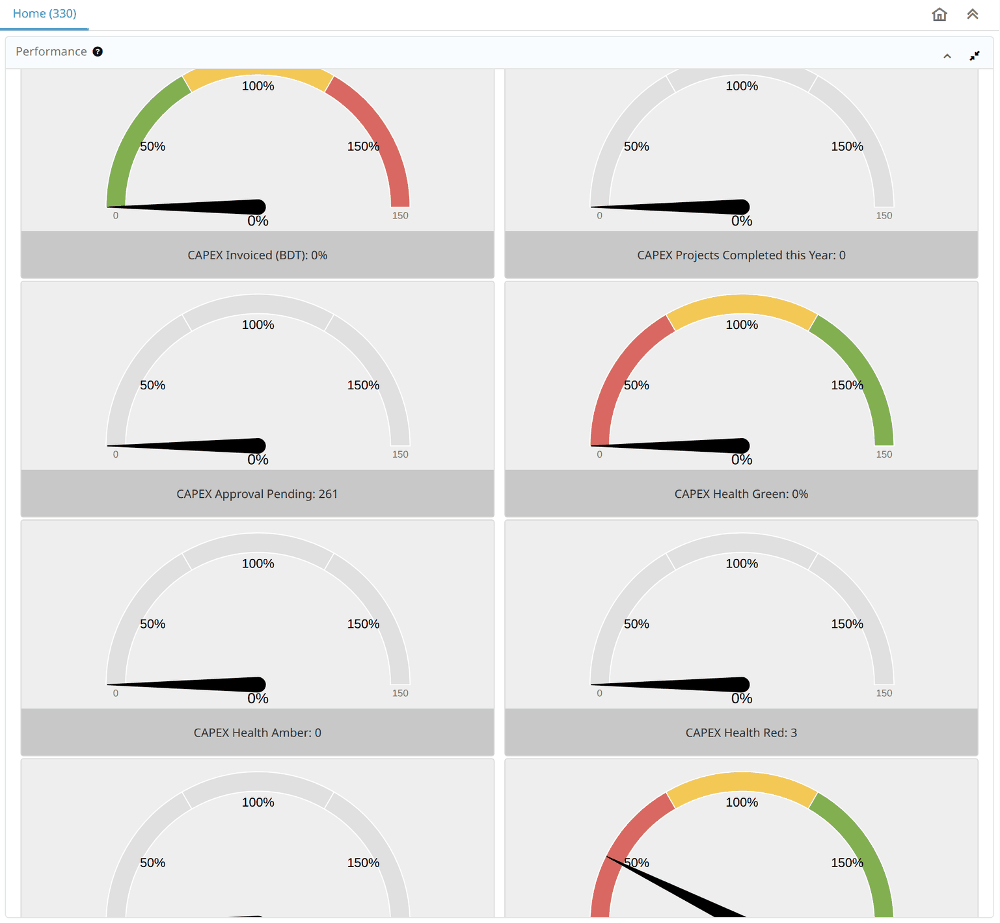
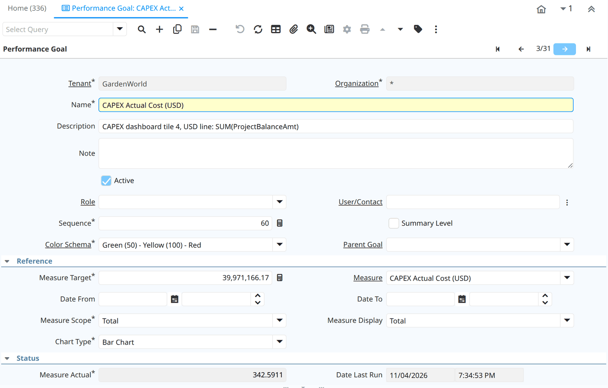
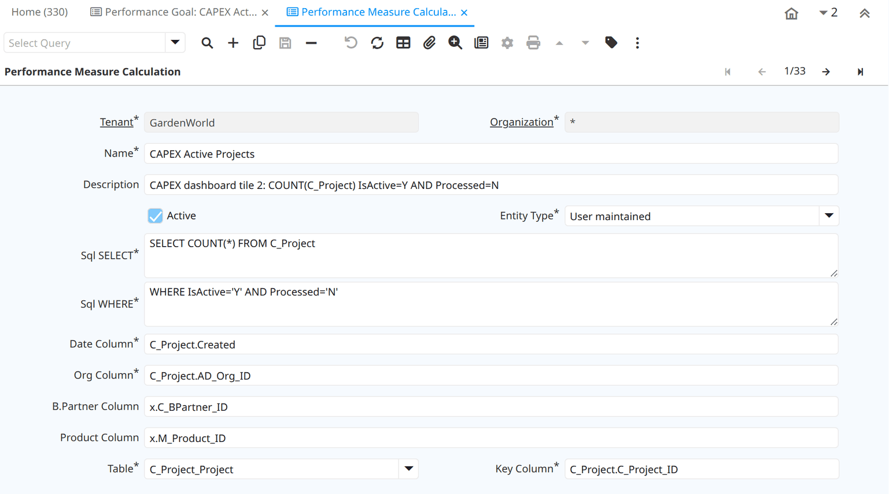
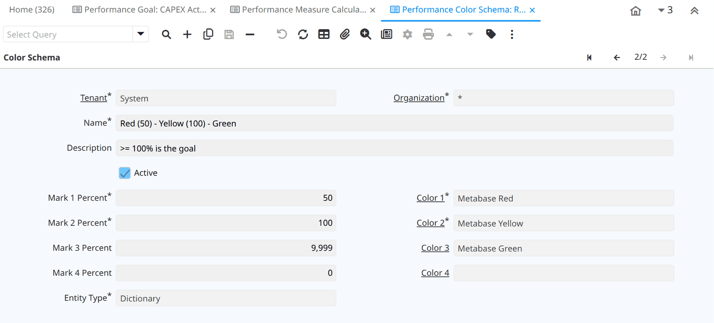

# BIM → ERP and the CAPEX Dashboard — Guide for iDempiere Users

> **⚠ DEMONSTRATOR — NOT OFFICIAL.** Every screenshot and figure comes from a **local GardenWorld test server**
> (iDempiere 13) holding test projects, some of them repeat test runs. Treat every number as a sample
> (`SAMPLE — NOT OFFICIAL`). The health and schedule rules are provisional until a client confirms them.

**What this is.** One set of project and capital-spending figures from your iDempiere, in three places:

- **The dashboard page**: a full executive page in a browser. It reads your iDempiere and writes nothing back.
- **The Performance panel on your iDempiere Home tab**: the same figures as ordinary Performance Goals, which you change in the
  stock windows.
- **The Performance panel on the twin's Home tab**: the same goals in Kernel-ERP, the SQLite twin of iDempiere that runs in a browser.

> **What it changes on your iDempiere:** no change to iDempiere's code or tables. The dashboard needs only read-only setup data.
> Sending a Project Order *from a BIM model* into iDempiere is a separate thing: that is one standard plugin. How it, the drawings
> filed against the project and this dashboard fit together is the next chapter.
> BIM Document (the drawings) is part of Kernel-ERP today; on your own iDempiere it needs a pack and a plugin: see *Installing it* and the *Developer's note*.

**Who reads what.** **Project manager:** *The dashboard page*, *The Home tab* and *What moves the numbers*.
**Administrator:** *Changing it* and *Installing it*. Everyone: *Three places*, *What it does not do yet* and *Troubleshooting*.

---

---

## From the BIM model to the dashboard (the whole flow)

One project, four places. Each hands the next the same project:

1. **The model becomes a Project Order.** In the Modeller or Viewer, select parts and send them: the order's phases and cost lines are
   the model's own, and the order is keyed by the model's name. A second send adds nothing.
2. **Drawings and model files are filed against the project: BIM Document.** A *deliverable* sits under one task of the project, with a
   **revision** and a state: **Draft**, **Issued for review**, **Issued for construction**, **Superseded**. Issuing a newer revision for
   construction makes the older one Superseded; an older revision cannot be issued after a newer one. The Project window shows, per task
   and phase, how many deliverables are issued for construction.
3. **The register decides what a walker may read.** The project's register (every deliverable at its latest revision, plus the superseded
   ones: number, revision, state, discipline, file kind, the file's `sha256`) is exported from the BIM Document. A sheet *issued for
   construction* is used as placed; *issued for review* as provisional and left out of totals; Draft and Superseded sheets are refused.
   This runs from a tool today; there is no button yet.
4. **This dashboard reads the same Project Order.** Its **BIM** button appears when the project's building file is found, by the project's
   value (the model's name). It does not show document counts yet.

### BIM Document fields

| Field | Means |
|---|---|
| Project, Phase, Task | Where the deliverable sits. The task is required |
| Deliverable no | The sheet or model number. Revisions of one deliverable share it |
| Revision | A number. The highest revision is the current one |
| Document status | Draft (DR), Issued for review (IP), Issued for construction (CO), Superseded (RE) |
| Superseded by | Set on the older revision when a newer one is issued for construction |
| Discipline, File kind | What the sheet covers (for example architecture, structure, services) and its format (IFC, DXF, ...) |
| Attachment `sha256` | The fingerprint of the attached file, so a register row can be checked against the file it names |
| Issued (on a task or phase) | Number of deliverables whose current revision is Issued for construction. Computed, never typed |
| Earned hours | Hours budget of those issued deliverables. Computed |
| Hours booked | Time-and-expense hours booked on the task. Computed |

---

## For review: three definitions we propose (not yet agreed)

Three of the design's tiles have no formula we could verify. These are our proposals, built the iDempiere way, so you can say whether
they are what you have in mind. **Until you confirm, the page prints them as ours.** Each is a Performance Measure row, so changing one
is editing a row, not code.

| Tile | Proposed definition | Why this | Question for you |
|---|---|---|---|
| **Project Stage** | A Project Type "CAPEX" whose standard phases are your five stages (Concept, Initiation, Planning, Execution, Closing). The stage is the project's own *Standard Phase*. | It is how iDempiere holds a project's stage, with no new column. The stock Standard Phase rows are sales steps and are not used | Are these the five names, in this order? |
| **Committed Cost: contract and verified** | **Contract** = completed purchase orders on the project. **Verified** = delivery recorded against the project (completed Project Issues). | The project's `CommittedAmt` is typed by hand and a purchase order never fills it, so the contract figure is computed from the orders. A completed Project Issue adds its cost to the project's balance, so verified overlaps *Actual Cost* | Is "verified" delivery, or invoice? |
| **Forecast Cost at Completion** | EAC = Spent + (Approved Budget − Done) ÷ CPI, where CPI = Done ÷ Spent | The usual form when past cost performance continues. *Spent*, *Done* and *Approved Budget* are already on this page. With Spent or Done at zero the tile says **no data**, not a number | Is this your formula, or plain Budget ÷ CPI? |

*Order of work:* Project Stage first (data only), then the committed split, then the forecast, because the forecast needs the actual cost
to be settled.

---

## Three places, one set of figures

These are different screens over the same kind of rows. They are not one HTML page shown three times.

| | Dashboard page | iDempiere Home tab | Twin Home tab |
|---|---|---|---|
| **What you see** | Seven tiles, five panels, project lists | Performance dials, one per goal | The same dials as iDempiere, on purpose |
| **What defines the figures** | Formulas built into the page | `PA_Goal` and `PA_Measure` rows | The same rows |
| **What calculates them** | The page, in the browser | iDempiere | The twin's goal engine, running the same SQL |
| **Where its data comes from** | A file written by a small job | Your iDempiere | A copy of your iDempiere's rows, in the browser |
| **Change a formula without code** | No | Yes, in the stock windows | Yes, in the same stock windows |
| **Change the look without code** | No | No | No |

### Rich or editable: today you choose

A goal is one number on a dial, so the Home tabs cannot draw a stage pipeline, a Physical vs Spent panel or a project list. The page can,
because it is not limited to what a goal expresses. But the page is the part you cannot change without a developer: its layout and
formulas are built into it. **There is no editor for the page.** On it you can only change the filters
and the data source, and its tiles do not click through to records: the one link out is the **BIM** button.

The windows under *Changing it* edit a goal's numbers and SQL. They do not change how anything looks. Where a figure appears on both,
the checks under *How it was checked* keep the two formulas in agreement.

### What the twin does and does not add

The twin does not show more figures than iDempiere. It is built to show the same ones in the same way, and a difference is a defect to fix.
What differs is where it runs:

| The twin adds | The twin lacks |
|---|---|
| Runs in a browser, with no server of its own | The page's panels: Stage, Physical vs Spent and the lists are not on its Home either |
| The password stays with the job: the copy and the browser never hold it | Six of its ten Home gadgets say *Not ported yet*, including Calendar, Views and Running Jobs |
| A Project Order folded from a BIM model can reach its Home before anything is pushed. A copy from iDempiere, while active, hides it until it is pushed | Edits made in its windows stay in the twin: they do not reach your iDempiere |
| You can change a goal there without touching your server | Nothing tells a user the copy is old. If the job stops, the figures just stop moving |
| Each saved edit is kept in a signed log | Tested on a test server only, with a handful of projects |

**Inside its 30-minute refresh, one difference remains.** The twin stores a recalculated goal on each device, so one user's Home does not
refresh another's stored value. On iDempiere it does, because there is one database.



### How close the page is to the design it follows

The page follows an executive dashboard a client prototyped. We have seen one screenshot of it, not its code or its formulas, so its tiles are matched by name.

**The same:** the title, the left menu's six items, the Org, Category and Status filters, Last Updated, the seven tiles and the five panels.

| | That design | This page | Why |
|---|---|---|---|
| Forecast Cost at Completion | A figure | *definition pending* | No formula has been stated |
| Committed Cost | Split into verified and contract | Committed, with invoiced under it | No column for that split has been stated |
| Project Stage | The client's own five stages | The Standard Phase names | How those stages map to `C_Phase` is not agreed |
| Money | One currency, in large units | Each currency separately, in full | Never added together |
| Explaining a tile | An information mark | The formula printed on the tile | So anyone can check it in SQL |
| Tiles | Icons and progress bars | Plain text | Not built |
| Data | Described as live | The last run of the job | See *Installing it* |

The figures themselves come from different data, so they will not match.

---

## The dashboard page

**[Open the page with the sample data](https://red1oon.github.io/bim-ootb/capex/index.html?snapshot=sample/pilot_snapshot.json&source=legacy&today=2026-11-04)**:
real rows read from the test server, the date held at 4 Nov 2026 so it matches this guide.



### How to read it

1. **Left menu.** *Dashboard* is this view. The others are below. The red badge on *Approval Pending* is that count.
2. **Data source** (bottom left). **B · Legacy iDempiere** is your server's data, from the job's file. **A · SQLite ERP DB** is the stock sample database shipped with the page: not your data, and not the twin's copy in your browser.
3. **Filters.** *Org*, *Category* (`ProjectCategory`) and *Status*. Status starts on **Active Projects**. To look at one project, add `&project=<Value>` to the page address (the page then shows *Project: <Value>* beside the filters); there is no project drop-down yet. That changes the money
   tiles, as explained under *Page and Home tab: why a figure can differ*.
4. **Last Updated.** The newest `C_Project.Updated` in the data, never the clock. An old date means old data.
5. **The ƒ line** under each tile states its formula in iDempiere columns, so anyone can check it in SQL.

A tile with nothing to judge says **no data**, not 0%. A tile with no agreed formula says **definition pending**, not a guess.

### The summary tiles

Money is shown **per currency**, never added together.

| Tile | Sample shows | Where it comes from |
|---|---|---|
| Total Projects (All) | 13, Closed: 1 | Every `C_Project`. Closed = `Processed = Y` |
| Active Projects | 9 | `IsActive = Y` and `Processed = N` |
| Approved Budget | USD 24,982,203.77, BDT 15,139,265.67 | Sum of `PlannedAmt` |
| Actual Cost | USD 342.59, BDT 7.97 | Sum of `ProjectBalanceAmt`, also as % of plan |
| Committed Cost | USD 1,347,462.62, BDT 1,000.00 (invoiced USD 8.10, BDT 0.00) | Sum of `CommittedAmt`, with `InvoicedAmt` under it |
| Forecast Cost at Completion | definition pending | No formula agreed yet |
| Projects Completed this year | 1 | `Processed = Y` with `DateFinish` in this year |

### The panels

These work per project, from its **Phase** tab, with three amounts:

- **Due** (PV) = planned amount of phases whose End Date has passed.
- **Done** (EV) = planned amount of phases marked Complete.
- **Spent** (AC) = the project's `ProjectBalanceAmt`.

| Panel | Sample shows | What it means |
|---|---|---|
| Project Health | Green 1, Amber 1, Red 1, No EVM data 6 | **No EVM data**: nothing due yet. **Green**: Done is at least 90% of Due, and of Spent if there is any. **Red**: below 90% on all of them. **Amber**: mixed |
| Project Stage | (no phase) 8, First Product Presentation 1 | Count by the project's Standard Phase (`C_Phase_ID`). Your own stages are not mapped onto this yet |
| Physical vs Spent | Physical USD 20%, BDT 0%. Spent 0% (the amounts spent are tiny) | **Physical** = Done as a share of all phases' planned amount. **Spent** = `ProjectBalanceAmt` as a share of `PlannedAmt`. Payment-based progress is not in the ERP |
| Schedule Performance | On Time 2, Delayed 1, At Risk 2, No schedule data 4, Average Delay 180 days | **No schedule data**: no phase with both dates. **At Risk**: Done is under 90% of Due. **Delayed**: a phase not Complete is past its End Date. Average Delay is over At Risk and Delayed projects |
| Budget Status | Within 1, Over 2, Not Started 6, Overrun USD 334.62, BDT 7.97 | **Not Started**: nothing spent. **Over**: Spent is above Planned. Overrun is the excess |

**What is in the sample.** Real documents on a test server, entered through iDempiere's own services, not invented figures. Most of
the projects are test pushes of one building, so the amounts themselves mean nothing. What each one is there to show:

| Project | What was done in iDempiere | Where it lands |
|---|---|---|
| HHS_VIEWER_PUSH_..840 | All phases past due. 5 of 6 marked Complete | Health Green, Schedule Delayed |
| HHS_VIEWER_PUSH_..809 | All phases past due. Smallest marked Complete, material issued | Health Amber, At Risk, Budget Within |
| SHED | One phase past due, not Complete | Health Red, At Risk |
| HHS_PLUGIN_POC | Marked Commitment, Committed Amount on a line, one sales invoice | Committed Cost, Invoiced |
| CAPEX_BDT_POC | New project in BDT: Committed Amount, material issued, no budget | BDT amounts, Budget Over, Overrun |
| Standard | Material issued, no budget | Budget Over, Overrun |
| HHS_VIEWER_PUSH_..730 | Finish Date entered, then Close Project | Closed, Completed this year. Not Active any more |

### The other views

**Projects** lists each project: Value, Name, Org, Currency, Planned, Actual, Committed, Standard Phase. The **BIM** button appears only when
that project's building file is found, and opens it in the BIM viewer. The file is found by name: `<project Value>_extracted.db`, the same name the BIM push uses for the Project Order. The drawings and models filed against the project (BIM Document) are not shown here yet; see the Modeller guide, *After the order*.



**Budget & Cost** lists Planned, Committed, Invoiced and Actual per project.



**Approval Pending** shows the count, 261 in the sample. **Procurement Risks** and **Handover** say *definition pending*: no agreed
definition or source yet.

### Page and Home tab: why a figure can differ

They use the same columns, but the page starts on Status **Active Projects** while the Home tab's money goals count every
project, including inactive ones. Set Status to **All** and they agree:

| Figure | Page, Status Active | Page, Status All | Home tab goal |
|---|---|---|---|
| Approved Budget (USD) | 24,982,203.77 | 39,971,166.17 | 39,971,166 |
| Approved Budget (BDT) | 15,139,265.67 | 30,286,701.64 | 30,286,702 |

---

## If you know iDempiere

The Home tab side is made of windows you already have.

| Dashboard piece | iDempiere window | Menu |
|---|---|---|
| One figure on the Home tab | **Performance Goal** | Performance Analysis and Accounting › Performance Measurement |
| What a goal measures | **Performance Measure** | same folder |
| The SQL behind it | **Performance Measure Calculation** | same folder |
| The dial's colours | **Performance Color Schema** | same folder |
| The panel itself | **Dashboard Content** (*Performance*, shown at login) | Organization Rules folder |

Search any of these by name in the box at the top left (Alt+G).

---

## The Home tab

1. Log in as usual. The goals have no Role or User set, so **every user of the tenant** sees them.
2. On **Home**, find the **Performance** panel, a narrow column at the far right.
3. Click the panel's **maximize** button (top right of the panel). Your stock goals come first, then the 27 CAPEX goals.



### Three kinds of dial

| Dial | Caption | Used for | How to read it |
|---|---|---|---|
| **Gray** | A number | Goals with no target | Read the number. The needle stays at 0: it means nothing here |
| **Green → Red** | A percent | Cost against budget, lower is better | Green up to 50%, yellow up to 100%, red beyond |
| **Red → Green** | A percent | Share of active projects, higher is better | Red up to 50%, yellow up to 100%, green beyond |





### Why only 9 of the 27 have a target

We followed what GardenWorld's own goals do: a plain plan number on the goal, and the colour schema that fits the direction. A
target turns the caption into a percent and hides the number, so it is used only where the percent says more.

| Goals | Target | Reads as |
|---|---|---|
| Actual Cost, Committed Cost, Invoiced (USD, BDT) | Approved Budget: USD 39,971,166.17, BDT 30,286,701.64 | Share of the budget used |
| Health Green, Schedule On Time, Budget Within | Active projects: 9 | `On Time: 22%` means 2 of 9 |
| The other 18 | None | The number itself |

The other 18 are the totals themselves, goals with no plan behind them (Completed this Year, Approval Pending, Average Delay,
Overruns), and the bad buckets (Amber, Red, No EVM data, Delayed, At Risk, No schedule data, Over, Not started). A bad bucket with
a target gets worse either way: on the stock schema, "33% of projects are red" would draw **green**.

**These targets are the test server's own figures. Enter your own plan.** A target is a fixed number, as on any stock goal, so
when projects are added, "of 9" stays 9 until someone changes it.

### The 27 goals

**Projects and money:**

| Goal | How it is worked out | Counts inactive projects? |
|---|---|---|
| Total Projects | All projects | Yes |
| Closed Projects | `Processed = Y` | Yes |
| Active Projects | `IsActive = Y` and `Processed = N` | No |
| Approved Budget (USD, BDT) | Sum of `PlannedAmt` | **Yes** |
| Actual Cost (USD, BDT) | Sum of `ProjectBalanceAmt` | **Yes** |
| Committed Cost (USD, BDT) | Sum of `CommittedAmt` | **Yes** |
| Invoiced (USD, BDT) | Sum of `InvoicedAmt` | **Yes** |
| Projects Completed this Year | `Processed = Y`, `DateFinish` in this year | Yes |
| Approval Pending | Workflow activities with `WFState = OS` and `Processed = N`, on **any** table | n/a |

**Health, schedule and budget**, active projects only, using Due, Done and Spent from *The panels* above:

| Goal | A project counts here when |
|---|---|
| Health No EVM data | Nothing is due yet |
| Health Green | Something is due, Done ≥ 90% of Due, and Spent is 0 or Done ≥ 90% of Spent |
| Health Amber | Something is due, Spent is above 0, and only one of those two tests passes |
| Health Red | Something is due, Done < 90% of Due, and Spent is 0 or Done < 90% of Spent |
| Schedule No schedule data | No phase has both a Start and End Date |
| Schedule At Risk | Has dated phases, something is due, and Done < 90% of Due |
| Schedule Delayed | Has dated phases, not At Risk, and an unfinished phase is past its End Date |
| Schedule On Time | Has dated phases, and neither At Risk nor Delayed |
| Schedule Average Delay (days) | Over At Risk and Delayed projects: the average of each one's largest overdue days |
| Budget Not started | Spent is 0 |
| Budget Within | Spent is not 0, and is at or below Planned |
| Budget Over | Spent is above Planned |
| Budget Actual Overrun (USD, BDT) | Total of Spent minus Planned over the Over projects |

The 90% is the one rule a client stated. The rest are our working definitions, and you can change any of them: see
*Change what a goal counts*.

---

## What moves the numbers

Both places only read your project records. These are the iDempiere actions behind each figure, read from iDempiere's own code and
tried on the test server:

| Figure | What moves it | Where |
|---|---|---|
| Schedule goals | Phases with Start Date and End Date | **Project** window, **Phase** tab |
| Due, Done, Health | Planned Amount on phases. Tick **Complete** when a phase finishes | **Phase** tab |
| Actual Cost, Budget goals | Issue material to the project | **Issue to Project** |
| Committed Cost | Tick **Commitment** on the project, then type **Committed Amount** on its lines | **Project** window, **Project Line** tab |
| Invoiced | Complete a **sales** invoice with the Project field set | **Sales Invoice and Credit/Debit Note** |
| Closed | Run **Close Project** | **Project** window |
| Completed this Year | Enter **Finish Date**, and close the project | **Project** window |

Three things that may surprise you:

- **A purchase order does not fill Committed Cost.** iDempiere has no code that writes it from a PO, not even Generate PO from Project. It is typed in.
- **Close Project does not set the Finish Date.** Without one, the project counts as Closed but not as Completed this Year.
- **Actual Cost is in your accounting currency, whatever the project's.** Issue to Project adds the product's cost without converting it. On the test server, a BDT project shows 7.97, which is the USD cost. If you run projects in another currency, read that tile knowing this.

**A measured example.** On the test server, ticking **Complete** on SHED's one overdue phase moved five goals. It was then undone.

| Home tab caption | Before | After |
|---|---|---|
| Health Green | 11% | 22% |
| Health Red | 1 | 0 |
| Schedule On Time | 22% | 33% |
| Schedule At Risk | 2 | 1 |
| Schedule Average Delay (days) | 180 | 269 |

The average delay went **up** although a project improved: it left the average, and it had one of the shorter delays.
Read that goal beside the At Risk and Delayed counts, not on its own.

---

## Changing it

You need no developer for any of this. It changes the Home tab goals; the page's formulas stay as they are.

### Set or change a target

1. Open **Performance Goal**. Find the goal with the arrows or search.
2. Enter **Measure Target** and pick a **Color Schema** that fits the direction. Save.



The amount behind a percent stays visible here, in **Measure Actual**.

!!! note "The first percent can be out of date"
    Saving a new target recalculates at once, but that first percent is scored against the **previous** target
    (standard iDempiere behaviour). The new target applies at the next refresh, see *Troubleshooting*.

### Show a goal to fewer people

In **Performance Goal**, set **Role** or **User/Contact**. To hide it, clear **Active**. Your stock goals can be
hidden the same way if you want only the CAPEX goals on Home.

### Change what a goal counts

1. Open **Performance Measure Calculation** and find the row with the goal's name.
2. Edit **Sql WHERE** (or **Sql SELECT**). Save.



!!! warning "A broken SQL shows 0, not an error"
    iDempiere catches a measure's SQL error, logs it and returns 0. After any edit, check the number is what you
    expect. A sudden 0 may be your SQL.

To see a **narrower** population (one organization, for example), iDempiere offers the **Restriction** tab of Performance Goal. We have not tried it on these goals.

### Change the dial's colours

Open **Performance Color Schema**. Each schema gives a colour up to Mark 1, up to Mark 2, and up to Mark 3.



| Schema | Tenant | Editable by a tenant user? |
|---|---|---|
| Green (50) - Yellow (100) - Red | System | No |
| Red (50) - Yellow (100) - Green | System | No |
| No target (Gray) | Yours | Yes |

To use other marks, add a schema in your tenant, then pick it in the goal's **Color Schema** field.

### Add a goal

Add a row in **Performance Measure Calculation**, a **Performance Measure** that uses it, then a **Performance Goal** on that
measure. To add a currency, copy an existing pair and change `C_Currency_ID` in Sql WHERE. We have edited targets through these windows and tested that; adding a goal by hand is standard iDempiere, but we have not run it for this dashboard.

---

## Installing it

Your administrator installs it once; nothing is installed on a user's computer. What gets installed, in order:

1. **The dashboard's read access** on your iDempiere (data only, no program code): the read-only web-service types and a user allowed to use them.
2. **The Home tab goals** (data only), if you want the Performance panel.
3. **BIM Document**, if you want drawings filed against projects: a metadata pack and one plugin (a `.jar`) on the server.

Kernel-ERP needs no installation: its Home tab goals and BIM Document are built in, and start or stop from **Plugins & Releases**.

The steps, the scripts and the plugin's contents are in the **Developer's note** at the end of this guide.

---

## What it does not do yet

| Topic | Today |
|---|---|
| Forecast Cost at Completion | No agreed formula: says *definition pending*. A proposal is under *For review* |
| Procurement Risks, Handover | No agreed definition: says *definition pending* |
| Project Stage | Shows the Standard Phase. How your stages map onto `C_Phase` is not agreed. A proposal is under *For review* |
| Payment-based progress | Not in the ERP |
| Project drop-down | Not built. One project is chosen by adding `&project=<Value>` to the page address. Planned: a fourth filter whose blank choice is **All Projects** |
| Document figures | Not built. Planned: a tile *issued for construction / deliverables*, from BIM Document. On a server that does not have BIM Document it will say **no data** |
| BIM Document on your own iDempiere | The plugin's source is written and compiles against iDempiere 13; it has not yet been installed and checked on a server. It runs in Kernel-ERP today |
| A revised model | Sending a revised model again adds nothing today (a second send changes nothing). Planned: it arrives as a new version of the schedule, the first one kept as the baseline |
| Register button | The register is exported and used by a tool; there is no button yet |
| Project Stage, Physical vs Spent, project lists on the Home tab | Page only, not goals |
| Other currencies on the Home tab | No money goal covers them until you add one. The page shows each currency it finds |

**Still 0 on the test server: Invoiced (BDT).** It has no BDT price list or USD-to-BDT rate, so a sales invoice can't reach a BDT
project. Every other goal has counted real documents.

**Check Approval Pending against your own meaning of "approval".** It counts every suspended workflow activity. On
the test server all 261 are on **Business Partner**, not on project documents.

---

## How it was checked

- Every tile drawn on the page equals the formula run separately over the sample's rows (19 of 19, at Status Active and All).
- Every CAPEX caption on the test server's real Home tab equals the twin's, all 27.
- For 26 of the 27 goals, Home tab values equal iDempiere's own goals, recalculated just before comparing. The other, Invoiced (BDT), is 0 on both sides, which proves nothing.
- iDempiere's calculation, the twin's and the page's own formulas agree on the same rows.
- A goal's stored value behaves the same on iDempiere and the twin: the caption holds inside the refresh interval, and moves after it, in three steps compared exactly.
- The read types, built from their script alone on a clean server, each answered a real call. A write through a read type is refused.
- A real edit in iDempiere reached the twin after the next job and reload, changing exactly one row, and was undone.

Not checked: a site larger than this test server. If the job stops, the copy just goes quietly out of date.

---

## Troubleshooting

| You see | Why | What to do |
|---|---|---|
| A gray dial at 0% | That goal has no target | Read the number in the caption |
| A percent, and you want the amount | A target hides the number | Open the goal: **Measure Actual** |
| A share over 100% | The target is fixed, and projects were added | Update **Measure Target** |
| A number looks out of date | A goal recalculates only when a Home tab shows it **and** its value is over 30 minutes old. We saw one still showing 318.68 when the real figure was 334.62 | Wait, or set `ZK_DASHBOARD_PERFORMANCE_REFRESH_INTERVAL` (milliseconds, default 1800000) in System Configurator |
| I changed the SQL and nothing moved | Only saving a goal's target or scope recalculates at once | Wait for the refresh |
| A goal suddenly reads 0 | The SQL may be broken: errors show as 0 | Check Sql WHERE and the server log |
| Page and Home tab budgets differ | The page starts on Status Active, the goals count inactive projects too | Set Status to All |
| Page shows old figures | The job has not run since. Check **Last Updated** | Run the job |
| The page has no **B · Legacy iDempiere** source | The job's file is not beside the page | Run the job, or check where it wrote |
| A project is missing from every Home tab money goal | Its currency is not USD or BDT | Add a goal for that currency |
| The panel is hard to read | It is a narrow column | Use the panel's maximize button |

---

Related guides: [Kernel-ERP User Guide](ERPUserGuide.md) · [Distributed ERP](DistributedERP.md).

---

## Developer's note

For the person who installs and extends it. Nothing here is needed to *use* the dashboard.

### How to install

#### The Home tab goals

For an administrator with database access. On the test server these were applied with `psql`, in name order, followed by
`update_sequences`.

| Script | Adds |
|---|---|
| `202611031900_CAPEX-R0.sql` | The first measure: Approved Budget (USD) |
| `202611032000_CAPEX-G2.sql` | The count and sum measures |
| `202611032100_CAPEX-G3.sql` | A goal for each of them |
| `202611032200_CAPEX-G4.sql` | The health, schedule and budget measures, and their goals |
| `202611041000_CAPEX-G7.sql` | The targets and the gray colour schema |

They are in the bim-ootb repository, under `capex/legacy/migration/iD13/postgresql/`, in iDempiere's own migration format.
The first statement of each registers it in the migration log. Most carry a `Restore` line at the top that removes what they
added. Goals calculate themselves the first time a Home tab shows them.

!!! warning "These scripts are written for GardenWorld"
    They set `AD_Client_ID = 11`, the currencies USD (100) and BDT (322), and this test server's target figures. **Do not run them
    on your own tenant.** Render your own from them instead, as below.

#### For your own tenant

`capex/tools/site_migration.js` writes your tenant's two scripts from the shipped ones. It never connects to your server.

1. `node capex/tools/site_migration.js --preflight <AD_Client_ID>` prints a read-only SQL. Run it with `psql -qtA` and save the line it prints as `preflight.json`.
   It reports your roles, the currencies your projects hold and your next free ids.
2. `node capex/tools/site_migration.js preflight.json --role <AD_Role_ID> --out <folder>`. Add `--targets <file>` to state your plan,
   for example `{"budget":{"USD":1000},"activeProjects":3}`.
3. Apply the two scripts with `psql` in name order, run `update_sequences()`, and restart the server.

A goal with no target stated goes on the gray schema, so another company's numbers can never reach you. It refuses, and says why, if no role
is given, if your projects hold no currency yet, or if these types or goals are already there.

Tested on a second tenant of a test server, through to that tenant's real Home tab. It has not been run on a real site.

#### The page

The page is plain files (`capex/index.html` and what it loads), with no server of its own and nothing to install in iDempiere's
code. Your iDempiere needs a read-only **web-service read type** for each of the 8 tables it reads, and a user allowed to use them.
These come in one migration script, `202611042300_CAPEX-WS-READ.sql`, under `capex/legacy/ws/migration/iD13/postgresql/`, for GardenWorld.
For your own tenant, *For your own tenant* above writes it. Restart the server afterwards. The write types in `capex/legacy/ws_testserver/`
are for a test server only: do not install them on yours.

A small job beside your server reads iDempiere and writes the file the page opens:

```
BRIDGE_BASE=https://your-server BRIDGE_USER=... BRIDGE_PASS=... BRIDGE_CLIENT=... BRIDGE_ROLE=... BRIDGE_ORG=... BRIDGE_WH=... \
  node capex/tools/legacy_snapshot.js
```

It writes `capex/legacy_snapshot.json`. The password stays with the job: the file and the browser never hold it, and nothing is
written to iDempiere. Run it on a schedule. The page shows what the last run saw. Add `?source=legacy` to the page's
address to open on your data.

!!! warning "The file holds your project figures"
    Whoever can open the page can read them. Serve it only where you would show them.

#### In Kernel-ERP

Nothing is installed by hand. The Home tab goals and BIM Document are built in: open **Plugins & Releases** to start or stop them. A stopped one
stays stopped.

#### BIM Document on your own iDempiere

Two parts, kept apart (metadata is data; code is code):

1. **A 2Pack file: metadata only.** The table `BIM_Document` and its columns, the lists (discipline, file kind, the four states), the window,
   the BIM Document tabs in the Project window, the menu entry, and the two process rows (they carry class *names*). The pack creates the
   physical table when it is missing (`ColumnElementHandler`). It holds no program code.
2. **An OSGi plugin, `org.idempiere.bimdocument`, with the Java in its `src` folder.** Source: `iDempiereOOTB/org.idempiere.bimdocument/` in the
   bim-compiler repository. Install it like any iDempiere plugin. A pack that names a class the server does not have is reported as *class not on the server*.

How the metadata gets in is your choice, as in any iDempiere installation:
**rows in the pack's `PackOut.xml`** (the dictionary itself); **SQL statements inside `PackOut.xml`** (a database type is stated per statement);
or **a SQL migration script** under the plugin's `migration` folder, as the dashboard's read types already do. A pack version is applied once and
never changed: a changed pack gets a new version. Start the database first, apply the pack, then check the rows on the server.

*Status:* installed and tested on a real iDempiere 13 server (a test instance on the developer's machine). The pack and the `I_`/`X_` classes are generated from one
Excel data-model workbook. The document types per client (`DocBaseType` BIM) are not yet created by the plugin, and the Project window's project-level BIM Document
tab is not built yet.

#### Try it: the BIM Document test instance

`scripts/legacy_bimdoc_refresh.sh` (in the bim-compiler repository) rebuilds a test instance from iDempiere's base seed in about two minutes: it creates a fresh
database, imports the seed, applies the newer migration scripts, installs the plugin and starts the server, then reads the rows back. The instance is
`~/idempiere-bimdoc`, at `http://localhost:8108/webui`; start and stop it with the `start.sh` and `stop.sh` beside it. `scripts/legacy_bimdoc_witness.sh` then runs the
checks inside the server (a document issued for construction supersedes the older revision, an older revision cannot be issued after a newer one, the register file,
a task-less deliverable refused) and rolls its changes back. Do not use iDempiere's own `ImportIdempiere.sh` on a database server shared with other databases: it drops
the shared `adempiere` role.

### The BIM Document model (what is in the plugin)

| Class (package `org.kernel.bim`) | What it is |
|---|---|
| `model.I_BIM_Document` | The interface: the table name, every column name as a constant, a getter and setter for each. The table id is read from the dictionary, never typed (it differs per database) |
| `model.X_BIM_Document` | The persistent class, in the shape iDempiere's own model generator writes (`extends PO implements I_BIM_Document, I_Persistent`). Plain getters and setters, no rules |
| `model.MBIMDocument` | The model class: the document rules, below |
| `model.BIMDocumentModelFactory` | Tells iDempiere that `BIM_Document` is served by `MBIMDocument` |
| `process.BIMDocumentRegisterExport` | Export Register |
| `process.BIMDocumentOpen` | Open |
| `process.BIMDocumentProcessFactory` | Tells iDempiere which class serves each process row |

**What `MBIMDocument` updates, and when.** It is the document-action class (`DocAction`), so the stock Document Action field drives it. Only two actions are offered:

| Action | Checks | What it changes |
|---|---|---|
| **Issue for review** (prepare) | The deliverable has a number and a title; it hangs under a project task; no newer revision is already Issued for construction. Otherwise the document goes *Invalid* and says why | Status becomes Issued for review |
| **Issue for construction** (complete) | The same checks, if it was not prepared first | Status becomes Issued for construction and the document is closed to further action. **Every older revision of the same deliverable that was Issued for construction or for review is set to Superseded**, its *Superseded By* points to this revision, and it is closed. Nothing else is touched |

Void, close, reverse and re-activate are not offered: a deliverable is replaced by a newer revision, not undone. The log carries
`§BIMDOC-SUPERSEDE` for each older revision changed, `§BIMDOC-ISSUED`, and `§BIMDOC-CHAIN` with the project's issued count before and after.

**What the processes update.** Neither changes any data.

| Process | Reads | Gives |
|---|---|---|
| Export Register | Every active document of the selected document's project | A `.json` file: each deliverable's current revision plus every superseded revision, with number, revision, status, discipline, file kind, name and the attached file's `sha256` (null when nothing is attached). The walkers read this file |
| Open | The attached file of the document's file kind | The file as a download, with its `sha256`. Refuses when there is no file kind or no attachment of that kind. (Kernel-ERP opens the Modeller or Viewer instead, because it has a browser file store; a server has none) |

The Project window's *Issued*, *Earned hours* and *Hours booked* columns are computed from the table by their own SQL: no class writes them.
