# CAPEX UAT Guide — from 2D drawings to the dashboard

<div class="uat-noprint" markdown="0"><a class="md-button md-button--primary" href="../CapexUATGuide.pdf" download>⬇ Download the PDF</a> <button type="button" class="md-button" onclick="window.print()">🖨 Print from the browser</button>
<span style="margin-left:.6em;font-size:.8em">The PDF is made from this page each time it is published, and checked: the checklist on a sheet of its own, each chapter on a new page, no table row split or cut off. Print it, tick the boxes by hand, sign the last page and hand it in.</span></div>
<style>
.md-typeset .uat-h { font-size: 1.5625em; font-weight: 300; letter-spacing: -.01em; line-height: 1.4; margin: 1.6em 0 .64em; }
@media print {
  .md-header, .md-tabs, .md-sidebar, .md-footer, .md-top, .md-source, .uat-noprint, .md-content__button, .headerlink { display: none !important; }
  .md-main__inner, .md-content, .md-content__inner, .md-grid { margin: 0 !important; padding: 0 !important; max-width: none !important; }
  .md-typeset { font-size: 10.5pt; }
  .md-typeset table:not([class]) { display: table; width: 100%; font-size: 9pt; }
  .md-typeset table:not([class]) th, .md-typeset table:not([class]) td { border: 1px solid #555; padding: 3pt 5pt; }
  .md-typeset tr, .md-typeset img, .md-typeset figure { break-inside: avoid; page-break-inside: avoid; }
  .md-typeset table:not([class]) { break-inside: avoid; page-break-inside: avoid; }
  .md-typeset table:not([class]) thead { display: table-header-group; }
  .md-typeset h2, .md-typeset h3, .md-typeset h4, .md-typeset p:has(+ .md-typeset__scrollwrap), .md-typeset p:has(+ table) { break-after: avoid; page-break-after: avoid; }
  .md-typeset__scrollwrap, .md-typeset__table { overflow: visible !important; }
  .uat-toc ul { margin-top: 2pt; } .uat-toc li { margin: 1pt 0; }
  .md-typeset h2 { break-before: page; page-break-before: always; }
  .md-typeset h3 { break-after: avoid; break-before: page; page-break-before: always; }
  .md-typeset h2 + h3, .uat-sheet h3, .uat-cover h3 { break-before: auto; page-break-before: auto; }
  .uat-cover { break-after: page; page-break-after: always; border: 1.5px solid #333; }
  .md-typeset h1 { margin-top: 18mm; }
  .md-typeset img { max-width: 100%; max-height: 105mm; }
  a[href]::after { content: none !important; }
  @page { margin: 14mm 12mm; }
  .uat-sheet { break-before: page; page-break-before: always; break-after: page; page-break-after: always; font-size: 9pt; }
  .uat-sheet table:not([class]) { font-size: 8pt; }
  .uat-sheet table:not([class]) th, .uat-sheet table:not([class]) td { padding: 1.5pt 4pt; }
  .uat-sheet p { margin: 3pt 0; }
  .uat-sheet h2 { break-before: auto; page-break-before: auto; }
}
</style>
<style>.uat-cover { border: 1px solid #888; border-radius: 4px; padding: .4em 1em .8em; margin: 1em 0 1.6em; } .uat-cover table:not([class]) { width: 100%; }</style>

<div class="uat-cover" markdown="1">

**Document control**

| | |
|---|---|
| Document | CAPEX UAT Guide — from 2D drawings to the dashboard |
| Purpose | The step-by-step test script for the User Acceptance Test of the pilot client (Sysnova): BIM drawings to a priced model, the ERP exercise, the CAPEX dashboard |
| Revision | **2026-11-20 (b)** |
| Status | Issued for UAT. Proven step by step by the UAT Dry Run of 2026-11-19 (86 of 86 steps PASS, the 80 steps of this guide and the 6 setup steps of the Developer Guide §3); the dry-run report is issued separately and stays as signed. This revision adds notes to A3.1 and B3.1 and lists, below, what changed or was found since that report. |
| Prepared and issued by | Redhuan D. Oon, Project Consultant |
| For | The pilot client's UAT team: System Setup, BIM, Project Mgmt Accounting |
| The latest copy | Page: [red1oon.github.io/BIMCompiler/CapexUATGuide](https://red1oon.github.io/BIMCompiler/CapexUATGuide/) · PDF: [CapexUATGuide.pdf](https://red1oon.github.io/BIMCompiler/CapexUATGuide.pdf). The PDF is made from the page at every publish and checked (pages, links). |

**Changes since the signed UAT report:** listed on the next page. Read them even if you have already done the UAT.

**Revision history**

| Revision | What changed |
|---|---|
| 2026-11-20 (b) | Change list item 8 and *See how* item 2: film part 2 made. No step changed |
| 2026-11-20 | The page *Changes since the signed UAT report* (after this cover); the pages *What is this?* (with *How do I pass?*: the UAT Run Checker and the result file to send back) and *Contents* with page numbers; *See how*, the films (1 linked, 2 pending); a table that fits on a page is no longer cut in two (a long one repeats its header row); A3.1 the Pack In window's steps and result; B3.1 the second currency note |
| 2026-11-19 | This cover; each section on a new page; page numbers; every link in the PDF opens the public site |
| 2026-11-18 | Corrections found by the UAT dry run: A1 links the Developer Guide §3 setup; D2b, D3, D8 figures for a fresh GardenWorld; D9 goals refresh every 30 minutes; B4.4 the model's line under Task Line |
| 2026-11-15 | Roles and the checklist sheet; B00 export from BricsCAD; B0 from the sheets as drawn to the marked set; B3.1 measured total cost; B5 mark your run with the reference pack; the PDF |
| 2026-11-14 | Corrections from the full dry run: window names and menu paths, chapter C step by step, C4 Issue to Project, construction products at standard cost, chapter B on the Shed drawing set |
| 2026-11-13 | First issue |

</div>

## Changes since the signed UAT report (2026-11-19)

Read these even if you have already done the UAT. If your run met one of them, retest that step. They go into the report's appendix; the signed report itself is not changed.

| # | Step | What | Status | What to do |
|---|---|---|---|---|
| 1 | B5.2, B5.3 | The UAT Run Checker wrongly read box 3 (your database) as **FAIL: tables differ, project_metadata 4 vs 5** when you skipped the optional **Accept all** (B2.2c). | **Fixed** 2026-11-19, live | If you saw that FAIL: reload the Run Checker and mark your run again with the same files |
| 2 | PDF download | Right after the site is updated, **⬇ Download the PDF** can fail once (*Failed - Unknown server error*, the file saved as `.html`). | Noted | Wait a minute and click again; the PDF is a few MB |
| 3 | A3.1 | This step's Confirm described only the folder script. The **Pack In** window ends with the Process Message **Processed=225 Un-Resolved=0**. | Corrected in this revision | If you used the window, that message is a pass |
| 4 | B4, D | The USD amount reaches the Project Order unchanged (B4.1, B4.2, B4.4). It is as correct as the shipped rate pack, not a market price. Chapter D's dashboard reads the GardenWorld test projects, not the Shed. | Noted | None |
| 5 | B3.1 | The amount in brackets is the rate pack's second currency (RM), whatever language you choose. Showing your local currency for the language you choose is **ongoing development**. | Noted, in development | Compare the **USD** figure |
| 6 | (film) | The hands-on film shows the ready-marked sheets. The raw-sheet path (B0: mark the sheets yourself, then Arrange) is to follow. | Noted | None; B0 is unchanged |
| 7 | A2.2, A3.1, C (log in) | After you log in as GardenAdmin, **Chrome** may show its own window *Change your password: the password you just used was found in a data breach*. That is Chrome's warning about the well-known demo password, not an iDempiere error. Until you close it, clicks on the page do nothing. | Noted | Press **OK** on Chrome's window, then go on |
| 8 | B0, B2.3, B5 (film) | The film *UAT, hands on, part 2* shows the path item 6 said was to follow: the nine sheets as drawn, marked by hand (B0.1 to B0.9), Arrange (B2.3), and the Run Checker with your nine marked copies in box 2 (B5): every row and the run read **PASS**. | Film made; link to follow (*See how*) | None; B0 is unchanged. Watch it before you mark the sheets yourself |


## What is this?

A hands-on test script for the testers of the pilot client (Sysnova). Each step says what to **do**, what you should **see**, and has a box to tick.
**A value is affirmed at its source, not trusted.** Wherever a step gives a number, it also says **Source:** where the number is kept (a record, a field, a formula) and what to open to see it there. Open that source, read the value yourself, and tick *Pass* only if it matches. A figure on the dashboard is never the evidence: the rows behind it are.

Work top to bottom: every chapter uses what the one before produced. Write anything that differs on the **Notes** line at the end of each chapter.

Dates in the test data are set for **13 November 2026**. Testing well after that day still works, but the colours on the dashboard (on time, late, over budget) drift with the calendar.

<p class="uat-h" id="how-do-i-pass">How do I pass?</p>

Do every step and tick its box. Your run is then marked in step **[B5 · Mark your run](#b5-mark-your-run-against-the-reference-pack)**, the last section of chapter B (B5.1 to B5.4). It is a step of this guide like any other, not a separate task.

In B5 you open the **[UAT Run Checker](https://red1oon.github.io/bim-ootb/capex/uat/check.html)**, give it the files and the two lines your own run produced, and press **Mark my run**. It compares them with the reference pack, a run already proven correct, and reads **PASS**, **FAIL** or **NOT GIVEN** for each one. It works in your browser: nothing is uploaded. Then press **Download result**.

**Your final goal is that file, `uat_result.json`: attach it to your signed sheets and send both back to the person who runs the UAT.** A box you leave out reads NOT GIVEN, never PASS. A tester who skipped B00 and B0 gets **PARTIAL PASS**, which is expected (B5.3).

<p class="uat-h" id="see-how">See how</p>

Films of the steps, on a real screen:

1. *UAT, hands on: where to click*: [https://youtu.be/PBp4qfV4mIo](https://youtu.be/PBp4qfV4mIo). From the downloads to B5 and the result file.
2. *UAT, hands on, part 2*: A3.1 Pack In, then B0 on the nine sheets as drawn (marked by hand), B2.3 Arrange, and B5 with all four rows PASS. Made; the link is added here when it is uploaded.

## Contents

<div class="uat-toc" markdown="1">

- [Changes since the signed UAT report](#changes-since-the-signed-uat-report-2026-11-19)
- [What is this?](#what-is-this)
    - [How do I pass?](#how-do-i-pass)
    - [See how](#see-how)
- [Checklist: who does what](#checklist-who-does-what)
- [A · Set up (System Setup, once)](#a-set-up-system-setup-once)
    - [A1 · The BIM apps on your own server (optional)](#a1-the-bim-apps-on-your-own-server-optional)
    - [A2 · Install the dashboard into your iDempiere](#a2-install-the-dashboard-into-your-idempiere)
    - [A3 · Load the test data (GardenWorld)](#a3-load-the-test-data-gardenworld)
    - [A4 · ERP model setup, where needed](#a4-erp-model-setup-where-needed)
- [B · BIM: the Shed, from 2D drawings to a priced model](#b-bim-the-shed-from-2d-drawings-to-a-priced-model-bim)
    - [B00 · For the drafter: export the nine sheets from BricsCAD as DXF](#b00-for-the-drafter-export-the-nine-sheets-from-bricscad-as-dxf)
    - [B0 · From the drawings as drawn to the marked set](#b0-from-the-drawings-as-drawn-to-the-marked-set)
    - [B1 · Get to know the drawings: one sheet at a time](#b1-get-to-know-the-drawings-one-sheet-at-a-time)
    - [B2 · Open all nine sheets: the drawings arrange themselves](#b2-open-all-nine-sheets-the-drawings-arrange-themselves)
    - [B2b · Convert the drawings to the 3D Shed](#b2b-convert-the-drawings-to-the-3d-shed)
    - [B3 · Fit the 4D schedule and the 5D rates to your local scene](#b3-fit-the-4d-schedule-and-the-5d-rates-to-your-local-scene)
    - [B4 · Send the model to the ERP as a Project Order](#b4-send-the-model-to-the-erp-as-a-project-order)
    - [B5 · Mark your run against the reference pack](#b5-mark-your-run-against-the-reference-pack)
- [C · ERP: the hands-on exercise](#c-erp-the-hands-on-exercise-project-mgmt-accounting-as-gardenworld-admin)
    - [C1 · Purchase orders](#c1-purchase-orders)
    - [C2 · Material receipt](#c2-material-receipt)
    - [C3 · Vendor invoice and payment](#c3-vendor-invoice-and-payment)
    - [C4 · Issue materials to site](#c4-issue-materials-to-site)
    - [C5 · Tick a phase](#c5-tick-a-phase)
- [D · The dashboard](#d-the-dashboard-project-mgmt-accounting-the-read-job-system-setup)
- [Known limits (do not fail a step on these)](#known-limits-do-not-fail-a-step-on-these)
- [Sign-off](#sign-off)

</div>

<div class="uat-sheet" markdown="1">

## Checklist: who does what

Three roles run this test. Tick a part when all its steps pass, and initial it.

| Role | Who | Needs |
|---|---|---|
| **System Setup** | your iDempiere administrator | `psql` and a server restart, the GardenWorld Admin login, Node.js (D's read job) |
| **BIM** | a BIM / QS tester; your **drafter** for B00 | a desktop browser; the drafter: BricsCAD |
| **Project Mgmt Accounting** | a project / accounting user | the GardenWorld Admin login, a desktop browser |

**Order:** System Setup first. BIM may start at once (public apps, not your iDempiere). Project Mgmt Accounting after A; D after C.

| Part | Role | Done in | Needs first | Hands over | Steps | Done / initials |
|---|---|---|---|---|---|---|
| A1 · Own web copy (optional) | System Setup | web server | — | your copy of the apps | 4 | ☐ |
| A2 · Install the dashboard | System Setup | `psql`, server restart | — | the dashboard's scripts in iDempiere | 3 | ☐ |
| A3 · Load the test data | System Setup | Pack In, `psql` | A2 | 12 projects, 10 products | 6 | ☐ |
| A4 · ERP model check | System Setup | iDempiere | A3 | vendor, stock, products | 4 | ☐ |
| B00 · Export the sheets as DXF | BIM (drafter) | BricsCAD | the drawing | nine `.dxf` | 3 | ☐ |
| B0 · To the marked set | BIM | Modeller | B00 or pack `sheets/` | nine `_marked.dxf` | 11 | ☐ |
| B1 · The sheets one at a time | BIM | Modeller | B0 | — | 4 | ☐ |
| B2 · Arrange and convert | BIM | Modeller, Viewer | B0 | `SHED_extracted.db` | 11 | ☐ |
| B3 · 4D and 5D | BIM | Viewer | B2 | total cost, finish date | 6 | ☐ |
| B4 · Project Order | BIM | Viewer, browser ERP | B2 | project **SHED** | 4 | ☐ |
| B5 · Mark your run | BIM | Run Checker | B0.9 B2.8 B2.9 B3.1 | `uat_result.json` | 4 | ☐ |
| C1 · Purchase orders | Project Mgmt Accounting | iDempiere | A3, A4 | orders | 2 | ☐ |
| C2 · Material receipt | Project Mgmt Accounting | iDempiere | C1 | goods received | 1 | ☐ |
| C3 · Invoice and payment | Project Mgmt Accounting | iDempiere | C2 | invoices, payments | 2 | ☐ |
| C4 · Issue to site | Project Mgmt Accounting | iDempiere | A3 | project spending | 4 | ☐ |
| C5 · Tick a phase | Project Mgmt Accounting | iDempiere | A3 | a phase completed | 1 | ☐ |
| D · The dashboard | Project Mgmt Accounting | browser | C; read job (System Setup) | figures signed off | 10 | ☐ |

Steps: A 17 · B 43 (29 if given the marked copies: skip B00, B0) · C 10 · D 10, as on the sign-off.

</div>

**What you need**

| Item | Where |
|---|---|
| A desktop browser (Chrome, Edge or Firefox) | — |
| The BIM apps | the public site [red1oon.github.io/bim-ootb](https://red1oon.github.io/bim-ootb/index.html), or your own copy (chapter A1) |
| What to install on your own machine first (git, Node.js, Python 3, a browser; VS Code only for developers) | [Developer Guide §3](DeveloperGuide.md#3-start-from-scratch-download-run-set-up-vs-code) |
| Your iDempiere, with its **GardenWorld** client and a GardenWorld Admin login | your server |
| The test-data pack | [202611131200_GardenWorld_CAPEXTestData.zip](https://github.com/red1oon/bim-ootb/raw/main/capex/plugin/testdata_2pack/202611131200_GardenWorld_CAPEXTestData.zip) |
| The construction-products script (10 materials at standard cost) | [202611141500_CAPEX-TD-CONSTRUCTION-PRODUCTS.sql](https://github.com/red1oon/bim-ootb/blob/main/capex/plugin/testdata_2pack/202611141500_CAPEX-TD-CONSTRUCTION-PRODUCTS.sql) |
| The dashboard's scripts for iDempiere | listed in chapter A2, all in the [bim-ootb repository](https://github.com/red1oon/bim-ootb/tree/main/capex/legacy) |
| The **Shed** drawing set: nine 2D sheets as **DXF** files, one per sheet | exported from BricsCAD by your drafter as in chapter **B00** (a `.dwg` cannot be opened); chapter B0 then turns them into the nine `…_marked.dxf` files that chapters B1 onward open (a tester given the `…_marked.dxf` copies skips B00 and B0) |
| The **reference pack** (to mark your run, chapter B5) | [Shed_UAT_pack_20261115.zip](https://objectstorage.ap-kulai-2.oraclecloud.com/n/ax3cp6tzwuy2/b/bim-ootb/o/uat/Shed_UAT_pack_20261115.zip): the nine sheets as B00 exports them, the supplied marked copies, the reference Viewer database and the expected values |
| The **UAT Run Checker** | [check.html](https://red1oon.github.io/bim-ootb/capex/uat/check.html) in your browser: it reads your files locally, nothing is uploaded |

The nine Shed sheets are the pilot client's own work, so its testers may use them. Any other drawing set goes through the same way once its sheets carry their settings (levels, datums and layer meanings), which the Modeller's **Drawing metadata** panel records.

**Where to find each window.** Every window and process below is in iDempiere's left-hand menu; open the folder and click the entry, or type the name in the menu's **Search** box. A new record is made with the **New** button in the toolbar, saved with **Save**, and a document is finished with its **Document Action** button (choose **Complete**, then **OK**).

| Name used in this guide | Menu path |
|---|---|
| Pack In | Application Dictionary ▸ Application Packaging ▸ Pack In |
| Accounting Schema | Performance Analysis and Accounting ▸ Accounting Rules ▸ Accounting Schema |
| Performance Measure Calculation | Performance Analysis and Accounting ▸ Performance Measurement ▸ Performance Measure Calculation |
| Business Partner | Partner Relations ▸ Business Partner Rules ▸ Business Partner |
| Product | Material Management and Pricing ▸ Material Management Rules ▸ Product |
| Warehouse and Locators | Material Management and Pricing ▸ Material Management Rules ▸ Warehouse and Locators |
| Project | Project Management ▸ Project |
| Issue to Project (a process) | Project Management ▸ Issue to Project |
| Project (Lines/Issues) | Project Management ▸ Project (Lines/Issues) |
| Purchase Order | Requisition-to-Invoice (Purchasing) ▸ Purchase Order |
| Material Receipt | Requisition-to-Invoice (Purchasing) ▸ Material Receipt |
| Purchase Invoice and Credit/Debit Note | Requisition-to-Invoice (Purchasing) ▸ Purchase Invoice and Credit/Debit Note |
| Payment and Receipt | Open Items (Financial Movements and Aging) ▸ Payment and Receipt |

**Who does what:** see the checklist sheet above.

---

## A · Set up (System Setup, once)

### A1 · The BIM apps on your own server (optional)

The Modeller, the Viewer, the Kernel ERP and the dashboard are plain web files: no application server and no database server. Use the public site, or serve your own copy.

**Setting up your own copy from nothing** (what to install first: git, Node.js, Python 3 and a browser; how to download the code, serve it, open the three apps and, for developers, set up VS Code) is written once, in the [Developer Guide, §3 Start from scratch](DeveloperGuide.md#3-start-from-scratch-download-run-set-up-vs-code). Follow it first if your machine is new to the project. Steps A1.1 to A1.4 below are the same download-and-serve steps, with what to confirm for this exercise. Installing iDempiere and its PostgreSQL database is **not** covered by either guide: chapter A2 onward starts from an iDempiere you already run.

| # | Do | Confirm on screen | Result |
|---|---|---|---|
| A1.1 | Copy the repository: `git clone https://github.com/red1oon/bim-ootb` | A folder `bim-ootb` with `index.html`, `modeller/`, `erp/`, `capex/` | ☐ Pass ☐ Fail |
| A1.2 | Serve the folder with any static web server, for example `python3 -m http.server 8080` inside it | The server says it is listening | ☐ Pass ☐ Fail |
| A1.3 | Open `http://<your-server>:8080/index.html`. On a first visit the page is a picture with two pills: click the **red** one | Three doors appear under *choose your door*. Hold the pointer on each to read its name: **Buildings / IFC**, **BIM Modeller**, **ERP** | ☐ Pass ☐ Fail |
| A1.4 | Open `/capex/index.html` on your server | The dashboard opens on its built-in sample store (3 projects). The computed tiles read **no data (CAPEX PA rows not installed)**: that is correct until the page reads your iDempiere (chapter D) | ☐ Pass ☐ Fail |

The large building databases are not stored in the repository. To open the sample buildings from your own server, ask us for the files and place them as the [Viewer guide](BIMUserGuide.md#run-it-on-your-own-machine) says.

### A2 · Install the dashboard into your iDempiere

All scripts are iDempiere migration scripts (PostgreSQL), written for the **GardenWorld** client. Apply them with `psql` **in file-name order**, run `update_sequences()`, then **restart the server**: iDempiere keeps web-service types and measures in memory.

| Folder in the repository | Script(s) | What it adds |
|---|---|---|
| [`capex/legacy/ws/migration`](https://github.com/red1oon/bim-ootb/tree/main/capex/legacy/ws/migration/iD13/postgresql) | `202611042300_CAPEX-WS-READ.sql` | Read-only web-service types for the dashboard's tables, and the role allowed to use them |
| [`capex/legacy/ws/q4`](https://github.com/red1oon/bim-ootb/tree/main/capex/legacy/ws/q4/migration/iD13/postgresql) | `202611111400_CAPEX-WS-Q4.sql` | Reading purchase orders and project issues |
| [`capex/legacy/ws/chain`](https://github.com/red1oon/bim-ootb/tree/main/capex/legacy/ws/chain/migration/iD13/postgresql) | `202611121700_CAPEX-WS-CHAIN.sql` | Reading receipts, vendor invoices and payments (the supply-chain view) |
| [`capex/legacy/ws/pacalc`](https://github.com/red1oon/bim-ootb/tree/main/capex/legacy/ws/pacalc/migration/iD13/postgresql) | `202611131400_CAPEX-WS-PACALC.sql` | Reading the dashboard's own formulas (Performance Analysis measures) from your server |
| [`capex/legacy/migration`](https://github.com/red1oon/bim-ootb/tree/main/capex/legacy/migration/iD13/postgresql) | every script, in name order (`202611031900_CAPEX-R0.sql` … `202611141000_CAPEX-FORECAST-PROJECTS.sql`) | The dashboard's formulas as Performance Analysis measures, the Home tab goals, their targets and colours. Money goals show the currency of your login |
| BIM Document plugin | see [Installing it](CapexDashboardGuide.md#installing-it) | Drawings filed against projects (optional for this test) |

| # | Do | Confirm on screen | Result |
|---|---|---|---|
| A2.1 | Apply the scripts above, run `update_sequences()`, restart iDempiere | Each script ends without an error; the server comes back | ☐ Pass ☐ Fail |
| A2.2 | Log in as GardenWorld Admin, open the **Home** tab | The Performance panel shows CAPEX goals, for example *CAPEX Total Projects*, *CAPEX Approved Budget* | ☐ Pass ☐ Fail |
| A2.3 | Open the window **Performance Measure Calculation** | Rows named *CAPEX …* are there; their SQL can be read and edited here. This is where the dashboard’s formulas live | ☐ Pass ☐ Fail |

Each script carries a **Restore** line at its top that removes what it adds.

### A3 · Load the test data (GardenWorld)

The pack holds **12 projects** (Value `TD_…`, names ending *(test data)*) with **42 phases**, **84 tasks**, **84 planned lines**, some phases already ticked complete, and **2 test products**. It holds **no documents** and none of the construction materials: those come from the script in A3.6: you make the orders, receipts, invoices, payments and issues yourself in chapter C. The data can stay in GardenWorld after the test.

The pack goes to the client named in its file name (**GardenWorld**), and is packed in by that client's administrator.

| # | Do | Confirm on screen | Result |
|---|---|---|---|
| A3.1 | Put the zip in an empty folder on the server and run `utils/RUN_ApplyPackInFromFolder.sh <folder>`, or use the **Pack In** window logged in as GardenWorld Admin (choose the zip, then run it). In the window: **New**, type a name, **Save**; the paperclip (**Attachment**) ▸ **Load** the zip ▸ **OK**; then the **PackIn** button ▸ **OK** | The run prints *Successful application of …CAPEXTestData.zip*, `Error=false` and ends with *Done*. The log also prints a `java.lang.Exception` trace for each planned line (*MProduct.loadPO: NO Data found*): these do not stop the run, and the rows are checked in A3.2 to A3.4. With the **Pack In** window, the Process Message reads **Processed=225 Un-Resolved=0** | ☐ Pass ☐ Fail |
| A3.2 | Open the **Project** window, search Value `TD_%` | 12 projects, for example *TD_RIVERSIDE – Riverside Tower (test data)* **Source:** the pack file itself holds 12 `C_Project` records; the window’s record count (status bar) is the count in your database | ☐ Pass ☐ Fail |
| A3.3 | Open *TD_RIVERSIDE*, tab **Phase** | 5 phases with dates; the first 3 are ticked **Complete** **Source:** the **Phase** tab’s own *Complete* tick boxes (the pack set them); count them yourself | ☐ Pass ☐ Fail |
| A3.4 | Look at the project’s **Currency** | The currency of GardenWorld’s *Purchase* price list. The pack sets no currency: iDempiere takes it from the price list, so it follows your setup | ☐ Pass ☐ Fail |
| A3.5 | Pack the same zip in a second time | No new projects: still 12. The folder run says the pack is *already installed* and skips it | ☐ Pass ☐ Fail |
| A3.6 | Apply the products script with `psql` (it can be applied twice: the second run adds nothing), then **restart iDempiere**: the accounting schema is kept in memory. The script makes 10 **Construction** products at the Schedule of Rates prices and sets GardenWorld's primary accounting schema (*GardenWorld US/A/US Dollar*) to **Standard** costing, because iDempiere costs a project issue by the *schema's* method. Its first lines hold the **Restore** line | The script ends without an error. **Accounting Schema** window: *GardenWorld US/A/US Dollar*, **Costing Method** *Standard* | ☐ Pass ☐ Fail |

### A4 · ERP model setup, where needed

GardenWorld already has the vendor, the warehouse and the locator; the products come from A3.6. Check them before chapter C:

| # | Do | Confirm on screen | Result |
|---|---|---|---|
| A4.1 | **Business Partner** window: find a vendor (for example *Seed Farm Inc.*, the one this guide uses) | At least one partner with *Vendor* ticked | ☐ Pass ☐ Fail |
| A4.2 | **Product** window: search Value `PWD-%`, then open *PWD-04.2 Brick masonry* | 10 products in category *Construction*. *PWD-04.2*: unit **M3**, stocked, price **68.1167** on the *Purchase* price list (tab **Price**; 8,174 BDT ÷ 120), and a **Standard** cost of 68.1167 (tab **Costs**) **Source:** the product’s **Description** field names it: *PWD SoR 2022 item 04.2, page …, 8174 BDT/M3 = 68.1167 USD at 120*. That is the Public Works Department Schedule of Rates item; read the rate and the item number there and divide by 120 yourself | ☐ Pass ☐ Fail |
| A4.3 | **Warehouse and Locators** window: open *HQ Warehouse*, tab **Locator** | It has the locator *Default HQ Locator*, where you receive and issue | ☐ Pass ☐ Fail |
| A4.4 | **Product** window: *Test material A (test data)* | The pack’s product exists, in category *TD Materials (test data)* | ☐ Pass ☐ Fail |

**Notes (chapter A):** ______________________________________________

---

## B · BIM: the Shed, from 2D drawings to a priced model (BIM)

This chapter uses **your own Shed drawing set**: the single-storey farm shed, drawn as nine 2D sheets. You will see each drawing on its own first, then the nine arranged in place, then the 3D model built from them.

**The drawings are shortened, so the model is too.** The real shed is **410 ft × 50 ft** (124.97 m × 15.24 m): 41 bays of 10 ft, grid lines 01 to 42. The drawings show only grids **01–06** and **35–42**, with the expansion joint drawn between 06 and 35; the length dimension is drawn 130 ft long and its text is written over to read *410'-0"*. The Modeller builds what is drawn: **13 bays, 39.62 m long**. Every quantity and cost in B2b to B4 is for those 13 bays, about a third of the real shed's length. The 50 ft width is drawn to scale.

The pictures were taken from the real Modeller with these same nine files. The label at the top of each picture and the red ring around a button were added for this guide; in the canvas-only pictures the drawing lines are shown at full strength so that they print clearly.

**The nine sheets.** From B1 on you open the `…_marked.dxf` copies: they carry the levels, heights and layer meanings the Modeller needs. You make them yourself from the nine sheets as drawn in **B0**; the result is the same, mark for mark, as the copies supplied for this test.

| Sheet file | What it is | Role the Modeller shows |
|---|---|---|
| `0_FLOOR_PLAN_marked.dxf` | Floor plan | PLAN |
| `3_BEAM_LAYOUT_marked.dxf` | Beam layout | PLAN |
| `4_FOUNDATION_LAYOUT_marked.dxf` | Foundation layout | PLAN |
| `1N_ELEV_NORTH_marked.dxf` | North elevation | ELEV |
| `1S_ELEV_SOUTH_marked.dxf` | South elevation | ELEV |
| `2_ELEV_WEST_marked.dxf` | West elevation | ELEV |
| `7_ELEV_EAST_marked.dxf` | East elevation | ELEV |
| `8_SECTION_AA_TRUSS_marked.dxf` | Section A-A, the roof truss | SECTION |
| `5_DETAILS_marked.dxf` | Details and general notes | NOTES |

### B00 · For the drafter: export the nine sheets from BricsCAD as DXF

*This step is for whoever holds the drawing in BricsCAD.* Send the testers **DXF files, one per sheet**, not the `.dwg`: the Modeller opens `.dxf` files only. BricsCAD writes a DXF with its **DXFOUT** command, whose options are *Entities* (which entities to export), *Binary* (leave it off: the file is then written as ASCII text), *Version*, and the number of decimal places (see the [BricsCAD help for DXFOUT](https://help.bricsys.com/en-us/document/command-reference/d/dxfout-command)).

**Settings**

| Setting | Use | Why |
|---|---|---|
| File type | **DXF, ASCII** (text) | A **binary** DXF is refused by the Modeller |
| DXF version | **2018** (any of 2000, 2004, 2007, 2010, 2013, 2018 gives the same model) | **R12** is refused: it has no drawing units and no hatches, and the gable walls are hatches |
| Files | **one DXF per sheet** | The whole drawing in one file gives no model: the Modeller cannot tell the sheets apart |
| Drawing units | **Inches** (system variable `INSUNITS`; the Shed drawing already has it) | A file without its units gives no model |
| Decimal places | **16** (the most DXFOUT offers) | keeps the coordinates as exact as in the drawing |
| Position | **as drawn**: do not move, rotate or scale a sheet before exporting it | B0 types levels and one box in the drawing's own coordinates |
| Layers, dimensions, hatches | **as drawn**: do not explode, rename or merge them | The Modeller reads the grid lines from the dimensions, the gable walls from the hatches, and each element type from its layer name (B0.4) |

| # | Do | Confirm on screen | Result |
|---|---|---|---|
| B00.1 | Open the Shed drawing in BricsCAD. Check that the drawing units are **Inches** | `INSUNITS` reads 1 (Inches) | ☐ Pass ☐ Fail |
| B00.2 | For each row of the table below: type **DXFOUT**, choose **Entities**, select everything inside that sheet's frame (a window from one corner of the frame to the other), and confirm. Leave **Binary** off, choose version **2018** and **16** decimal places, and save under the file name in the table | One `.dxf` file per row, nine in all | ☐ Pass ☐ Fail |
| B00.3 | Send the nine `.dxf` files to the testers | The testers open them in B0.1, which is the check: **All defaults** must list **34** yellow rows, then **113** after B0.2. Other counts mean the export differs from the drawings this guide was proven on: check the settings above and export again | ☐ Pass ☐ Fail |

| Frame in the drawing (its title) | Save as |
|---|---|
| Shed Floor Plan | `0_FLOOR_PLAN.dxf` |
| Beam Lay out Plan | `3_BEAM_LAYOUT.dxf` |
| Foundation Lay out Plan | `4_FOUNDATION_LAYOUT.dxf` |
| North and South Elevation (one frame, two drawings): the **upper** drawing, North | `1N_ELEV_NORTH.dxf` |
| the same frame, the **lower** drawing, South | `1S_ELEV_SOUTH.dxf` |
| West Elevation | `2_ELEV_WEST.dxf` |
| East Elevation | `7_ELEV_EAST.dxf` |
| Section A-A (Truss Detail) | `8_SECTION_AA_TRUSS.dxf` |
| the details frame (footing, column and grade-beam casting ratios, long sections of the beams) | `5_DETAILS.dxf` |

The general *Section A-A* frame is not used in this test.

*Proven by measurement (witness W-UAT-SHED-SOURCE, 2026-11-15) with files written in each DXF version by a DXF library, not by BricsCAD itself: ASCII 2000 to 2018 give the same model, 512 bodies, identical; R12, binary DXF, the whole drawing in one file, and a file without its units give no model. The settings above follow from that; the DXFOUT options are quoted from BricsCAD's help.*

### B0 · From the drawings as drawn to the marked set

*No export from your drafter yet?* The reference pack's `sheets/` folder holds the nine sheets exactly as B00 writes them; start B0 from those.

The nine sheets as drawn carry no settings: the Modeller cannot tell which CAD layer is a column, how deep the footings go, or where the expansion joint is. In this step you tell it, in the **Drawing metadata** panel, and save the result as nine `…_marked.dxf` copies. Every value below is read from the drawings (the source is named in each row); nothing is invented. Type the numbers exactly as written.

The panel has sections you open by clicking their title: **All defaults** (the yellow list), **Sheets** (one card per sheet), **Layers**, **Body heights**, **Exclude areas**. The badge at the top says **Blocked · n** (n things still missing) or **Qualifies**.

| # | Do | Confirm on screen | Result |
|---|---|---|---|
| B0.1 | Open [the Modeller](https://red1oon.github.io/bim-ootb/modeller/modeller.html). **📂 Open → Open 2D drawings (.dxf)…** and select **all nine** sheets exported in B00: `0_FLOOR_PLAN.dxf`, `3_BEAM_LAYOUT.dxf`, `4_FOUNDATION_LAYOUT.dxf`, `1N_ELEV_NORTH.dxf`, `1S_ELEV_SOUTH.dxf`, `2_ELEV_WEST.dxf`, `7_ELEV_EAST.dxf`, `8_SECTION_AA_TRUSS.dxf`, `5_DETAILS.dxf` | The **Drawing metadata** panel opens. The badge reads **Blocked** with a number (58 or 99 on the two exports this guide was proven on: the number depends on how the sheets were cut and is not a check). **All defaults** lists **34** yellow rows: what the Modeller read from the files (units, sheet roles and names, grid lines) | ☐ Pass ☐ Fail |
| B0.2 | In **All defaults**, press **Accept stated + read** | The list grows to **113** yellow rows: the grid lines, level lines and roles that follow from the first ones | ☐ Pass ☐ Fail |
| B0.2b | Press **Accept all** | **0** yellow rows. The badge still reads **Blocked** with a smaller number (48 or 89). In **Sheets**, eight cards now show a role (3 PLAN, 4 ELEV, 1 SECTION); `5_DETAILS` is the notes sheet | ☐ Pass ☐ Fail |
| B0.3 | In **Sheets**, open any card. In its **Set** field replace `BUILD-NAME` with **SHED** and press Enter | Every sheet's **Set** reads **SHED** (typing it once fills all nine) | ☐ Pass ☐ Fail |
| B0.4 | Open **Layers**. Under each heading, pick the meaning of each CAD layer from its list, as in the table below. Where the table says *one sheet only*, press the small arrow at the right of the layer's row (**Type this layer sheet by sheet**) and pick the meaning on that sheet's line only | After **PLAN · Col = column** the badge reads **Blocked · 1**; after **ELEV · Wall = panel** it reads **Qualifies**. When all ten are set, **All defaults** shows **14** yellow rows (sizes the Modeller assumes, such as the fan depth) | ☐ Pass ☐ Fail |
| B0.4b | In **All defaults**, press **Accept all** | **0** yellow rows | ☐ Pass ☐ Fail |
| B0.5 | Open **Body heights**. It lists **footing** and **beam** as waiting (no elevation shows them). Type **footing**: z0 `-1.4478`, z1 `-1.143`, **Add**. Type **beam**: z0 `3.098794`, z1 `3.352794`, **Add** | Two rows: `@BODYZ=footing,-1.4478,-1.143` and `@BODYZ=beam,3.098794,3.352794`. The badge still reads **Qualifies** | ☐ Pass ☐ Fail |
| B0.6 | In **Sheets**, open each elevation and the section card in turn. Under **Level datums (@Z)**, type the height `0.6096` in the first box and the card's y (table below) in **y where drawn**, then **Add** | Each of the five cards lists a new `@Z=0.6096` row beside the two it read itself (`@Z=0` and the eave or ridge height). The badge still reads **Qualifies** | ☐ Pass ☐ Fail |
| B0.7 | Open **Exclude areas**. Choose **3_BEAM_LAYOUT** in its list and press **Exclude area** (the button now reads **Drag a box**). On the canvas, zoom to the bay between grid **06** and grid **35**: the beam layout's **expansion joint** is the pair of close vertical lines (about 22 cm apart) running across all four rows A to D. Drag a box from above row A to below row D that holds both lines and the small break marks beside them: start about half a metre left of the left line (not more than 1 m: two short beam ends start 1.05 m to the left) and stop about 25 cm right of the right line. The break marks reach 18 cm out from the lines; the beams of the right-hand block start 37 cm right of the right line, so the box must stop before them. Press **Drag a box** again to leave the tool | **Exclude areas** lists one row, `3_BEAM_LAYOUT @EXCLUDE=…` with the box's four numbers. Without it the joint's two lines are read as four extra beams (B2b would then read 515 elements, not 511) | ☐ Pass ☐ Fail |
| B0.8 | Read the top of the panel | The badge reads **Qualifies**; **All defaults** has **0** yellow rows | ☐ Pass ☐ Fail |
| B0.9 | Press **Save marked copies** (at the foot of the panel) | Your browser downloads nine files named `0_FLOOR_PLAN_marked.dxf` … `5_DETAILS_marked.dxf`, the names used from B1 on. The panel says **Downloaded: …**; the files you opened are unchanged | ☐ Pass ☐ Fail |

**B0.4 · the ten layer meanings**

| Heading in Layers | CAD layer | Pick | Where it is read from |
|---|---|---|---|
| PLAN sheets | `Col` | column | the 12"×12" column squares on the plans |
| PLAN sheets | `Fo` | footing | the F-1 footing outlines on the foundation layout |
| PLAN sheets | `Dim` | beam, **3_BEAM_LAYOUT only** (one sheet only) | the B-1 / B-2 beam lines of the beam layout (on the other plans the layer is left unread) |
| PLAN sheets | `Rod` | doorswing | the door arcs of the floor plan (`Rod` is on the floor plan only, so its row has no arrow) |
| ELEV sheets | `Wall` | panel | the brick-wall hatches of the gable ends |
| ELEV sheets | `Rod` | fan | the exhaust fans drawn on the elevations |
| ELEV sheets | `Dim` | net | the zigzag nets above the low bays |
| ELEV sheets | `Win` | door | the meaning the supplied set carries; it changes no element count in this test |
| ELEV sheets | `0` | column, **1S_ELEV_SOUTH only** (one sheet only) | the columns drawn on the south elevation |
| SECTION sheets | `Fo` | bar | the truss members of section A-A |

**B0.6 · the five level datums** (`0.6096` m = 24 in, the plinth level *PL*: on every elevation the PL line is drawn 24 in above the ground line)

| Card | y where drawn |
|---|---|
| `1S_ELEV_SOUTH` | `-4446.6` |
| `1N_ELEV_NORTH` | `-3895.2` |
| `2_ELEV_WEST` | `-4515.7264` |
| `7_ELEV_EAST` | `-3766.442` |
| `8_SECTION_AA_TRUSS` | `-3726.416` |

**B0.5 · where the body heights come from.** Footing F-1 is 12 in thick, its top 45 in below the finished ground (z −1.143 m to −1.4478 m). The beams run from 122 in to 132 in above the ground (3.0988 m to 3.3528 m), as the section's lines give them; the elevations draw the beam soffit at 120 in, a 2 in difference the drawings leave open and this test does not settle.

*Proven (witness W-UAT-B0, 2026-11-15): these steps, done in the real Modeller on the nine sheets as drawn, reach **Qualifies**, save nine copies equal mark for mark to the supplied `…_marked.dxf` set, and B2b's **Convert** then reads the same `Converted: 511 elements (0 door/window fills), 2 openings cut.` The datum y values are typed, not picked with the **Pick** button; picking was not part of the proof.*

### B1 · Get to know the drawings: one sheet at a time

Open [the Modeller](https://red1oon.github.io/bim-ootb/modeller/modeller.html). The drawings are opened from **📂 Open → Open 2D drawings (.dxf)…**

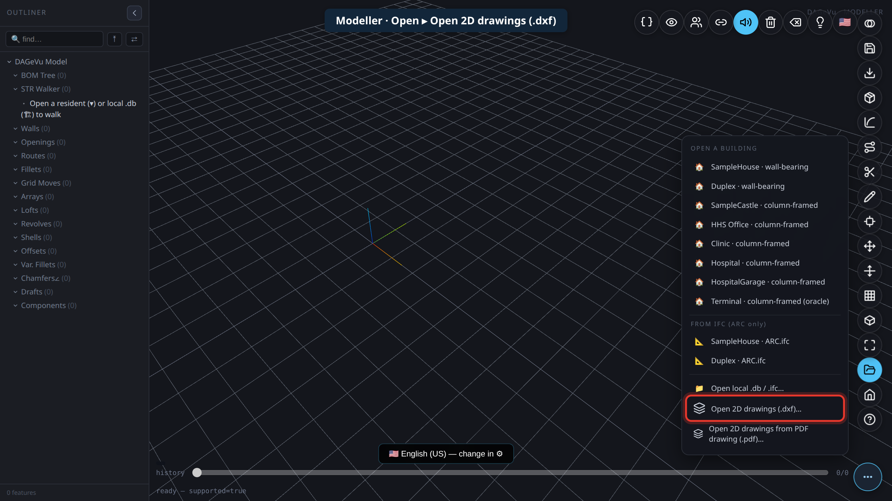

*Picture B1-a · Modeller: Open ▸ Open 2D drawings (.dxf)*

| # | Do | Confirm on screen | Result |
|---|---|---|---|
| B1.1 | **📂 Open → Open 2D drawings (.dxf)…** and select **only** `0_FLOOR_PLAN_marked.dxf` | The Shed **floor plan** is drawn on the canvas, as in picture B1-b: the long rectangle of the shed with its grid lines and column marks. The badge in the **Drawing metadata** panel reads **Blocked** for one sheet on its own: that is expected, one sheet is not yet a building | ☐ Pass ☐ Fail |
| B1.2 | Fold the **2D Drawings** panel away (the fold button in its title bar) and close the **Drawing metadata** panel (✕) to see the whole drawing. Turn the mouse wheel to zoom, drag to move | You recognise your own floor plan | ☐ Pass ☐ Fail |

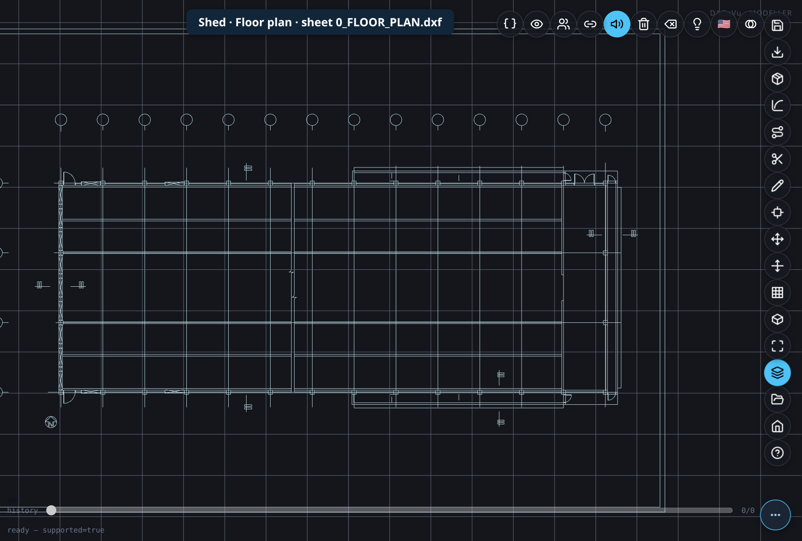

*Picture B1-b · **Shed · Floor plan** · sheet `0_FLOOR_PLAN.dxf`, on its own*

| # | Do | Confirm on screen | Result |
|---|---|---|---|
| B1.3 | Reload the page. Open **only** `3_BEAM_LAYOUT_marked.dxf` | The **beam layout** is drawn, as in picture B1-c | ☐ Pass ☐ Fail |
| B1.4 | Reload the page. Open **only** `4_FOUNDATION_LAYOUT_marked.dxf` | The **foundation layout** is drawn, as in picture B1-d | ☐ Pass ☐ Fail |

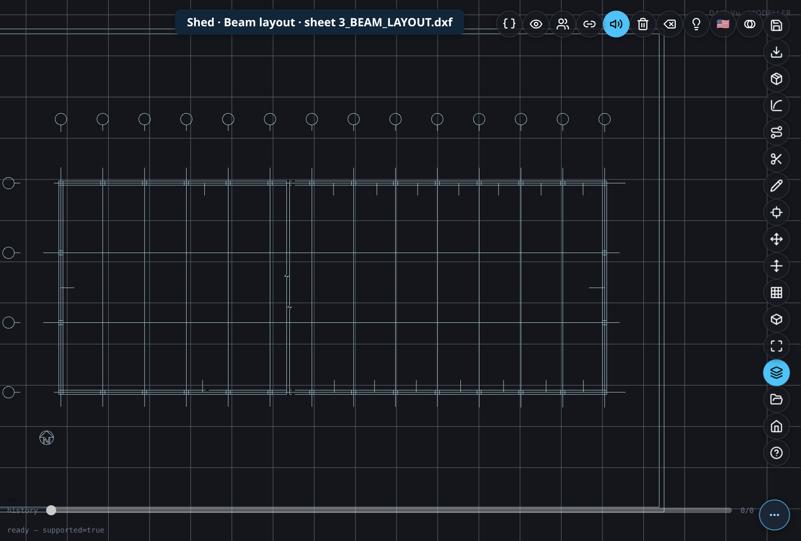

*Picture B1-c · **Shed · Beam layout** · sheet `3_BEAM_LAYOUT.dxf`, on its own*

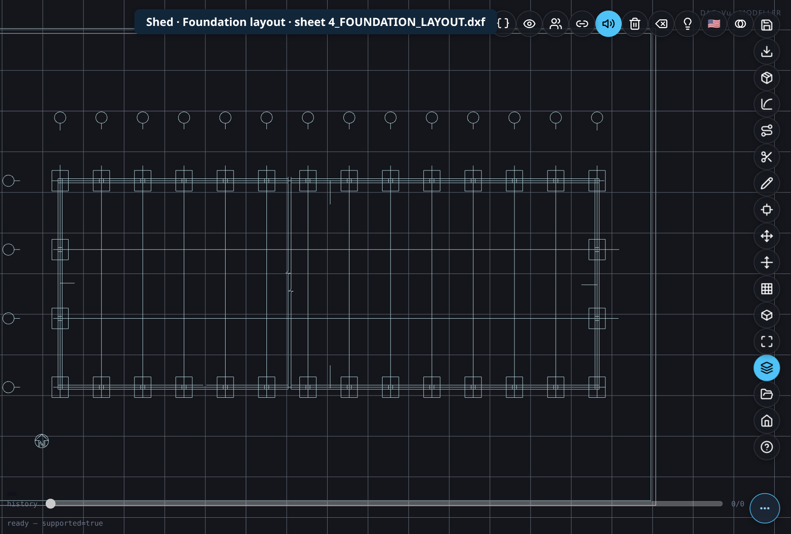

*Picture B1-d · **Shed · Foundation layout** · sheet `4_FOUNDATION_LAYOUT.dxf`, on its own*

An elevation or the section opened on its own shows nothing: it has to stand on a plan. You will see them in the next step, standing in place.

### B2 · Open all nine sheets: the drawings arrange themselves

| # | Do | Confirm on screen | Result |
|---|---|---|---|
| B2.1 | Reload the page. **📂 Open → Open 2D drawings (.dxf)…** and select **all nine** `…_marked.dxf` files at once | The **2D Drawings** panel is titled **9 SHEETS** and lists each file with its role: three PLAN rows, four ELEV rows, the section and the NOTES sheet (picture B2-a) | ☐ Pass ☐ Fail |
| B2.2 | Read the top of the **Drawing metadata** panel | The green badge reads **Qualifies**. Under it a line reads **MISSING SHEETS · no list … INCONCLUSIVE**: that is expected, because these nine files carry no list of the sheets a set should have, so the Modeller cannot count missing ones; it does not stop **Convert**. The **SHEETS** list shows each sheet with its role: three **PLAN**, four **ELEV**, one **SECTION**, one **NOTES** | ☐ Pass ☐ Fail |
| B2.2b | Below the sheets, find the yellow block **ALL DEFAULTS**. It says **14 yellow in 1 group**. Click the **▸** on the group to open it and read the 14 rows. Each row is one setting the Modeller applied because the drawings do not state it: its name and value (for example *building.type = General*, *fan.blades = 4*, *bodies.pair_max_width = 0.5*), then a sentence saying what it does. These rows are conventions, so clicking one does **not** jump to a place on the sheet. To see a whole sheet with its markings drawn on it, press **Sheet** on a sheet’s card; **Esc** (or the ✕) closes it again | You have read all 14 rows and agree with each value for **your** shed. Ten rows end in **[guess]**, the Modeller’s assumptions: *building.type*, *column.top_under_beam*, *fan.blades*, *fan.depth*, *fan.housing_wall*, *net.thickness*, *panel.plane*, *profile.angle_heel*, *profile.angle_mesh* and *section.spacing*. Read those hardest. Write any value you do not accept on the **Notes** line. **Source:** each row’s own sentence says where the value comes from | ☐ Pass ☐ Fail |
| B2.2c | Do nothing to the yellow rows yet: **Convert** (B2.6) works with the 14 rows still open. Optional: press **Accept all** (the button above the group; no key is needed) to mark them as yours. To keep just one, press **✓ Keep this value** at the right of its row | The panel itself says *the defaults stay applied and Convert is not held up by them*. **Keep this value** on a row removes that row and no other (14 becomes 13). **Accept all** takes the yellow count from **14** to **0** and the block empties. Either way the badge stays **Qualifies** and Convert gives the same result (B2.6). If your browser still shows 3 rows left after **Accept all**, it is running an older copy of the Modeller: reload the page (Ctrl+F5) | ☐ Pass ☐ Fail |
| B2.3 | These nine sheets carry every value, so they open **already in place**: the Modeller does not replay anything on opening. Press **Arrange** in the panel to watch them move into place | The status line counts **Step 1/46 … Step 46/46** (one step per setting, the last is *@CUT*). The plans lie on the ground; each elevation stands on the side it shows; the section stands across the shed (picture B2-b). The details sheet is not placed (it is notes only) | ☐ Pass ☐ Fail |
| B2.4 | Fold the **2D Drawings** panel away, close the **Drawing metadata** panel (✕), and orbit with the mouse | You can see the floor plan you looked at in B1 lying flat, with the four elevations standing around it | ☐ Pass ☐ Fail |

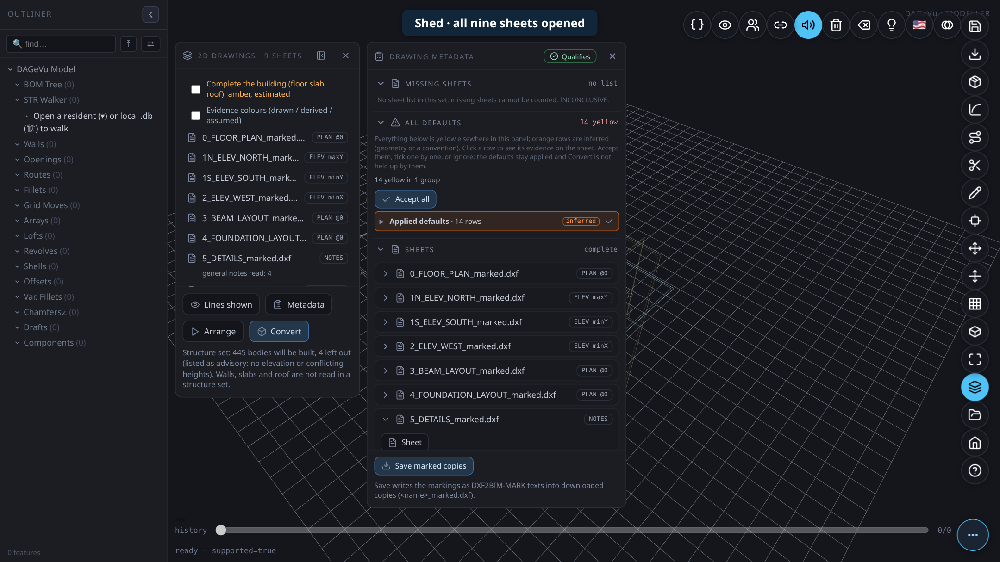

*Picture B2-a · **Shed · all nine sheets opened**: the list of sheets with their roles, and the verdict **Qualifies***

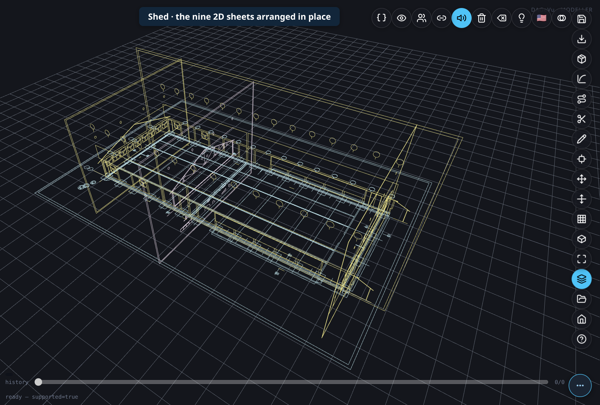

*Picture B2-b · **Shed · the nine 2D sheets arranged in place**: plans flat, elevations and section standing*

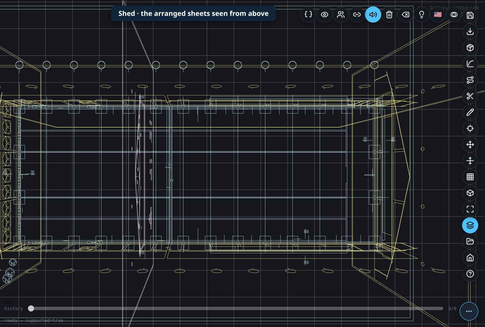

*Picture B2-c · **Shed · the arranged sheets seen from above**: the floor plan again, now with the other sheets around it*

### B2b · Convert the drawings to the 3D Shed

| # | Do | Confirm on screen | Result |
|---|---|---|---|
| B2.5 | If you pressed **Arrange**, wait until the status line stops counting *Step n/46* (or press **Esc** to stop it). Unfold the **2D Drawings** panel and tick **Complete the building (floor slab, roof)** | The box is ticked | ☐ Pass ☐ Fail |
| B2.6 | Press **Convert** (ringed in picture B2-d) | Before you press it, the panel’s status line reads *Structure set: 445 bodies will be built, 4 left out (listed as advisory: no elevation or conflicting heights)*. After it: **Converted: 511 elements (0 door/window fills), 2 openings cut.** The Shed is built in 3D: columns, walls, beams, the roof on its trusses, doors and fans (picture B2-e). The yellow count is unchanged by Convert | ☐ Pass ☐ Fail |
| B2.7 | Orbit around the model | It is the shed as these sheets draw it: one row of columns on each grid line of the floor plan (14 lines along the length, 4 across) | ☐ Pass ☐ Fail |
| B2.8 | **Export → Viewer database (.db)** (ringed in picture B2-f) | A `.db` file is downloaded | ☐ Pass ☐ Fail |
| B2.9 | Open the [front door](https://red1oon.github.io/bim-ootb/index.html), **Buildings / IFC**, then the card **Blank Viewer · Open your own .db file**. In the blank Viewer press **Ctrl+O** (Open Building) and choose the `.db` | The status line reads **DONE — SHED 511 elements**, the same count as the Convert; orbit with the mouse | ☐ Pass ☐ Fail |

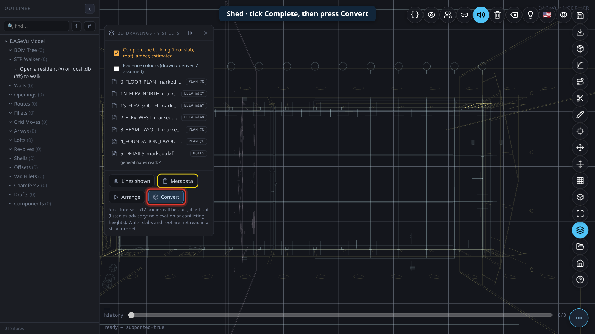

*Picture B2-d · **Shed · tick Complete, then press Convert**, in the 2D Drawings panel*

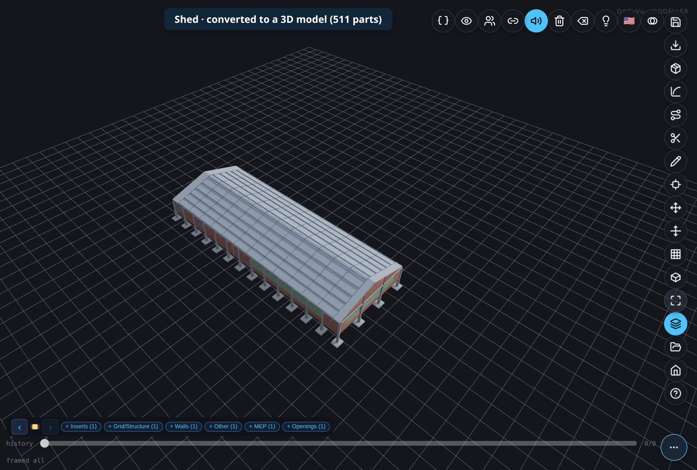

*Picture B2-e · **Shed · converted to a 3D model** (511 parts when these pictures were taken)*

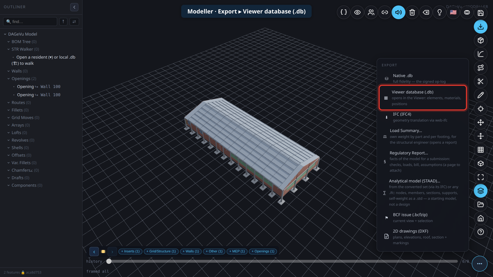

*Picture B2-f · Modeller: Export ▸ Viewer database (.db)*

Full detail of every panel: [DXF2BIM guide](DXF2BIMGuide.md#step-by-step-in-the-modeller).

### B3 · Fit the 4D schedule and the 5D rates to your local scene

The schedule and the cost come from reference files the Viewer ships with. You edit your own copy in the browser. Full detail: [Your own 4D / 5D references](BIMUserGuide.md#your-own-4d-5d-references-rates-durations-sequence).

| Reference | Open it from | Example edit for this test |
|---|---|---|
| **5D Rate Pack** (the active pack, for example `cidb2024_my`) | **Settings → Edit Project JSON → 5D Rate Pack** | raise the rate of one material (for example walls) by 10 % |
| **4D Schedule Template** | **Settings → Edit Project JSON → 4D Schedule Template** | add waiting days after one phase: in **dependencies → within_level**, raise `lag_days` of the *superstructure* rows by 5. (A phase has no length of its own to type: its length is worked out from the parts and the crews) |
| **4D Sequence & Labour Rules** | **Settings → Edit Project JSON → 4D Sequence & Labour Rules** | change one trade’s crew size |

| # | Do | Confirm on screen | Result |
|---|---|---|---|
| B3.1 | Note the Viewer’s total cost (Find panel: `total cost`; it is the cost of the 13 drawn bays, see the note at the top of chapter B) and the schedule’s finish date (**Time Machine**, key **T**) | With the shipped rates the total reads **USD 96,839 (RM 372,457) — total building cost** (the digits may be grouped differently in your browser's language). The amount in brackets is the rate pack's second currency (RM), whatever language you choose; your local currency for the chosen language is in development. A higher figure, such as USD 97,979, means the B0.7 exclude box missed the expansion joint. Write the total and the finish date down: ________ / ________ | ☐ Pass ☐ Fail |
| B3.2 | Make the rate edit and the lag edit above. Your copy is saved in this browser as you type | The form keeps your value; a list shown as JSON text must stay valid JSON | ☐ Pass ☐ Fail |
| B3.3 | **Reload the Viewer tab**, so it reads your copies | The building opens again | ☐ Pass ☐ Fail |
| B3.4 | Read the total cost again | It moved in the direction of your rate edit | ☐ Pass ☐ Fail |
| B3.5 | Open **Time Machine** (key **T**). Press **Jump to start**, then **Build** | The finish date moved by the days you added (5 on each edited row); the day counter and the *placed* count rise as the parts go up in order | ☐ Pass ☐ Fail |
| B3.6 | **⬇ Download** your edited files, then **Reset** them | You keep your copies as files; the Viewer is back on the shipped references | ☐ Pass ☐ Fail |

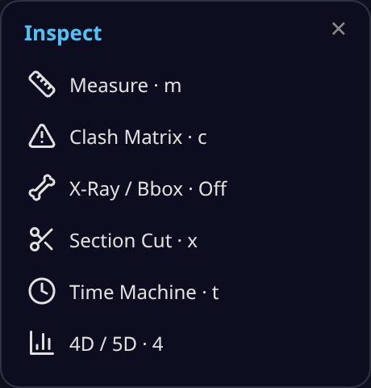

### B4 · Send the model to the ERP as a Project Order

Do this in the **Viewer**, on the Shed you opened in B2.9. (In the Modeller, **ERP ▸ Project Order** prices a building that was *opened* from a database; for a model made from drawings it tells you to use this route.) Full detail: [Send it to ERP](ModellerGuide.md#send-it-to-erp-project-order-variant-vo).

| # | Do | Confirm on screen | Result |
|---|---|---|---|
| B4.1 | Open the **Find** panel and click one group of parts in its list (for example a column type) | The panel shows the group's cost and the button **› ERP** | ☐ Pass ☐ Fail |
| B4.2 | Press **› ERP** | The status line reads *Project Order: 1 lines · contract …  (saved)* and a link **open ↗** appears | ☐ Pass ☐ Fail |
| B4.3 | Press **› ERP** again | *Project Order: 0 lines*: nothing new is added, the order is keyed by the model's name (**SHED**) | ☐ Pass ☐ Fail |
| B4.4 | Click **open ↗**. On the Kernel ERP sign-in page choose **GardenAdmin**, then **Log In** | The ERP opens on the project **SHED** (*BIM: SHED*) with its planned amount (the amount of the group you clicked in B4.1). Its **Phase** and **Task** tabs each hold one record. The line from the model is under **Task Line** (with the Task selected), showing the same planned amount: a line shows in the tab of its lowest level, as in iDempiere (*Task Line*: a task is set; *Phase Line*: a phase but no task; *Project Line*: neither), so **Project Line** and **Phase Line** read *0 records* | ☐ Pass ☐ Fail |

### B5 · Mark your run against the reference pack

This is the step that *How do I pass?* (at the start of this guide) points to. The **UAT Run Checker** compares what your run produced with the run this guide was proven on, stage by stage. It reads your files in your browser; nothing is uploaded. Keep the files from B0.9 and B2.8 and the two lines from B2.9 and B3.1 for this step.

| # | Do | Confirm on screen | Result |
|---|---|---|---|
| B5.1 | Download the **reference pack** (link in *What you need*) and open the [UAT Run Checker](https://red1oon.github.io/bim-ootb/capex/uat/check.html). In box **1** choose the pack's `.zip` | Under box 1: *Pack intact: 19 files checked, built 2026-11-15 …*. A damaged or wrong file is refused, and **Mark my run** stays off | ☐ Pass ☐ Fail |
| B5.2 | In box **2** select your nine `…_marked.dxf` from B0.9 (all at once); in box **3** your `SHED_extracted.db` from B2.8; in box **4** paste the Viewer's status line from B2.9; in box **5** the total-cost line from B3.1 (before your rate edit) | The boxes hold your files and lines | ☐ Pass ☐ Fail |
| B5.3 | Press **Mark my run** | One row per stage: **B0.9** marked sheets, **B2.8** Viewer database, **B2.9** status line, **B3.1** total cost, each **PASS**, **FAIL** or **NOT GIVEN**, with the reason under it. Your run reads **PASS** when all four pass. A tester who skipped B00 and B0 has no marked files: B0.9 reads NOT GIVEN and the run **PARTIAL PASS** | ☐ Pass ☐ Fail |
| B5.4 | Press **Download result (uat_result.json)** and attach the file to this sign-off | The file is saved | ☐ Pass ☐ Fail |

*Proven (witness W-UAT-CHECK, 2026-11-15) on the pack as it is served: a run equal to the proven one marks PASS on all four rows; a run whose B0.7 exclude box was skipped marks FAIL on all four (515 elements, USD 97,979); an empty form marks INCONCLUSIVE; a pack with one file changed is refused.*

**Notes (chapter B):** ______________________________________________

---

## C · ERP: the hands-on exercise (Project Mgmt Accounting, as GardenWorld Admin)

Use the 12 test projects. The table says, per project, what to make. The products are the **Construction** products of A3.6 (**not** GardenWorld's own); use any GardenWorld vendor, the *Purchase* price list and *HQ Warehouse*. Do not type a price: the order line takes it from the price list, which is the product's standard cost. On each document, set **Project** to the test project (the windows do not ask for a phase).

| Product | Name | Unit | Standard cost (USD) |
|---|---|---|---|
| PWD-04.2 | Brick masonry | M3 | 68.1167 |
| PWD-07.2.2 | RC 1:2:4 column | M3 | 115.5250 |
| PWD-08.1.2 | Reinforcement bar Grade 400 | KG | 0.8333 |
| PWD-10.6 | Steel section | KG | 1.0750 |
| PWD-10.21 | Profiled metal roofing | M2 | 4.8167 |

| Project | Name | Phases ticked (from the pack) | Purchase orders | How far the completed order goes | Issue to the project |
|---|---|---|---|---|---|
| TD_RIVERSIDE | Riverside Tower | 3 of 5 | complete: 29 M3 PWD-04.2; leave in Draft: 7 M3 PWD-04.2 | Paid in full | 3 M3 PWD-04.2 |
| TD_DEPOT | North Depot | 1 of 4 | leave in Draft: 1,008 KG PWD-08.1.2 | — | 92 KG PWD-08.1.2 |
| TD_BRIDGE | Bridge Deck | 2 of 4 | complete: 21 M3 PWD-07.2.2; leave in Draft: 31 M3 PWD-07.2.2 | Half paid | 5 M3 PWD-07.2.2 |
| TD_CLINIC | Clinic Wing | 2 of 4 | — | — | 107 KG PWD-10.6 |
| TD_DATAHALL | Data Hall | 1 of 3 | complete: 1,674 KG PWD-10.6; leave in Draft: 1,116 KG PWD-10.6 | Received | 178 KG PWD-10.6 |
| TD_SUBSTATION | Substation | 1 of 3 | complete: 104 M2 PWD-10.21 | Ordered only | — |
| TD_CARPARK | Car Park | 2 of 3 | — | — | 95 M2 PWD-10.21 |
| TD_SCHOOL | School Block | 3 of 4 | complete: 1,350 KG PWD-08.1.2 | Paid in full | 321 KG PWD-08.1.2 |
| TD_PUMP | Pump Station | 1 of 3 | — | — | 36 KG PWD-10.6 |
| TD_OFFICE | Office Fit-out | 0 of 3 | — | — | — |
| TD_WAREHOUSE | Warehouse 3 | 0 of 3 | leave in Draft: 133 M2 PWD-10.21 | — | — |
| TD_PLAZA | Plaza | 3 of 3 | — | — | 110 KG PWD-08.1.2 |

The products cost at **Standard**: a receipt at any price leaves a product's cost where it is, and every issue raises the project's **Spent** by *quantity × standard cost*. With this table the projects spread across the dashboard's Budget colours (chapter D) instead of all turning red. Five projects (*TD_DEPOT*, *TD_CLINIC*, *TD_CARPARK*, *TD_PUMP*, *TD_PLAZA*) issue a product that was never received, so its on-hand quantity goes negative. GardenWorld allows that; a warehouse that does not allow negative stock refuses those issues.

### C1 · Purchase orders

Make one order per row of the table that has a purchase order, with the quantity it states.

| # | Do | Confirm on screen | Result |
|---|---|---|---|
| C1.1 | **Purchase Order** window, **New**. Header: **Business Partner** *Seed Farm Inc.* (or any vendor), **Price List** *Purchase*, **Warehouse** *HQ Warehouse*, **Project** the test project (the field sits in the header). Save. Tab **PO Line**, **New**: **Product** the table's product, **Quantity** from the table; leave the price as the price list gives it. Save | The line price is the product's standard cost (for example 68.1167 for *PWD-04.2*). The order's **Total Lines** = quantity × price (for example 29 × 68.1167 = 1,975.38) and **Grand Total** is the same (the tax rate is 0). **Source:** the price is the product’s **Price** tab, *Purchase* list (A4.2); multiply it by the quantity yourself | ☐ Pass ☐ Fail |
| C1.2 | **Document Action ▸ Complete ▸ OK** on the orders the table marks *complete*; leave the others as they are | Document status *Completed* on those, *Drafted* on the others | ☐ Pass ☐ Fail |

### C2 · Material receipt

| # | Do | Confirm on screen | Result |
|---|---|---|---|
| C2.1 | For each completed order whose *How far* is *Received*, *Half paid* or *Paid in full*: **Material Receipt** window, **New**. Header: **Business Partner** the same vendor, **Project** the test project. Press **Create lines from**, choose the purchase order, tick its line, **OK**. On the **Receipt Line** tab check the **Locator** is *Default HQ Locator*. Save, then **Document Action ▸ Complete ▸ OK** | The receipt is *Completed* and carries the order's product and quantity. The product’s on-hand quantity rose (menu entry **Storage per Product**: type the name in the menu’s Search box), and in the **Product** window, tab **Costs**, its **Standard** cost did not change | ☐ Pass ☐ Fail |

### C3 · Vendor invoice and payment

Only *Half paid* and *Paid in full* orders (TD_BRIDGE, TD_RIVERSIDE, TD_SCHOOL).

| # | Do | Confirm on screen | Result |
|---|---|---|---|
| C3.1 | **Purchase Invoice and Credit/Debit Note** window, **New**. Header: **Target Document Type** *AP Invoice*, **Business Partner** the same vendor, **Project** the test project. Press **Create lines from**, choose the purchase order (or its receipt), tick the line, **OK**. Save, then **Document Action ▸ Complete ▸ OK** | The invoice is *Completed*; its **Grand Total** equals the order's | ☐ Pass ☐ Fail |
| C3.2 | **Payment and Receipt** window, **New**. **Document Type** *AP Payment*, **Business Partner** the same vendor, **Invoice** the invoice you just made (the amount fills in; the **Project** field disappears once an invoice is chosen, that is normal), **Bank Account** *MoneyBank 1234*, **Tender type** *Check*. For *Half paid* change **Payment amount** to half the invoice total. Save, then **Document Action ▸ Complete ▸ OK** | The payment is *Completed*. On the invoice, **Paid** is ticked for *Paid in full*; for *Half paid* it is not, and the open amount is the other half | ☐ Pass ☐ Fail |

### C4 · Issue materials to site

This is done in two parts, once per test project that has an issue in the table (nine projects). The pack's projects are category *General*, and iDempiere refuses to issue material to a General project (*Project not Work Order or Asset*), so each project is first set to the **Work Order (Job)** type.

| # | Do | Confirm on screen | Result |
|---|---|---|---|
| C4.1 | **Project** window, open the test project. Press **Set Project Type**, choose **Work Order (Job)**, **OK** | The message says *OK*. The project's phases are still there (the Phase tab still lists them) and the **Set Project Type** button no longer accepts another type | ☐ Pass ☐ Fail |
| C4.2 | Menu **Project Management ▸ Issue to Project**. **Project** the test project, **Locator** *Default HQ Locator*, **Product** the table's product, **Movement Quantity** from the last column, **Movement Date** today. Leave **Shipment/Receipt**, **Expense Report** and **Project Line** empty. **OK** | The message says *Created 1* | ☐ Pass ☐ Fail |
| C4.3 | **Project (Lines/Issues)** window, find the project, tab **Issues** | One issue line with the product and quantity, **Document Status** *Completed* | ☐ Pass ☐ Fail |
| C4.4 | Back in the **Project** window, look at **Project Balance** in the header | It rose by *quantity × standard cost*: *TD_RIVERSIDE* 3 × 68.1167 = **204.35**, *TD_BRIDGE* 5 × 115.525 = **577.63**, *TD_DATAHALL* 178 × 1.075 = **191.35**. A project that issues nothing stays at 0 **Source:** the quantity is on the issue line (C4.3) and the cost is the product’s **Standard** cost on its **Costs** tab; multiply them yourself and compare with **Project Balance** | ☐ Pass ☐ Fail |

### C5 · Tick a phase

| # | Do | Confirm on screen | Result |
|---|---|---|---|
| C5.1 | **Project** window, a test project (for example *TD_DEPOT*), tab **Phase**: tick **Complete** on the next phase that is not ticked, **Save** | The phase stays ticked (for *TD_DEPOT* 2 of 4 now); that project's *Done* on the dashboard rises (chapter D) | ☐ Pass ☐ Fail |

**Notes (chapter C):** ______________________________________________

---

## D · The dashboard (Project Mgmt Accounting; the read job: System Setup)

The dashboard reads a file that a small read job writes from your iDempiere. Run the job first, and again whenever you want fresh figures (it needs Node.js; the full line with user, password, tenant and role is in the [Developer's note](CapexDashboardGuide.md#developers-note)):

```
BRIDGE_BASE=http://<your-idempiere>:<port> node capex/tools/legacy_snapshot.js
```

It writes the file `capex/legacy_snapshot.json` inside your copy of the repository (the folder from A1.1, next to `index.html`), and ends with a line `§DASH_LEGACY_SNAPSHOT … projects=14 … unavailable=[]` (14 on a fresh GardenWorld). Then open `/capex/index.html?source=legacy` on the server that holds that copy (see [How the dashboard connects to the data](CapexDashboardGuide.md#how-the-dashboard-connects-to-the-data)). Every tile is described in [The dashboard page](CapexDashboardGuide.md#the-dashboard-page).

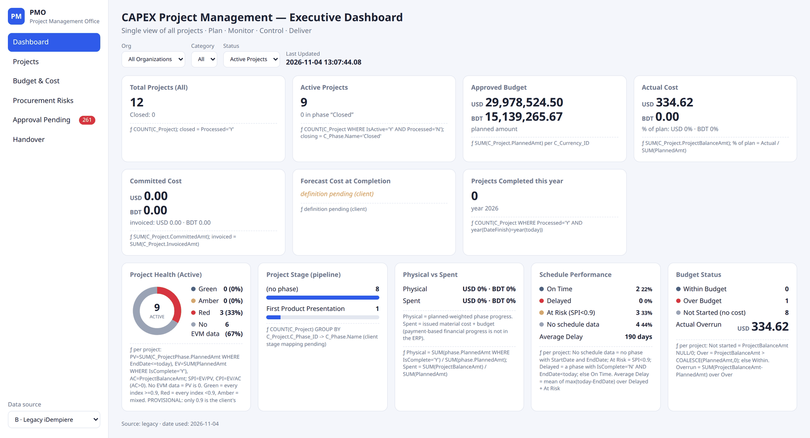

| # | Do | Confirm on screen | Result |
|---|---|---|---|
| D1 | Read **Total Projects** and **Active Projects** | **14** and **14** on a fresh GardenWorld: the 12 test projects plus GardenWorld's own *Standard* and *Landscape* (plus any of your own). **Step into the source:** click the number: the side panel lists the projects behind it, and its row count is the figure. **ƒ formula** under the tile shows the measure (D7) |  ☐ Pass ☐ Fail |
| D2 | Read **Approved Budget** | The sum of the planned amounts, per currency: **USD 4,667.80** (the 12 test projects 4,067.80 plus *Landscape* 600.00). **Step into the source:** click the number; add the **Approved** column of the panel yourself. Press **ERP ↗** on a project: iDempiere’s **Project** window shows the same figure in **Planned Amount**, and it equals the sum of **Planned Amount** on the **Phase** tab |  ☐ Pass ☐ Fail |
| D2b | Read the **Budget** tile (Within / Over / Not started) | **Over** lists *TD_CARPARK* (Spent 457.59 against a plan of 330.00) and *TD_DATAHALL* (191.35 against 181.50), the other 7 projects with issues are **Within**; **Not started** is 5: *TD_OFFICE*, *TD_SUBSTATION*, *TD_WAREHOUSE* and GardenWorld’s own *Landscape* and *Standard*, which carry no spending on a fresh GardenWorld. The three counts read **Within 7, Over 2, Not started 5**. If your server's *Standard* project already carries spending, it moves out of *Not started* **Step into the source:** click **Total Projects** and read each project’s **Spent**, **Approved** and **Budget** columns: *Over* is Spent above Approved, *Not started* is Spent 0 | ☐ Pass ☐ Fail |
| D3 | Read **Actual Cost** (Spent) | It rose by what you issued in C4: **2,020.45** over the 12 test projects. GardenWorld’s own projects carry no spending on a fresh GardenWorld, so the tile reads **USD 2,020.45**, **43 %** of plan (add whatever your own projects already carry). **Step into the source:** click the number and add the **Spent** column; each project’s **Spent** is **Project Balance** in iDempiere’s **Project** window (C4.4) | ☐ Pass ☐ Fail |
| D4 | Open **Procurement Risks** in the left menu. Then open a test project's page (D5) and its **Procurement** tab | Left menu: *Open purchase orders* = the 5 you left Drafted, **USD 6,738.39** in total. Project page: the **Supply chain** card shows that project's order at the stage you took it to (*TD_SUBSTATION* Ordered, *TD_DATAHALL* Received, *TD_BRIDGE* Invoiced, *TD_RIVERSIDE* and *TD_SCHOOL* Paid) and lists its receipt, invoice and payment **Step into the source:** each document number in the Supply chain card is a record number: open that receipt, invoice or payment in iDempiere (**Material Receipt**, **Purchase Invoice and Credit/Debit Note**, **Payment and Receipt**) and read its status and amount | ☐ Pass ☐ Fail |
| D5 | Click a number on a tile | The drill panel lists the projects behind it; click a project to open its page | ☐ Pass ☐ Fail |
| D6 | On the project page of *TD_RIVERSIDE*, open the tabs | Overview: Approved **371.25**, 5 phases. The Schedule tab draws the 5 phase bars with the pack’s dates, the first 3 *Complete* **Source:** the project’s **Phase** tab in iDempiere (*Planned Amount*, start and end dates, *Complete*); read them there and compare | ☐ Pass ☐ Fail |
| D7 | Open **ƒ formula** under a tile | The formula is shown; it is the same Performance Analysis measure your iDempiere holds (A2.3) | ☐ Pass ☐ Fail |
| D8 | Change **Layout** (top bar) to *Executive* and **Skin** to *Dark*, then back to *Classic* and *Light* | The look changes. *Executive* shows fewer, re-labelled tiles (*Actual Cost* becomes *Spent so far*) with the same figures (4,667.80 approved, 2,020.45 spent); *Classic* shows them all again | ☐ Pass ☐ Fail | ☐ Pass ☐ Fail |
| D9 | Log in to iDempiere again and read the **Home** tab. Home goals are recalculated only when they are older than **30 minutes** (System Configurator name `ZK_DASHBOARD_PERFORMANCE_REFRESH_INTERVAL`, 1800000 ms). If you opened Home at A2.2 less than 30 minutes ago, the goals still show the counts from before the test data (for example *CAPEX Total Projects* 2): either wait, or open **System Admin ▸ General Rules ▸ System Rules ▸ System Configurator**, set that name's **Configured Value** to `60000`, save, and log in again | The CAPEX goals show the same counts as the dashboard tiles, money in your login’s currency. A goal that has a target (for example *Health Green*, *Schedule On Time*, *Actual Cost*) shows its percentage of the target on the Home tab, not the count | ☐ Pass ☐ Fail |

**Notes (chapter D):** ______________________________________________

---

## Known limits (do not fail a step on these)

- **Proposed figures.** *Forecast*, *Procurement Risks* and *Handover* use definitions we proposed; they await your confirmation.
- **Postings in the Kernel ERP.** Project issues complete but are not yet posted to the books in the browser-based Kernel ERP; in your iDempiere they post as usual.
- **Task dates.** Task dates are kept by the BIM Document plugin; without it, the Schedule tab draws phases only.
- **Standard costing is a PostgreSQL iDempiere set-up.** The products script, and the change of GardenWorld’s accounting schema to Standard costing, are not available in the browser-based Kernel ERP. Applying the script changes how *all* GardenWorld products are costed on that server, so apply it on a test copy, not on a live GardenWorld.
- **This pack in the Kernel ERP.** Loading this test pack into the browser-based Kernel ERP (rather than into your iDempiere) is not available yet.

## Sign-off

| Chapter | Role / name | Date | Passed / total | Signature |
|---|---|---|---|---|
| A · Set up | System Setup: | | / 17 | |
| B · BIM | BIM: | | / 43 (29 if you were given the marked copies and skipped B00 and B0) | |
| C · ERP | Project Mgmt Accounting: | | / 10 | |
| D · Dashboard | Project Mgmt Accounting: | | / 10 | |
