# CAPEX UAT Guide — from 2D drawings to the dashboard

<div class="uat-noprint" markdown="0"><button type="button" class="md-button md-button--primary" onclick="window.print()">🖨 Print this guide / Save as PDF</button>
<span style="margin-left:.6em;font-size:.8em">Print it, tick the boxes by hand, sign the last page and hand it in. In the print dialog choose <b>Save as PDF</b> to keep a file.</span></div>
<style>
@media print {
  .md-header, .md-tabs, .md-sidebar, .md-footer, .md-top, .md-source, .uat-noprint, .md-content__button, .headerlink { display: none !important; }
  .md-main__inner, .md-content, .md-content__inner, .md-grid { margin: 0 !important; padding: 0 !important; max-width: none !important; }
  .md-typeset { font-size: 10.5pt; }
  .md-typeset table:not([class]) { display: table; width: 100%; font-size: 9pt; }
  .md-typeset table:not([class]) th, .md-typeset table:not([class]) td { border: 1px solid #555; padding: 3pt 5pt; }
  .md-typeset tr, .md-typeset img, .md-typeset figure { break-inside: avoid; page-break-inside: avoid; }
  .md-typeset h2 { break-before: page; page-break-before: always; }
  .md-typeset h3 { break-after: avoid; }
  .md-typeset img { max-width: 100%; max-height: 105mm; }
  a[href]::after { content: none !important; }
  @page { margin: 14mm 12mm; }
}
</style>

A hands-on test script for the testers of the pilot client (Sysnova). Each step says what to **do**, what you should **see**, and has a box to tick.
**A value is affirmed at its source, not trusted.** Wherever a step gives a number, it also says **Source:** where the number is kept (a record, a field, a formula) and what to open to see it there. Open that source, read the value yourself, and tick *Pass* only if it matches. A figure on the dashboard is never the evidence: the rows behind it are.

Work top to bottom: every chapter uses what the one before produced. Write anything that differs on the **Notes** line at the end of each chapter.

Dates in the test data are set for **13 November 2026**. Testing well after that day still works, but the colours on the dashboard (on time, late, over budget) drift with the calendar.

**What you need**

| Item | Where |
|---|---|
| A desktop browser (Chrome, Edge or Firefox) | — |
| The BIM apps | the public site [red1oon.github.io/bim-ootb](https://red1oon.github.io/bim-ootb/index.html), or your own copy (chapter A1) |
| Your iDempiere, with its **GardenWorld** client and a GardenWorld Admin login | your server |
| The test-data pack | [202611131200_GardenWorld_CAPEXTestData.zip](https://github.com/red1oon/bim-ootb/raw/main/capex/plugin/testdata_2pack/202611131200_GardenWorld_CAPEXTestData.zip) |
| The construction-products script (10 materials at standard cost) | [202611141500_CAPEX-TD-CONSTRUCTION-PRODUCTS.sql](https://github.com/red1oon/bim-ootb/blob/main/capex/plugin/testdata_2pack/202611141500_CAPEX-TD-CONSTRUCTION-PRODUCTS.sql) |
| The dashboard's scripts for iDempiere | listed in chapter A2, all in the [bim-ootb repository](https://github.com/red1oon/bim-ootb/tree/main/capex/legacy) |
| The **Shed** drawing set: nine 2D sheets (.dxf) with their settings written in | the nine `…_marked.dxf` files supplied for this test, listed in chapter B1 |

The nine Shed sheets are the pilot client's own work, so its testers may use them. Any other drawing set goes through the same way once its sheets carry their settings (levels, datums and layer meanings), which the Modeller's **Drawing metadata** panel records.

**Where to find each window.** Every window and process below is in iDempiere's left-hand menu; open the folder and click the entry, or type the name in the menu's **Search** box. A new record is made with the **New** button in the toolbar, saved with **Save**, and a document is finished with its **Document Action** button (choose **Complete**, then **OK**).

| Name used in this guide | Menu path |
|---|---|
| Pack In | Application Dictionary ▸ Application Packaging ▸ Pack In |
| Accounting Schema | Performance Analysis and Accounting ▸ Accounting Rules ▸ Accounting Schema |
| Performance Measure Calculation | Performance Analysis and Accounting ▸ Performance Measurement ▸ Performance Measure Calculation |
| Business Partner | Partner Relations ▸ Business Partner Rules ▸ Business Partner |
| Product | Material Management and Pricing ▸ Material Management Rules ▸ Product |
| Warehouse and Locators | Material Management and Pricing ▸ Material Management Rules ▸ Warehouse and Locators |
| Project | Project Management ▸ Project |
| Issue to Project (a process) | Project Management ▸ Issue to Project |
| Project (Lines/Issues) | Project Management ▸ Project (Lines/Issues) |
| Purchase Order | Requisition-to-Invoice (Purchasing) ▸ Purchase Order |
| Material Receipt | Requisition-to-Invoice (Purchasing) ▸ Material Receipt |
| Purchase Invoice and Credit/Debit Note | Requisition-to-Invoice (Purchasing) ▸ Purchase Invoice and Credit/Debit Note |
| Payment and Receipt | Open Items (Financial Movements and Aging) ▸ Payment and Receipt |

**Who does what**

| Chapter | Who |
|---|---|
| A · Set up | your iDempiere administrator, once |
| B · BIM: drawings to a priced model | a BIM / QS tester |
| C · ERP: buying and issuing to site | an ERP tester, as GardenWorld Admin |
| D · The dashboard | everyone |

---

## A · Set up (administrator, once)

### A1 · The BIM apps on your own server (optional)

The Modeller, the Viewer, the Kernel ERP and the dashboard are plain web files: no application server and no database server. Use the public site, or serve your own copy.

| # | Do | Confirm on screen | Result |
|---|---|---|---|
| A1.1 | Copy the repository: `git clone https://github.com/red1oon/bim-ootb` | A folder `bim-ootb` with `index.html`, `modeller/`, `erp/`, `capex/` | ☐ Pass ☐ Fail |
| A1.2 | Serve the folder with any static web server, for example `python3 -m http.server 8080` inside it | The server says it is listening | ☐ Pass ☐ Fail |
| A1.3 | Open `http://<your-server>:8080/index.html`. On a first visit the page is a picture with two pills: click the **red** one | Three doors appear under *choose your door*. Hold the pointer on each to read its name: **Buildings / IFC**, **BIM Modeller**, **ERP** | ☐ Pass ☐ Fail |
| A1.4 | Open `/capex/index.html` on your server | The dashboard opens on its built-in sample store (3 projects). The computed tiles read **no data (CAPEX PA rows not installed)**: that is correct until the page reads your iDempiere (chapter D) | ☐ Pass ☐ Fail |

The large building databases are not stored in the repository. To open the sample buildings from your own server, ask us for the files and place them as the [Viewer guide](BIMUserGuide.md#run-it-on-your-own-machine) says.

### A2 · Install the dashboard into your iDempiere

All scripts are iDempiere migration scripts (PostgreSQL), written for the **GardenWorld** client. Apply them with `psql` **in file-name order**, run `update_sequences()`, then **restart the server**: iDempiere keeps web-service types and measures in memory.

| Folder in the repository | Script(s) | What it adds |
|---|---|---|
| [`capex/legacy/ws/migration`](https://github.com/red1oon/bim-ootb/tree/main/capex/legacy/ws/migration/iD13/postgresql) | `202611042300_CAPEX-WS-READ.sql` | Read-only web-service types for the dashboard's tables, and the role allowed to use them |
| [`capex/legacy/ws/q4`](https://github.com/red1oon/bim-ootb/tree/main/capex/legacy/ws/q4/migration/iD13/postgresql) | `202611111400_CAPEX-WS-Q4.sql` | Reading purchase orders and project issues |
| [`capex/legacy/ws/chain`](https://github.com/red1oon/bim-ootb/tree/main/capex/legacy/ws/chain/migration/iD13/postgresql) | `202611121700_CAPEX-WS-CHAIN.sql` | Reading receipts, vendor invoices and payments (the supply-chain view) |
| [`capex/legacy/ws/pacalc`](https://github.com/red1oon/bim-ootb/tree/main/capex/legacy/ws/pacalc/migration/iD13/postgresql) | `202611131400_CAPEX-WS-PACALC.sql` | Reading the dashboard's own formulas (Performance Analysis measures) from your server |
| [`capex/legacy/migration`](https://github.com/red1oon/bim-ootb/tree/main/capex/legacy/migration/iD13/postgresql) | every script, in name order (`202611031900_CAPEX-R0.sql` … `202611141000_CAPEX-FORECAST-PROJECTS.sql`) | The dashboard's formulas as Performance Analysis measures, the Home tab goals, their targets and colours. Money goals show the currency of your login |
| BIM Document plugin | see [Installing it](CapexDashboardGuide.md#installing-it) | Drawings filed against projects (optional for this test) |

| # | Do | Confirm on screen | Result |
|---|---|---|---|
| A2.1 | Apply the scripts above, run `update_sequences()`, restart iDempiere | Each script ends without an error; the server comes back | ☐ Pass ☐ Fail |
| A2.2 | Log in as GardenWorld Admin, open the **Home** tab | The Performance panel shows CAPEX goals, for example *CAPEX Total Projects*, *CAPEX Approved Budget* | ☐ Pass ☐ Fail |
| A2.3 | Open the window **Performance Measure Calculation** | Rows named *CAPEX …* are there; their SQL can be read and edited here. This is where the dashboard’s formulas live | ☐ Pass ☐ Fail |

Each script carries a **Restore** line at its top that removes what it adds.

### A3 · Load the test data (GardenWorld)

The pack holds **12 projects** (Value `TD_…`, names ending *(test data)*) with **42 phases**, **84 tasks**, **84 planned lines**, some phases already ticked complete, and **2 test products**. It holds **no documents** and none of the construction materials: those come from the script in A3.6: you make the orders, receipts, invoices, payments and issues yourself in chapter C. The data can stay in GardenWorld after the test.

The pack goes to the client named in its file name (**GardenWorld**), and is packed in by that client's administrator.

| # | Do | Confirm on screen | Result |
|---|---|---|---|
| A3.1 | Put the zip in an empty folder on the server and run `utils/RUN_ApplyPackInFromFolder.sh <folder>`, or use the **Pack In** window logged in as GardenWorld Admin (choose the zip, then run it) | The run prints *Successful application of …CAPEXTestData.zip*, `Error=false` and ends with *Done*. The log also prints a `java.lang.Exception` trace for each planned line (*MProduct.loadPO: NO Data found*): these do not stop the run, and the rows are checked in A3.2 to A3.4 | ☐ Pass ☐ Fail |
| A3.2 | Open the **Project** window, search Value `TD_%` | 12 projects, for example *TD_RIVERSIDE – Riverside Tower (test data)* **Source:** the pack file itself holds 12 `C_Project` records; the window’s record count (status bar) is the count in your database | ☐ Pass ☐ Fail |
| A3.3 | Open *TD_RIVERSIDE*, tab **Phase** | 5 phases with dates; the first 3 are ticked **Complete** **Source:** the **Phase** tab’s own *Complete* tick boxes (the pack set them); count them yourself | ☐ Pass ☐ Fail |
| A3.4 | Look at the project’s **Currency** | The currency of GardenWorld’s *Purchase* price list. The pack sets no currency: iDempiere takes it from the price list, so it follows your setup | ☐ Pass ☐ Fail |
| A3.5 | Pack the same zip in a second time | No new projects: still 12. The folder run says the pack is *already installed* and skips it | ☐ Pass ☐ Fail |
| A3.6 | Apply the products script with `psql` (it can be applied twice: the second run adds nothing), then **restart iDempiere**: the accounting schema is kept in memory. The script makes 10 **Construction** products at the Schedule of Rates prices and sets GardenWorld's primary accounting schema (*GardenWorld US/A/US Dollar*) to **Standard** costing, because iDempiere costs a project issue by the *schema's* method. Its first lines hold the **Restore** line | The script ends without an error. **Accounting Schema** window: *GardenWorld US/A/US Dollar*, **Costing Method** *Standard* | ☐ Pass ☐ Fail |

### A4 · ERP model setup, where needed

GardenWorld already has the vendor, the warehouse and the locator; the products come from A3.6. Check them before chapter C:

| # | Do | Confirm on screen | Result |
|---|---|---|---|
| A4.1 | **Business Partner** window: find a vendor (for example *Seed Farm Inc.*, the one this guide uses) | At least one partner with *Vendor* ticked | ☐ Pass ☐ Fail |
| A4.2 | **Product** window: search Value `PWD-%`, then open *PWD-04.2 Brick masonry* | 10 products in category *Construction*. *PWD-04.2*: unit **M3**, stocked, price **68.1167** on the *Purchase* price list (tab **Price**; 8,174 BDT ÷ 120), and a **Standard** cost of 68.1167 (tab **Costs**) **Source:** the product’s **Description** field names it: *PWD SoR 2022 item 04.2, page …, 8174 BDT/M3 = 68.1167 USD at 120*. That is the Public Works Department Schedule of Rates item; read the rate and the item number there and divide by 120 yourself | ☐ Pass ☐ Fail |
| A4.3 | **Warehouse and Locators** window: open *HQ Warehouse*, tab **Locator** | It has the locator *Default HQ Locator*, where you receive and issue | ☐ Pass ☐ Fail |
| A4.4 | **Product** window: *Test material A (test data)* | The pack’s product exists, in category *TD Materials (test data)* | ☐ Pass ☐ Fail |

**Notes (chapter A):** ______________________________________________

---

## B · BIM: the Shed, from 2D drawings to a priced model

This chapter uses **your own Shed drawing set**: the single-storey farm shed, drawn as nine 2D sheets. You will see each drawing on its own first, then the nine arranged in place, then the 3D model built from them.

The pictures were taken from the real Modeller with these same nine files. The label at the top of each picture and the red ring around a button were added for this guide; in the canvas-only pictures the drawing lines are shown at full strength so that they print clearly.

**The nine sheets** (open the `…_marked.dxf` copies: they carry the levels, heights and layer meanings the Modeller needs)

| Sheet file | What it is | Role the Modeller shows |
|---|---|---|
| `0_FLOOR_PLAN_marked.dxf` | Floor plan | PLAN |
| `3_BEAM_LAYOUT_marked.dxf` | Beam layout | PLAN |
| `4_FOUNDATION_LAYOUT_marked.dxf` | Foundation layout | PLAN |
| `1N_ELEV_NORTH_marked.dxf` | North elevation | ELEV |
| `1S_ELEV_SOUTH_marked.dxf` | South elevation | ELEV |
| `2_ELEV_WEST_marked.dxf` | West elevation | ELEV |
| `7_ELEV_EAST_marked.dxf` | East elevation | ELEV |
| `8_SECTION_AA_TRUSS_marked.dxf` | Section A-A, the roof truss | SECTION |
| `5_DETAILS_marked.dxf` | Details and general notes | NOTES |

### B1 · Get to know the drawings: one sheet at a time

Open [the Modeller](https://red1oon.github.io/bim-ootb/modeller/modeller.html). The drawings are opened from **📂 Open → Open 2D drawings (.dxf)…**

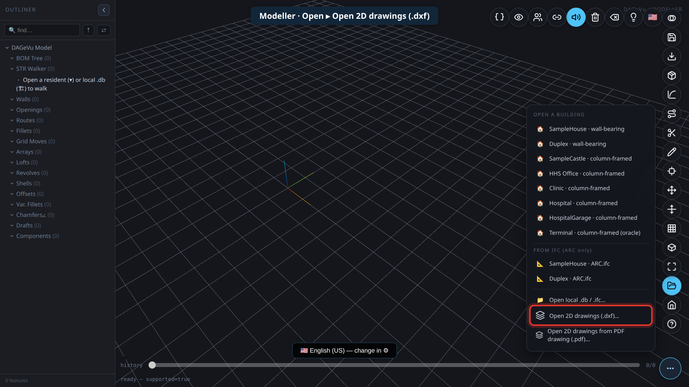

*Picture B1-a · Modeller: Open ▸ Open 2D drawings (.dxf)*

| # | Do | Confirm on screen | Result |
|---|---|---|---|
| B1.1 | **📂 Open → Open 2D drawings (.dxf)…** and select **only** `0_FLOOR_PLAN_marked.dxf` | The Shed **floor plan** is drawn on the canvas, as in picture B1-b: the long rectangle of the shed with its grid lines and column marks. The badge in the **Drawing metadata** panel reads **Blocked** for one sheet on its own: that is expected, one sheet is not yet a building | ☐ Pass ☐ Fail |
| B1.2 | Fold the **2D Drawings** panel away (the fold button in its title bar) and close the **Drawing metadata** panel (✕) to see the whole drawing. Turn the mouse wheel to zoom, drag to move | You recognise your own floor plan | ☐ Pass ☐ Fail |

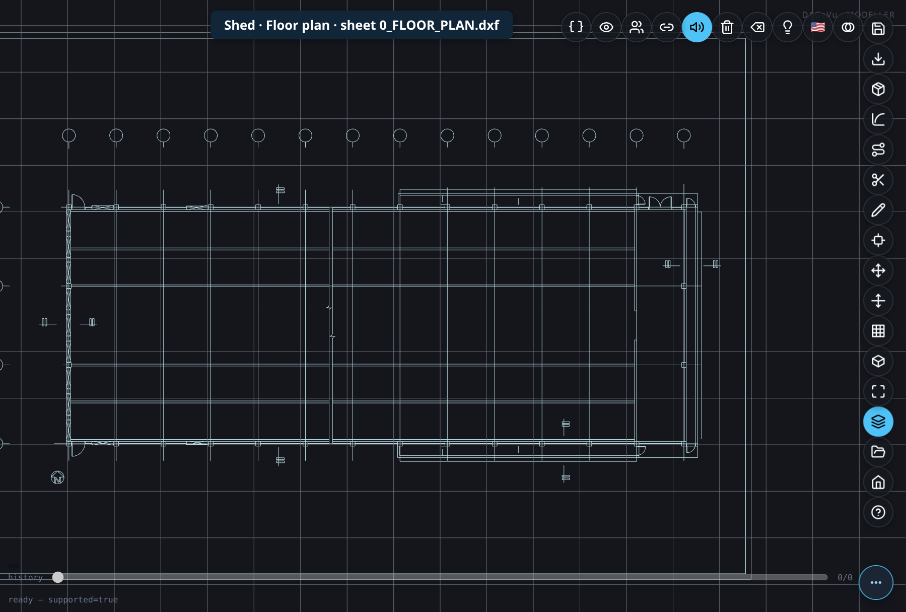

*Picture B1-b · **Shed · Floor plan** · sheet `0_FLOOR_PLAN.dxf`, on its own*

| # | Do | Confirm on screen | Result |
|---|---|---|---|
| B1.3 | Reload the page. Open **only** `3_BEAM_LAYOUT_marked.dxf` | The **beam layout** is drawn, as in picture B1-c | ☐ Pass ☐ Fail |
| B1.4 | Reload the page. Open **only** `4_FOUNDATION_LAYOUT_marked.dxf` | The **foundation layout** is drawn, as in picture B1-d | ☐ Pass ☐ Fail |

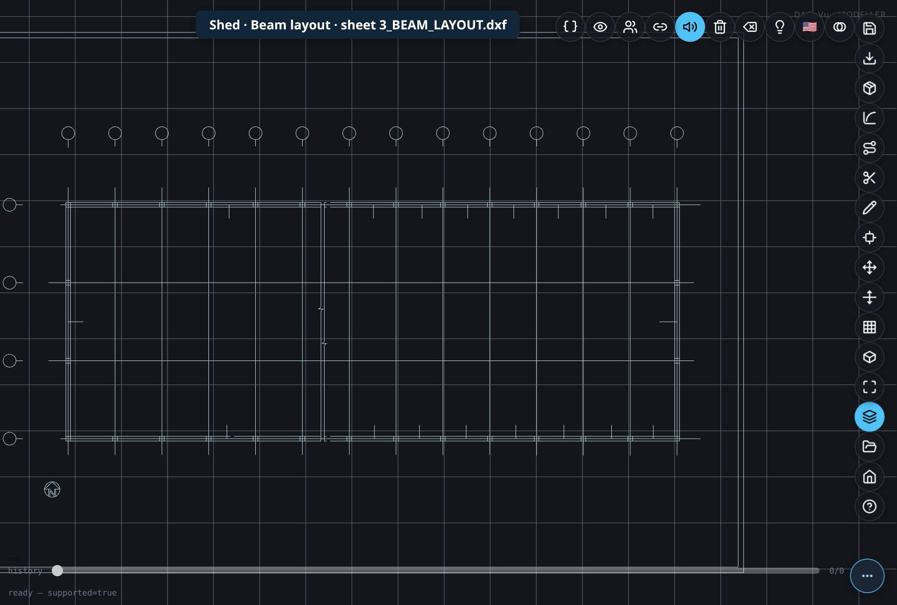

*Picture B1-c · **Shed · Beam layout** · sheet `3_BEAM_LAYOUT.dxf`, on its own*

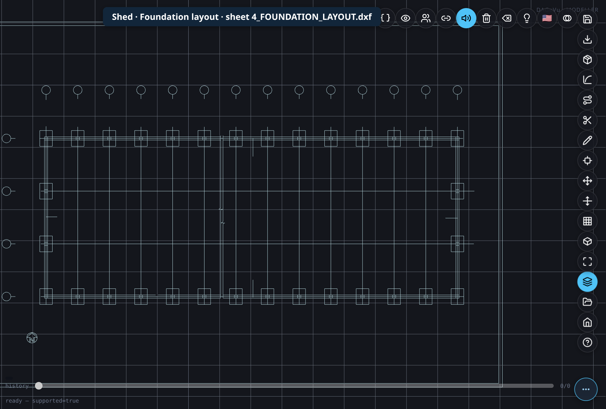

*Picture B1-d · **Shed · Foundation layout** · sheet `4_FOUNDATION_LAYOUT.dxf`, on its own*

An elevation or the section opened on its own shows nothing: it has to stand on a plan. You will see them in the next step, standing in place.

### B2 · Open all nine sheets: the drawings arrange themselves

| # | Do | Confirm on screen | Result |
|---|---|---|---|
| B2.1 | Reload the page. **📂 Open → Open 2D drawings (.dxf)…** and select **all nine** `…_marked.dxf` files at once | The **2D Drawings** panel is titled **9 SHEETS** and lists each file with its role: three PLAN rows, four ELEV rows, the section and the NOTES sheet (picture B2-a) | ☐ Pass ☐ Fail |
| B2.2 | Read the top of the **Drawing metadata** panel | The green badge reads **Qualifies**. Under it a line reads **MISSING SHEETS · no list … INCONCLUSIVE**: that is expected, because these nine files carry no list of the sheets a set should have, so the Modeller cannot count missing ones; it does not stop **Convert**. The **SHEETS** list shows each sheet with its role: three **PLAN**, four **ELEV**, one **SECTION**, one **NOTES** | ☐ Pass ☐ Fail |
| B2.2b | Below the sheets, find the yellow block **ALL DEFAULTS**. It says **14 yellow in 1 group**. Click the **▸** on the group to open it and read the 14 rows. Each row is one setting the Modeller applied because the drawings do not state it: its name and value (for example *building.type = General*, *fan.blades = 4*, *bodies.pair_max_width = 0.5*), then a sentence saying what it does. These rows are conventions, so clicking one does **not** jump to a place on the sheet. To see a whole sheet with its markings drawn on it, press **Sheet** on a sheet’s card; **Esc** (or the ✕) closes it again | You have read all 14 rows and agree with each value for **your** shed. Ten rows end in **[guess]**, the Modeller’s assumptions: *building.type*, *column.top_under_beam*, *fan.blades*, *fan.depth*, *fan.housing_wall*, *net.thickness*, *panel.plane*, *profile.angle_heel*, *profile.angle_mesh* and *section.spacing*. Read those hardest. Write any value you do not accept on the **Notes** line. **Source:** each row’s own sentence says where the value comes from | ☐ Pass ☐ Fail |
| B2.2c | Do nothing to the yellow rows yet: **Convert** (B2.6) works with the 14 rows still open. Optional: press **Accept all** (the button above the group; no key is needed) to mark them as yours. To keep just one, press **✓ Keep this value** at the right of its row | The panel itself says *the defaults stay applied and Convert is not held up by them*. **Keep this value** on a row removes that row and no other (14 becomes 13). **Accept all** takes the yellow count from **14** to **0** and the block empties. Either way the badge stays **Qualifies** and Convert gives the same result (B2.6). If your browser still shows 3 rows left after **Accept all**, it is running an older copy of the Modeller: reload the page (Ctrl+F5) | ☐ Pass ☐ Fail |
| B2.3 | These nine sheets carry every value, so they open **already in place**: the Modeller does not replay anything on opening. Press **Arrange** in the panel to watch them move into place | The status line counts **Step 1/46 … Step 46/46** (one step per setting, the last is *@CUT*). The plans lie on the ground; each elevation stands on the side it shows; the section stands across the shed (picture B2-b). The details sheet is not placed (it is notes only) | ☐ Pass ☐ Fail |
| B2.4 | Fold the **2D Drawings** panel away, close the **Drawing metadata** panel (✕), and orbit with the mouse | You can see the floor plan you looked at in B1 lying flat, with the four elevations standing around it | ☐ Pass ☐ Fail |

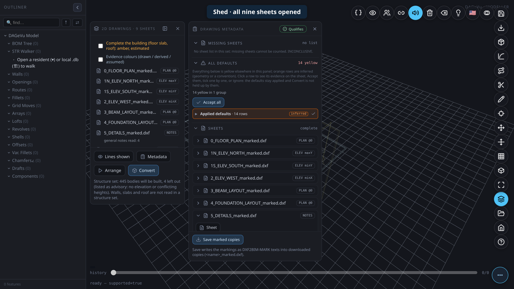

*Picture B2-a · **Shed · all nine sheets opened**: the list of sheets with their roles, and the verdict **Qualifies***

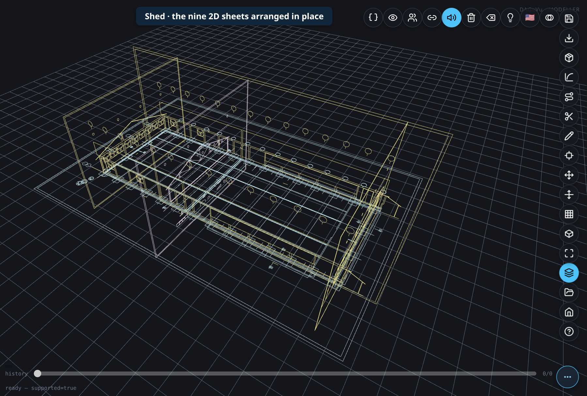

*Picture B2-b · **Shed · the nine 2D sheets arranged in place**: plans flat, elevations and section standing*

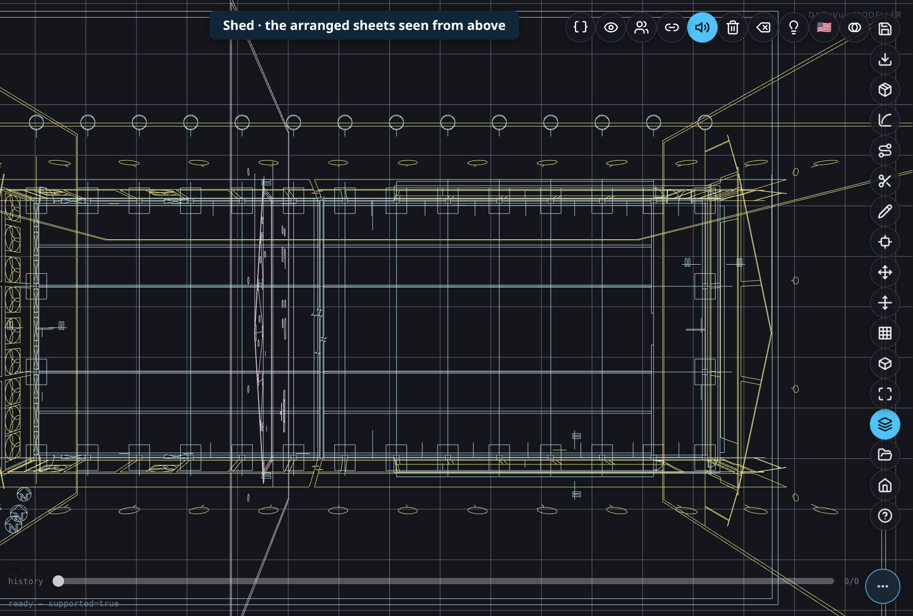

*Picture B2-c · **Shed · the arranged sheets seen from above**: the floor plan again, now with the other sheets around it*

### B2b · Convert the drawings to the 3D Shed

| # | Do | Confirm on screen | Result |
|---|---|---|---|
| B2.5 | If you pressed **Arrange**, wait until the status line stops counting *Step n/46* (or press **Esc** to stop it). Unfold the **2D Drawings** panel and tick **Complete the building (floor slab, roof)** | The box is ticked | ☐ Pass ☐ Fail |
| B2.6 | Press **Convert** (ringed in picture B2-d) | Before you press it, the panel’s status line reads *Structure set: 445 bodies will be built, 4 left out (listed as advisory: no elevation or conflicting heights)*. After it: **Converted: 511 elements (0 door/window fills), 2 openings cut.** The Shed is built in 3D: columns, walls, beams, the roof on its trusses, doors and fans (picture B2-e). The yellow count is unchanged by Convert | ☐ Pass ☐ Fail |
| B2.7 | Orbit around the model | It is the shed as these sheets draw it: one row of columns on each grid line of the floor plan (14 lines along the length, 4 across) | ☐ Pass ☐ Fail |
| B2.8 | **Export → Viewer database (.db)** (ringed in picture B2-f) | A `.db` file is downloaded | ☐ Pass ☐ Fail |
| B2.9 | Open the [front door](https://red1oon.github.io/bim-ootb/index.html), **Buildings / IFC**, then the card **Blank Viewer · Open your own .db file**. In the blank Viewer press **Ctrl+O** (Open Building) and choose the `.db` | The status line reads **DONE — SHED 511 elements**, the same count as the Convert; orbit with the mouse | ☐ Pass ☐ Fail |

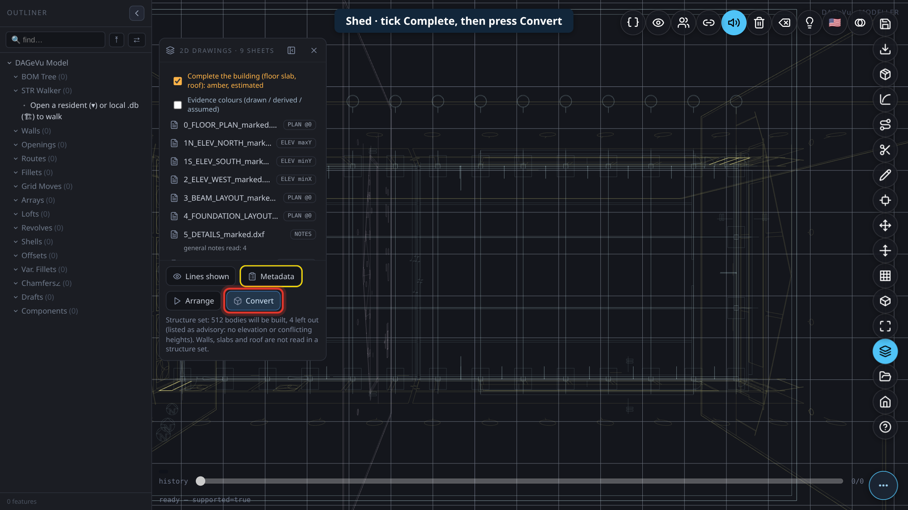

*Picture B2-d · **Shed · tick Complete, then press Convert**, in the 2D Drawings panel*

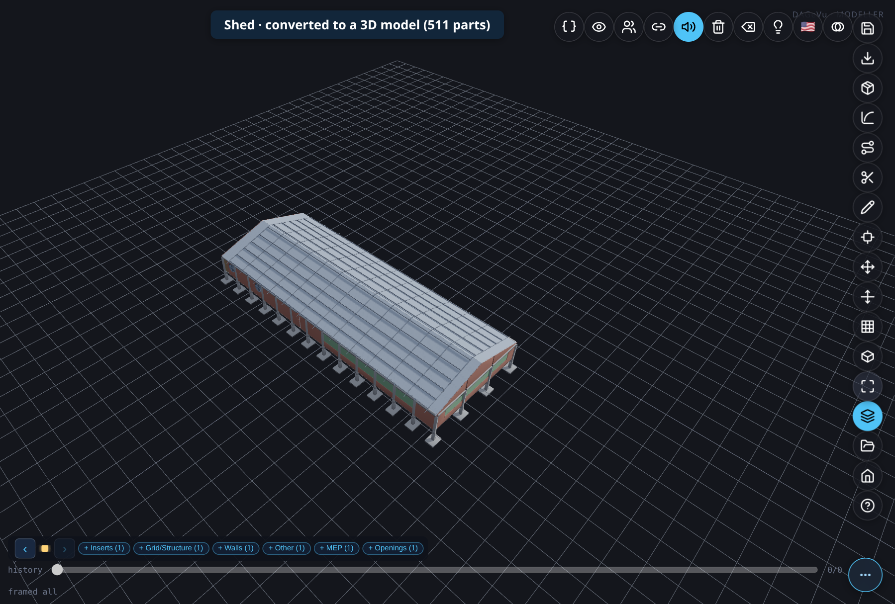

*Picture B2-e · **Shed · converted to a 3D model** (511 parts when these pictures were taken)*

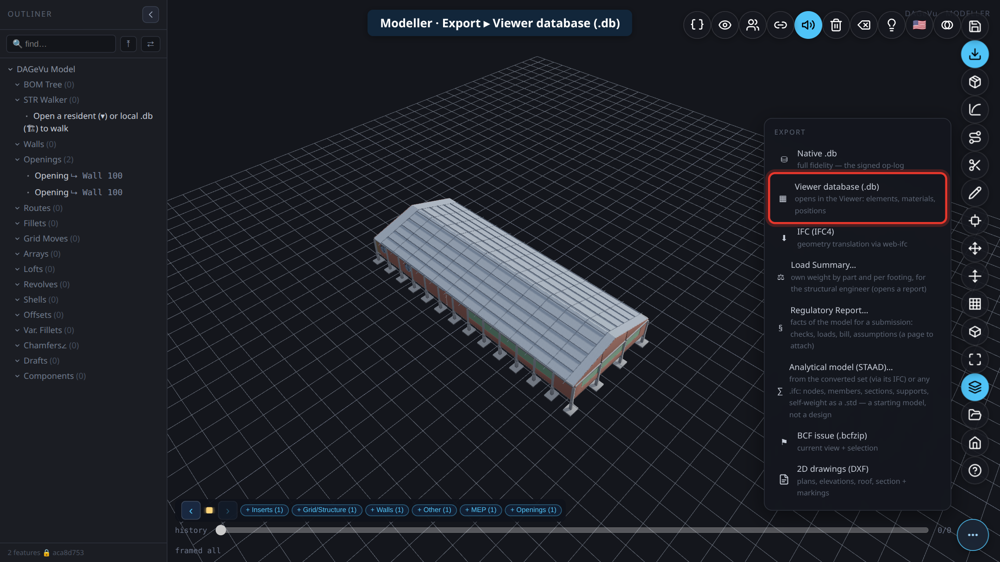

*Picture B2-f · Modeller: Export ▸ Viewer database (.db)*

Full detail of every panel: [DXF2BIM guide](DXF2BIMGuide.md#step-by-step-in-the-modeller).

### B3 · Fit the 4D schedule and the 5D rates to your local scene

The schedule and the cost come from reference files the Viewer ships with. You edit your own copy in the browser. Full detail: [Your own 4D / 5D references](BIMUserGuide.md#your-own-4d-5d-references-rates-durations-sequence).

| Reference | Open it from | Example edit for this test |
|---|---|---|
| **5D Rate Pack** (the active pack, for example `cidb2024_my`) | **Settings → Edit Project JSON → 5D Rate Pack** | raise the rate of one material (for example walls) by 10 % |
| **4D Schedule Template** | **Settings → Edit Project JSON → 4D Schedule Template** | add waiting days after one phase: in **dependencies → within_level**, raise `lag_days` of the *superstructure* rows by 5. (A phase has no length of its own to type: its length is worked out from the parts and the crews) |
| **4D Sequence & Labour Rules** | **Settings → Edit Project JSON → 4D Sequence & Labour Rules** | change one trade’s crew size |

| # | Do | Confirm on screen | Result |
|---|---|---|---|
| B3.1 | Note the Viewer’s total cost (Find panel: `total cost`) and the schedule’s finish date (**Time Machine**, key **T**) | Write both down: ________ / ________ | ☐ Pass ☐ Fail |
| B3.2 | Make the rate edit and the lag edit above. Your copy is saved in this browser as you type | The form keeps your value; a list shown as JSON text must stay valid JSON | ☐ Pass ☐ Fail |
| B3.3 | **Reload the Viewer tab**, so it reads your copies | The building opens again | ☐ Pass ☐ Fail |
| B3.4 | Read the total cost again | It moved in the direction of your rate edit | ☐ Pass ☐ Fail |
| B3.5 | Open **Time Machine** (key **T**). Press **Jump to start**, then **Build** | The finish date moved by the days you added (5 on each edited row); the day counter and the *placed* count rise as the parts go up in order | ☐ Pass ☐ Fail |
| B3.6 | **⬇ Download** your edited files, then **Reset** them | You keep your copies as files; the Viewer is back on the shipped references | ☐ Pass ☐ Fail |

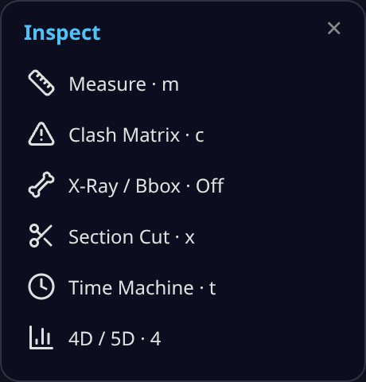

### B4 · Send the model to the ERP as a Project Order

Do this in the **Viewer**, on the Shed you opened in B2.9. (In the Modeller, **ERP ▸ Project Order** prices a building that was *opened* from a database; for a model made from drawings it tells you to use this route.) Full detail: [Send it to ERP](ModellerGuide.md#send-it-to-erp-project-order-variant-vo).

| # | Do | Confirm on screen | Result |
|---|---|---|---|
| B4.1 | Open the **Find** panel and click one group of parts in its list (for example a column type) | The panel shows the group's cost and the button **› ERP** | ☐ Pass ☐ Fail |
| B4.2 | Press **› ERP** | The status line reads *Project Order: 1 lines · contract …  (saved)* and a link **open ↗** appears | ☐ Pass ☐ Fail |
| B4.3 | Press **› ERP** again | *Project Order: 0 lines*: nothing new is added, the order is keyed by the model's name (**SHED**) | ☐ Pass ☐ Fail |
| B4.4 | Click **open ↗**. On the Kernel ERP sign-in page choose **GardenAdmin**, then **Log In** | The ERP opens on the project **SHED** (*BIM: SHED*) with its planned amount; its **Phase**, **Task** and **Project Line** tabs hold the rows from the model | ☐ Pass ☐ Fail |

**Notes (chapter B):** ______________________________________________

---

## C · ERP: the hands-on exercise (GardenWorld Admin)

Use the 12 test projects. The table says, per project, what to make. The products are the **Construction** products of A3.6 (**not** GardenWorld's own); use any GardenWorld vendor, the *Purchase* price list and *HQ Warehouse*. Do not type a price: the order line takes it from the price list, which is the product's standard cost. On each document, set **Project** to the test project (the windows do not ask for a phase).

| Product | Name | Unit | Standard cost (USD) |
|---|---|---|---|
| PWD-04.2 | Brick masonry | M3 | 68.1167 |
| PWD-07.2.2 | RC 1:2:4 column | M3 | 115.5250 |
| PWD-08.1.2 | Reinforcement bar Grade 400 | KG | 0.8333 |
| PWD-10.6 | Steel section | KG | 1.0750 |
| PWD-10.21 | Profiled metal roofing | M2 | 4.8167 |

| Project | Name | Phases ticked (from the pack) | Purchase orders | How far the completed order goes | Issue to the project |
|---|---|---|---|---|---|
| TD_RIVERSIDE | Riverside Tower | 3 of 5 | complete: 29 M3 PWD-04.2; leave in Draft: 7 M3 PWD-04.2 | Paid in full | 3 M3 PWD-04.2 |
| TD_DEPOT | North Depot | 1 of 4 | leave in Draft: 1,008 KG PWD-08.1.2 | — | 92 KG PWD-08.1.2 |
| TD_BRIDGE | Bridge Deck | 2 of 4 | complete: 21 M3 PWD-07.2.2; leave in Draft: 31 M3 PWD-07.2.2 | Half paid | 5 M3 PWD-07.2.2 |
| TD_CLINIC | Clinic Wing | 2 of 4 | — | — | 107 KG PWD-10.6 |
| TD_DATAHALL | Data Hall | 1 of 3 | complete: 1,674 KG PWD-10.6; leave in Draft: 1,116 KG PWD-10.6 | Received | 178 KG PWD-10.6 |
| TD_SUBSTATION | Substation | 1 of 3 | complete: 104 M2 PWD-10.21 | Ordered only | — |
| TD_CARPARK | Car Park | 2 of 3 | — | — | 95 M2 PWD-10.21 |
| TD_SCHOOL | School Block | 3 of 4 | complete: 1,350 KG PWD-08.1.2 | Paid in full | 321 KG PWD-08.1.2 |
| TD_PUMP | Pump Station | 1 of 3 | — | — | 36 KG PWD-10.6 |
| TD_OFFICE | Office Fit-out | 0 of 3 | — | — | — |
| TD_WAREHOUSE | Warehouse 3 | 0 of 3 | leave in Draft: 133 M2 PWD-10.21 | — | — |
| TD_PLAZA | Plaza | 3 of 3 | — | — | 110 KG PWD-08.1.2 |

The products cost at **Standard**: a receipt at any price leaves a product's cost where it is, and every issue raises the project's **Spent** by *quantity × standard cost*. With this table the projects spread across the dashboard's Budget colours (chapter D) instead of all turning red. Five projects (*TD_DEPOT*, *TD_CLINIC*, *TD_CARPARK*, *TD_PUMP*, *TD_PLAZA*) issue a product that was never received, so its on-hand quantity goes negative. GardenWorld allows that; a warehouse that does not allow negative stock refuses those issues.

### C1 · Purchase orders

Make one order per row of the table that has a purchase order, with the quantity it states.

| # | Do | Confirm on screen | Result |
|---|---|---|---|
| C1.1 | **Purchase Order** window, **New**. Header: **Business Partner** *Seed Farm Inc.* (or any vendor), **Price List** *Purchase*, **Warehouse** *HQ Warehouse*, **Project** the test project (the field sits in the header). Save. Tab **PO Line**, **New**: **Product** the table's product, **Quantity** from the table; leave the price as the price list gives it. Save | The line price is the product's standard cost (for example 68.1167 for *PWD-04.2*). The order's **Total Lines** = quantity × price (for example 29 × 68.1167 = 1,975.38) and **Grand Total** is the same (the tax rate is 0). **Source:** the price is the product’s **Price** tab, *Purchase* list (A4.2); multiply it by the quantity yourself | ☐ Pass ☐ Fail |
| C1.2 | **Document Action ▸ Complete ▸ OK** on the orders the table marks *complete*; leave the others as they are | Document status *Completed* on those, *Drafted* on the others | ☐ Pass ☐ Fail |

### C2 · Material receipt

| # | Do | Confirm on screen | Result |
|---|---|---|---|
| C2.1 | For each completed order whose *How far* is *Received*, *Half paid* or *Paid in full*: **Material Receipt** window, **New**. Header: **Business Partner** the same vendor, **Project** the test project. Press **Create lines from**, choose the purchase order, tick its line, **OK**. On the **Receipt Line** tab check the **Locator** is *Default HQ Locator*. Save, then **Document Action ▸ Complete ▸ OK** | The receipt is *Completed* and carries the order's product and quantity. The product’s on-hand quantity rose (menu entry **Storage per Product**: type the name in the menu’s Search box), and in the **Product** window, tab **Costs**, its **Standard** cost did not change | ☐ Pass ☐ Fail |

### C3 · Vendor invoice and payment

Only *Half paid* and *Paid in full* orders (TD_BRIDGE, TD_RIVERSIDE, TD_SCHOOL).

| # | Do | Confirm on screen | Result |
|---|---|---|---|
| C3.1 | **Purchase Invoice and Credit/Debit Note** window, **New**. Header: **Target Document Type** *AP Invoice*, **Business Partner** the same vendor, **Project** the test project. Press **Create lines from**, choose the purchase order (or its receipt), tick the line, **OK**. Save, then **Document Action ▸ Complete ▸ OK** | The invoice is *Completed*; its **Grand Total** equals the order's | ☐ Pass ☐ Fail |
| C3.2 | **Payment and Receipt** window, **New**. **Document Type** *AP Payment*, **Business Partner** the same vendor, **Invoice** the invoice you just made (the amount fills in; the **Project** field disappears once an invoice is chosen, that is normal), **Bank Account** *MoneyBank 1234*, **Tender type** *Check*. For *Half paid* change **Payment amount** to half the invoice total. Save, then **Document Action ▸ Complete ▸ OK** | The payment is *Completed*. On the invoice, **Paid** is ticked for *Paid in full*; for *Half paid* it is not, and the open amount is the other half | ☐ Pass ☐ Fail |

### C4 · Issue materials to site

This is done in two parts, once per test project that has an issue in the table (nine projects). The pack's projects are category *General*, and iDempiere refuses to issue material to a General project (*Project not Work Order or Asset*), so each project is first set to the **Work Order (Job)** type.

| # | Do | Confirm on screen | Result |
|---|---|---|---|
| C4.1 | **Project** window, open the test project. Press **Set Project Type**, choose **Work Order (Job)**, **OK** | The message says *OK*. The project's phases are still there (the Phase tab still lists them) and the **Set Project Type** button no longer accepts another type | ☐ Pass ☐ Fail |
| C4.2 | Menu **Project Management ▸ Issue to Project**. **Project** the test project, **Locator** *Default HQ Locator*, **Product** the table's product, **Movement Quantity** from the last column, **Movement Date** today. Leave **Shipment/Receipt**, **Expense Report** and **Project Line** empty. **OK** | The message says *Created 1* | ☐ Pass ☐ Fail |
| C4.3 | **Project (Lines/Issues)** window, find the project, tab **Issues** | One issue line with the product and quantity, **Document Status** *Completed* | ☐ Pass ☐ Fail |
| C4.4 | Back in the **Project** window, look at **Project Balance** in the header | It rose by *quantity × standard cost*: *TD_RIVERSIDE* 3 × 68.1167 = **204.35**, *TD_BRIDGE* 5 × 115.525 = **577.63**, *TD_DATAHALL* 178 × 1.075 = **191.35**. A project that issues nothing stays at 0 **Source:** the quantity is on the issue line (C4.3) and the cost is the product’s **Standard** cost on its **Costs** tab; multiply them yourself and compare with **Project Balance** | ☐ Pass ☐ Fail |

### C5 · Tick a phase

| # | Do | Confirm on screen | Result |
|---|---|---|---|
| C5.1 | **Project** window, a test project (for example *TD_DEPOT*), tab **Phase**: tick **Complete** on the next phase that is not ticked, **Save** | The phase stays ticked (for *TD_DEPOT* 2 of 4 now); that project's *Done* on the dashboard rises (chapter D) | ☐ Pass ☐ Fail |

**Notes (chapter C):** ______________________________________________

---

## D · The dashboard

The dashboard reads a file that a small read job writes from your iDempiere. Run the job first, and again whenever you want fresh figures (it needs Node.js; the full line with user, password, tenant and role is in the [Developer's note](CapexDashboardGuide.md#developers-note)):

```
BRIDGE_BASE=http://<your-idempiere>:<port> node capex/tools/legacy_snapshot.js
```

It writes the file `capex/legacy_snapshot.json` inside your copy of the repository (the folder from A1.1, next to `index.html`), and ends with a line `§DASH_LEGACY_SNAPSHOT … projects=14 … unavailable=[]` (14 on a fresh GardenWorld). Then open `/capex/index.html?source=legacy` on the server that holds that copy (see [How the dashboard connects to the data](CapexDashboardGuide.md#how-the-dashboard-connects-to-the-data)). Every tile is described in [The dashboard page](CapexDashboardGuide.md#the-dashboard-page).

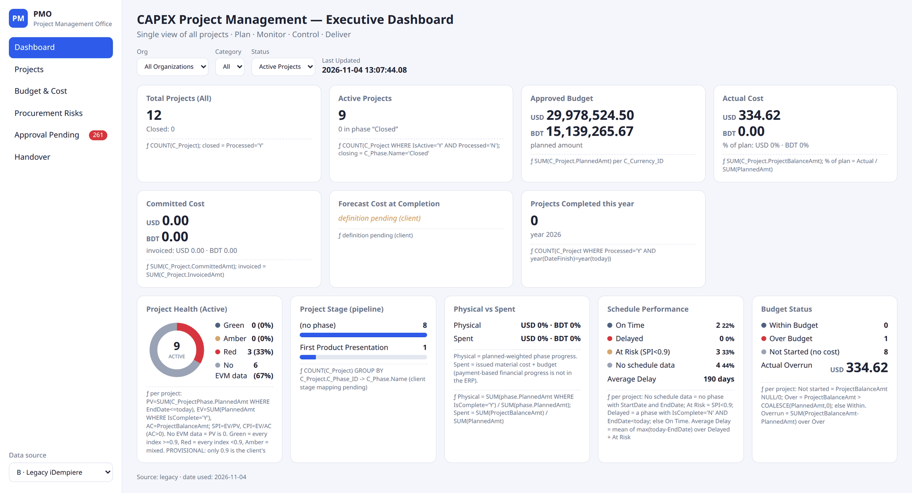

| # | Do | Confirm on screen | Result |
|---|---|---|---|
| D1 | Read **Total Projects** and **Active Projects** | **14** and **14** on a fresh GardenWorld: the 12 test projects plus GardenWorld's own *Standard* and *Landscape* (plus any of your own). **Step into the source:** click the number: the side panel lists the projects behind it, and its row count is the figure. **ƒ formula** under the tile shows the measure (D7) |  ☐ Pass ☐ Fail |
| D2 | Read **Approved Budget** | The sum of the planned amounts, per currency: **USD 4,667.80** (the 12 test projects 4,067.80 plus *Landscape* 600.00). **Step into the source:** click the number; add the **Approved** column of the panel yourself. Press **ERP ↗** on a project: iDempiere’s **Project** window shows the same figure in **Planned Amount**, and it equals the sum of **Planned Amount** on the **Phase** tab |  ☐ Pass ☐ Fail |
| D2b | Read the **Budget** tile (Within / Over / Not started) | **Over** lists *TD_CARPARK* (Spent 457.59 against a plan of 330.00) and *TD_DATAHALL* (191.35 against 181.50), plus GardenWorld’s own *Standard* project if it is still there; the other 7 projects with issues are **Within**; **Not started** is 4: *TD_OFFICE*, *TD_SUBSTATION*, *TD_WAREHOUSE* and GardenWorld’s *Landscape*. The three counts read **Within 7, Over 3, Not started 4** **Step into the source:** click **Total Projects** and read each project’s **Spent**, **Approved** and **Budget** columns: *Over* is Spent above Approved, *Not started* is Spent 0 | ☐ Pass ☐ Fail |
| D3 | Read **Actual Cost** (Spent) | It rose by what you issued in C4: **2,020.45** over the 12 test projects. With GardenWorld’s own *Standard* project (137.70) the tile reads **USD 2,158.15**, **46 %** of plan. **Step into the source:** click the number and add the **Spent** column; each project’s **Spent** is **Project Balance** in iDempiere’s **Project** window (C4.4) | ☐ Pass ☐ Fail |
| D4 | Open **Procurement Risks** in the left menu. Then open a test project's page (D5) and its **Procurement** tab | Left menu: *Open purchase orders* = the 5 you left Drafted, **USD 6,738.39** in total. Project page: the **Supply chain** card shows that project's order at the stage you took it to (*TD_SUBSTATION* Ordered, *TD_DATAHALL* Received, *TD_BRIDGE* Invoiced, *TD_RIVERSIDE* and *TD_SCHOOL* Paid) and lists its receipt, invoice and payment **Step into the source:** each document number in the Supply chain card is a record number: open that receipt, invoice or payment in iDempiere (**Material Receipt**, **Purchase Invoice and Credit/Debit Note**, **Payment and Receipt**) and read its status and amount | ☐ Pass ☐ Fail |
| D5 | Click a number on a tile | The drill panel lists the projects behind it; click a project to open its page | ☐ Pass ☐ Fail |
| D6 | On the project page of *TD_RIVERSIDE*, open the tabs | Overview: Approved **371.25**, 5 phases. The Schedule tab draws the 5 phase bars with the pack’s dates, the first 3 *Complete* **Source:** the project’s **Phase** tab in iDempiere (*Planned Amount*, start and end dates, *Complete*); read them there and compare | ☐ Pass ☐ Fail |
| D7 | Open **ƒ formula** under a tile | The formula is shown; it is the same Performance Analysis measure your iDempiere holds (A2.3) | ☐ Pass ☐ Fail |
| D8 | Change **Layout** (top bar) to *Executive* and **Skin** to *Dark*, then back to *Classic* and *Light* | The look changes. *Executive* shows fewer, re-labelled tiles (*Actual Cost* becomes *Spent so far*) with the same figures (4,667.80 approved, 2,158.15 spent); *Classic* shows them all again | ☐ Pass ☐ Fail | ☐ Pass ☐ Fail |
| D9 | Log in to iDempiere again and read the **Home** tab | The CAPEX goals show the same counts as the dashboard tiles, money in your login’s currency. A goal that has a target (for example *Health Green*, *Schedule On Time*, *Actual Cost*) shows its percentage of the target on the Home tab, not the count | ☐ Pass ☐ Fail |

**Notes (chapter D):** ______________________________________________

---

## Known limits (do not fail a step on these)

- **Proposed figures.** *Forecast*, *Procurement Risks* and *Handover* use definitions we proposed; they await your confirmation.
- **Postings in the Kernel ERP.** Project issues complete but are not yet posted to the books in the browser-based Kernel ERP; in your iDempiere they post as usual.
- **Task dates.** Task dates are kept by the BIM Document plugin; without it, the Schedule tab draws phases only.
- **Standard costing is a PostgreSQL iDempiere set-up.** The products script, and the change of GardenWorld’s accounting schema to Standard costing, are not available in the browser-based Kernel ERP. Applying the script changes how *all* GardenWorld products are costed on that server, so apply it on a test copy, not on a live GardenWorld.
- **This pack in the Kernel ERP.** Loading this test pack into the browser-based Kernel ERP (rather than into your iDempiere) is not available yet.

## Sign-off

| Chapter | Tester | Date | Passed / total | Signature |
|---|---|---|---|---|
| A · Set up | | | / 17 | |
| B · BIM | | | / 25 | |
| C · ERP | | | / 10 | |
| D · Dashboard | | | / 10 | |
