# 2D Drawings → BIM (DXF2BIM) — User Guide
*[← Back to the **User Guide**](USER_GUIDE.md) · [Modeller Guide](ModellerGuide.md) · [Home](index.md)*

Turn a set of 2D CAD drawings (`.dxf`) — floor plans, elevations, a roof plan and a section — into a 3D BIM
model inside the **DAGeVu Modeller**, and export it as IFC4 with real storeys.

It is **deterministic**: the same drawings and the same metadata give the same model, every time. **No AI
runs on your drawings** — the code reads geometry and the labels you (or the drawing) state. Anything the
drawing cannot tell it is listed as a **gap**, never guessed.

> **Status.** Proven end to end on two sets: the Duplex (walls, slabs, roof, openings) and a steel-frame shed
> (columns, beams, footings, cladding, roof members), from raw 2D sheets to a model you can open in the Viewer for
> 3D, 4D and 5D. See [What it does not do yet](#what-it-does-not-do-yet) before you try your own drawings.

---

## The idea in one paragraph

Each 2D sheet is its own flat world. What joins the sheets (which face, which way up, which height, which storey, which
unit) is written on a drawing only for a person. The Modeller **reads it from the drawing where it is there, defaults it
where a convention exists (shown yellow), asks you for it where nothing can decide (shown red)**, checks the whole set
(**Qualifies** or a clickable list of what blocks), and only then converts. The facts you state are stored **inside the
DXF** on its own layer (`DXF2BIM-MARK`), so the file stays a normal DXF any CAD program opens. Every element remembers
the DXF entity (handle and layer) it came from.

---

## Three jobs

| You want to… | Go to |
|---|---|
| **Open a model** that already exists (a `.db` or `.ifc`) | **Open** pill in the [Modeller Guide](ModellerGuide.md) |
| **Turn 2D drawings into a model** | [Step by step](#step-by-step-2d-drawings-to-a-model) below |
| **Edit** the model afterwards | the [Modeller Guide](ModellerGuide.md): sketch, move, cut openings, history |

---

## Step by step: 2D drawings to a model

The walk-through uses a real set, a steel-frame **shed**: 9 raw BricsCAD sheets (3 plans, 4 elevations, a section,
a details sheet), no markings in any of them. The numbers in the text are what that set gives you. Yours will differ;
the order of the steps does not.

**Open:** [red1oon.github.io/bim-ootb/modeller/modeller.html](https://red1oon.github.io/bim-ootb/modeller/modeller.html) (desktop browser).

### 1 · Open the drawings
1. Click **Open** (top of the left toolbar).
2. In the chooser click **Open 2D drawings (.dxf)…**
3. Select **all** the sheets of the set at once and confirm.

Two panels appear: **2D Drawings** (one row per sheet) and **Drawing metadata**. The chip at the top of the metadata
panel is the verdict: **Blocked · 58** on the raw shed, which means 58 things still have to be stated before it can
convert. Nothing is converted yet and nothing has been guessed: every sheet starts as flat as it was drawn (1 unit = 1 mm,
all nine sheets lying metres apart: 9.3 × 2.6 m pile, the floor plan and foundation plan 7.4 m apart).

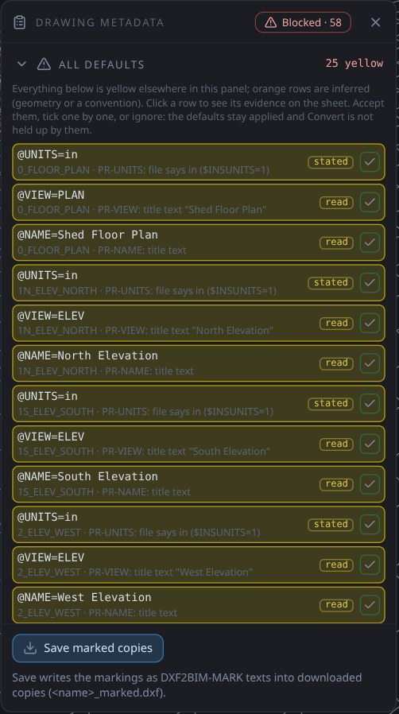

### 2 · Watch the sheets place themselves
A raw set (one with at least one defaulted row) plays an **arrangement** on open; press **Arrange** to see it again.
It runs four phases, 54 steps on the shed: **1 Scale** (inches to metres) · **2 Orient** (plans to their level,
elevations stood up) · **3 Assemble** (onto one grid, each elevation onto its face, North mirrored) · **4 Name**.
A caption at the bottom names the sheet, what is being done and **how sure it is**.

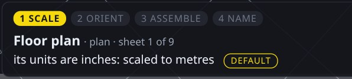

A set that already carries its markings opens **placed**, with no replay.

**The colour legend** (rows in the panel, lines on the canvas):

| Colour | Meaning |
|---|---|
| **Yellow** | defaulted or read from the file: applied, **not yours yet** |
| **Orange** | inferred from the geometry or a convention (e.g. `@LEVEL=0` for plans that state no level) |
| **Red outline** | required: you must state it |
| **Solid** (no tint) | stated by you |

Click any row to see its evidence on the sheet. The yellow rows never silently become facts: **Convert stays
refused until you accept or change them.**

### 3 · Accept what you agree with
Click **Accept all** in the *All defaults* box. On the shed: 25 yellow rows turn solid and the chip drops
**58 → 48**. Press **Convert** now and it refuses and says why (`Convert refused: qualify verdict blocked, 48
blocking item(s)`). The 48 are the things only you can state:

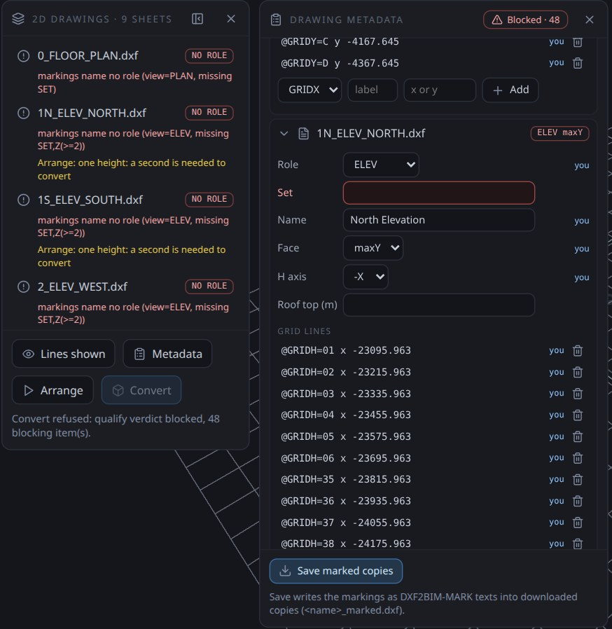

### 4 · State what only you can state
Work down the red-outlined fields. Each fix updates the chip. You never type outside the panel; each value is written
as a marking in the sheet's own copy (see [the metadata](#the-metadata-for-cad-users)).

1. **The set name, once.** Type one word (`SHED`) into **Set** on the first sheet; it fills the same row on all
   eight others. Chip **48 → 45**.

   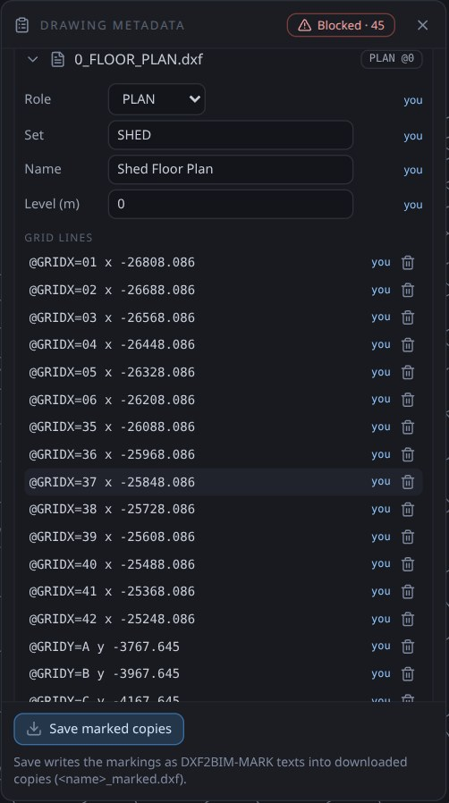

2. **A second height for each elevation and the section.** Each sheet knows one level (ground, drawn at one `y`) and asks
   for a second, with the exact question: *"One height is known: 0 m at y -3919.192. Give a second: read a level text or a
   dimension on this sheet, type it in metres, and the y where it is drawn."* Type the height in the **height** box and the
   y of that line in the next, then **Add**. Five sheets on the shed. Chip: 45 → 48 (the sheets are now usable, so
   what each layer means can now be asked).

   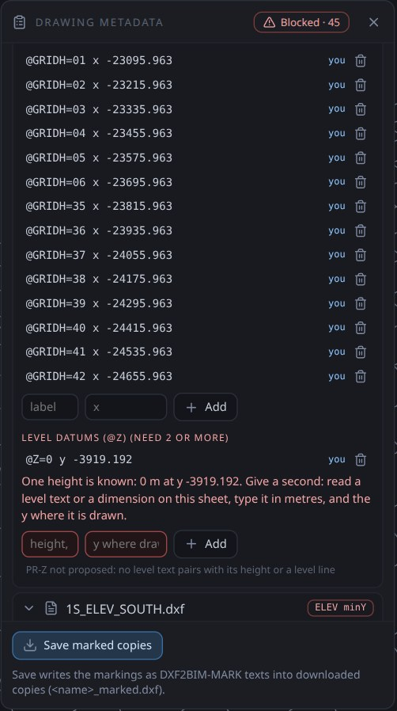

3. **What each CAD layer is.** In **Layers**, for every layer pick what it holds: column, beam, footing, panel, fan, door…
   The same layer name can mean different things on different sheets (`Dim` is a beam on the beam plan and a net on the
   elevations; `0` is a column on the south elevation only). Use the small arrow beside a layer to **split it by sheet**.
   Ten layers on the shed. Chip **→ 0**: the verdict turns **Qualifies**.

   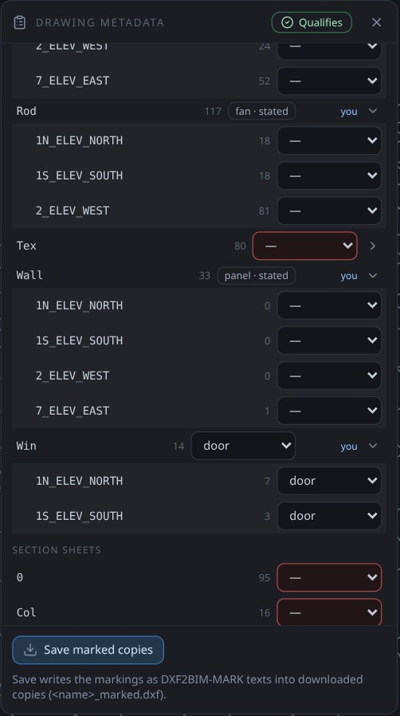

4. **Body heights.** No elevation shows the z-range of beams and footings; the **Body heights** section asks for them
   (metres, from the drawing's detail). Until you state them those bodies are left out, never guessed.

   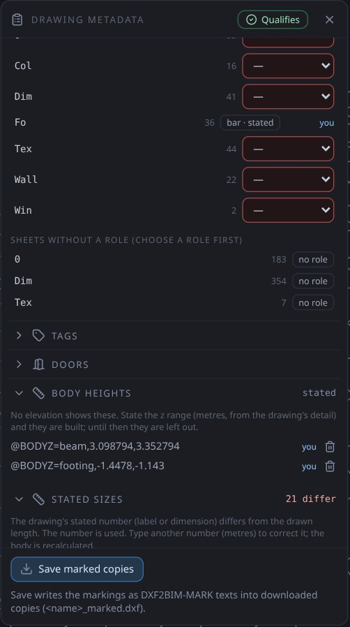

5. **Leave out what is not building.** In **Exclude areas** choose the sheet, click **Drag a box**, then drag across the
   stray drawing on the canvas. On the shed this removes 4 bodies (449 → 445).

   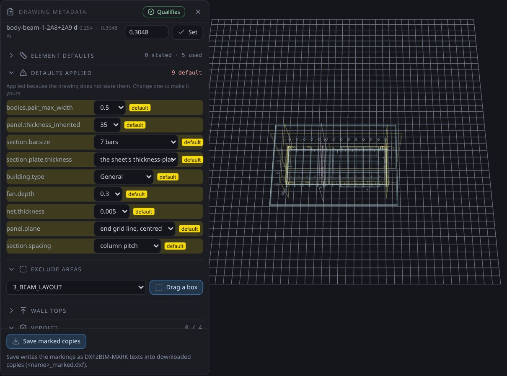

### 5 · Convert
1. Tick **Complete the building (floor slab, roof): amber, estimated** if you want the slab and roof; they are
   estimated, so they show **amber**.
2. Click **Convert**. It is enabled only when the verdict is **Qualifies**, and runs as **one undo step**.

On the shed: **512 bodies**: 96 columns, 35 beams, 32 footings, 41 walls, 1 slab, 2 roof pieces and 168 members; **4
left out**, listed as advisory with the reason (no elevation, or conflicting heights). The status line says so.

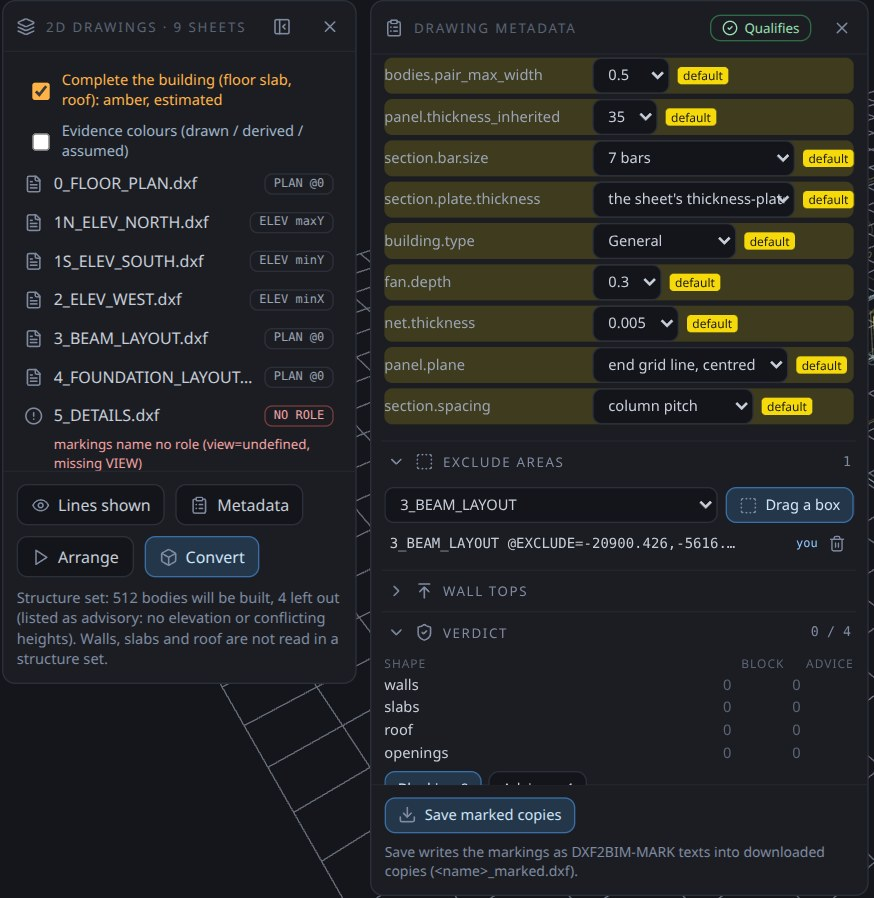

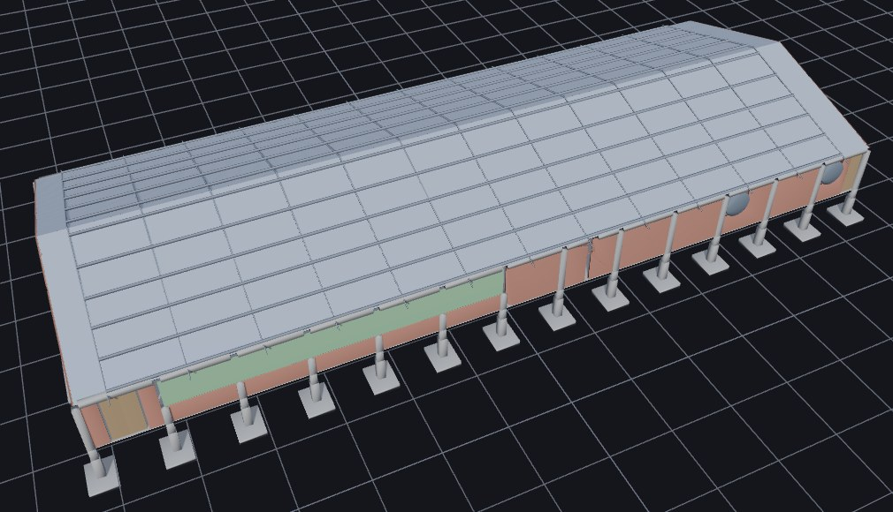

### 6 · Export, then open it in the Viewer
Click **Export** (right toolbar), then **Viewer database (.db)**. The file downloads, and it is the same database the
Viewer's own extractor makes from an IFC of the model (checked: equal to the extractor's output for the same shed;
it opens in the Viewer as the 512-element shed). Open it in the **Viewer** for 3D, 4D (a generated schedule) and 5D
(a rate-based cost estimate with its coverage line).
To carry on authoring, the same file reopens in the Modeller (**Open ▸ Open local .db / .ifc…**): on the shed all
512 elements come back, structure included (the ARC-only filter applies to `.ifc` files, not to this database).

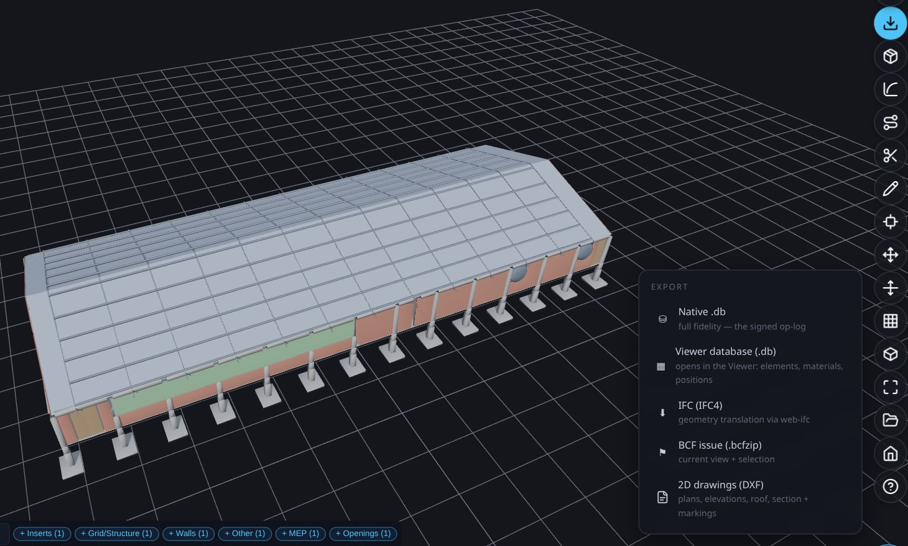

The other entries: **Native .db** (the signed op-log, reopens in the Modeller), **IFC (IFC4)** with a proper spatial
structure, **BCF issue**, **2D drawings (DXF)**.

### 7 · Save the marked copies (optional but recommended)
**Save marked copies** (bottom of the metadata panel) downloads `<name>_marked.dxf` for every sheet with everything you
stated written in. The originals are never modified. Open the marked copies next time and the set opens **placed**, with
0 blocking items and nothing to replay.

### If it says Blocked
The verdict lists **each blocking item** by sheet and field; click one to jump to it. Nothing is built from a guess:
what the drawings do not say is either asked for, left out (and listed), or marked yellow/amber so you can see it was assumed.

---

## If your set already carries markings (the standard set)

Sets written by the standard 2D writer, or marked by a previous run, open already placed and **Qualify** with nothing
to type. The Duplex's standard set is an example:


| | |
|---|---|
|  |  |
| *Front elevation: walls and openings on that face, level datums and height dimensions.* | *Section: slabs and roof cut through, with their levels: this is where slab thickness comes from.* |

**Rules the writer follows** (drafting conventions, stated as choices):

- A floor plan shows **everything the cut plane passes through**, cut at the storey level + 1.2 m.
- Grid lines sit on **load-bearing and exterior wall axes**, never snapped to a module.
- Door arcs: the **hinge** from the IFC door type, the **swing side** from the door leaf, the **radius = leaf width**.
  No hinge data → a `HINGE ?` note, never a guessed arc.
- Slab thickness is read from the **section**, not from elevations.

On the Duplex, **Export → IFC4** gives 96 wall pieces, 2 slabs, 1 roof, 14 doors, 22 windows, 2 storeys.

---

## The metadata, for CAD users

Metadata is plain text on the layer **`DXF2BIM-MARK`**, one marking per text entity, `@KEY=value`. You can type
it in any CAD program, or let the editor write it.

| Marking | Example | Meaning |
|---|---|---|
| `@VIEW` | `@VIEW=PLAN` · `ELEV` · `ROOF` · `SECTION` | what the sheet is |
| `@LEVEL` | `@LEVEL=3.1` | plan level (m) — defines the storey |
| `@FACE` | `@FACE=minY` | which building face an elevation shows |
| `@CUT` | `@CUT=X,2304.25` | where a section cuts (drawing units) |
| `@ROOF` | `@ROOF=6.457` | roof top level |
| `@UNITS` | `@UNITS=mm` | drawing units |
| `@REGION` / `@EXCLUDE` | rectangles | the part of the sheet that is the view / areas to ignore |
| `@LAYER` | `@LAYER=A-WALL,wall` | what a layer means on this sheet |
| `@TAG` | `@TAG=door,D3` | the mark of the element under the text |
| `@SCHEDULE` | `@SCHEDULE=D3,door,900,2100` | a schedule row (size of a mark) |
| `@WALLTOP` | `@WALLTOP=3.1,slab_above` · `@WALLTOP=handle:99,5.695` | interior wall heights |
| `@BY` (suffix) | `@LEVEL=3.1 @BY=user` | who stated it: `user` or `model`; no suffix = stated in the file |

**One rule governs it all:** geometry is what is drawn and dimensioned; a label states only what geometry
cannot decide (which product, which schedule mark, how tall an interior wall is). A difference between the
drawing and its schedule is reported (`GAP:schedule_conflict`), never silently resolved.

---

## What it does not do yet

- **What is built is what the sheets show.** Columns, beams, footings, panels, fans, walls, members, slab and roof come
  from the sheets; anything no sheet shows is **left out and listed** (4 on the shed), never invented.
- **Roof and slab** are estimated when you tick *Complete the building* (amber), not read from a drawing.
- **Door and window schedules**, and roof rules beyond the default, are not read yet.
- **Rectilinear buildings:** skewed and curved walls are reported as gaps.
- **"Any DXF"** is not claimed. A set needs a role per sheet, a second height on each elevation and section, and the layer
  meanings; the panel asks for each and the verdict tells you when it is complete.
- **The component library** (door/window geometry) loads locally; on the public site Convert reports the library as
  unreachable until it is published, so door and window fills may be 0.

---

## For developers

The same pipeline runs in Node (BIMCompiler repo):

```bash
# standard 2D set from a model DB (+ door operations extracted from the IFC by scripts/extractIFC2DB.js)
python3 2D_Layout/python/std2d.py <model_extracted.db> --out 2D_Layout/output/STD --door-ops <door_ops.db>
node tests/dxf2bim/mark_dx_set.js std <door_ops.db>        # metadata from the model (@BY=model)
DXSET=std node tests/dxf2bim/rosetta_dx_shell.js           # basic shapes, checked against the model
node tests/dxf2bim/rosetta_qualify.js                      # the verdict for every test set
```

Specs: [DXF2BIM spec](DXF2BIM_SPEC.md) · [Basic shapes spec](DXF2BIM_BASIC_SHAPES_SPEC.md) ·
[Reader user guide](DXF2BIM_USER_GUIDE.md). Modeller lane spec: `prompts/DXF2BIM_MODELLER_LANE.md` (bim-ootb).
Every check has a deliberately broken control that must fail. Code is MIT licensed.

*Test drawing credit: the American Farmhouse drawings used as an independent test are by Jay Osborne
(freefarmhouse.com), CC BY-SA; they are not included in the repository.*
