# 2D Drawings → BIM (DXF2BIM) — User Guide
*[← Back to the **User Guide**](USER_GUIDE.md) · [Modeller Guide](ModellerGuide.md) · [Home](index.md)*

Turn a set of 2D CAD drawings (`.dxf`) — floor plans, elevations, a roof plan and a section — into a 3D BIM
model inside the **DAGeVu Modeller**, and export it as IFC4 with real storeys.

It is **deterministic**: the same drawings and the same metadata give the same model, every time. **No AI
runs on your drawings** — the code reads geometry and the labels you (or the drawing) state. Anything the
drawing cannot tell it is listed as a **gap**, never guessed.

> **Status: preliminary.** Two paths. (1) **Standard sets** (walls, floor slabs, roof, door and window openings,
> fills): proven end-to-end on the Duplex, which has a 3D answer key. (2) **Structure sets** drawn only in 2D
> (columns, footings, beams, wall panels, fans, nets, doors, trusses): worked on a real farm-shed drawing set, see
> [A building drawn only in 2D](#a-building-drawn-only-in-2d-a-farm-shed). Anything a drawing does not state is a
> **yellow** setting: see [the yellow list](DXF2BIM_Yellow_List.md). Read
> [What it does not do yet](#what-it-does-not-do-yet) before you try your own drawings.

**Videos** (the owner's channel, [youtube.com/@redhuanoon](https://www.youtube.com/@redhuanoon); in the order this guide follows):

1. [BricsCAD 2D to BIM 5D in depth](https://youtu.be/TuTlhO8cCIY) (7:12, 2026-10-28): the whole path on the farm shed: what the drawing does not
   state, the Sheet view, the markings written into your DXF, Convert, one wall edited in small steps, one more bay and where its cost comes from.
2. [2D layout assembled automatically in BIM 3D](https://youtu.be/mwZ6fkngaao) (4:10, 2026-10-22): a raw set opening, each sheet moved by its yellow
   defaults, then what a person states (steps 1 and 3).
3. [BricsCAD 2D DXF to BIM 5D](https://youtu.be/SnqJ7ERxuk0) (5:17, 2026-10-18): the shed from the converted model to the Viewer, 4D and 5D (shed step 7).
4. [BIM 3D to DXF 2D](https://youtu.be/buybl3BWTUw) (1:58, 2026-10-21): a model written out as a standard 2D set ([What a standard sheet looks like](#what-a-standard-sheet-looks-like)).
5. [DXF to BIM 3D to 2D to 3D round trip both ways](https://youtu.be/RaU6A8y6ymw) (4:35, 2026-10-16): the Duplex standard set read back to the model it came from.

6. Can I hand this in? — the submission pack (2026-11-01): the same converted shed, then what you attach to a submission (Load Summary, bill, Regulatory Report).
   <!-- TODO: add the link once the film is published; no URL yet -->

Related, outside this guide: [MEP Walker onto new 2D drawing in BIM](https://youtu.be/tkKP__O1sGU) (1:36, 2026-10-23).

---

## The idea in one picture

1. **A standard 2D set.** Grid lines on the real wall axes (1, 2, 3… across; A, B, C… up, skipping I and O),
   dimension strings in three tiers (overall · grid-to-grid · detail), level marks, door swings, window sills.
2. **Metadata.** Each sheet says what it is (plan of which level, which elevation face, roof, section) and the
   few facts geometry cannot decide (units, wall tops, door sizes from the schedule). The metadata lives
   **inside the DXF**, on its own layer, so the file stays a normal DXF any CAD program opens.
3. **A verdict.** Before anything is built, the drawings are checked. Green = *Qualifies*. Red = a clickable
   list of exactly what is missing or inconsistent.
4. **Convert.** One click builds the model. Every element remembers the DXF entity (handle and layer) it came from.

---

## What a standard sheet looks like


*Ground floor plan of the Duplex, written from the model by the standard 2D writer. Grid bubbles at both ends;
dimension strings: overall (8800 / 17800), grid-to-grid (4192 + 4192, 7620 / 2143 / 7620) and detail (walls
and openings). Every dimension is a real CAD dimension measured between its two points — never typed text.*

| | |
|---|---|
|  |  |
| *Front elevation: walls and openings on that face, level datums and height dimensions.* | *Section: slabs and roof cut through, with their levels — this is where slab thickness comes from.* |

▶ Video: [BIM 3D to DXF 2D](https://youtu.be/buybl3BWTUw) (1:58) · [the round trip both ways](https://youtu.be/RaU6A8y6ymw) (4:35).

**Rules the writer follows** (drafting conventions, stated as choices):

- A floor plan shows **everything the cut plane passes through** — cut at the storey level + 1.2 m.
- Grid lines sit on **load-bearing and exterior wall axes**, never snapped to a module.
- Door arcs: the **hinge** from the IFC door type (left/right hand), the **swing side** from the door leaf, the
  **radius = leaf width** (not the frame). No hinge data → a `HINGE ?` note, never a guessed arc.
- Slab thickness is read from the **section**, not from elevations.

---

## Step by step in the Modeller

**Open:** [red1oon.github.io/bim-ootb/modeller/modeller.html](https://red1oon.github.io/bim-ootb/modeller/modeller.html) (desktop browser).

### 1 · Open the drawings
**📂 Open → Open 2D drawings (.dxf)…** and select **all** sheets of the set at once (plans, elevations, roof,
section). The **2D Drawings** panel lists each sheet with its role; the canvas shows each sheet placed in 3D —
plans at their level, elevations on their face, the section on its cut plane.

A raw set (no metadata yet) **plays its arrangement** as it opens: each sheet first lies where it was drawn, then
moves to where its markings and yellow defaults put it, one value at a time, so you can see what each value does.
**Arrange** in the 2D Drawings panel plays it again; **Esc** stops it. ▶ Video: [2D layout assembled automatically in BIM 3D](https://youtu.be/mwZ6fkngaao) (4:10).


### 2 · Check the metadata
Press **Metadata**. The **Drawing metadata** panel shows, per section:

| Section | What you set | Notes |
|---|---|---|
| **Sheets** | role (plan / elevation / roof / section), level, face, cut | a plan's level defines a storey |
| **Units** | mm, m, in, ft | **you confirm** — the file header is shown ("file says mm") but never applied by itself |
| **Layers** | which layer holds walls, doors, glazing, dims, grid, levels; or ignore | templates for common layer standards |
| **Tags** | click an element on the canvas, pick its mark / type | e.g. a door mark that links to the schedule |
| **Exclude areas** | drag a box around decking, furniture, landscaping | its contents are ignored |
| **Wall tops** | "walls stop under the slab above", or a height per wall | interior wall heights are never visible in elevations |
| **Verdict** | live result | click an item to zoom to it on the drawing |

Every value shows **where it came from**: *from file*, *from model*, or *you*.


#### 2a · See a whole sheet: Sheet
Open a sheet's card in the **Sheets** section and press **Sheet**. The sheet fills the canvas beside the panel,
**as it was drawn**, with its metadata drawn on top:

- a **grid line** or **level datum** you stated is a dashed line through its own position, labelled `@GRIDX=A`,
  `@Z=3.1` …; a tag sits at its point, an exclude area is drawn as its box;
- values that have no place on the sheet (units, role, name, set) are listed in a **markings box**;
- every **yellow row still open** in the list is a ring at the spot the editor read it from (yellow = stated or
  read, orange = inferred). Tick the row in the list and its ring turns into a marking, while the view stays open.

A sheet that already has its own border and title block keeps them. A sheet without one (for example a sheet
written by the model's own 2D export) gets an **ISO border and title block** at the paper size and scale that hold
it (1:100 first, then 1:200, 1:500, 1:50, on A4 to A0); what the drawing does not say (date, owner, approver,
revision) is shown in yellow as *not stated*, never filled in. **Save SVG** saves the view at paper size, **Print**
prints it, and **Markings** switches the drawn metadata off for a clean copy. Wheel to zoom, drag to pan, **Esc**
or ✕ to close; nothing you do in the view changes the drawings or the metadata.

**What the view draws** (bim-ootb §D101):

- **Every dimension, even when the DXF does not link it to its picture.** On the shed's 9 sheets all 147 dimensions are drawn: 111 through their own stored
  pictures (found by their definition points), and 36 (North and South elevations, which have no stored picture) drawn from their own points with the value in the file's
  own dimension style. Those 36 values are small next to the sheet's texts; that is the file's style, not a fault. A dimension that cannot be matched is left out and counted, never drawn from a guess.
- **CAD codes read as symbols:** `%%c` shows as Ø, `%%d` as °, `%%p` as ±.
- **The drafter's geometry, as given, one scale both ways.** The view does not rescale a detail to match its written values. A detail sheet that is drawn **not to scale stays not to scale**
  and the written values govern: on the shed's details sheet a span written `10'-0"` is drawn about 1.7 times its scale and the cross-sections `12"` about 4.2 to 4.5 times (§D102).
- **A details / notes sheet shows NOTES.** A sheet that states notes but draws no body shows the chip **NOTES** (not a red *NO ROLE*) and "general notes read: n" in both panels,
  and it is not counted as needing input.

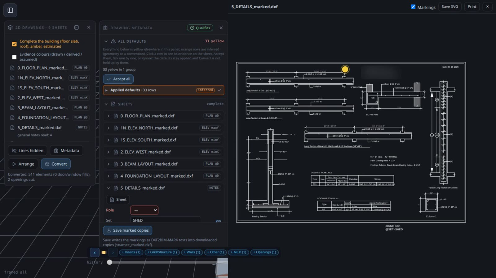

### 3 · Raw drawings: fill in what is missing
A drawing without metadata opens with **red** fields and the verdict **Blocked**. The editor lists
**suggestions** it can prove from the drawing (e.g. a title text "GROUND FLOOR PLAN" → role = plan) — **nothing
becomes metadata until you tick it.**


Click any verdict item to jump to it:


The rest of this step is written from a first-time walk through the real Modeller (2026-10-22) on the Duplex
standard set with every marking removed (8 sheets, the plain drawings a CAD program would hand you). The walk
reached **Qualifies**, and **Convert** built 135 elements with 36 openings cut, the same numbers as the editor's
own end-to-end check. (Today the same set converts to 87 elements with 36 openings cut: a drawn wall line is now
one wall, not one piece per segment.) The counts below are the clicks and typed values of that walk.

#### 3a · What yellow means
A **yellow row** is a value the editor read from the drawing (or a default it applied) that is **not yours yet**.
Each row names its source: `PR-UNITS: file says mm`, `PR-GRID: grid line 190 + label 1`, `PR-Z: level text B5 +
level line B3`. Tick one row, tick a whole group, or press **Accept all**; the value then shows **you**. When the list holds both
values the file states or a text names (stated / read) and values inferred from geometry or a convention (orange rows), **Accept all** is
replaced by two buttons, **Accept stated + read** and **Accept inferred**: check the orange rows first (a click on a row shows its evidence on the sheet). Ignoring a yellow default
is allowed (the default stays applied and is listed); ignoring a yellow *suggestion* leaves the field empty.

The list grows as you answer. On the plain Duplex set it came in four rounds (walk of 2026-10-22; the editor has
since read more from the titles, so today's rounds are larger: 24 rows in round 1, 66 in round 2):

| Round | Appears after | Rows | What they are |
|---|---|---|---|
| 1 | opening the sheets | 10 | units of each sheet (8), the section's view and name (2) |
| 2 | you choose each sheet's role | 49 | grid lines on the plans and elevations, level datums (`@Z`) from level texts, elevation faces, the section cut |
| 3 | you type the set name once | 7 | the same set name for the other sheets |
| 4 | you type the plan levels | 5 | the horizontal axis (`@HAXIS`) of each elevation and the section, fitted to the plan grid |

The list opens with its count (round 2 of the plain Duplex: `66 yellow in 6 groups`) and the accept buttons, **above** the rows. The rows come in one
group per rule (*Grid lines*, *Level datums*, *Elevation faces* ...), closed: the header gives the rule, its row count and the
sheets, and one tick accepts exactly that group. A grid group states its measurement in the header (for each of `GRIDX` /
`GRIDY` / `GRIDH`: the label range and the bay sizes in drawing units), so a badly formed grid shows before you accept it. For
the set-wide values (units, set name, roof) the header names the one value when every sheet agrees (`@UNITS=mm on all 8
sheets`); a sheet that disagrees is shown on its own, open, marked *disagrees*, and the group tick leaves it.

**The section cut.** When the section's title states where it cuts (`SECTION A-A AT X=2304.25`), the cut is read from
the title (*Section cut from the title*, a read row) and nothing else is looked at. Only when the title does not
say it does the editor pair the two section labels on the plan (*Section cut*, an **orange** inferred row): check
that one on the sheet before you accept it. (Until 2026-10-23 the pairing ran first and was wrong on both standard
sets walked: it took two grid bubbles with the section's letter. Since then, on the Duplex and the three-storey
office, the cut, the roles, the plan levels and the roof tops read from the titles equal the model's own, 0 wrong:
`W-TITLE`, `DXF2BIM_FOUNDATION_LANE.md` §D46.)

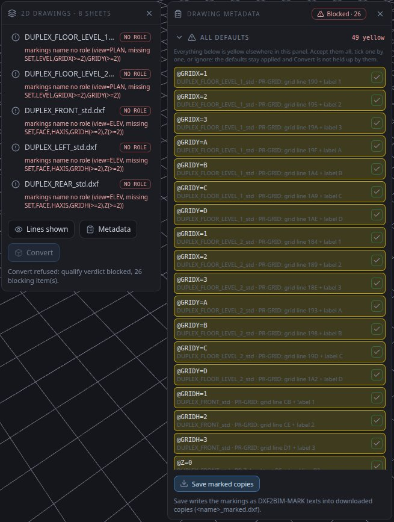

#### 3b · The sheet facts and datums: what you state, and how
| Marking | What it is | Where it comes from in the walk | How you give it |
|---|---|---|---|
| Role (`@VIEW`) | plan, elevation, roof plan or section | the title, read without its scale or a trailing note (`FRONT ELEVATION  1:100` → elevation) | accept; pick from the list only when no title says it |
| `@SET` | the name of the set | nothing in the drawing; when no sheet names it, the placeholder `BUILD-NAME` is offered (orange) | type once and the other sheets get it as yellow; or accept the placeholder to go on: it stays marked *default* until you type the real name on any one sheet, which replaces it on every sheet |
| `@UNITS` | drawing units | the file header (`$INSUNITS`), shown as yellow | accept |
| `@LEVEL` | a plan's storey level, metres | the plan title (`LEVEL 2 PLAN (FFL +3.100)` → 3.1) | accept; type it only when no title states it |
| `@ROOF` | the roof top, metres | a roof-top text on the sheet (`T/ROOF +6.457`, `TOP OF ROOF ...`); two different values on one sheet are not proposed | accept; type it where no text states it |
| `@Z` | a level datum on an elevation or section: a height in metres at a drawing y | level texts paired with their level lines; else the heavy ground line as z 0; the second height from the drawing's own vertical dimension (orange: a dimension the CAD measured, not typed over, at dimension scale 1) | accept; only where no such dimension exists: type the height and **Pick** its line on the sheet (see the shed) |
| `@GRIDX` / `@GRIDY` / `@GRIDH` | which grid label sits on which line | grid lines with their labels, or dimension ticks | accept |
| `@FACE` | which side of the building an elevation shows | the sheet name or title (FRONT, LEFT, SOUTH...) | accept |
| `@HAXIS` | which plan axis runs left to right on an elevation | fitted to the plan grid after the plan levels exist | accept (round 4) |
| `@CUT` | where the section cuts the plan | the section title (`AT X=2304.25`); else the section labels on the plan (orange) | accept; check an orange one on the sheet |

On the walk of 2026-10-22 the Duplex needed 7 role picks and 11 typed values (set name 1, levels 3, roof top 6,
cut 1). Since §D46 (2026-10-23) the roles, the levels, the roof tops and the cut are read from the titles and texts
(W-TITLE: 8 of 8 roles by **Accept all** alone, 0 wrong), so the set name is the one value left to type for the
sheets, and since §D98 (2026-10-31) even that one can be the accepted placeholder `BUILD-NAME` until you name the set. The whole walk has not been re-counted since.

#### 3c · Wall tops
After the sheets are complete, **Wall tops** lists the interior walls no elevation shows (17 on the ground floor,
27 on the first floor of the Duplex). Tick **Interior walls run to the slab above** once per plan; the list
empties. A wall that stops lower than the slab can still be given its own top in the field beside it.

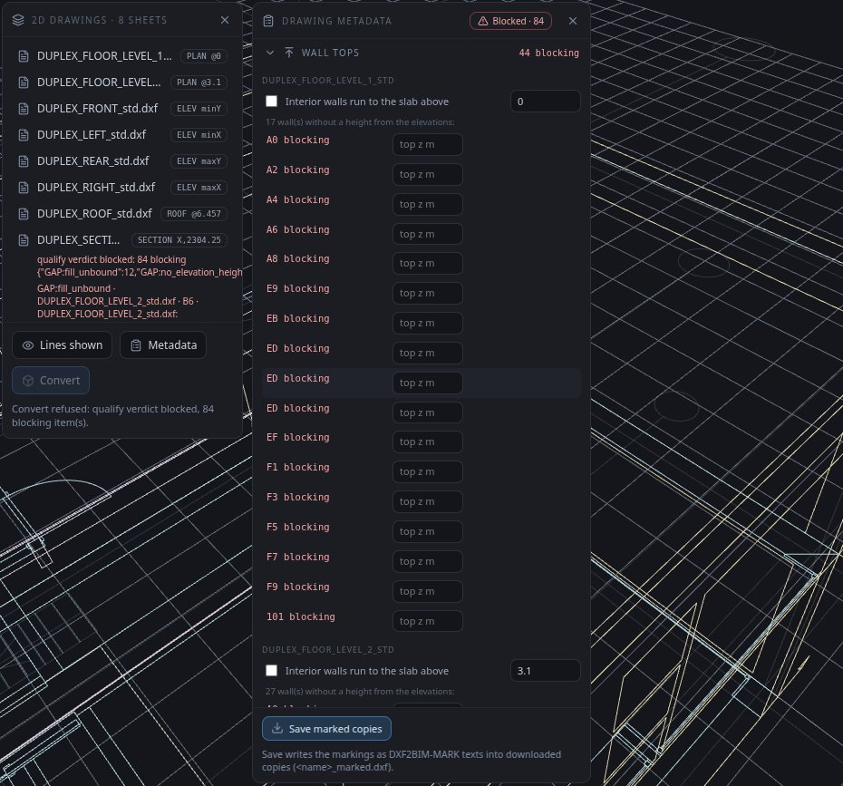

#### Doors and windows tagged by width
Give each row of the drawing's **Door schedule** and **Window schedule** once, in the **Doors and windows** section
(mark, width, height; a window row also its sill). When a plan carries a door schedule as text, its rows are
proposed from that text (*Schedule rows*, a read row) and you only accept them; otherwise type them. The editor
then proposes one **orange** row per schedule row, for example `@TAG=door,D1 on 6 doors`: every untagged door (or
window) whose drawn width matches exactly that row's width. One tick tags them all. A width that two rows share is
not proposed (it is listed with both marks); tag those one by one. Measured: Duplex doors 4 rows, 4 clicks, 14 tags
(W-TAG-WIDTH); Duplex windows 10 tagged in 3 clicks, 4 left because two 819 mm rows differ only by their sill
(W-WIN-TAG-WIDTH); on a clinic set whose door types share one leaf width, 234 doors are listed, never guessed.

#### 3d · Blocking items: what they mean and what to do
A **blocking** item stops Convert. An **advisory** item does not. The verdict lists them; click one to zoom to it.
What blocked the plain Duplex after the sheets were complete, and how each was cleared:

| Item | Meaning | What to do |
|---|---|---|
| `QF:elev_roof_unstated`, `QF:elev_height_dim_missing` | an elevation has no roof top | type `@ROOF` on that elevation |
| `GAP:no_elevation_height` on `A-WALL-PRTN` | interior walls with no height | Wall tops (3c) |
| `GAP:no_elevation_height` + `GAP:no_host_cut` on `A-DOOR` | a door with no schedule mark: its height is unknown and its opening is not cut | Doors (below) |
| `GAP:fill_unbound` | a window with no product: the plan cannot tell three windows stacked at one position apart | Tags, picked on an elevation (below) |
| `QF:layer_unmapped` | a layer the set does not read | Layers: choose what it holds, or *ignore* |

**Doors.** The plain drawings carry the door widths (the drawn leaf) but **no door heights**: you bring them from the
door schedule. In **Doors**, add one schedule row per door type (mark, width, height in mm, then **+**), or accept
the rows read from a schedule text. Then tick the **Tags by width** rows (above): each tags every door of its width.
For a door left over (a width two rows share, or a width no row has), **Tag doors**: click the door in the list (the
canvas zooms to it), click the door's **arc** on the canvas, pick the mark, **Tag**. Click the arc itself: a click
beside it, or on the leaf line, answers *No door here*. The Duplex has 14 doors of 4 widths: 4 schedule rows and 4
clicks (on the walk of 2026-10-22, before tags by width: 14 tags, about 4 clicks per door).

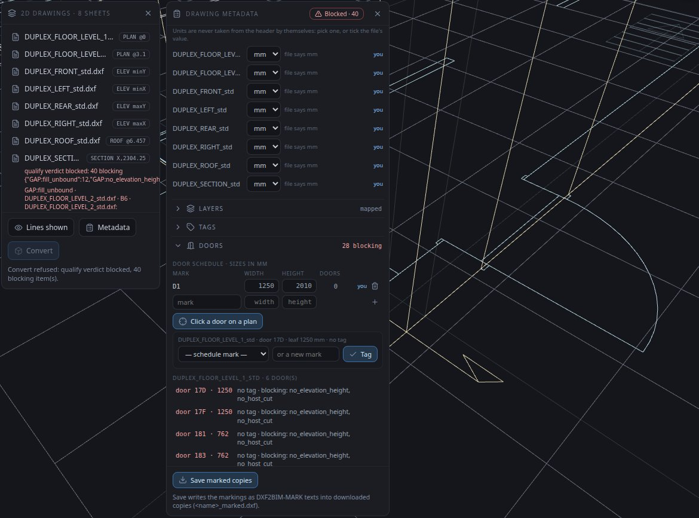

**Stacked windows.** In **Tags**, turn on the Tag tool, turn the view to face an elevation, click a window's glazing
there (the plan position and height come from the elevation), choose the product, **Add**. The product list holds
every window family of the library (37 on the walk) by name, without sizes: choose the one whose name matches the
drawn width (on the Duplex, the 819 mm family). A wrong family is reported as `GAP:type_size_mismatch` and the tag
can be removed with its bin icon. When the library holds several types of one size, the window takes the library's
first one as an **amber default** (listed as `GAP:type_defaulted`, advisory: it does not block) and you correct it
per window with a tag; on the Duplex that first type is right for 4 of the 12 stacked windows (`@DEFAULT=type.size_tie,none`
on a sheet turns the default off).

When the last blocking item is cleared the badge reads **Qualifies** and Convert is enabled.

#### 3e · How long the plain Duplex took
Clicks and typed values of the walk of **2026-10-22**, from opening to Qualifies: 3 to open, 4 *Accept all*, 7 role
picks, 11 typed sheet values, 2 wall-top ticks, then 83 actions for the 14 doors (16 for the schedule rows) and 41
for the 12 stacked windows. The doors and windows were about four fifths of the work. The machine time between
steps was under 2 s each (a verdict re-run takes 0.2 to 0.8 s on this set).

What changed since, step by step (each measured by its own check; the whole walk has not been re-counted): the
roles, levels, roof tops and cut are read from the titles (7 role picks and 10 of the 11 typed values gone); the
14 doors are tagged by width in 4 clicks after their 4 schedule rows; 10 windows are tagged by width in 3 clicks.

### 4 · Save the marked copies
**Save marked copies** downloads `<name>_marked.dxf` for every sheet, with your metadata written in. The
originals are never modified. Next time you open the marked copies, everything is already filled.

### 5 · Convert
**Convert** is enabled only when the verdict is **Qualifies**. It builds walls, floor slabs, the roof, cuts the
door and window openings, and places the door and window fills from the component library — as **one undo
step**.

Two choices sit above **Convert**. **Evidence colours (drawn / derived / assumed)** shows each body by how it is
known instead of its material: drawn as is, **derived** (amber: computed from drawing evidence plus a stated
convention) or **assumed** (red: no drawing evidence for it). **Firm catalogue: Load** takes your office's catalogue
(made from one of your own IFC models with `modeller/tools/catalogue_from_ifc.js`): a wall or slab of a thickness
in the catalogue gets that thickness's most frequent material, a door its type, with the count stated. A file
that does not fit is refused with the reason, never half-loaded; **Clear** goes back to the reference materials.


#### 5a · Properties: what a part carries
Click a converted part and the **Properties** panel opens beside the tool rail. It shows exactly what that part's IFC will carry: the IFC class, name,
label, predefined type and material, then the drawing evidence in groups — **Source** (sheet, handle, layer, how it is known), **Size** (each stated size, in
metres, with its base and top), **Drawing notes** (each note beside the sheet and handle it was read from) and **Schedule** (the schedule row it matched). A value
with no content is not shown, because the IFC does not write it. A part you drew yourself, or one from an opened IFC, says *no drawing evidence: this part was not
converted from the 2D set*. With several parts selected it shows the last one picked; **×** closes it until the selection changes. On a small screen with the
metadata editor open there is no room beside it, so it opens on top of the editor.

### 6 · Export IFC
**Export → IFC4.** The file has a proper spatial structure (Project → Site → Building → Storeys) and every
element contained in its storey. On the Duplex standard set (measured 2026-10-26): 44 walls (one wall per drawn
wall line), 6 slabs, 1 roof, 14 doors, 22 windows, 36 openings, 2 storeys.

**Export → Viewer database (.db)** builds the same IFC4 and runs it through the extractor the Viewer uses, then
downloads `<name>_extracted.db`. Open that file in the **Viewer** (**Open → local .db**) for 3D, 4D and 5D.

---

### 7 · Load Summary (for your structural engineer)
**Export ▸ Load Summary…** opens a report in a new tab: *what your drawings tell the structural engineer. Not a design check.*

- **Own weight by part**: every converted part weighed from its drawn size and material, with the unit weight it used and where that comes from
  (BNBC 2012 Part 6 Ch 2, Tables 2.2.1 / 2.2.2: concrete 22.8 kN/m³ + 0.63 per 1 % reinforcement, brick 18.9, steel 77.0, galvanized roof sheeting 0.096 kN/m² for 0.8 mm).
  Green = a cited table value, amber = a best-effort default to confirm (the reinforcement percentage and the roof sheet thickness are not drawn).
- **Load on each footing**: each part goes once to the nearest footing in plan; a ground-floor slab bears on the ground. The pressure on the soil is shown;
  the soil's capacity is a red field until a soil report gives it.
- **Shape for wind and earthquake**: length, width, eave and ridge height, roof slope, read from the model.
- **What only you can state** (red, never guessed): fan, door and netting weights, the size of members the drawing does not size, the site district, the soil capacity.
- **Inputs**: edit the values and facts on the page and press **Apply** to recompute; **Download inputs** keeps them; to keep a value with the drawings,
  state it in the Modeller as `@DEFAULT=<key>,<value>`. **Print / Save as PDF** for the engineer.

On the farm shed (2026-11-01, Complete ticked): 5,275.1 kN of own weight from 480 parts (537.9 t), 1,737.9 kN on the 32 footings, 3,537.2 kN of ground slab on the
ground; the heaviest footing carries 120.0 kN (64.6 kPa); 32 parts are listed as not weighed (12 members with no section drawn and none to assume, 13 fans, 4 doors,
3 nettings). Members with no section on their label take the drawing's most common section of the same kind, marked *assumed* (91 of the shed's 156 bars).
A beam is sized along its own axis, so a beam drawn at an angle weighs the same as one square to the grid.
It does not compute live load, wind, earthquake or member strength: those need the stated site, soil and an engineer's analysis.

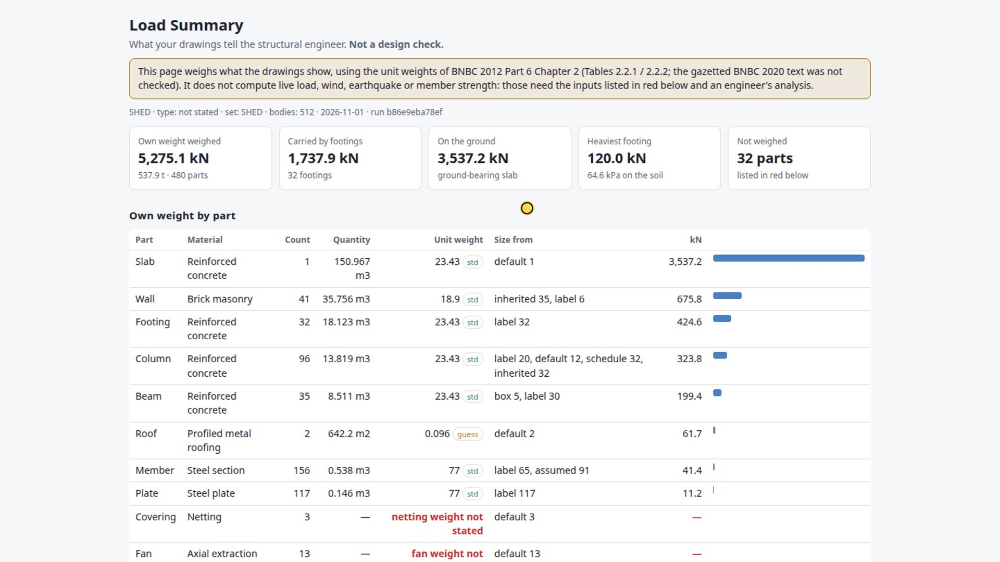

### 8 · Regulatory Report (what you hand in)
**Export ▸ Regulatory Report…** opens a short form of the facts a model cannot give (plot area, setbacks, occupancy, district, soil bearing capacity …,
ten in all). A box left empty makes the report say *not stated*; nothing is guessed. Pick the rate pack and press **Build report**.

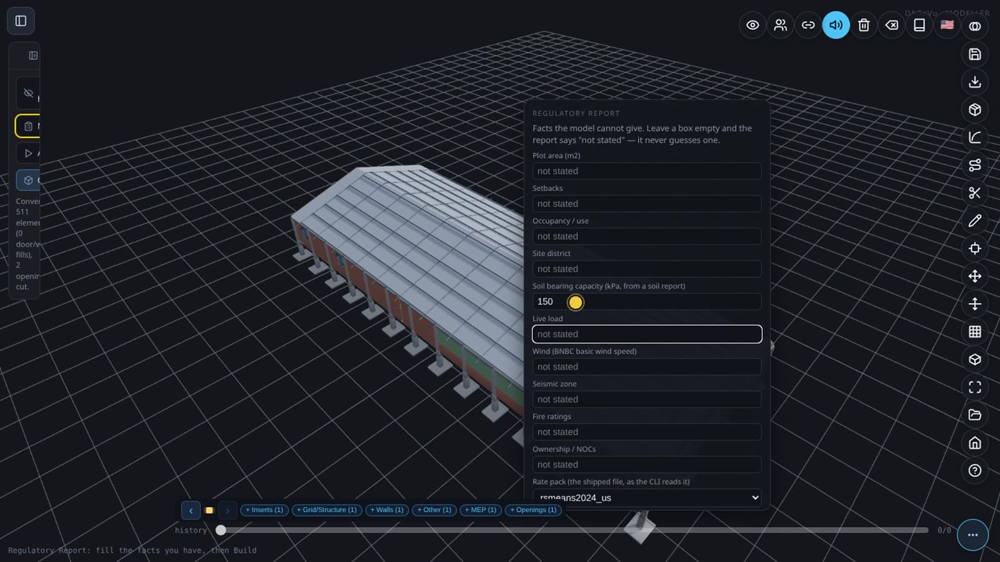

The report has nine sections: identification and scope, areas and heights, egress checks, structural checks, dead load, foundation loads, the bill of quantities,
model quality, and the assumptions and facts not stated. Each verdict is a plain word (PASS, FINDINGS n, INCONCLUSIVE, NOT STATED), never "compliant";
it says first that it is **not a compliance certificate**, and its signature blocks are left blank for the people who sign.

| | |
|---|---|
| 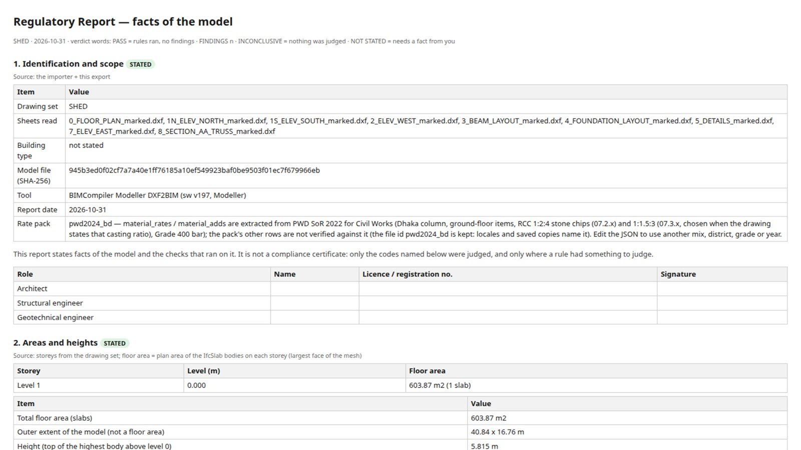 | 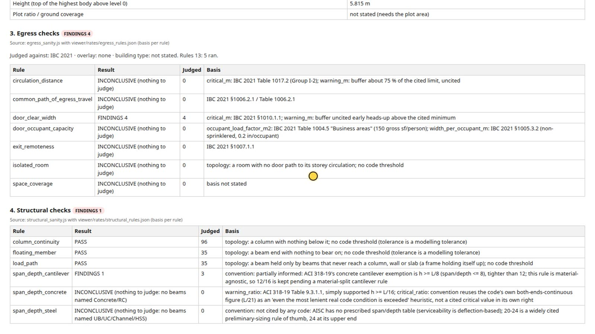 |
| 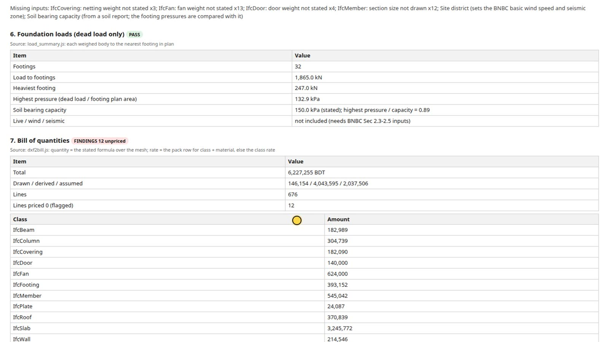 | 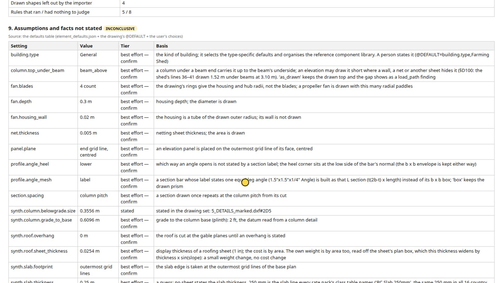 |

**Where the report is kept.** It is ONE self-contained HTML file, `regulatory_report.html` (its styles are inside it): the Modeller downloads it to your browser's
download folder and opens it in a new tab; the CLI writes it to `<out>/regulatory_report.html` with `--report`. Print it to PDF from the browser if a PDF is wanted.

**Is it editable?** At its **source**, yes, and that is where to edit it. The report's format lives in one open-source (MIT) file, `modeller/reg_report.js` in bim-ootb:
the facts the form asks for (`FACTS`, line 17), the nine sections, their titles, order and verdict words (`compose()`, lines 40–98), the look (the `css` string,
line 101) and the page skeleton (line 102). The Modeller's Export and the CLI's `--report` both use this one file, so a change there (a section renamed, an
authority's header added, another style) reaches both; the witnesses W-REG-REPORT and W-REG-REPORT-UI check that the page and the CLI still match.
**Before building**, edit what goes in, not the page: the facts form, the rate pack and its rates (the rate editor), and the defaults (Element defaults ▸ Set);
build again and the report follows in seconds. Editing the downloaded HTML by hand is possible, but that copy no longer matches the model fingerprint and sources it states.
The 4D/5D page is different (a live page, its downloads are Excel files): see [4D5D Analysis ▸ Where the page's format is kept, and how to edit it](4D5DAnalysis.md).

### 9 · Analytical model (STAAD, for your structural engineer)
**Export ▸ Analytical model (STAAD)…** downloads a `.std` file the engineer opens in STAAD.Pro as a **starting model, not a design**. It is built from the model's IFC,
so the same export works on a converted 2D set (it writes the IFC first) and, with nothing converted, on **any `.ifc` you choose**.

- **Members**: each column, beam and steel member on its centre line; a free end that lands on another member's span joins it there. Gusset plates, walls, the roof
  sheet, fans, doors and netting are listed as left out with the reason; a footing becomes a **support** (FIXED by default; Element defaults `analytical.support`).
- **Joints**: member ends closer than `analytical.node_snap` (0.25 m by default) are one joint. Ends joined to nothing are listed as **dangling**, with their sheet
  and handle, never hidden.
- **Sections and materials**: concrete rectangles from the drawn sizes; steel angles from the label (or the drawing's most common section, marked assumed).
  Concrete stiffness is E = 4700 √f'c from the drawing's own strength note (ACI 318-19 §19.2.2.1); with no f'c stated, no stiffness is given and a finding says so.
  A member whose stated material is neither concrete nor steel gets no stiffness either.
- **Load**: one case, self-weight only. No live, wind or seismic load, no member releases: the file header lists every assumption for the engineer.

On the farm shed: 337 members (96 column pieces, 35 beams, 206 truss-bar pieces), 319 joints, 32 supports, 36 dangling ends, 14 findings; a 19,330-byte `.std`.
The file built from the drawings and the file built from the exported IFC alone are **byte-identical**, so nothing the analysis needs is lost on the way through IFC.
From the command line: `node modeller/dxf2bim_cli.js --sheets <sheets> --out <dir> --complete --analytical` (also writes `analytical.json`, an open format), or
`node modeller/dxf2bim_cli.js --ifc-in <file.ifc> --analytical --out <dir>` for any IFC. A typical IFC from elsewhere states no section sizes and no f'c, so its
members take their box sizes and get findings instead of a stiffness (measured on six models, e.g. `Ifc4_Revit_STR.ifc`: 449 members, 453 joints, 4 supports, 152 dangling ends).

### If something goes wrong
| What you see | Why | What to do |
|---|---|---|
| the panel says *Convert failed: …* (the badge still says *Qualifies*: the drawings are fine, the run was not) | the conversion stopped on an error; *(nothing was built)* or *(undone)* says the model is as it was before the click | **Convert** again; if it fails again, the message and the console line `§DXF-CONVERT failed …` are what to report |
| *No door here: click a door's arc or leaf* | the click was beside the door's swing box | click on the arc itself |
| a suggested `@CUT` that disagrees with the section's title | grid bubbles with the section's letter were read as the section line | type the cut from the title |
| *PR-VIEW not proposed: no title text ending PLAN / ELEVATION / SECTION* | the title, once a scale (`1:100`) and a closing bracket are set aside, does not end with the view word, or the sheet has no title text | choose the role from the list, or retitle the sheet (see *Drawing in BricsCAD* below) |
| **Save marked copies** asks to allow several downloads | one file per sheet is downloaded | allow it; the copies keep every value you stated |

## The metadata, for CAD users

**The rule: labels set what geometry cannot.** The drawing's geometry gives the 3D outline. Anything the geometry
cannot decide (which product, which schedule mark, which of two same-size types) is set by a label you state
(`@TAG`, `@LABEL`, `@SCHEDULE`). The editor never guesses: an undecided element is left untyped and listed as a gap
with its candidates. A label sets the *type*; it never changes a measured size.

Metadata is plain text on the layer **`DXF2BIM-MARK`**, one marking per text entity, `@KEY=value`. You can type
it in any CAD program, or let the editor write it.

| Marking | Example | Meaning |
|---|---|---|
| `@VIEW` | `@VIEW=PLAN` · `ELEV` · `ROOF` · `SECTION` | what the sheet is |
| `@LEVEL` | `@LEVEL=3.1` | plan level (m) — defines the storey |
| `@FACE` | `@FACE=minY` | which building face an elevation shows |
| `@CUT` | `@CUT=X,2304.25` | where a section cuts (drawing units) |
| `@ROOF` | `@ROOF=6.457` | roof top level |
| `@UNITS` | `@UNITS=mm` | drawing units |
| `@REGION` / `@EXCLUDE` | rectangles | the part of the sheet that is the view / areas to ignore |
| `@LAYER` | `@LAYER=A-WALL,wall` | what a layer means on this sheet |
| `@TAG` | `@TAG=door,D3` | the mark of the element under the text |
| `@SCHEDULE` | `@SCHEDULE=D3,door,900,2100` | a schedule row (size of a mark) |
| `@WALLTOP` | `@WALLTOP=3.1,slab_above` · `@WALLTOP=handle:99,5.695` | interior wall heights |
| `@BY` (suffix) | `@LEVEL=3.1 @BY=user` | who stated it: `user` or `model`; no suffix = stated in the file |

**One rule governs it all:** geometry is what is drawn and dimensioned; a label states only what geometry
cannot decide (which product, which schedule mark, how tall an interior wall is). A difference between the
drawing and its schedule is reported (`GAP:schedule_conflict`), never silently resolved.

---

## Drawing in BricsCAD so fewer values are guessed

The editor fills every value it can from the drawing, and says how sure it is: **yellow** = read from a text
the sheet holds, **orange** = inferred from geometry or a convention, **no row at all** = stated. A few drafting
habits in BricsCAD (or any CAD program) move values from orange to yellow, or remove the row altogether. Each tip
below names what the editor then does.

| In BricsCAD | What the editor then does |
|---|---|
| Set the drawing units: system variable **`INSUNITS`** (1 = inches, 4 = millimetres), the same on every sheet | Units come from the file (yellow). A sheet whose units differ from the others is shown on its own, marked *disagrees* |
| Write the **title** as one text with the view word: `GROUND FLOOR PLAN`, `NORTH ELEVATION`, `SECTION A-A` (a scale such as `1:100` after it is fine) | The sheet's role is read from the title (yellow), not picked by hand |
| Put the **level in the plan title**: `LEVEL 2 PLAN (FFL +3.800)`, the value in metres | The plan's level is read (yellow); without it, the default ground level 0 is offered (orange) |
| Put the **cut in the section title**: `SECTION A-A AT X=2304.25` | The section cut is read (yellow); without it, it is inferred by pairing the section's letter with texts on the plan (orange), and on two test sets that guess was wrong |
| Write the **roof top** on an elevation or section: `T/ROOF +10.695` or `TOP OF ROOF +10.695` | The roof top is read (yellow) |
| Draw **level datums** on elevations and sections: a horizontal line on a level layer with its text at that height, such as `LEVEL 1 +0.000` (metres) | Each datum is read (yellow); without them only the ground line is guessed (orange) |
| Draw **grid lines** as straight LINEs on a grid layer (`A-GRID`, or your own layer once typed as *grid*), each with its label (`A`, `1`, `10`, `AA`) as a plain text at the line's end, in or next to its bubble | Every grid line is read (yellow). On the shed the grid is inferred from the dimension ticks instead (orange: 91 rows) |
| Give each kind of thing **its own layer, with the same name on every sheet**, ideally the US National CAD Standard names the Modeller itself writes (`A-WALL-FULL`, `A-DOOR`, `A-GLAZ`, `A-GRID`, `A-ANNO-DIMS`, `S-SLAB` …) | Layers are recognised instead of asked, and one answer covers every sheet. The shed's sheets use short names (`Wall`, `Win`, `Col`, `Dim`, `C L`) and put the frame, title block and much else on layer `0`: every layer there has to be stated |
| Keep **dimensions as real dimensions**: do not explode them or type over their text | The dimension checks compare drawn and written values. On the shed a dimension written `410'-0"` over a drawn 1,560 in is listed as a conflict |
| Draw in **model space** (the *Model* tab), not on a layout | The editor reads model space only |
| Save each sheet with **Save As → DXF**, one file per sheet | The shed's sheets (DXF, AutoCAD 2010 format) open as they are |

**Strongest of all: write the values yourself, in BricsCAD.** A marking is plain text on layer **`DXF2BIM-MARK`**,
one `@KEY=value` per text (see *The metadata, for CAD users* above), for example `@SET=SHED`, `@UNITS=in` or
`@LEVEL=0`. A value written this way is stated: it opens with no yellow row and needs no tick. The set name is the
one value no drawing states by itself: on the plain Duplex it is the first thing the editor asks for.

## A building drawn only in 2D: a farm shed

▶ Video: [BricsCAD 2D to BIM 5D in depth](https://youtu.be/TuTlhO8cCIY) (7:12): this shed, from the raw sheets to one more bay and its cost.

A common CAD set (here a BricsCAD drawing set saved as DXF) with **no 3D model behind it**: nine sheets, a floor
plan, four elevations, a beam layout, a foundation plan, a truss section and a details sheet (grades, casting
ratios, footing and column schedules). There is no answer key, so the check
is different: every body traces to a drawn entity, a setting you stated, or a **yellow default** you can see.
The method (units, grid from dimension ticks, level and datum) is the same as above; what differs is that the
building is made of **bodies** read from layers you type, not of walls and slabs.

1. **Open** the sheets. Each one lists three yellow suggestions it can prove (units from the file header, view and
   name from the title). **Accept all** also takes the grid from the dimension ticks and the ground datum from the
   heavy ground line.
2. **State the few facts only a person can** (set name, plan level, the datum height, e.g. a plinth line 2 ft above
   ground read from the column detail). They are written into the sheets themselves, so the **settings sheets
   reopen together** next time. In the walk of 2026-10-22 on the nine raw sheets: the set name typed once, `@LEVEL=0`
   typed on the three plans (floor, beam layout, foundation layout), and on each of the four elevations and the
   section a second level datum: **z** `0.6096` and the **drawing y** of the plinth line (a CAD coordinate such as
   `-4446.6`, read in the CAD program). That is 10 typed values for the datums.
   Each typed y lay 24.0 in (within 0.02 in) above the ground line the editor had already accepted as z 0, so the
   value you type is the plinth height; the y only places it.

   **Since 2026-10-29 the shed asks for none of these heights.** Its elevations and section carry vertical dimensions
   that BricsCAD measured itself (not typed over), and the file's dimension scale is 1: that shows each sheet is drawn
   at full size, so the second height is read from the longest such dimension (*Second heights from the drawing's
   dimensions*, an orange row: check it, then **Accept all** takes it). Measured: the 5 read heights build the same
   445 bodies as the 5 typed ones (worst difference 0.000 mm). A typed-over dimension (this set has `8'`, `16'-0"`,
   `410'-0"` and `8"` written over the measurement) is never used. A sheet with no such dimension, or whose dimension
   scale is not 1 (a reduced-scale sheet), still asks, as below.

   **Pick instead of typing the y:** press **Pick** beside the height field. The sheet opens around its known datum;
   a dashed line follows the pointer and snaps to a drawn horizontal line, its label giving the y and the drawn
   distance from the known datum (`24.00 in above @Z=0`: a measurement shown, the height is still yours to type).
   Click: the y fills the field. Where two drawn lines are too close to tell apart at that zoom, the label says
   *zoom in* and the click picks nothing: wheel in and click again. **Esc** leaves the field as it was. The pick
   writes no marking; you type the height and press **Add** as before.
3. **Type the layers that mean something:** column, footing, beam, wall-panel hatch, fan, net, door swing, truss
   bar, door frame. Nothing else is chosen for you. In **Layers** this is 10 choices; two of them hold only on one
   sheet (the `Dim` layer is a beam on the beam layout only, layer `0` is a column on the South elevation only): use
   the split button of that row to choose sheet by sheet. The door frame on the elevations is listed as **door**.
   Once the first body layer is chosen the set is read as a structure set and the dimension-text items of the
   standard check (18 on this set) no longer block.
4. **Give heights nothing draws** (footing depth, beam range) under *Body heights*, and leave out the areas that
   would build false bodies (an expansion-joint strip). The heights are typed in **metres** even when the sheets are
   in inches (`-1.4478` for -57 in). Nothing flags the expansion joint: without the exclude box the walk built 516
   bodies, the four extra being beams along the joint; with it, 512. Use *Exclude areas*, pick the beam layout and
   drag a box over the joint.
5. **Complete the building** (optional): adds the floor slab and gabled roof the drawings imply, in amber, with
   their thickness listed as yellow defaults.
6. **Convert.** The whole shed lands on the canvas: 512 bodies (96 column parts: 32 columns, each with a below-grade
   part and a grade-to-base part; 32 footings, 35 beams, 41 wall panels, 13 fans, 3 nets, 4 doors, the truss members
   and plates, a slab and a roof). Each body is in its **material's
   standard colour** and carries its class, the drawing's own type label, its material, its storey and its
   **source** (sheet, handle, layer, how each size was obtained).

   **The details sheet.** A sheet that states notes but draws no body (it has no role) is accepted as a *notes sheet*,
   not refused. Its text is read by a fixed grammar and carried as properties, each with the cell it came from:
   the concrete grade (f'c, fy) on every concrete body, each casting ratio on exactly the elements it names (footing,
   column, grade beam, floor: not the beams), and the **footing and column schedules**, read by cell position
   against their headers, on the footings and columns (the schedule has one row per kind and the bodies carry no
   type name, so the properties say *single schedule row*). The column schedule also states a larger section
   **below grade** (14 x 14 in): each column then continues from its footing to grade at that section, with no
   setting typed (a stated `@DEFAULT` still wins). Not built, because the drawings give only labels: the false
   ceiling and the slats of the cross-section.

   **Type marks checked across the set.** For each mark (`B-1`, `GB-1`, `C-1` ...) the app counts where it is **tagged** on the sheets, where it is **detailed** (a
   "Long Section of ..." title or a schedule row on the notes sheet) and how many **parts** carry it (bim-ootb §D102). When the set converts and has a notes sheet, two
   advisories can follow: `GAP:mark_not_modelled` (tagged, no part) and `GAP:mark_no_detail` (tagged or modelled, no detail). They never block, and the app never builds or drops a part
   because of them. On the shed: `B-1`, `B-2`, `C-1`, `F-1` are modelled and detailed; **`GB-1` is tagged 4 times on the foundation layout and detailed, but no sheet draws it, so it is
   reported and not built**: four tags do not say which spans the grade beams run, and building them under every wall would be a guess. Draw it on a typed layer and it is built as drawn.

   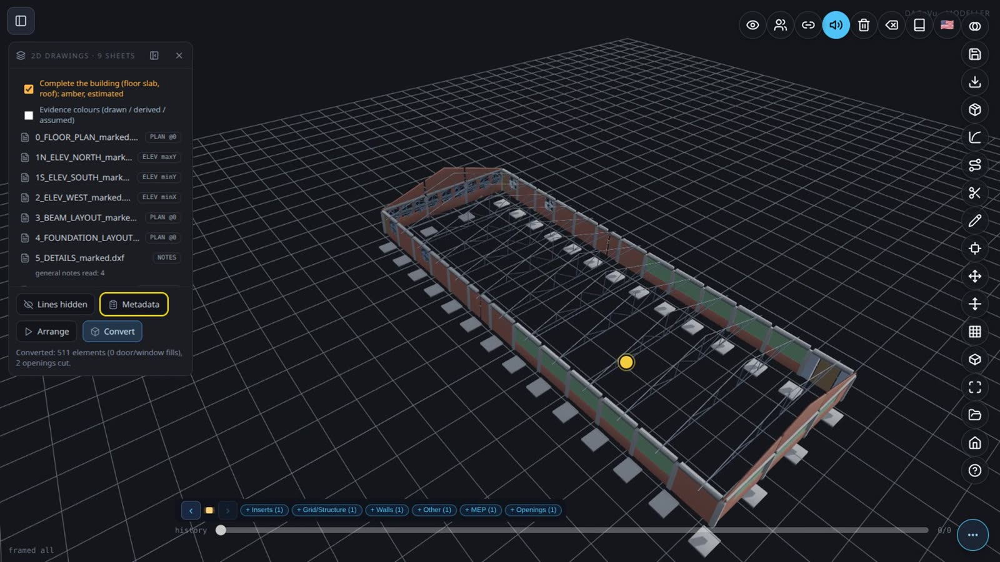

   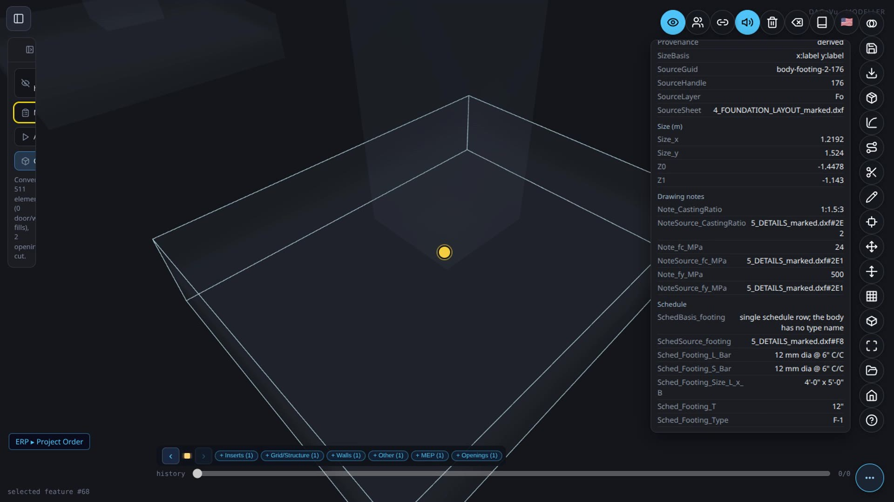


7. **Save and open elsewhere.** *Export → IFC4* writes the typed model with materials, colours and a property set
   `Dxf2Bim_Evidence` (Provenance, SourceSheet, SourceHandle, SourceLayer, Kind, SizeBasis; the `Pset_` prefix is reserved for buildingSMART's own sets, so the product's set does not use it) per mesh. The usual
   IFC → database extractor gives a database with the material name, the colour and one provenance row per mesh.
   The **Viewer** opens that database (3D in the material colours, Find, per-element information), and so does the
   **4D/5D page**. ▶ Video: [BricsCAD 2D DXF to BIM 5D](https://youtu.be/SnqJ7ERxuk0) (5:17).


**Read these numbers as what they are.** The 5D cost is the Viewer's rate-based **estimate**, not a tender. The 4D
schedule is the Viewer's **generated default** (phases by discipline), not the farm's real construction sequence.
The repeated trusses are **assumed** (the drawings show one section, not its spacing), shown red under the
*Evidence colours* option.

**The IFC is checked by an independent validator.** The shed's IFC4 from both writers (headless and the page) is validated with IfcOpenShell at schema level: zero statements (it was 23: every door carried derived-attribute markers and the STEP header had no author or organisation; both are fixed, and a witness puts the old defect back to prove the validator catches it). The EXPRESS WHERE rules and the buildingSMART online validation service have not been run yet. The file formats and their versions are written down in [the format contract](DXF2BIM_FORMAT.md).

**Closing the loop on the drawing itself.** The shed's IFC was written back to a standard 2D set and compared with
the original plan at 1 mm: all 32 columns, all 18 grid centre lines and the 4 doors match to under 0.02 mm, and
the wall faces to 0.004 mm. This proves the reading is self-consistent; it is not a comparison with a 3D reference.

---

## The yellow list: what you fill in, and the defaults used

A drawing never states everything a model needs. **[The yellow list](DXF2BIM_Yellow_List.md)** gives, in one place:
**(A)** the facts you are asked to state, **(B)** all 43 default settings with their value, whether it is a
standard or a guess, and its basis, **(C)** the *Farming Shed* building-type values and their sources,
**(D)** what *Complete the building* adds, **(E)** how drawn / derived / assumed evidence is shown, and
**(F)** the items the shed drawings left open. You may ignore it: the defaults stay applied and every one is listed.

### Which default matters? Element defaults ▸ Measure impact

On a structure set the **Element defaults** section lists every default in use (one row per setting, grouped by element). **Measure impact** ranks them by what they move
(bim-ootb §D99, #2483):

- Nothing runs until you press it. The **first click** loads the tools and shows a **rate-pack picker** (the locale's pack is preselected, for example *PWD Bangladesh SoR 2022*);
  the **second click** measures.
- It re-runs the model once per option of each default and lists the defaults by what they change: the **bill**, the **own weight** (kN) and the **body count**. Your model on screen does not change while it measures.
- A default that moves none of the three is gathered in one collapsed line, *No effect on the bill, the loads or the body count (n)*; click it to open.
- Any later change (a marking, a choice, the pack, *Complete*) marks the result *Measured before your last change*; press it again.
- It measures bill, own weight and body count only. It does not re-run the structural checks.

Measured on the shed (pack PWD Bangladesh SoR 2022, 1.4 s): **6 active, 6 inert**. Slab thickness (0.15 m) −1,298,309 BDT · section spacing −262,675 BDT (126 bodies fewer) ·
`column.top_under_beam` (as drawn) −38,717 BDT · building type +19,968 BDT · roof overhang +11,231 BDT · roof sheet thickness 0 BDT (+0.06 kN). The ranking is the shed's; another set ranks differently.

**The PWD rate pack** is named **PWD Bangladesh SoR 2022**: its source is the Finance Division approval of 21 June 2022, valid three years. (The file id `pwd2024_bd` is unchanged.)

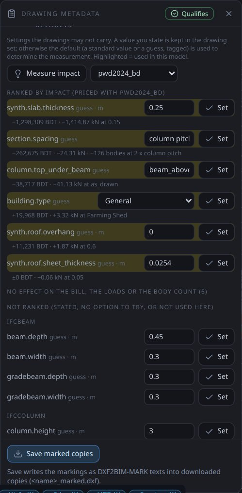

---

## Prior art

What already exists, what we believe is new, what we learned from others, and what using them would cost:
**[Prior art](DXF2BIM_Prior_Art.md)**. Short version: other tools detect walls, doors and windows with default
parameters and ask a subscription; we state the gaps, keep provenance on every body, and ask nothing but the facts
in the yellow list. No head-to-head benchmark has been run.

---

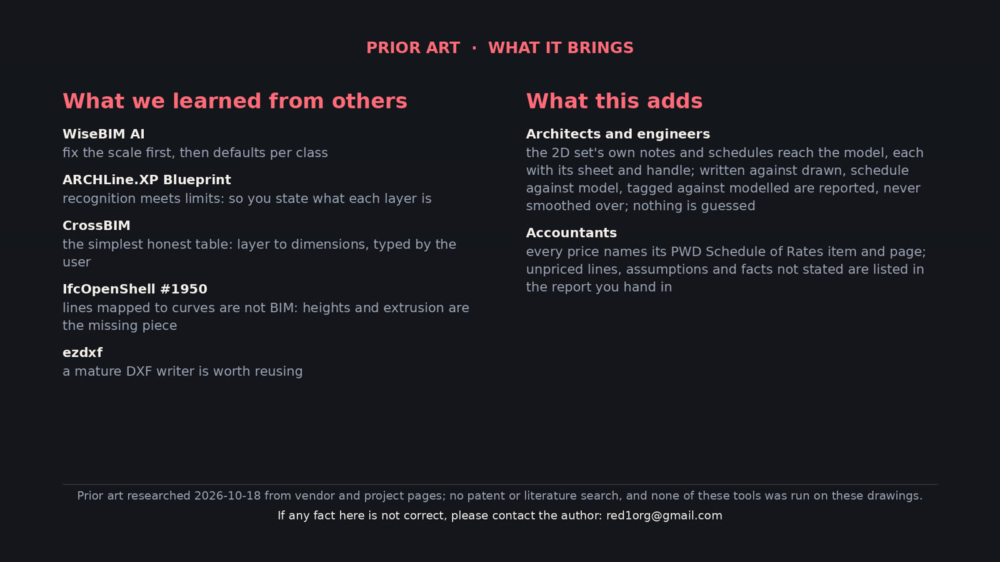

## What it does not do yet

Honest limits of the preliminary version:

- **Basic shapes only:** walls, curtain walls (a plan's `A-WALL-CURT` band becomes `IfcCurtainWall`, priced by area), slabs, roof, openings, door/window fills, and for structure sets the bodies listed above. No stairs, railings, ramps, piles, ceilings or furniture are built from a 2D set yet (their defaults are in the yellow list, ready for the builders; no drawing used so far carries them).
- **Structure sets and standard sets are not mixed yet:** a set that types body layers (column, beam...) and also wall/slab/opening layers is refused with that reason.
- **Evaporative pads and the shed's false ceiling** are labelled or drawn but not read yet. (The details sheet *is* read: its stated concrete grades reach the bodies they name, and its footing and column schedules give the below-grade columns.)
- **Angled walls:** a 2D set written from a model now cuts the windows of angled walls (Hospital 72, LTU 59 windows
  had no gap before), and reading such a set back finds a door's host on the angled wall's own outline. **Curved
  walls** are reported as gaps; roofs are flat outlines (pitched or curved roofs are not drawn correctly yet).
- **Columns** are cut and drawn, but not yet as column symbols on the grid.
- **Openings above or below the plan cut** (e.g. high bathroom windows) — being changed so every opening of
  the storey is shown from its host wall regardless of height.
- **The Regulatory Report is not a certificate.** It states the facts of the model, with blank signature blocks for the people who sign; it is not a code-compliance certificate.
- **The details' bar sizes are not used.** Reinforcement is an assumed bill line (a stated percentage of each concrete body), shown as assumed.
- **The Load Summary is own weight, not a structural design.** No live load, wind, earthquake or member strength.
- **The analytical model is a starting point, not an analysis.** It has not been opened in STAAD.Pro here (no STAAD on the build machine; it is checked by its own reader); releases, member orientation and loads other than self-weight are for the engineer.
- **"Any DXF"** is not claimed. Your drawing needs the metadata above; the editor helps you add it, the verdict
  tells you when it is complete.
- **The component library** (door/window geometry) is published: when no local copy is present, Convert loads it
  from the project's object storage. A window or door type the library does not hold is a blocking item, never a box.

---

## For developers

The same pipeline runs in Node (BIMCompiler repo):

```bash
# standard 2D set from a model DB (+ door operations extracted from the IFC by scripts/extractIFC2DB.js)
python3 2D_Layout/python/std2d.py <model_extracted.db> --out 2D_Layout/output/STD --door-ops <door_ops.db>
node tests/dxf2bim/mark_dx_set.js std <door_ops.db>        # metadata from the model (@BY=model)
DXSET=std node tests/dxf2bim/rosetta_dx_shell.js           # basic shapes, checked against the model
node tests/dxf2bim/rosetta_qualify.js                      # the verdict for every test set
```

Specs: [DXF2BIM spec](DXF2BIM_SPEC.md) · [Basic shapes spec](DXF2BIM_BASIC_SHAPES_SPEC.md).
Modeller lane spec: `prompts/DXF2BIM_MODELLER_LANE.md` (bim-ootb).
Every check has a deliberately broken control that must fail. Code is MIT licensed.

*Test drawing credit: the American Farmhouse drawings used as an independent test are by Jay Osborne
(freefarmhouse.com), CC BY-SA; they are not included in the repository.*

---

## Shed example POC: how long it takes and how big it is

*Measured 2026-10-19 on one laptop (CPU only, headless browser with software rendering, no GPU), the real nine-sheet shed set (with the details sheet), 2,943 CAD entities, about 1.05 MB of DXF in total. Times are wall-clock from the run logs; they exclude the time a person spends typing the facts in [the yellow list](DXF2BIM_Yellow_List.md).*

| Step | Time | Output |
|---|---|---|
| Open the nine settings sheets to a verdict (*Qualifies*) | **2.1 s** | roles, grid, 445 bodies ready (512 with *Complete*) |
| **Convert** to 3D: click to 512 bodies on the canvas | **0.23 s** | 512 bodies with material colours and metadata |
| Export IFC4 in the page | 0.4 s | 1,001,552 bytes (about 1.0 MB) |
| IFC → database (the in-browser extractor) | 0.5 s | **1,118,208 bytes (1.1 MB; about 230 KB compressed)** |
| Open that database in the Viewer, 3D fully rendered | 2.3 s | 512 elements |
| The same whole shed from the command line (read sheets, 512 bodies, bill, IFC4) | **0.88 s** | about 198 MB of memory |

So the machine part, from an opened set of sheets to a rendered Viewer, is **about five and a half seconds**; the 3D itself appears in under a quarter of a second after Convert. The five-minute film is slow because it narrates and types, not because the software is.

The database holds 512 elements (about 160 KB is mesh geometry across 133 distinct shapes, about 550 KB the per-mesh provenance and notes rows (4,961 rows) with their index, the rest names, materials, colours and bounding boxes). A 1.05 MB set of drawings becomes a 1.1 MB database. (The compressed size and the split by table were measured on the equivalent page-extracted database of the film take, same pipeline.)

A caution on method: this is one machine and one building, measured by the run logs, not a benchmark; a larger building will take longer (the Hospital extraction in the Node CLI takes minutes). An earlier measurement of the command-line extractor looked slow (16 s) because every row was its own disk commit; that is fixed in the extractor (0.4 s), and the numbers above use the fixed one.
