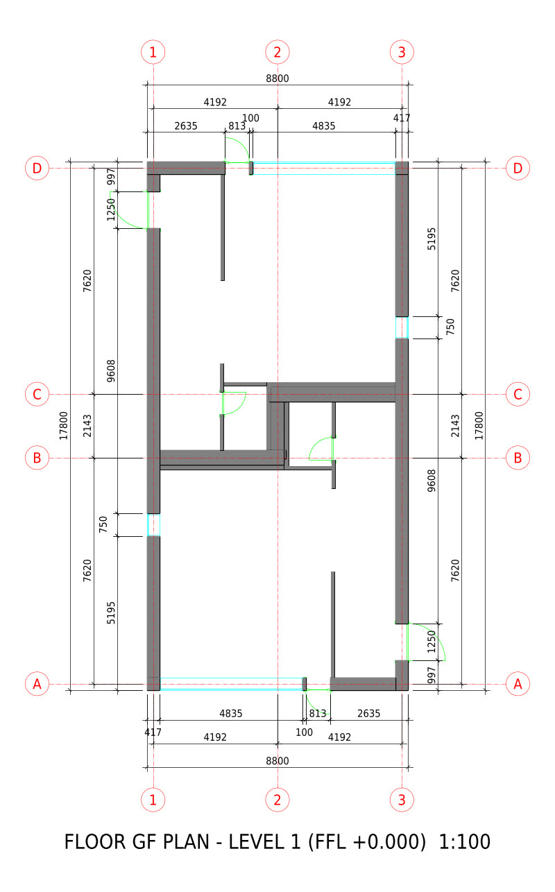
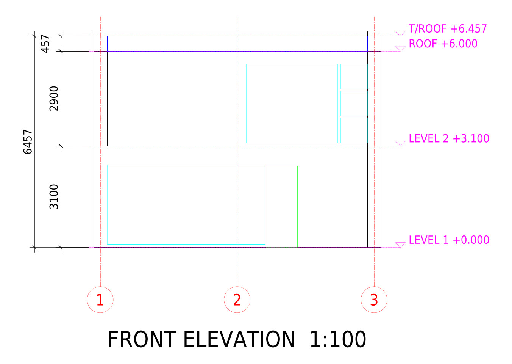
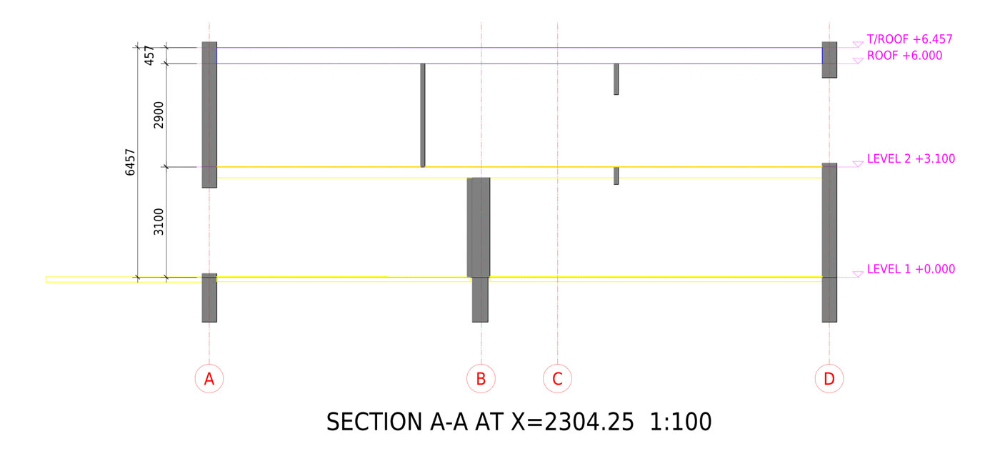
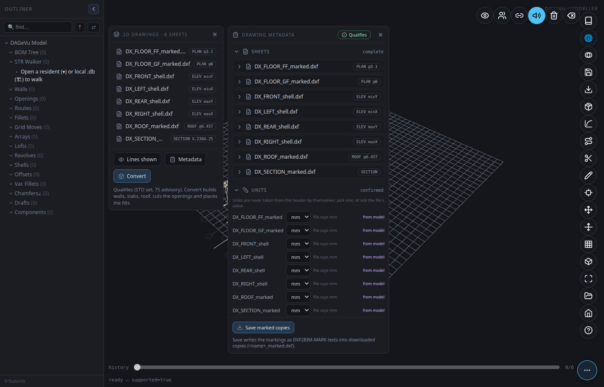
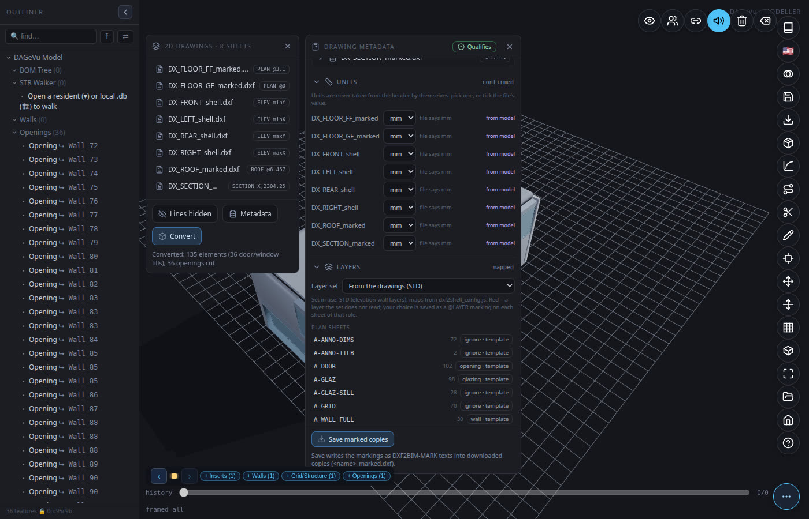
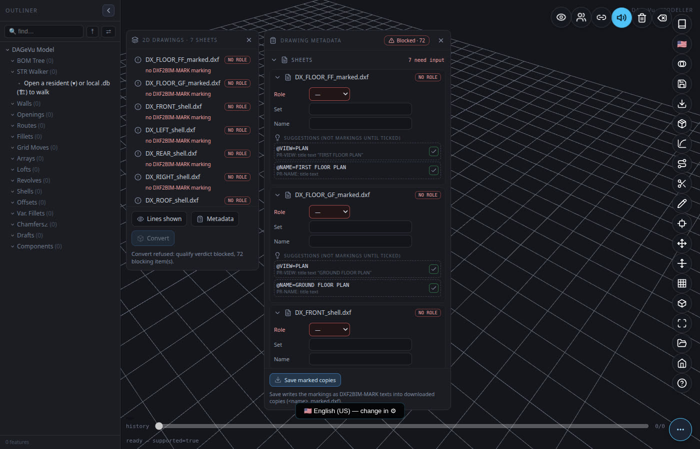
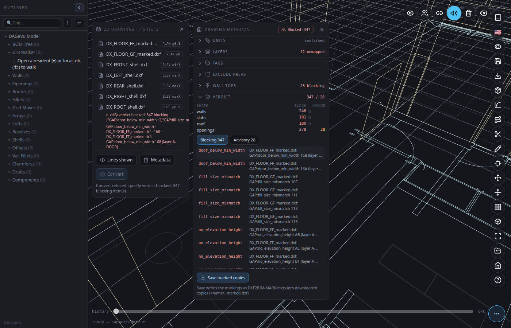
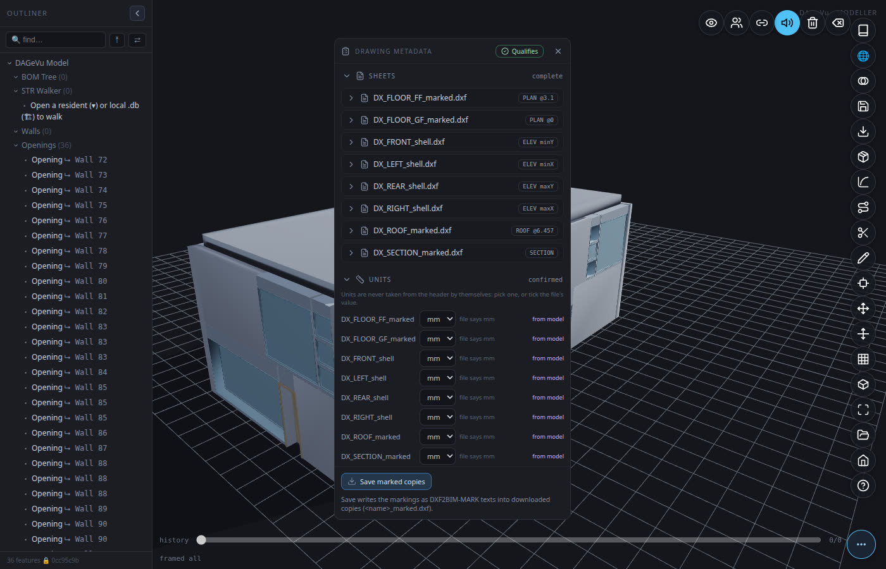
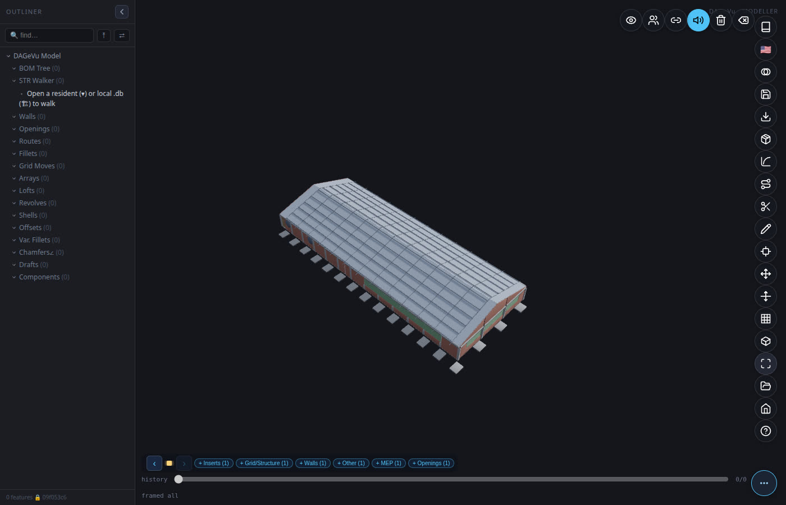
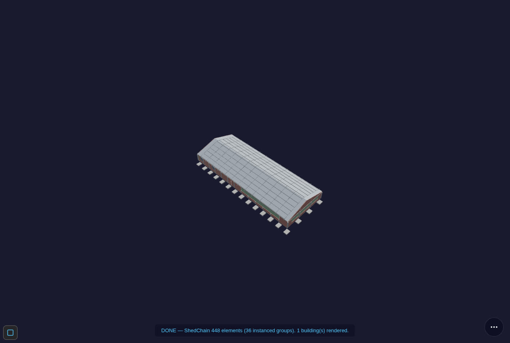

# 2D Drawings → BIM (DXF2BIM) — User Guide
*[← Back to the **User Guide**](USER_GUIDE.md) · [Modeller Guide](ModellerGuide.md) · [Home](index.md)*

Turn a set of 2D CAD drawings (`.dxf`) — floor plans, elevations, a roof plan and a section — into a 3D BIM
model inside the **DAGeVu Modeller**, and export it as IFC4 with real storeys.

It is **deterministic**: the same drawings and the same metadata give the same model, every time. **No AI
runs on your drawings** — the code reads geometry and the labels you (or the drawing) state. Anything the
drawing cannot tell it is listed as a **gap**, never guessed.

> **Status: preliminary.** Two paths. (1) **Standard sets** (walls, floor slabs, roof, door and window openings,
> fills): proven end-to-end on the Duplex, which has a 3D answer key. (2) **Structure sets** drawn only in 2D
> (columns, footings, beams, wall panels, fans, nets, doors, trusses): worked on a real farm-shed drawing set, see
> [A building drawn only in 2D](#a-building-drawn-only-in-2d-a-farm-shed). Anything a drawing does not state is a
> **yellow** setting: see [the yellow list](DXF2BIM_Yellow_List.md). Read
> [What it does not do yet](#what-it-does-not-do-yet) before you try your own drawings.

---

## The idea in one picture

1. **A standard 2D set.** Grid lines on the real wall axes (1, 2, 3… across; A, B, C… up, skipping I and O),
   dimension strings in three tiers (overall · grid-to-grid · detail), level marks, door swings, window sills.
2. **Metadata.** Each sheet says what it is (plan of which level, which elevation face, roof, section) and the
   few facts geometry cannot decide (units, wall tops, door sizes from the schedule). The metadata lives
   **inside the DXF**, on its own layer, so the file stays a normal DXF any CAD program opens.
3. **A verdict.** Before anything is built, the drawings are checked. Green = *Qualifies*. Red = a clickable
   list of exactly what is missing or inconsistent.
4. **Convert.** One click builds the model. Every element remembers the DXF entity (handle and layer) it came from.

---

## What a standard sheet looks like



*Ground floor plan of the Duplex, written from the model by the standard 2D writer. Grid bubbles at both ends;
dimension strings: overall (8800 / 17800), grid-to-grid (4192 + 4192, 7620 / 2143 / 7620) and detail (walls
and openings). Every dimension is a real CAD dimension measured between its two points — never typed text.*

| | |
|---|---|
|  |  |
| *Front elevation: walls and openings on that face, level datums and height dimensions.* | *Section: slabs and roof cut through, with their levels — this is where slab thickness comes from.* |

**Rules the writer follows** (drafting conventions, stated as choices):

- A floor plan shows **everything the cut plane passes through** — cut at the storey level + 1.2 m.
- Grid lines sit on **load-bearing and exterior wall axes**, never snapped to a module.
- Door arcs: the **hinge** from the IFC door type (left/right hand), the **swing side** from the door leaf, the
  **radius = leaf width** (not the frame). No hinge data → a `HINGE ?` note, never a guessed arc.
- Slab thickness is read from the **section**, not from elevations.

---

## Step by step in the Modeller

**Open:** [red1oon.github.io/bim-ootb/modeller/modeller.html](https://red1oon.github.io/bim-ootb/modeller/modeller.html) (desktop browser).

### 1 · Open the drawings
**📂 Open → Open 2D drawings (.dxf)…** and select **all** sheets of the set at once (plans, elevations, roof,
section). The **2D Drawings** panel lists each sheet with its role; the canvas shows each sheet placed in 3D —
plans at their level, elevations on their face, the section on its cut plane.



### 2 · Check the metadata
Press **Metadata**. The **Drawing metadata** panel shows, per section:

| Section | What you set | Notes |
|---|---|---|
| **Sheets** | role (plan / elevation / roof / section), level, face, cut | a plan's level defines a storey |
| **Units** | mm, m, in, ft | **you confirm** — the file header is shown ("file says mm") but never applied by itself |
| **Layers** | which layer holds walls, doors, glazing, dims, grid, levels; or ignore | templates for common layer standards |
| **Tags** | click an element on the canvas, pick its mark / type | e.g. a door mark that links to the schedule |
| **Exclude areas** | drag a box around decking, furniture, landscaping | its contents are ignored |
| **Wall tops** | "walls stop under the slab above", or a height per wall | interior wall heights are never visible in elevations |
| **Verdict** | live result | click an item to zoom to it on the drawing |

Every value shows **where it came from**: *from file*, *from model*, or *you*.



### 3 · Raw drawings: fill in what is missing
A drawing without metadata opens with **red** fields and the verdict **Blocked**. The editor lists
**suggestions** it can prove from the drawing (e.g. a title text "GROUND FLOOR PLAN" → role = plan) — **nothing
becomes metadata until you tick it.**



Click any verdict item to jump to it:



### 4 · Save the marked copies
**Save marked copies** downloads `<name>_marked.dxf` for every sheet, with your metadata written in. The
originals are never modified. Next time you open the marked copies, everything is already filled.

### 5 · Convert
**Convert** is enabled only when the verdict is **Qualifies**. It builds walls, floor slabs, the roof, cuts the
door and window openings, and places the door and window fills from the component library — as **one undo
step**.



### 6 · Export IFC
**Export → IFC4.** The file has a proper spatial structure (Project → Site → Building → Storeys) and every
element contained in its storey. On the Duplex standard set: 96 wall pieces, 2 slabs, 1 roof, 14 doors,
22 windows, 2 storeys.

---

## The metadata, for CAD users

Metadata is plain text on the layer **`DXF2BIM-MARK`**, one marking per text entity, `@KEY=value`. You can type
it in any CAD program, or let the editor write it.

| Marking | Example | Meaning |
|---|---|---|
| `@VIEW` | `@VIEW=PLAN` · `ELEV` · `ROOF` · `SECTION` | what the sheet is |
| `@LEVEL` | `@LEVEL=3.1` | plan level (m) — defines the storey |
| `@FACE` | `@FACE=minY` | which building face an elevation shows |
| `@CUT` | `@CUT=X,2304.25` | where a section cuts (drawing units) |
| `@ROOF` | `@ROOF=6.457` | roof top level |
| `@UNITS` | `@UNITS=mm` | drawing units |
| `@REGION` / `@EXCLUDE` | rectangles | the part of the sheet that is the view / areas to ignore |
| `@LAYER` | `@LAYER=A-WALL,wall` | what a layer means on this sheet |
| `@TAG` | `@TAG=door,D3` | the mark of the element under the text |
| `@SCHEDULE` | `@SCHEDULE=D3,door,900,2100` | a schedule row (size of a mark) |
| `@WALLTOP` | `@WALLTOP=3.1,slab_above` · `@WALLTOP=handle:99,5.695` | interior wall heights |
| `@BY` (suffix) | `@LEVEL=3.1 @BY=user` | who stated it: `user` or `model`; no suffix = stated in the file |

**One rule governs it all:** geometry is what is drawn and dimensioned; a label states only what geometry
cannot decide (which product, which schedule mark, how tall an interior wall is). A difference between the
drawing and its schedule is reported (`GAP:schedule_conflict`), never silently resolved.

---

## A building drawn only in 2D: a farm shed

A common CAD set (here a BricsCAD drawing set saved as DXF) with **no 3D model behind it**: eight sheets, a floor
plan, four elevations, a beam layout, a foundation plan and a truss section. There is no answer key, so the check
is different: every body traces to a drawn entity, a setting you stated, or a **yellow default** you can see.
The method (units, grid from dimension ticks, level and datum) is the same as above; what differs is that the
building is made of **bodies** read from layers you type, not of walls and slabs.

1. **Open** the sheets. Each one lists three yellow suggestions it can prove (units from the file header, view and
   name from the title). **Accept all** also takes the grid from the dimension ticks and the ground datum from the
   heavy ground line.
2. **State the few facts only a person can** (set name, plan level, the datum height, e.g. a plinth line 2 ft above
   ground read from the column detail). They are written into the sheets themselves, so the **settings sheets
   reopen together** next time.
3. **Type the layers that mean something:** column, footing, beam, wall-panel hatch, fan, net, door swing, truss
   bar, door frame. Nothing else is chosen for you.
4. **Give heights nothing draws** (footing depth, beam range) under *Body heights*, and leave out the areas that
   would build false bodies (an expansion-joint strip).
5. **Complete the building** (optional): adds the floor slab and gabled roof the drawings imply, in amber, with
   their thickness listed as yellow defaults.
6. **Convert.** The whole shed lands on the canvas: 448 bodies (32 columns, 32 footings, 35 beams, 41 wall panels,
   13 fans, 3 nets, 4 doors, the truss members and plates, a slab and a roof). Each body is in its **material's
   standard colour** and carries its class, the drawing's own type label, its material, its storey and its
   **source** (sheet, handle, layer, how each size was obtained).



7. **Save and open elsewhere.** *Export → IFC4* writes the typed model with materials, colours and a property set
   `Pset_Dxf2Bim` (Provenance, SourceSheet, SourceHandle, SourceLayer, Kind, SizeBasis) per mesh. The usual
   IFC → database extractor gives a database with the material name, the colour and one provenance row per mesh.
   The **Viewer** opens that database (3D in the material colours, Find, per-element information), and so does the
   **4D/5D page**.




**Read these numbers as what they are.** The 5D cost is the Viewer's rate-based **estimate**, not a tender. The 4D
schedule is the Viewer's **generated default** (phases by discipline), not the farm's real construction sequence.
The repeated trusses are **assumed** (the drawings show one section, not its spacing), shown red under the
*Evidence colours* option.

**Closing the loop on the drawing itself.** The shed's IFC was written back to a standard 2D set and compared with
the original plan at 1 mm: all 32 columns, all 18 grid centre lines and the 4 doors match to under 0.02 mm, and
the wall faces to 0.004 mm. This proves the reading is self-consistent; it is not a comparison with a 3D reference.

---

## The yellow list: what you fill in, and the defaults used

A drawing never states everything a model needs. **[The yellow list](DXF2BIM_Yellow_List.md)** gives, in one place:
**(A)** the facts you are asked to state, **(B)** all 41 default settings with their value, whether it is a
standard or a guess, and its basis, **(C)** the *Farming Shed* building-type values and their sources,
**(D)** what *Complete the building* adds, **(E)** how drawn / derived / assumed evidence is shown, and
**(F)** the items the shed drawings left open. You may ignore it: the defaults stay applied and every one is listed.

---

## What it does not do yet

Honest limits of the preliminary version:

- **Basic shapes only:** walls, slabs, roof, openings, door/window fills, and for structure sets the bodies listed above. No stairs, railings, ramps, piles, ceilings, curtain walls or furniture are built from a 2D set yet (their defaults are in the yellow list, ready for the builders; no drawing used so far carries them).
- **Structure sets and standard sets are not mixed yet:** a set that types body layers (column, beam...) and also wall/slab/opening layers is refused with that reason.
- **Evaporative pads, the shed's false ceiling and its detail sheet** (concrete grades, below-grade column size) are labelled or drawn but not read yet.
- **Rectilinear buildings:** skewed and curved walls are reported as gaps; roofs are flat outlines (pitched or
  curved roofs are not drawn correctly yet).
- **Columns** are cut and drawn, but not yet as column symbols on the grid.
- **Openings above or below the plan cut** (e.g. high bathroom windows) — being changed so every opening of
  the storey is shown from its host wall regardless of height.
- **"Any DXF"** is not claimed. Your drawing needs the metadata above; the editor helps you add it, the verdict
  tells you when it is complete.
- **The component library** (door/window geometry) is loaded locally during this preliminary stage; on the
  public site Convert reports the library as unreachable until it is published.

---

## For developers

The same pipeline runs in Node (BIMCompiler repo):

```bash
# standard 2D set from a model DB (+ door operations extracted from the IFC by scripts/extractIFC2DB.js)
python3 2D_Layout/python/std2d.py <model_extracted.db> --out 2D_Layout/output/STD --door-ops <door_ops.db>
node tests/dxf2bim/mark_dx_set.js std <door_ops.db>        # metadata from the model (@BY=model)
DXSET=std node tests/dxf2bim/rosetta_dx_shell.js           # basic shapes, checked against the model
node tests/dxf2bim/rosetta_qualify.js                      # the verdict for every test set
```

Specs: [DXF2BIM spec](DXF2BIM_SPEC.md) · [Basic shapes spec](DXF2BIM_BASIC_SHAPES_SPEC.md) ·
[Reader user guide](DXF2BIM_USER_GUIDE.md). Modeller lane spec: `prompts/DXF2BIM_MODELLER_LANE.md` (bim-ootb).
Every check has a deliberately broken control that must fail. Code is MIT licensed.

*Test drawing credit: the American Farmhouse drawings used as an independent test are by Jay Osborne
(freefarmhouse.com), CC BY-SA; they are not included in the repository.*
