# Developer Guide

*As of 2026-11-13 · for a developer who will read or change the code by hand · replaces the April 2026 guide (now in `docs/archive/DEVELOPER_GUIDE.md`)*

---

## 0. Read this first: what is unusual here

This codebase is different from most web projects, and the differences are on purpose. If you open it expecting a normal
JavaScript app, several things will look broken when they are not. Ten things to know before you change a line:

| # | What you will notice | Why it is like this | What it means for you |
|---|---|---|---|
| 1 | **No framework, no build step, no bundler.** The `.js` files you edit are the files the browser runs. | The app must work offline and air-gapped, from a static folder, for years. Nothing to compile means nothing to break. | Save the file, reload the page. There is no `npm run build`. Do not add one. |
| 2 | **No `import`/`export`.** One production file uses ES modules. Files are plain `<script>` tags. | Same reason: plain scripts load from any static host, with no tooling. | **The order of `<script>` tags in the HTML page is the dependency graph.** Move a tag above what it needs and the app breaks with an "undefined" error. `viewer/viewer.html` (247 tags) and `erp/idempiere.html` (205) are the closest thing to a build manifest. |
| 3 | **One shared object, two spellings.** Viewer modules are `function setupX(A) { A.camera = … }`; other code reads the same object as `APP.camera`. | Every module gets the app object handed in, no registry. | `grep "APP.camera ="` finds nothing. Look it up in `internal/APP_SURFACE.md` (bim-ootb): 1,676 fields, each with the `file:line` that defines it. |
| 4 | **Most files end with a UMD tail**: `if (typeof module …) module.exports = X`. | The same file runs in the browser *and* in Node, so witnesses can test it without a browser. | Do not remove the tail. Your editor sees these files as modules, so "go to definition" needs the generated `types/globals.gen.d.ts` (§4). |
| 5 | **The database is SQLite running inside the browser tab** (sql.js, WebAssembly). There is no server. | Local-first: the user's data lives with the user. | Reading and writing data is SQL against a file in memory. "The backend" is a `.db` file. |
| 6 | **A service worker caches files for offline use.** Precached files are served cache-first. | Air-gapped use. | **After you edit a precached file, the browser keeps serving the old one** until its `?v=` and the worker's `CACHE_VERSION` go up. Run `node scripts/bump.js <file> --write` (§5.1). |
| 7 | **Some parts load only when first used** (the viewer's Find/navigate parts, from a list in `viewer/main.js`). They are not precached, on purpose. | Fast start: no bytes spent on features you have not opened. | Keep it that way. Never add a lazy module to the precache list to "fix" a warning. `bump.js` handles lazy lists for you. |
| 8 | **Proof is a log line, not a screenshot.** Code prints `§TAG` lines (`console.log('§CLASH_FILM …')`); about 9,300 distinct tags. | A value you can read back is evidence; a picture is not. | When you claim something works, show the `§` line that proves it. Exit code 0 is not evidence. Read the log. |
| 9 | **Tests are called witnesses**, and each one names the issue it proves or disproves. About 1,350 witness files. | A test that passes without telling you whether the problem is solved is not a test. | A witness must be able to say FAIL and INCONCLUSIVE (nothing was judged), not only PASS. Start new ones from `witness_kit/contract.js`. |
| 10 | **Data changes ship as SQL, not as database files.** | A small text patch is reviewable and reaches a live user without a binary ever moving. | Never commit a `.db`. Write a patch (`migration/*.sql`, or `<app>/patches/*.sql`) **and** make sure the app's loader applies it on load (§5.3). |

Two more habits run through every file:

- **Spec before code.** Most important files open with a `# ⚠ DO NOT REMOVE — SPEC (W-NAME)` block: scope, rules R1..Rn, and the
  witness that proves each rule. Read the header and you know the file without reading the body. Example: `viewer/db_resolve.js`.
- **Extract, don't invent.** Values come from the source model (IFC), the database, or the legacy system being mirrored. No
  made-up numbers, no defaults dressed up as data.
- **It is free and open source (MIT), and changes go through the tracker.** Open an issue first, then a pull request that
  links it. See §10.

---

## 1. The picture: parts and patterns

### 1.1 The parts

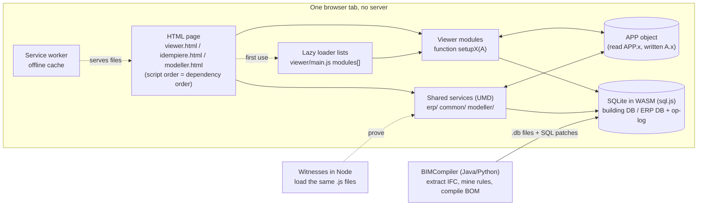

**bim-ootb folders, by role** (file counts 2026-11-13):

| Folder | Role |
|---|---|
| `viewer/` (926) | The BIM viewer: scene, streaming, panels, tools, 4D schedule ("time machine", `tm_*`), film/camera (`cpe_*`, `fx_*`, `maxq_*`), Find (`nf_*`, lazy) |
| `erp/` (1,063) | Kernel-ERP: dictionary parser (`ad_*`), windows (`crud_*`), models (`model_*`), processes, posting, op-log (`kernel_ops.js`), migration readers |
| `modeller/` (717) | The Modeller (assemble and hand off): walkers, DXF to BIM (`dxf2bim/`), rules editor |
| `common/` (269) | Shared by more than one app: room graph, history bar, the relay layer (`common/comm/`), file store |
| `capex/`, `teams/`, `hr_bim_asset/` | Add-on apps and overlays: CAPEX dashboard, Teams collaboration overlay, HR/tenancy module |
| `bim/`, `geomapping/`, `readiness/`, `standards/`, `schema/` | Tools and data: IFC utility knife, IFC-to-BOM geomapping, readiness toolkit, jurisdiction packs, the building DB schema |
| `buildings/` | Building DB patches and analysis (the full DBs are served from object storage) |
| `witness/`, `witness_kit/`, `tests/`, `*/tests/` | Witnesses and the shared witness contract |
| `scripts/` | Developer tools: `bump.js`, generators, split tooling. Never loaded by a page |

### 1.2 The patterns: learn these eight and you can read any file

| # | Pattern | What it looks like (real code) | Example |
|---|---|---|---|
| 1 | **Viewer module**: a function that receives the shared object and hangs its parts on it | `async function setupScene(A) {` … `A.camera = camera;` | `viewer/scene.js:8`, `:163` |
| 2 | **Shared service (UMD)**: one closure, published to the browser *and* to Node | `(function (global) {` … `global.CpmSchedule = API;` `if (typeof module !== 'undefined' && module.exports) module.exports = API;` | `viewer/cpm_schedule.js:44`, `:935-937` |
| 3 | **Spec header**: the file's contract, with the witness that proves it | `// # ⚠ DO NOT REMOVE — SPEC (W-DB-404-OCI-RETRY)` `// SCOPE: one pure decision — …` `// WHY: …` | `viewer/db_resolve.js:6-14` |
| 4 | **`§` log line**: the proof that code ran, with the values | `console.log('§TAG key=value …')`, about 9,300 distinct tags | any production file |
| 5 | **Lazy loader list**: parts fetched on first use, not at boot | `var modules = [ 'find_erp_push.js?v=5', … 'nf_room.js?v=1', … 'navigate_find.js?v=65' ]` | `viewer/main.js` (Find/navigate) |
| 6 | **Dictionary-driven ERP**: windows, tabs and fields read from the iDempiere dictionary, not hand-coded | `// ad_parser.js — iDempiere Application Dictionary parser for SQLite` `// Reads AD_Menu, AD_Window, AD_Tab, AD_Field, AD_Column from SQLite.` | `erp/ad_parser.js`, then `erp/crud_*.js` |
| 7 | **Op-log**: every change is a hash-chained operation, so history can be replayed and checked | `function commitOp(db, opType, params, inputGuids, outputGuid, opUuid, ts) {` | `erp/kernel_ops.js:79` |
| 8 | **Self-heal patch**: a shipped DB is fixed by a SQL patch the page applies on load | `A._applyPendingPatch = async function(buf, url) {` + `buildings/patches/*.sql` | `viewer/scene.js:2111` |

Most files are pattern 1 or 2, with a 3 at the top, printing 4s.

---

## 2. The two repositories

| Repo | What it is | Language | Where to start |
|---|---|---|---|
| **bim-ootb** | The browser app: **Viewer**, **Modeller**, and the **Kernel-ERP** (an iDempiere-compatible ERP). This is what users run. | Plain JavaScript, sql.js (SQLite WASM), Three.js | `viewer/viewer.html`, `erp/idempiere.html`, `modeller/modeller.html` |
| **BIMCompiler** (this repo) | The compiler and the lab: IFC extraction, rule mining, BOM compilation and the proof gates; specs (`prompts/`), docs (`docs/`), scripts. | Java 17, Python, SQLite, shell | `docs/ArchitectureOverview.md`, `prompts/` |

The browser app was split out of this repo in May 2026. Since then bim-ootb is where the product changes; this repo holds the
compiler, the specs and the docs site.

**Size, measured 2026-11-13 (bim-ootb):** 856 production `.js` files, 286,724 lines (vendored libraries, tests and witnesses
not counted). You will not read it all; §6 says what to read first.

**⚠ Copies.** This repo still holds old copies of many bim-ootb files (under `build/scriptor/*/_kw_old/`, `deploy/live/`,
`deploy/sandbox/`, `deploy/dev/`). 329 of them differ from the real file. **bim-ootb is the source.** The committed
`.vscode/settings.json` hides most of these copies from search, and makes `deploy/live/` (the production snapshot) read-only.

---

## 3. Set up — there is nothing to build

1. Clone **bim-ootb** (and BIMCompiler if you need the compiler or the specs). One clone of each.
2. Open the folder in **VS Code**. The repo ships its editor setup: `jsconfig.json`, `types/`, `.vscode/settings.json`,
   `.vscode/tasks.json`, `.vscode/launch.json`, `.editorconfig`.
3. Serve it: task **Serve repo (http://localhost:8000)**, or `python3 -m http.server 8000` in the repo root.
4. Open `http://localhost:8000/viewer/viewer.html` (or `erp/idempiere.html`, `modeller/modeller.html`).
5. To debug with breakpoints: Run ▸ **Viewer in Chrome** (also ERP, Modeller, and **Node: this witness / script**).
6. Optional, recommended: install the repo's own VS Code add-on, **X0 Navigator** (§4.1). Two commands from the bim-ootb folder,
   offline, no npm: `node devtools/vscode/pack.js`, then `code --install-extension devtools/vscode/dist/x0-navigator-0.1.0.vsix`.
   Reload VS Code.

`npm install` is needed only for the lint check (`eslint`, a dev tool) and is never needed by the app.
The app's only runtime dependency is `sql.js`, which is already vendored.

**Editor tasks** (Terminal ▸ Run Task):

| Task | Does |
|---|---|
| Run this witness (full log → logs/) | `node <current file>`; full output to `logs/<name>.log`, last 20 lines and the exit code on screen. Line 1 of the log is a `§LOG_STAMP` (§6) |
| Run viewer witness suite | the headless witness suite (also `npm test`) |
| Lint as CI does | `npx eslint viewer modeller`: the `no-undef` check that catches a missing global |
| Regenerate editor indexes | the committed `internal/APP_SURFACE.md` and `types/globals.gen.d.ts`. X0 Navigator does not need this: it keeps its own fresh copy (§4.1) |

**Editor snippets** (type the word, press Tab; `.vscode/witness.code-snippets`):

| Type | You get |
|---|---|
| `witness` | a new witness built on `witness_kit/contract.js`. Unedited it FAILs, so it cannot pass by accident |
| `slog` | one log line in the repo's form: `console.log('§TAG key=' + value);` |
| `spec` | the `⚠ DO NOT REMOVE — SPEC (W-NAME)` header a new script opens with (comment lines only) |

---

## 4. Finding things

| You want | Do this |
|---|---|
| Where a function or global is defined | **F12** works for true globals (`setupScene` → `viewer/scene.js`) and, through `types/globals.gen.d.ts`, for about 6 in 10 UMD globals' members (`ADParser.init` → `erp/ad_parser.js`). The rest: search for `X = ` or `function X`. |
| Where an `APP.x` / `A.x` field is set | With X0 Navigator (§4.1): **F12** or hover on the field. Without it: `internal/APP_SURFACE.md`. Its "phantom" list (107 fields read in production but never written, counted 2026-11-14; 11 more are flagged "untied write" and are probably live) is a list of dead guards. Check before relying on one. |
| What a `§TAG` means | With X0 Navigator (§4.1): hover the tag. Without it: search the tag. The code that prints it is the definition, and its spec is usually named in the same file's header. |
| What a spec section says (`§S59`, `W-BUMP`) | Search `prompts/` in both repos for the section or witness name. |
| A file cited as `file:line` in an old prompt | Line numbers drift (the big files were split in 2026-10). **Search for the function name instead.** |
| Which page loads a file | Search the HTML pages for the file name; for lazy parts, `viewer/main.js` `modules[]`. |

Search hides vendored libraries and six generated one-line data files (`erp/genesis_dict.js`, `erp/fk_rules.js`, …). Those
files open read-only. Edit the generator named on their first line instead.

### 4.1 X0 Navigator: the repo's own VS Code extension

It lives in bim-ootb `devtools/vscode/x0-navigator/`. It is plain JavaScript with no dependencies and no build step, it never
calls a model or the network, and no page loads it. It answers two questions from the repo's own files (table below).

**Install it** (proven in VS Code 1.146.0 by `devtools/vscode/x0-navigator/tests/realvsc/install.js`):

1. In the bim-ootb folder: `node devtools/vscode/pack.js`. It writes `devtools/vscode/dist/x0-navigator-0.1.0.vsix` (plain node, no npm, no internet).
2. `code --install-extension devtools/vscode/dist/x0-navigator-0.1.0.vsix`. No `code` command? In VS Code: Extensions view ▸ `…` ▸
   **Install from VSIX…** and pick that file. (`node devtools/vscode/pack.js --install` does steps 1 and 2.)
3. Reload VS Code (**Developer: Reload Window**).
4. Check: open any `viewer/*.js` and hover a field such as `APP.db`. The hover starts with `written at`.

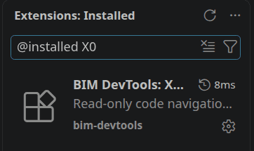

*After step 3, the Extensions view (filter `@installed X0`) lists it.*

After you pull changes to the add-on, run steps 1–3 again (the installed copy is a copy). Remove it with
`code --uninstall-extension bim-devtools.x0-navigator`. **Do not symlink the folder into `~/.vscode/extensions/`:** VS Code ignores a
folder its `extensions.json` does not list, so nothing loads and nothing warns you (this guide said to symlink until 2026-11-13).


| You do | You get | Read from |
|---|---|---|
| **F12** on `APP.camera` (also `A.x` / `app.x` in a file that binds that name) | a jump to the line where the field is written | the APP field index made by `scripts/gen_app_surface.js` |
| Hover the same field | `written at <file:line> · N writes · N reads` | the same index |
| Hover a `§TAG` in any `.js` file | up to 5 places in `prompts/` and `docs/` of both repos that name the tag (headings first), then up to 5 lines of code that print it | the specs and the source |
| Explorer side bar ▸ **Run & Ship** (4 steps, also as commands) | *Run local*: the serve task plus each app's URL and cache version on disk. *Check*: `node --check` on the JS that differs from `origin/main`, the precache audit, and the bump rule. *Cost if deployed*: see next row. *Fetch back*: is the live site on `main`'s versions and commit? | the repo's own scripts and git; Fetch back reads the live site (the only step that uses the network) |
| Status bar, and command **Cost if deployed** | `viewer: start-up · 103 KB` for the open file; the command prints, per app, start-up and offline-cache bytes of your tree against `origin/main` | each `sw.js` cache list and the pages' script tags |
| **Shift+F12** (Find All References) on the same field | every place the field is written and read, under any of its spellings; VS Code's own JavaScript support cannot give this, because the object is written under one name and read under another | every site the repo's generator recorded, kept beside X0's own fresh index (nothing added to the repo) |
| A warning on line 1 after you save an edited file the offline cache serves, with a quick fix (the light bulb, or **Ctrl+.**) | *Bump the cache version for this file* (one click: the repo's `scripts/bump.js --write`), or *Show what the bump would change* (the dry run). Never done silently | the *Check* step's own bump rule, for this one file |
| A grey line above code that prints a `§TAG` | `last: <the line a saved log holds for that tag> · <log> @ <commit>`; click it to open the log | `logs/*.log` whose first line is a `§LOG_STAMP` (§6) |
| Hover a `§TAG` on the line that prints it | the same hover, ending in `last value: <line> — <log>:<line> @ <commit>`, or `last value not shown: <reason>` (`no stamped log found` · `tag not in any stamped log` · `file changed since the log` · `file was dirty when the log was made`) | the same stamped logs; the grey line stays silent without proof, the hover says why |
| Command **X0 Navigator: Context for this file** | one block of markdown about the open file, opened beside the code and copied: its header comment, how it reaches a user and the bump command, the `APP` fields set in it, each `§TAG` it prints with its spec place and last provable value | all the indexes above. X0 calls no model: you paste the block where you like (§4.2) |

**It never guesses.** Each answer below is on purpose:

| It shows | Meaning | What to do |
|---|---|---|
| `PHANTOM — read, never written`, and F12 does nothing | no code sets this field: the guard can never be true, or its writer was removed | do not rely on the field; see §11 item 4 |
| `PHANTOM? — no writer the index can tie …`, with a `file:line` | the index found no writer it can prove, but that line assigns a field of this name through a local name it could not tie to the shared object | probably live: read that line. It is a gap in the index, not a dead field |
| nothing at all on an `APP.x` | the field is not in the index (new and unsaved, or `A` is an unrelated local in this file) | save the file and hover again |
| `index stale`, and F12 does nothing | the line the index points at no longer mentions the field | hover again in a few seconds, or run **X0 Navigator: Rebuild indexes** |
| `no spec found` on a `§TAG` | no file in `prompts/` or `docs/` names the tag | the code that prints it is all there is: read that |

#### What you see, step by step

Every picture below is the real editor (VS Code 1.146), recorded on this repo as shipped. Nothing is a mock-up.

**1. The plain editor.** The project opens like any folder: the tree on the left, the code on the right.

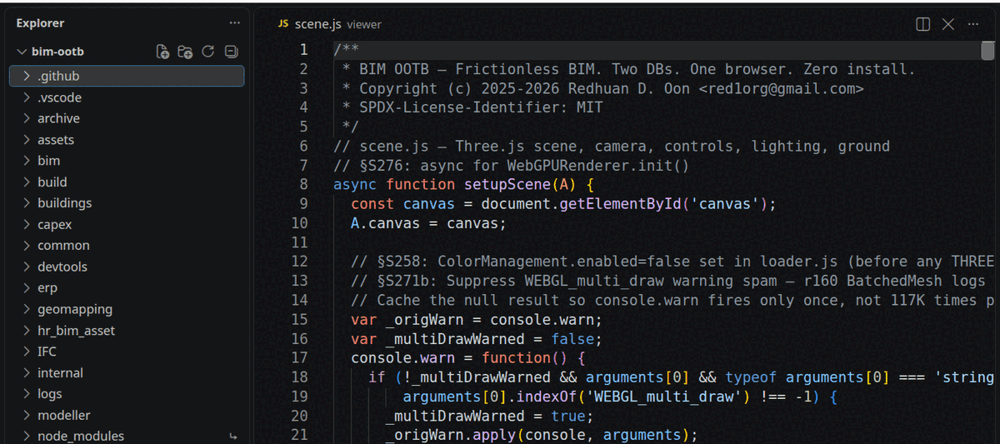

**2. Before: the editor cannot say where a field is set.** Go to Definition (F12) on `APP.db` answers "No definition found", because the
code writes that field as `A.db`.

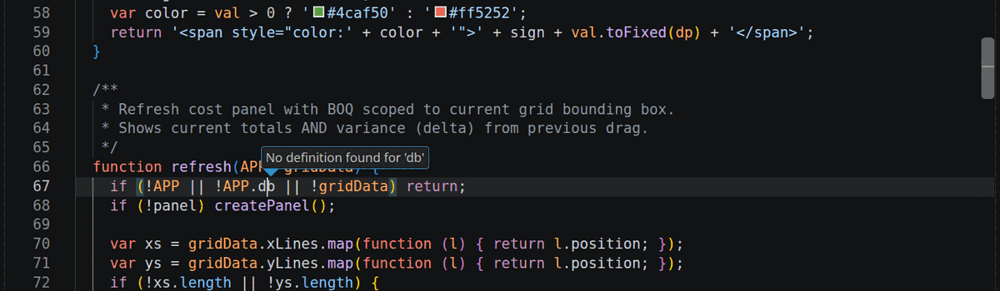

**3. With X0 Navigator: hover.** The same line now says where the field is written, and how often it is written and read.

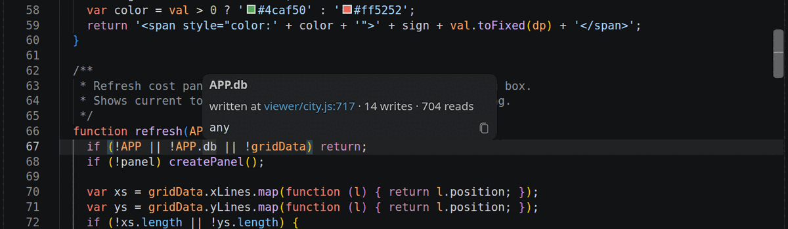

**4. F12 jumps to that line.**

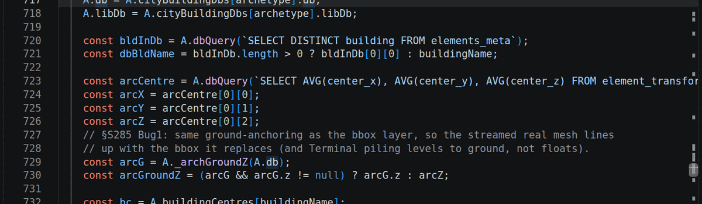

**5. A field nothing sets says so.** `PHANTOM` means the field is read but never written: do not rely on it. Here line 357 copies a
function that no code ever defines.

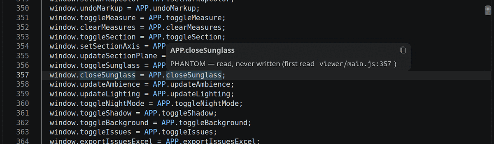

*Picture retaken 2026-11-14. Until that day the index missed files that had been split into parts, and called 130 of these fields
phantom when they were written (bim-ootb #2961, #2974). The count went from 281 to 171; where the index still cannot be sure it now says
`PHANTOM?` and names the line to read.*

**6. Hover a `§TAG`.** You get the spec pages that name it (headings first) and the code line that prints it.

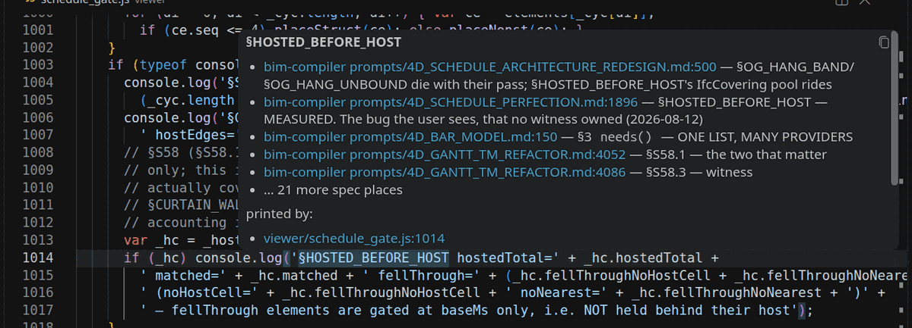

A tag that no spec names says `no spec found`:

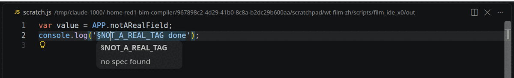

**7. The code moved? It refuses a wrong jump, then catches up.** A line was added above the write and the file saved. The next hover
says `index stale`; a few seconds later the same hover gives the new line.

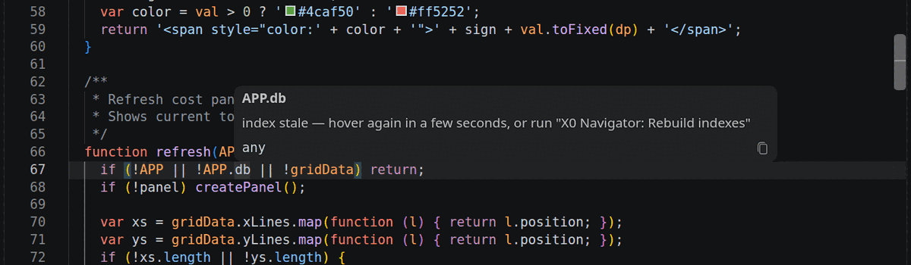

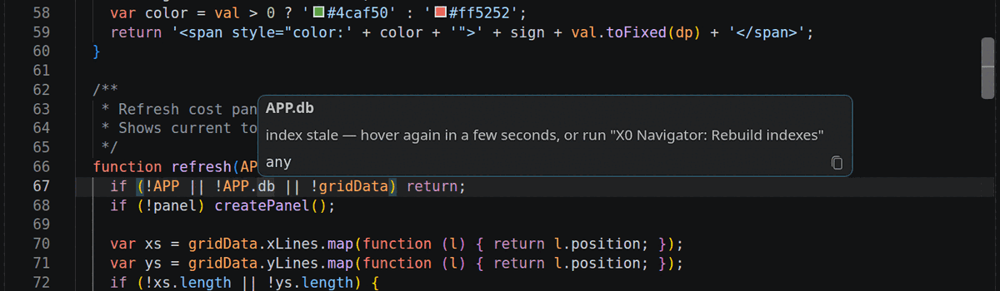

**8. Which code made this log?** A log saved by *Run this witness* starts with a `§LOG_STAMP` line. Here it names the commit, and
`viewer/city.js` as the one file that had been edited.

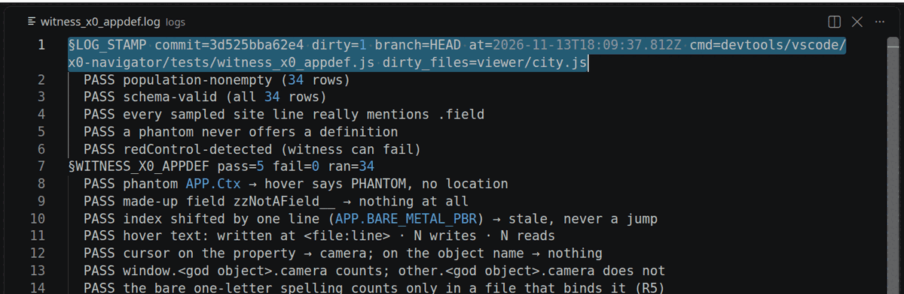

**9. Run & Ship.** The list sits at the bottom of the Explorer side bar. *Check* prints its three steps in the *X0 Navigator* output.

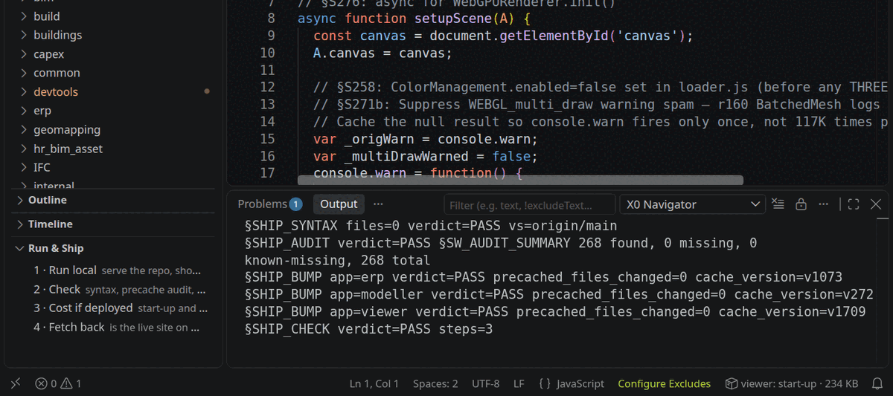

**10. Cost if deployed.** The output lists start-up and offline-cache bytes per app; the status bar (bottom right) says how the open
file reaches a user: `viewer: start-up · 234 KB`.

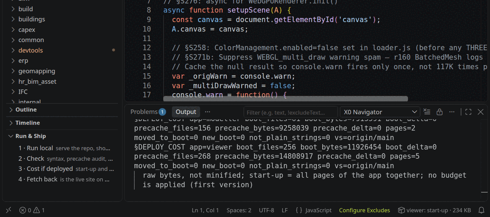

**11. The value beside the code.** The grey line above line 143 is what that line last printed, with the log and commit it came from.
It appears only when that can be proven.

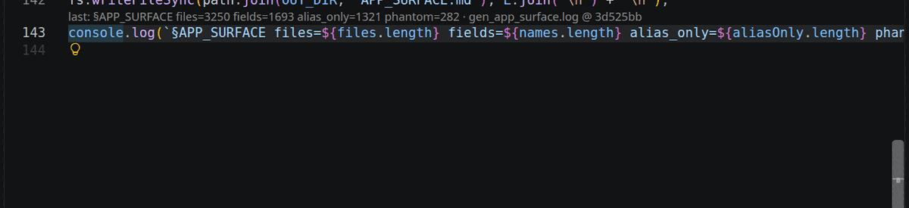

**The last three rows are first versions (2026-11-13). What they do not do yet:** Run & Ship does not commit, open a PR, merge or deploy,
and runs no browser. Cost counts raw bytes (not minified), all of an app's pages together, with no budget. The grey value line appears only
when the log names its commit and the file that prints the tag is unchanged since; otherwise it shows nothing, so expect few at first.
It reads the checkout's `logs/` and the folders in the setting `bimDevtools.extraLogDirs` (default `~/.cache/bim4d`, where bake logs are
kept; read-only). A bake log counts from the first bake after 2026-11-14, when the bake script began writing the `§LOG_STAMP` line.
*Fetch back* answers INCONCLUSIVE when the live site carries no deploy stamp, and FAIL when a version or the commit differs: right after a
merge, wait a minute or two and press it again.

**The index looks after itself.** The committed `internal/APP_SURFACE.md` is only a snapshot: about two merges in three move its line
numbers (26 of 39, measured 2026-11-13). X0 runs the generator into VS Code's own storage folder when it starts, and again when
a lookup misses after you saved a file. One run takes about 4 seconds in the background. It never writes inside the repo, so there is
nothing to commit and nothing to conflict on. **Do not regenerate and commit `APP_SURFACE.md` in an unrelated PR** for X0's sake.

For bim-compiler specs to show in a `§TAG` hover, keep the two clones side by side (`bim-ootb/` next to `bim-compiler/`), or set
`bimDevtools.compilerRoot`. Its witnesses (node only, no VS Code needed) are listed in its `README.md`.


### 4.2 Working with an AI assistant in VS Code (optional)

Nothing in this project needs an AI assistant, and X0 Navigator never calls one. If you choose to use one, this is how it fits. The facts
about Claude Code are from its documentation (code.claude.com/docs, read 2026-11-14).

**Two kinds of help, often used together.** An *autocomplete* assistant (GitHub Copilot's original style) suggests the next lines as grey
text while you type. An *agent* (Claude Code) has no grey-text completion: you describe a task, it reads files, runs commands and proposes
edits across files, and you approve them.

**Claude Code in VS Code, two ways.** (1) The *Claude Code* extension (Extensions view; VS Code 1.94 or later): a chat panel, your
selection and open file shared with it, `Alt+K` to insert a reference such as `@file.js#5-10`, proposed edits as side-by-side diffs with
Accept / Reject, a plan you can comment on, and "rewind code to here" on earlier messages. (2) The `claude` command in VS Code's own
terminal panel: with the extension installed it connects to the editor by itself, sees your selection and the Problems panel, and opens its
diffs in the editor. The terminal has every command; the panel has a subset.

**Staying in control: the habits that matter here.**

| Habit | Why |
|---|---|
| Ask for a plan before code on anything larger than a small fix, and read it | The cheapest place to stop a wrong approach |
| Read every diff before you accept it | The diff is the truth; the summary is a claim |
| One bounded task per session, on its own branch | A session that wanders is hard to review and hard to undo |
| Make it prove the change: a witness, a `§` line, the log read | "Done" without a log line is not done (§6) |
| Select the code, then say "this" | The selection travels with your message: no describing where |
| Keep project rules in `CLAUDE.md`, not in your head | Every new session reads it; a rule only said once is forgotten |
| Rewind instead of arguing | When an edit went wrong, go back to the checkpoint and restate the task |

**Writing the code yourself in VS Code, or letting the agent write it? An honest comparison.**

| | Mostly by agent ("vibe") | Mostly by hand in VS Code, agent as helper |
|---|---|---|
| Speed on a well-described task | Fast: many files, tests and docs in one go | Slower, one edit at a time |
| How well you know your own code | It fades: you approve more than you read | It grows: you learn where things are and why |
| Control over what changes | Only as good as your review of each diff | Direct: nothing changes that you did not type or accept |
| Cost | Paid per use, and long sessions cost the most | The editor and the add-on cost nothing to run |
| Same answer twice? | No. The same request can give different code | Yes for the tools here: an index lookup, a check, a byte count give the same answer every time |
| When it goes wrong | Plausible-looking mistakes, found late | Your own mistakes, usually found at once |
| Tedious, wide work (rename in 40 files, write a witness, draft a spec) | Its best use | Slow and error-prone by hand |

**The three worries, plainly.** *Losing control:* an agent does what it is allowed to do, so the limits are yours to set: it asks before
it edits, changes arrive as diffs, work stays on a branch and merges only through a pull request with checks. *Runaway cost:* cost follows
session length and the number of helpers started, so keep tasks small, start a new session for a new task, and let free deterministic
tools answer what they can (the facts server and X0's commands cost nothing). *Results that vary:* true of the model, not of code. This
project's answer is to make the model's work checkable by things that do not vary: a parser, a witness with a red control, a `§` line in
a log, a commit hash. A result that passes those can be trusted on that evidence, whoever typed it.

**A path that keeps you in charge.** (1) Read and navigate in VS Code with X0 Navigator until you can find anything yourself. (2) Make
small edits by hand; run *Check* before every commit. (3) Give the agent the wide or tedious jobs, one at a time, with a plan first.
(4) Review every diff as if a new colleague wrote it. (5) Keep what you learn in `CLAUDE.md`, so the next session starts from it.

**Give the assistant this project's facts (off by default).** `devtools/mcp/x0-facts/` is a small local server that answers from the same
code X0 Navigator uses: where an `APP` field is set, what a `§TAG` means, how a file is loaded, what a change costs, the last provable
logged value, the pre-ship check, and `context_for_file`: all of that for one file in a single answer (the same block as the editor command
*Context for this file*). It is read-only, calls no model and opens no network connection.

- On, from the bim-ootb folder: `claude mcp add x0-facts --scope local -- node devtools/mcp/x0-facts/server.js` (you, this project only).
- Off: `claude mcp remove x0-facts --scope local`. Inside a session, `/mcp` shows it and switches it for that session.
- When no assistant starts it, no process runs. X0 Navigator works the same with it on or off.

**Seeing what a session uses** (Claude Code documentation, read 2026-11-14). In the VS Code panel: the prompt box shows how full the
context window is, and `/usage` opens an *Account & usage* dialog (plan users see usage bars; API-key users see the session's cost and
tokens). In the terminal: `/usage` (also typed `/cost`) shows session cost and plan limits, and `/context` shows what fills the context
window, item by item. A terminal status line can show cost and context percentage all the time (`statusLine` in the settings). Not
documented: a status line inside the VS Code panel.
---

## 5. Changing things

### 5.1 Any edit to a file the browser loads

```
edit  →  node scripts/bump.js <file>           (dry run: shows what it will change)
      →  node scripts/bump.js <file> --write   (page ?v= +1, loader list ?v= +1 for lazy parts, CACHE_VERSION +1)
      →  node tests/audit_sw_precache.js        (precache list and pages agree)
      →  npx eslint viewer modeller             (no undefined globals)
      →  run the witness for what you changed, READ ITS LOG
```

There are three service workers, each with its own `CACHE_VERSION`: `viewer/sw.js`, `erp/sw.js`, `modeller/sw.js`. Put the
reason for a bump in the commit message, not in the `sw.js` line. The 4D schedule also has its own cache key,
`_GANTT_CACHE_VERSION` in `viewer/tm_dash.js`. If you change how a schedule is built, bump it by hand (`bump.js` does not).

### 5.2 Adding a new browser file

Add its `<script src="name.js?v=1">` in the right place in the page (order matters, §0 #2), add it to that app's
`PRECACHE_ASSETS` in `sw.js` **unless it is lazy on purpose**, bump `CACHE_VERSION`, and add any new shared global name to
`eslint.globals.json`.

### 5.3 Changing data

- **Rules, patterns, schema** (small, regenerable DBs such as `duplex_rules.db`, `terminal_rules.db`): a `migration/*.sql` script
  (append-only; never edit an old migration), or regenerate with the mining scripts.
- **A fix to a shipped building DB:** a SQL patch plus the self-heal loader that applies it when the page loads
  (Viewer: `A._applyPendingPatch` in `viewer/scene.js` + `buildings/patches/*.sql`; Modeller: `str_walker_outliner.js`).
  **The patch and the loader are one task**: a patch nobody applies is not done.
- **A full rebuilt building DB** goes to object storage, never git.
- Never commit a `.db` file. Git LFS is switched off.

### 5.4 ERP windows: one generic engine, never per-window code

The ERP user interface is one engine driven by the iDempiere Application Dictionary (`ad_seed.db`), the way iDempiere itself works. A
fault on one window is fixed in the generic layer (with the iDempiere class it ports cited), never with `if (table === 'c_order')`.
"It works" means *X of N dictionary windows pass*, not one happy path. Where behaviour is in doubt, the real iDempiere is the
oracle. The SQLite kernel must behave like legacy iDempiere, look and feel included.

### 5.5 Big files

The largest viewer files were split in 2026-10 by a generator that keeps every statement byte-identical
(`scripts/split_closure.js`, checked by `scripts/split_verify.js`). The film/camera files (`effects`, `cinema_path_editor`,
`cinema_maxq` families) are a protected lane: only small helper extraction there. Still long and worth care: 29 functions of
400+ lines, for example `_cinemaPathPlan` (2,823 lines), `injectGantt`, `renderAtTime`, `computeSchedule`.

---

### 5.6 The clock rule: time, dates and ids in ERP code

**The rule (owner decisions A-2, A-3, A-4, 2026-11-14).** Code that calculates (ERP processes, callouts, posting, the op-log fold, the schedule maths) never asks the machine for the time. The **shell** (the page, the service worker, the web-service kernel) reads the clock once, and everything else asks the transaction's env. Replaying a recorded operation must give the same rows on any day, in any time zone; a hidden `new Date()` breaks that quietly.

| You need | Ask | Never |
|---|---|---|
| the session's day (what legacy calls `#Date`) | `trx.env.date` (the login context's `#Date` is the source) | `new Date().toISOString().slice(0, 10)` |
| a time stamp for a new row | `A.Env.nowStamp(trx.env)` (the local wall-clock string) | `new Date()` |
| milliseconds | `A.Env.nowMs(trx.env)` | `Date.now()` |
| the local day of an instant you were given | `A.Env.stamp(ms).day` (also `.now`, `.millis`) | cutting the day out of `toISOString()` |
| a transaction env, in the shell | `A.Env.modelEnv(loginContext, { nowMs, uuid, perfMs })` | building the object by hand |

`A` is `X.A` (`AdCallout`) inside a process. If the env has no clock the call **throws and logs `§ENV_NO_DATE`**: that is the design, the core never falls back to a wall clock.

**The day is the LOCAL day, never the UTC day.** Legacy dates by the server's local day (the reference: iDempiere's web-service login sets `#Date` from the JVM's local time). `toISOString()` is UTC, so between local midnight and the zone offset the date comes out as *yesterday*. That was bim-ootb #2996: the headless kernel dated an invoice made at 00:30 in a +08 zone the 12th instead of the 13th. Test any date change at **00:30 in a +08 zone**; a test that only runs in UTC proves nothing here.

**Prove it:** `node erp/tests/witness_core_clock_reads.js` scans the files already migrated for a clock call and must print `clockReads=0` on every line, ending `§WITNESS_CORE_CLOCK_READS … fail=0`; `node erp/tests/witness_env_views.js` checks the day in UTC and Asia/Kuala_Lumpur (`§ENV_VIEWS … same=Y`); `node erp/tests/witness_replay_clock.js` replays a journal three days later (`§REPLAY_CLOCK … match=Y`). Both new witnesses carry a red control: a planted clock read must make them fail.
**Where it stands:** the migration is in progress, one file per pull request, and the files still to do are listed in `prompts/CODE_ARCHITECTURE_DESIGN.md` Part A (timing reads and a few id sources remain). Until it is finished, a file not in the witness's list may still read the clock; do not add new reads to any file under `erp/processes/`, `erp/callouts/`, `erp/model_*.js` or the schedule maths.

## 6. Proving it

- **Witnesses** live in `viewer/tests/`, `erp/tests/`, `modeller/tests/`, `tests/`, `witness/` and `scripts/tests/`. Run one with
  `node <file>` (or the editor task) and **read the log**. `npm test` runs the headless suite (`tests/run_witness_suite.js`;
  browser witnesses only with `--browser`, report-only because they are timing-sensitive).
- **New witness:** start from `witness_kit/contract.js` and the example
  `viewer/tests/witness_tm_schedule_output_of_truth.js`. Name the issue. Make it able to print FAIL and INCONCLUSIVE. Add a
  red control (a case that must fail) so you know it can.
- **Visual behaviour** (camera paths, positions, motion) is proven from numbers read off the real objects and `§` lines, never from
  how a screenshot looks.
- **A saved log says which code made it.** The witness task and the suite runner (`npm test`) start every log with one line:
  `§LOG_STAMP commit=<hash> dirty=<n> branch=… at=<time> cmd=…`, plus `dirty_files=…` when 1 to 10 tracked files differ from the commit
  (`scripts/log_stamp.js`). **Before you trust a value in a saved log, read that line:** if the commit is old, or the file that prints
  the value is in `dirty_files`, re-run the witness instead. A log without the line (anything saved before 2026-11-13, or by another
  tool) cannot be tied to code. Measured that day: saved logs held about a quarter of the `§TAG`s the code prints, and almost none
  said which code produced them. When you save a log yourself, put the stamp first:
  `node scripts/log_stamp.js <what you ran> > logs/x.log; node <file> >> logs/x.log 2>&1`.

**First reading, about two evenings.** The first three are the reading path in bim-ootb `prompts/SESSION_OPENER_READ_AND_REVIEW.md` §B;
the last two are added here: `witness_kit/contract.js` → the op-log hash chain in `erp/kernel_ops.js` (`stableStringify` → `commitOp`) →
`erp/ad_parser.js` → `viewer/db_resolve.js` (a model spec header) → `viewer/main.js` (boot + lazy lists).
`internal/CodeScrapBook.md` is the long-form version of this section.

### 6.1 The logged-value rule (usable in any project)

A tool that shows "the value this line last printed" beside the code is useful only if the value still belongs to the code on screen.
A debugger knows that because the process is live. A saved log does not, so the rule has to supply it:

> **Show a logged value only when the code that printed it is unchanged since the commit the log names, and was not edited when the log
> was made. Otherwise show a named reason. Never a guess.**

What a project must emit to use it, and nothing more:

| Piece | Form here | Why |
|---|---|---|
| A stamp near the top of each saved log | `§LOG_STAMP commit=<hash> dirty=<n> … [dirty_files=a,b]` (`scripts/log_stamp.js`) | names the code, and says which tracked files differed from that commit |
| A tag on the line that prints | `console.log('§TAG …')` | ties a log line to one line of code |
| The log kept on disk | `logs/*.log`, or a folder named in a setting | the evidence itself |

The three proofs, in order, and what the reader is told when one fails:

| Proof | If it fails |
|---|---|
| A stamped log carries the tag | `no stamped log found`, or `tag not in any stamped log` |
| The printing file was not edited when the log was made (the stamp must list the edited files to prove it) | `file was dirty when the log was made`, or `stamp does not name its dirty files` |
| The printing file is unchanged since the stamp's commit (`git diff --quiet <commit> -- <file>`) | `file changed since the log` |

Two things the rule refuses on purpose. A line that names only a commit is not a stamp: without the edited-files count the second
proof cannot be made (this is why a bake's own commit line is not accepted, and the bake now writes the stamp). And a value is never
shown "probably current": the reason is shown instead.

**What is and is not new.** Showing run-time values in the editor is established (live-process tools do it), and so are frame-capture and
log viewers. Those tools get freshness for free from a running process, or do not claim it. The piece here is the provenance check on
an offline log. It is a few lines of code (`devtools/vscode/x0-navigator/lib/lens_index.js`: `parseStamp`, `whyNot`, `explain`), has
no dependency, and its witness (`witness_x0_lens.js`) holds a red control for every refusal above.

---

## 7. The compiler side (this repo)

What the April guide described is still here, and it is still the compiler. The details are in `docs/archive/DEVELOPER_GUIDE.md`:

| Part | Where | Run |
|---|---|---|
| Java modules: `DAGCompiler`, `BIM_COBOL` (verbs), `ORMSandbox`, `TopologyMaker`, `orm-core` | repo root, `pom.xml` | `mvn compile -q`, `./scripts/run_tests.sh` |
| Proof gates G1–G6 (compiler reconstruction truth) | `RosettaStoneGateTest.java` | `./scripts/run_RosettaStones.sh classify_sh.yaml`. **Local discipline: no CI runs these.** |
| Headless smoke subset | `.github/workflows/ci.yml` | `scripts/system_is_real.sh` |
| Pre-commit hook | `.git/hooks/pre-commit` | gates: block library · compile check · tamper seal · data integrity |
| Migrations | `migration/` (186 files) | append-only |
| Schema reference | `docs/internal/DATA_MODEL.md`, `docs/internal/SQLite3D_Schema.md` | |
| Walker rules (which rules DB a building class walks) | `docs/internal/WalkerDoctrine.md` | locked, read before walker work |

The core idea still holds: **a building is a Bill of Materials.** One parent, N children, each with a quantity, recursively
(building → floor → room → furniture). WHAT (orders, categories, products), HOW (BOMs, attribute sets, validation) and WHERE
(the output DB) are kept apart. Positions are computed by verbs, never typed in.

---

## 8. Traps that have cost real time

| Trap | What happens | Do instead |
|---|---|---|
| A date taken from `toISOString().slice(0, 10)` or `new Date()` in ERP code | The UTC day, or today's wall clock: wrong near midnight, and a replay on another day gives other rows (#2996) | `trx.env.date`, `A.Env.nowStamp(trx.env)` (§5.6); test at 00:30 in a +08 zone |
| Edited a precached file, reloaded, "nothing changed" | Service worker served the old file | `bump.js` (§5.1), or DevTools ▸ Application ▸ "Update on reload" while debugging |
| Opened the copy instead of the source | 329 stale copies in this repo | Edit in bim-ootb. Check the path before you save |
| Trusted a `file:line` from an old prompt | Lines moved in the 2026-10 splits | Search for the function name |
| A grep count that looked like a finding | Comments and words inside words match too (`TODO` inside *METODOLOGI*) | Check that the hits are code before acting |
| A green witness that judged nothing | Empty population reads as 0 = PASS | Make it print INCONCLUSIVE when nothing was judged |
| Two copies of one responsibility | Duplicates drift (`ERPKernel` is published by two files; `modeller/routewalker.js` vs `viewer/routewalker.js`) | Find the owner first. The 4D lane keeps an ownership table in `prompts/4D_MODEL_INTEGRITY.md` §I |
| History written into code comments | Slow to read (about 5% of comment lines are dated change stories; one `sw.js` comment had grown to 234,833 characters on one line) | History goes in the commit message and `prompts/`; comments say what the code does now |
| Witness paths assume one machine | Many witnesses hard-code the author's home folder | Expect to adjust paths on a new machine; a shared resolver is an open item |
| A saved log with no `§LOG_STAMP` line | Its values look current but may come from code that has since changed. Measured 2026-11-13: almost no saved log said which code made it | Read line 1 of the log (§6). No stamp, an old commit, or the printing file listed as dirty: re-run the witness |
| A copy of the tree inside the tree (an agent worktree under `.claude/worktrees/`, a nested clone) | A tool that walks folders reads the copy as source. `gen_app_surface.js` once put 1,082 rows pointing into such a copy, so F12 opened the stale file | A dev tool skips any sub-folder that holds a `.git` entry, and its witness also runs on a checkout that looks like a working one, not only a clean one |
| A PR auto-merged by CI's bot (bim-ootb) | The *Deploy to GitHub Pages* workflow does not start for a merge made with the workflow's own token. Only GitHub's plain branch build publishes: raw files, no `erp/version.json`. Seen live 2026-11-13 | Enable auto-merge yourself right after opening the PR (`gh pr merge <n> --auto --squash`), then press **Fetch back** (§4.1) a minute or two after the merge: it must say PASS |
| Two numbers in a squash title, `… (#issue) (#pr)` | Until 2026-11-13 the deploy wrote both into `erp/version.json` and the file was not valid JSON | Fixed in the workflow (it takes the last number). Put `Fixes #N` in the PR body, not in the title |

---

## 9. What not to add, and what breaks maintainability or speed

The app is deliberately small: pure SQLite WASM, local-first, air-gapped capable. Editor help is fine **only** where no page loads it.

| Fine (editor/dev only) | Not fine (reaches the app or adds a dependency) |
|---|---|
| `jsconfig.json`, `types/*.d.ts`, `.vscode/`, `.editorconfig` | `.ts` source files, a compile or bundle step |
| `// @ts-check` and JSDoc comments (the browser ignores them) | TypeScript, a framework, or any new library in `package.json` `dependencies` |
| Scripts under `scripts/` (bump, generators, witnesses) | A forked or extra runtime library |
| | Mass reformatting (one huge diff that collides with every open branch) |

The editor tools that need a TypeScript parser use the copy that ships inside VS Code (`scripts/lib/find_ts.js`), so nothing extra
is installed. ES modules are native to browsers, but switching to them changes load order at run time, so only file by file,
behind a witness, and only when asked.


### 9.1 Changes that break maintainability

| Change | Why it hurts | Do instead |
|---|---|---|
| A second implementation of something that already has an owner (a second schedule formula, a second master-detail engine, a "quick" copy of a helper) | The two drift apart and disagree; nobody knows which one runs | Find the owner and call it. The 4D ownership table (`prompts/4D_MODEL_INTEGRITY.md` §I) is the model |
| Per-window or per-table special cases in the ERP (`if (table === 'c_order')`) | Every new window needs new code; the generic engine rots | Fix the generic layer, cite the iDempiere class it ports, count *X of N* windows |
| A new shared global without adding it to `eslint.globals.json` | The `no-undef` gate goes red, or a typo becomes a silent `undefined` | Add the name in the same change; regenerate `types/globals.gen.d.ts` |
| Removing a file's UMD tail, or moving a `<script>` tag | The Node witnesses can no longer load the file / the page breaks on an undefined global | Keep the tail; respect load order (§0 #2) |
| Editing a generated file (`erp/genesis_dict.js`, `internal/APP_SURFACE.md`, `types/globals.gen.d.ts`, …) or a copy in this repo | Overwritten on the next regeneration / edits the wrong file | Edit the generator named on line 1 / edit bim-ootb |
| Writing change history into code comments | Slow to read; one comment grew to 234,833 characters on one line | Commit message and `prompts/`; comments say what the code does now |
| Growing an already long function (29 functions are 400+ lines) | Harder to read and to witness | Add a small named function beside it; split only with the byte-identical method (§5.5) |
| Hard-coded personal paths, invented values, defaults dressed up as data | Fails on another machine / breaks *extract, don't invent* | Paths from config; values from a named source |
| A witness that cannot fail (no red control, PASS on an empty set) | Green forever, proves nothing | INCONCLUSIVE when nothing was judged; one case that must fail |
| Mass reformat, rename sweep (e.g. `A` → `APP` across the tree), big multi-purpose PRs | One giant diff that collides with every open branch | One module at a time, behind its witness |

### 9.2 Changes that break speed or memory

Measured, not guessed (`docs/BrowserScaleBenchmark.md`): in one tab the limit is **memory, not drawing speed**. The heap grows about
**0.17 GB per million vertices** (fit over three large models). A render pass costs about 6 ms on a laptop GPU while the largest
model peaks at 3.4–3.8 GB. Phones have far less room per tab.

| Change | Why it hurts | Do instead |
|---|---|---|
| Adding a script to the page's boot list for a feature most users do not open | Every user pays for it on every start | Lazy-load it from the loader list on first use (the viewer's Find/navigate parts are the pattern) |
| Precaching a lazy module "to fix a warning" | Bigger install, slower first load, for a part that is lazy on purpose | Leave it out of `PRECACHE_ASSETS` unless it must work offline. `bump.js` only ever prints a NOTE for it |
| Anything that delays the first paint of the ERP shell | The shell must appear instantly from cache (`erp/sw.js` header: stale-while-revalidate for pages) | Do the work after first paint |
| Adding geometry (welds, clones, outlines, pre-warm meshes) without counting it | Memory is the limit, and it is measured per vertex, not per element | State the vertices / heap added in a `§` line at the end of the pass |
| Keeping a second copy of a big buffer in JavaScript (vertices, normals, a whole DB) | Doubles the memory for that data | Typed-array views and on-demand reads |
| Rewriting the whole database to save a small change | Cost grows with model size | Save deltas |
| Assuming "hidden" or "far away" frees memory | Level-of-detail and occlusion save drawing work, not memory: nothing is disposed | Design new geometry paths so off-screen parts can be released; streaming is the growth path, not more RAM |
| A heavy pass with no cost line | The next person cannot tell what it costs | End it with a `§` line: heap (`performance.memory`) and vertices |

---

## 10. Contributing: issue first, then a pull request

This is a FOSS project under the MIT licence, and it is *author-decided*: anyone may copy, change and redistribute it, and the
author decides what enters the main line (bim-ootb `GOVERNANCE.md`, after SQLite's "open-source but not open-contribution").
A change is considered only if every test still passes and **no test or check is removed or weakened**. A change that breaks a
principle (local first, the legacy-iDempiere twin including look and feel, one generic dictionary engine, a test before a claim)
is declined, whoever asks.

**The flow:**

1. **Open an issue on the tracker first**, in the repo you would change
   ([bim-ootb issues](https://github.com/red1oon/bim-ootb/issues) for the app, [BIMCompiler issues](https://github.com/red1oon/BIMCompiler/issues)
   for the compiler and docs). Say what is wrong or missing, how to reproduce it, and the **source** for any value (IFC file,
   legacy record, published rate). Paste the `§` log line that shows the problem. One issue, one problem.
2. **Wait for the author's go** on anything beyond a small fix. The issue is where scope is agreed, before code is written.
3. **Fork, and branch from the latest `main`/`master`:** `fix/<thing>`, `feat/<thing>`, `docs/<thing>`.
4. **Spec first.** For a new rule or behaviour, write the spec block (§0) and the witness claim before the code.
5. **One small change per pull request**, then run the witness for that area and read its log. Before you push, also run the
   gates in §5.1 (`bump.js` if you changed a browser file, `audit_sw_precache.js`, `eslint`).
6. **Open the pull request** with `Fixes #<issue>` in the body. Fill in the template: what changed, the source, the `§` log
   lines that prove it, and lines added/removed. Commit titles use the conventional types the release notes are built from:
   `feat:`, `fix:`, `perf:`, `docs:`, `refactor:`, `revert:`.
7. **CI must be green**, and the author reviews and merges. Do not merge your own change into the main line.

**Easy first contributions** need no engine knowledge: a rate template for your country, a test building, a product catalogue, a
locale. The list is in `CONTRIBUTING.md` (BIMCompiler). **Avoid:** invented data, pull requests that do several things,
touching `deploy/live/`, adding a dependency (§9). No CLA is needed.

---

## 11. Recommended refactoring (when you are in a file anyway)

None of these is a sweep. Each is one file or one module at a time, behind its witness, and none adds a dependency (§9). Ranked by
how much it helps a reader for how little risk. The full work order, written for a later session to carry out, is
`prompts/REFACTOR_FOR_READERS.md` (this repo).

| # | Refactor | What it buys | Risk | How to prove it |
|---|---|---|---|---|
| 1 | **`// @ts-check` + JSDoc** on the files you edit most (today 0 files have `@ts-check`, 54 have any JSDoc) | Autocomplete, hover docs and red squiggles in that file. Comments only: the browser sees nothing | None at run time | The file's witness unchanged; no unintended new red in VS Code |
| 2 | **Move the export to the top level** for the UMD globals F12 cannot follow (17 of 44 sampled, e.g. `Dxf2Bim`, `ScheduleEngine`): `var X = (function(){ … return api; })(); if (typeof module …) module.exports = X;` | F12 and find-references start working for that global | Low: same object, same name | `scripts/tests/witness_global_types.js` resolves one more; the file's own witness unchanged |
| 3 | **One owner per responsibility**: retire the duplicates the type generator lists (`ERPKernel` in two files; `Bonsai` ×3 and `ERP` ×4 publishers; `modeller/routewalker.js` vs `viewer/routewalker.js`) | One place to read and fix | Medium: callers may rely on a copy's differences | Diff the copies first; witness every caller; the deleted lines are part of the change |
| 4 | **Clear the phantom fields**: 107 `APP.x` fields read in production but never written (recounted 2026-11-14 after the index fix, bim-ootb #2974) (`internal/APP_SURFACE.md`) | Dead guards gone; fewer "where is this set?" hunts | Low per field | The phantom count goes down; the file's witness unchanged |
| 5 | **Split the longest functions** with the byte-identical method: `injectGantt` (992 lines), `renderAtTime` (961), `_getMaterial` (762), `computeSchedule` (654) | Readable units, each with a name | Medium: shared closure variables | `scripts/split_closure.js` + `split_verify.js` (every statement identical, in order); 4D: the cached run identical |
| 6 | **Rename `A` to `APP` in one module** (`viewer/scene.js` first, 606 sites) | grep finds definitions again | Low per module, high as a sweep | `APP_SURFACE.md` field and phantom counts identical before and after |
| 7 | **One path resolver for witnesses** instead of hard-coded home folders | Witnesses run on a second machine | Medium: touches the proof chain | Every converted witness gives the same verdict before and after |
| 8 | **A rule for where new witnesses go** (today six folders) | Fewer places to look | None for the rule; moving files is a change (CI and scripts name some files) | Every reference updated in the same change |

**Not recommended:** a framework, a bundler, `.ts` files, converting the tree to ES modules in one go, or a repo-wide reformat.
Each one either reaches the app or produces a diff nobody can review.

---

## 12. Where to read next

| If you will work on | Read |
|---|---|
| The whole system, as an outside reviewer | [Architecture Overview](ArchitectureOverview.md) |
| The ERP fold engine | [Fold Engine Black Book](FoldEngineBlackBook.html) |
| The viewer's module layout | [Viewer Component Model](ViewerComponentModel.html) |
| How the in-browser database works | [How the Database Works](SQLiteWasmArchitectureActual.html) |
| Code navigation, measured | `internal/CodeScrapBook.md`, `internal/APP_SURFACE.md` (bim-ootb) |
| Editor setup and why each piece exists | `prompts/EDITOR_MAINTAINABILITY_STUDY.md` (this repo) |

**Sources.** Every path above is in [BIMCompiler](https://github.com/red1oon/BIMCompiler) or [bim-ootb](https://github.com/red1oon/bim-ootb).
Counts were measured on 2026-11-13 (bim-ootb `main` @ `cc9988c2`, BIMCompiler `master` @ `90684efbe`).
