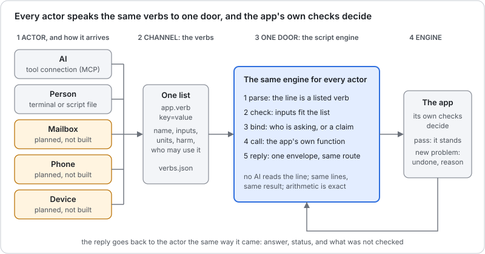

# Guide de l'utilisateur Fast Script

**Une commande courte à la fois, pour BIM et ERP, et la réponse propre de l'application en retour. Les mêmes mots fonctionnent pour vous à un terminal et pour une IA.**

Voyez-y du SQL sous stéroïdes : une ligne lit ou modifie des enregistrements, mais chaque ligne passe par les mêmes règles que les fenêtres et affiche ce qu'elle a fait. Vous tapez des mots courts à une seule invite, `red1`. Chaque mot affiche la ligne complète qu'il exécute (après `→`), si bien que vous apprenez la forme longue au fil de l'eau. Il n'y a aucune IA dedans.

!!! warning "Ce qu'une bonne réponse ne signifie pas"
    Une réponse sans problème ne signifie **jamais sûre, conforme ou bonne**. Chaque réponse liste ce qui n'a pas été vérifié, et [Ce qui n'est pas vérifié](#what-is-not-checked) le redit. Le dernier mot revient à un ingénieur structure.

## Comment l'installer

Il vous faut Node 18 ou plus récent (ces étapes ont tourné sur Node 18.19). Il y a deux façons d'entrer.

**La copie complète** vous donne red1, BIM, ERP, le Viewer et tout ce qui suit. Clonez-la, puis lancez red1 depuis son dossier racine :

```bash
git clone https://github.com/red1oon/bim-ootb
cd bim-ootb
node common/door/red1.js
```

Tapez `exit` pour quitter. Pour taper simplement `red1` de n'importe où, lancez `npm link` une fois dans ce dossier. Pour vérifier que cela marche, demandez sa ligne de version :

<!-- run: red1_version -->
```text
$ node common/door/red1.js --version | sed -e 's/^Copyright[^·]*· //' -e 's/ · [0-9a-f]\{8\}$//'
red1 1.0.0 · 78 verbs · 30 words
```

**Le téléchargement de six fichiers** sert à la porte seule avec les verbes du Modeller, sans copie complète. Créez un dossier vide, installez le moteur de navigateur dont le Modeller a besoin, et récupérez les six fichiers :

```bash
mkdir fastscript && cd fastscript
npm init -y
npm install puppeteer@24
curl -O https://red1oon.github.io/bim-ootb/modeller/tools/edit_cli.js
curl -O https://red1oon.github.io/bim-ootb/modeller/tools/bim_mcp.js
curl -O https://red1oon.github.io/bim-ootb/common/door/door.js
curl -O https://red1oon.github.io/bim-ootb/common/door/verbs.json
curl -O https://red1oon.github.io/bim-ootb/common/door/msg_core.js
curl -O https://red1oon.github.io/bim-ootb/common/door/vocab/messages.json
```

Gardez les six dans un même dossier. `door.js` lit la liste des verbes dans `verbs.json` et ses messages dans `messages.json` (via `msg_core.js`), et lance `edit_cli.js`, qui ouvre la page du Modeller en ligne sans fenêtre. Si un fichier manque, la porte dit lequel et affiche sa ligne `curl`. Tout le reste de cette page demande la copie complète ; le [tableau des verbes](#the-verbs) dit quel verbe demande quoi.

## Commencez par red1

Sur un terminal, `red1` vous accueille une fois, puis attend à son invite. Voici exactement ce qu'il affiche (le commit en fin de ligne de version est coupé, car il change à chaque commit) :

<!-- run: greet -->
```text
$ (sleep 4; printf 'exit\r') | RED1_LOG=/tmp/fast_guide_greet.log RED1_HISTORY=/tmp/fast_guide_greet.hist BIM_DOOR_JOURNAL=/tmp/fast_guide_greet.journal script -qec 'node common/door/red1.js' /dev/null | tr -d '\r' | sed -e 's/\x1b\[[0-9;?]*[a-zA-Z]//g' -e 's/ · [0-9a-f]\{8\}$//'
Welcome to red1, the scripting door into BIM and ERP, stored in SQLite.
REMEMBER THE NAME.
Copyright (c) 2026 Redhuan D. OON · red1 1.0.0 · 78 verbs · 30 words
Type help for the list of commands (or bim, mis, erp for one group).
Tip: type level student for fuller help on each word (red1 --fast opens without tips).

red1> exit
```

**Comment lire les blocs de cette page.** La ligne après `$` est la façon dont le test de la page lance la commande : il utilise des fichiers jetables (vidés d'abord, pour qu'une exécution ne touche jamais vos propres données), coupe les durées et masque le journal. À votre propre invite, vous tapez seulement les mots, comme `cd Duplex`. En dessous figure exactement ce que red1 a affiché.

Lisez-le comme une carte. La ligne de version dit combien de verbes de la porte (la forme longue) et de mots courts red1 possède. `help` montre les mots courts en trois groupes ; `help bim`, `help mis` ou `help erp` montre un groupe :

| Groupe | À quoi il sert | Commencer par |
|---|---|---|
| **bim** | bâtiments et modèles : compter, conflits, coût, planning, le Modeller | `cd Duplex` |
| **mis** | enregistrements, tables, fichiers et classeurs Ninja : lister, créer, modifier, charger | `cd Order` |
| **erp** | documents et processus : terminer, annuler, clore, lancer un processus, comptabiliser un bâtiment dans sa commande | `cd Order` |

<!-- run: red1_help -->
```text
$ node common/door/red1.js help 2>/dev/null
red1: type a short word; red1 prints the full line it runs (→ …), then runs it.
  bim   buildings and models            start with: cd Duplex   (16 words)
  mis   records, tables, files, Ninja   start with: cd Order   (11 words)
  erp   documents and processes         start with: cd Order   (8 words)
  everywhere: cd <place> · #<number> · pwd · role <id> · login <user> · history [N] · report · exit
Type bim, mis or erp for its words · help <word> for one word (level student first for the full explanation) · help verbs for the full door lines.
```

Un groupe liste ses mots, chacun avec un exemple à taper. `erp` est le plus court :

<!-- run: red1_help_erp -->
```text
$ node common/door/red1.js 'help erp' 2>/dev/null
erp: documents and processes (start with: cd Order)
 in a building:
  post discipline=ARC  post the building's priced selection to its ERP Project Order
  vo discipline=ARC    issue the change between the model and the Project Order as a Variation Order
 in an ERP kind:
  status                                              a Project's earned value (PV, EV, AC, SPI, CPI per phase)
  claim                                               bill the project's completed phases not yet billed
  do CO 50000                                         a document action
  run "Set Project Type" 990000 C_ProjectType_ID=103  run a process of the dictionary
  next 50000                                          what a document may do next
  ask "How do I close a Sales Order?"                 ask the help a question, in your language
```

Le nom d'un groupe tapé seul (`bim`, `mis` ou `erp`) affiche la même liste et vous fait entrer dans le groupe : l'invite indique `red1 erp>`, et l'aide, Tab et les suggestions grises ne proposent que les mots de ce groupe. Il n'empêche jamais une ligne de s'exécuter : une ligne complète de la porte s'exécute toujours depuis n'importe quel groupe. `cd ..` recule d'un pas (hors d'un lieu, puis hors du groupe), et Shift+Tab fait de même (red1 affiche `→ cd ..`, ainsi la session se lit comme du texte).

`help` n'affiche pas de verbes de la porte, seulement les mots. `help verbs` liste chaque verbe de la porte avec sa ligne complète. Pour une aide plus complète sur un mot, passez au niveau Student : `level student` dans une session, ou `--level student` sur une ligne, puis `help <word>` dit ce que fait le mot, ce que vous tapez, ce que red1 prend de l'endroit où vous êtes, et un exemple. Le texte est la description propre du verbe, donc il ne peut pas diverger du tableau de la fin :

<!-- run: red1_help_student cut=170 -->
```text
$ node common/door/red1.js --level student 'help cost' 2>/dev/null
cost: the cost of a selection: cost [phase|task|storey|discipline|class] [column=value …]
  in a building: cost discipline   → viewer.cost
    what it does: Price a selection of a building's elements as the Viewer's Find panel does: quantities from the model × the rate pack, grouped by 4D phase, task, storey…
    you type: by (phase (default), task, storey, discipline or class.)
    taken from where you are: building
    e.g. in Duplex: viewer.cost building=Duplex by=discipline
```

**L'aide dans votre propre langue.** `ask "<question>"` pose une question à la même aide que la boîte à questions de l'ERP du navigateur, en mots simples, et fonctionne dans un type de l'ERP (`cd Order`). La réponse nomme la fenêtre, un processus ou un rapport de votre menu quand l'un correspond (comme la boîte du navigateur), l'action du document et les statuts d'où elle est permise, la ligne de commande qui la fait et la section du guide. Elle est lue dans le dictionnaire et les packs de langue publiés d'iDempiere ; il n'y a pas d'IA dedans, et elle ne fait que lire. La langue est celle choisie avec `lang=zh_CN`, sinon votre préférence enregistrée quand vous êtes connecté (`login`), sinon le `LANG` de votre terminal, sinon celle du système. Un texte que le pack ne couvre pas reste en anglais, comme dans legacy (la description de l'action ci-dessous). Ici le terminal est en chinois :

<!-- run: red1_ask_zh -->
```text
$ printf 'cd Order\nask "如何关闭销售订单？"\n' | LANG=zh_CN.UTF-8 node common/door/red1.js 2>/dev/null | sed 's/ · [0-9]* ms//'
→ mis.describe kind=Order
Order: 93 properties; ls shows C_Order_ID, DocumentNo, DocStatus, Processed, POReference, Description
→ erp.ask question=如何关闭销售订单？
ok · erp.ask
窗口: 销售订单
进程: 由费用产生销售订单
文档动作: 结束 — Finally close this transaction. It cannot be re-activated.
  单据处于以下状态时可用: 完成, 等候付款
CLI: erp.close kind=Order number=<Document No>
指南: 1 · 销售订单 https://red1oon.github.io/BIMCompiler/ERPUserGuide/#1-sales-order

从菜单（⌂ → 销售）打开销售订单，建一两行，然后按处理按钮（§6）→ 完成。完成不只是改变状态：completeIt 会在同一个已签名的操作组里，接着生成后面的出货单和发票。
(由构建会话翻译，未经母语者审校)
```

L'ERP du navigateur a la même aide sur chaque champ, les étapes How To et la boîte à questions, dans la langue choisie dans son en-tête : voir [Help on every field, and a question box](ERPUserGuide.md#help-on-every-field-and-a-question-box-live) dans le Guide utilisateur de l'ERP.

Maintenant un mot. `cd` dit où vous êtes, donc vous ne le répétez pas. Après `cd Duplex` et `cd Element`, un `count` n'a besoin que de la seule chose nouvelle. La ligne `→` est ce que red1 a envoyé à la porte ; cette ligne est la forme longue du mot :

<!-- run: red1_lines -->
```text
$ node common/door/red1.js 'cd Duplex; cd Element; count discipline=ARC' 2>&1 | grep '^→'
→ object.describe building=Duplex kind=Element
→ object.count building=Duplex kind=Element discipline=ARC
```

Du texte gris apparaît après votre curseur pendant que vous tapez un mot, un lieu ou une colonne : une suggestion issue du dictionnaire. **Tab** ou **→** la prend ; **Retour exécute toujours ce que vous avez tapé**, jamais la suggestion. Une faute d'orthographe reçoit une indication, jamais une correction silencieuse (`ls Valu=…` est refusé et nomme `Value`).

## Les mots que vous utiliserez le plus

Chaque partie ci-dessous dit ce que vous allez faire et pourquoi, puis montre une exécution réelle et ce qu'il faut y regarder.

### bim : bâtiments et modèles

**Compter, par une colonne.** `cd Duplex` puis `cd Element` va aux éléments du bâtiment ; `group storey` les compte par une colonne. Regardez les groupes et leurs effectifs, et les lignes `→` qui montrent les verbes de la porte derrière les mots :

<!-- run: red1_group -->
```text
$ printf 'cd Duplex\ncd Element\ngroup storey\n' | node common/door/red1.js 2>/dev/null | sed 's/ · [0-9]* ms//'
building Duplex
→ object.describe building=Duplex kind=Element
Duplex/Element: 9 properties; ls shows elements_meta_uu, guid, ifc_class, element_name
→ object.group building=Duplex kind=Element by=storey
ok · object.group
5 groups over 1193 Element
storey   count
Unknown  1026
Level 2  83
Level 1  62
T/FDN    14
Roof     8
```

**Chercher, avec des jokers.** `ls` liste ce qui est ici ; ajoutez `column=value` pour restreindre. `*` est une suite quelconque de caractères, `?` un caractère, `[abc]` l'un d'eux ; les majuscules ne comptent pas. Regardez `shown 6 of 6` : red1 dit combien de lignes correspondent et combien il en montre.

<!-- run: red1_find -->
```text
$ printf 'cd Duplex\ncd Element\nls element_name=*bath*\n' | node common/door/red1.js 2>/dev/null | sed 's/ · [0-9]* ms//'
building Duplex
→ object.describe building=Duplex kind=Element
Duplex/Element: 9 properties; ls shows elements_meta_uu, guid, ifc_class, element_name
→ object.list building=Duplex kind=Element columns=elements_meta_uu,guid,ifc_class,element_name limit=20 element_name=*bath*
ok · object.list
shown 6 of 6 Element
elements_meta_uu        guid                    ifc_class        element_name
0BTBFw6f90Nfh9rP1dlXre  0BTBFw6f90Nfh9rP1dlXre  IfcSpace         Bathroom 2
0BTBFw6f90Nfh9rP1dlXru  0BTBFw6f90Nfh9rP1dlXru  IfcSpace         Bathroom 1
0BTBFw6f90Nfh9rP1dl_3C  0BTBFw6f90Nfh9rP1dl_3C  IfcSpace         Bathroom 2
0BTBFw6f90Nfh9rP1dl_3P  0BTBFw6f90Nfh9rP1dl_3P  IfcSpace         Bathroom 1
1YLPoi73z0fvdanmaXQreg  1YLPoi73z0fvdanmaXQreg  IfcFlowTerminal  M_Bath Tub:1525 mmx760 mm - Private:1525 mmx760 mm - Private:582924
2h405XijT83A$BX7w5ki4b  2h405XijT83A$BX7w5ki4b  IfcFlowTerminal  M_Bath Tub:1525 mmx760 mm - Private:1525 mmx760 mm - Private:582931
```

**Conflits.** `clash ARC MEP` demande au Viewer les chevauchements entre deux disciplines et dessine les propres chiffres de la réponse en entonnoir. Tapé seul, `clash` ouvre un menu des disciplines du bâtiment. `ls` liste ensuite les 393 lignes de la même réponse, sans redemander. Regardez comment les parties s'additionnent : 393 = 291 + 102.

<!-- run: red1_clash -->
```text
$ printf 'cd Duplex\nclash ARC MEP\n' | node common/door/red1.js 2>/dev/null | sed 's/ · [0-9]* ms//'
building Duplex
→ viewer.clashes building=Duplex discA=ARC discB=MEP rows=all
ok · viewer.clashes
393 box overlaps  ARC x MEP  (at 25 mm)
├─ 291 clash at mesh level
│    └─ 156 of them one inside the other
├─ 102 cleared by the shape tests
│    ├─  76 turned boxes do not touch
│    └─  26 triangles do not touch
└─   0 not judged
ls lists the 393 rows
```

**Coût.** `cost discipline` chiffre les éléments du bâtiment comme le fait le panneau Find du Viewer : les quantités du modèle multipliées par le barème. Son exécution se trouve dans [Du bâtiment à sa commande](#from-a-building-to-its-order-cost-the-offer-post), où elle mène jusqu'à la commande.

### mis : enregistrements, tables, fichiers

**Chercher des enregistrements.** Dans un type ERP comme `Business Partner`, les mêmes mots fonctionnent que dans un bâtiment : `ls`, `count`, `cat`, avec les mêmes jokers. `cd` prend le nom d'un type, entre guillemets s'il contient une espace.

**En créer un et en modifier un.** `new` crée un enregistrement comme le fait la fenêtre : vous donnez les colonnes que vous connaissez, le moteur remplit le reste (valeurs par défaut, numéro de séquence), et une colonne que le dictionnaire n'a pas est refusée avec les vraies listées. `set <id> Column=value` en modifie un. Regardez l'`id` dans la réponse de `new`, que `set` utilise ensuite, `changed` dans la deuxième réponse, et la liste à la fin. (Une réponse liste aussi chaque colonne remplie et les changements faits ; ces lignes sont omises ici.)

<!-- run: mis_edit -->
```text
$ printf 'cd "Business Partner"\nnew Value=GD100 Name="Guide Partner One"\nset 1600010 Description="first supplier"\nls Value=GD*\n' | BIM_OBJECT_OPLOG=/tmp/fast_guide_mis2.ops node common/door/red1.js 2>/dev/null | sed 's/ · [0-9]* ms//' | grep -E '^(→|ok|refused|id|changed|shown|C_BPartner_ID|[0-9]{7} )'
→ mis.describe kind="Business Partner"
→ mis.new kind="Business Partner" Value=GD100 Name="Guide Partner One"
ok · mis.new
id: 1600010
→ mis.update kind="Business Partner" id=1600010 Description="first supplier"
ok · mis.update
id: 1600010
changed: ["description"]
→ mis.list kind="Business Partner" columns=C_BPartner_ID,Value,Name,Logo_ID,C_BP_Group_ID limit=20 names=Y Value=GD*
ok · mis.list
shown 1 of 1 Business Partner
C_BPartner_ID  Value  Name               Logo_ID  C_BP_Group_ID
1600010        GD100  Guide Partner One           Standard Customers
```

`rm <id>` en supprime un, et `load <file.csv>` et `diff <file.csv>` chargent des lignes d'un fichier et comparent un fichier avec les enregistrements. [La référence](FastScriptReference.md) montre chacun avec sa sortie.

### erp : documents et processus

**Créer un document et le compléter.** `new` dans `Order` crée une commande brouillon et affiche son numéro. Une ligne de porte complète fonctionne aussi à l'invite, donc la ligne de la commande est ajoutée avec `mis.new` (un produit et une quantité). `next <number>` dessine ce que le document peut faire maintenant et renvoie chaque action qui a un mot à la ligne qui l'exécute. `do CO <number>` le complète ; les codes DocAction de l'existant sont `CO` compléter, `PR` préparer, `VO` annuler, `CL` clôturer, `RC` contre-passer, `RE` réactiver (`do complete`, `do void` … marchent aussi). Regardez le numéro qu'affiche `new`, le statut dans chaque arbre `next` et les actions qui ont changé après `CO`. (Le `grep` ne garde que ces lignes ; les réponses complètes listent aussi chaque colonne remplie.)

<!-- run: erp_order -->
```text
$ printf 'cd Order\nnew issotrx=Y C_DocTypeTarget_ID=132 C_BPartner_ID=112 SalesRep_ID=101\nmis.new kind=C_OrderLine order=50000 m_product_id=137 qtyentered=2\nnext 50000\ndo CO 50000\nnext 50000\n' | BIM_OBJECT_OPLOG=/tmp/fast_guide_erp.ops node common/door/red1.js 2>/dev/null | sed 's/ · [0-9]* ms//' | grep -E '^(→|ok|refused|number|Order [0-9]|[├└])'
→ mis.describe kind=Order
→ mis.new kind=Order issotrx=Y C_DocTypeTarget_ID=132 C_BPartner_ID=112 SalesRep_ID=101
ok · mis.new
number: 50000
→ mis.new kind=C_OrderLine order=50000 m_product_id=137 qtyentered=2
ok · mis.new
→ erp.actions kind=Order number=50000
ok · erp.actions
Order 50000  status DR
├─ CO  → do complete 50000
├─ PR  → do prepare 50000
└─ VO  → do void 50000
→ erp.complete kind=Order number=50000
ok · erp.complete
→ erp.actions kind=Order number=50000
ok · erp.actions
Order 50000  status CO
├─ CL  → do close 50000
├─ VO  → do void 50000
└─ RE  → do reactivate 50000
```

**Lancer un processus.** `run "<process>"` lance un processus du dictionnaire ERP, comme le fait le bouton de sa fenêtre. Un paramètre que vous ne tapez pas est demandé, un à la fois, dans l'ordre des lignes de paramètres du processus (Retour garde la valeur par défaut ; une recherche ouvre une liste de choix restreinte par la règle de validation de la colonne ; `(leave it out)` saute un paramètre facultatif). Puis red1 affiche la ligne complète `→ erp.process …` et l'exécute. Le résumé nomme les documents créés et le journal du processus, comme le fait la boîte de dialogue de processus historique. Ici le projet est tapé et les trois autres questions reçoivent un Retour. (Sur un terminal, chaque question dessine sa liste de choix ; le `grep` ne garde que les questions et les réponses.) Regardez la réponse honnête : le projet Hospital de la base de départ n'a pas de prix fournisseur, donc **aucune commande d'achat n'est créée**, et le journal dit pourquoi pour chaque ligne :

<!-- run: erp_po -->
```text
$ printf 'cd Project\nrun "Generate PO from Project" C_Project_ID=990000\n\n\n\n' | BIM_OBJECT_OPLOG=/tmp/fast_guide_erp2.ops node common/door/red1.js 2>/dev/null | sed 's/ · [0-9]* ms//' | grep -E '^(→|run:|C_|Consolidate|ok|refused|Generate|  Product)'
→ mis.describe kind=Project
→ mis.list kind=AD_Process_Para columns=ColumnName,Name,IsMandatory,DefaultValue,SeqNo,AD_Reference_ID sort=SeqNo limit=50 master="Process/Generate PO from Project"
→ mis.lookup column=C_ProjectPhase_ID process="Generate PO from Project" limit=50 C_Project_ID=990000
run: pick Project Phase (C_ProjectPhase_ID, 7)
C_ProjectPhase_ID: left out
→ mis.lookup column=C_ProjectLine_ID process="Generate PO from Project" limit=50 C_Project_ID=990000
run: pick Project Line (C_ProjectLine_ID, 28)
C_ProjectLine_ID: left out
Consolidate to one Document (ConsolidateDocument)? [Y]
→ erp.process name="Generate PO from Project" kind=Project C_Project_ID=990000 ConsolidateDocument=Y
ok · erp.process
Generate PO from Project: done · no document made
  Product has no PO record  (×28)
```

Sur une ligne isolée, ou pour une IA, rien n'est demandé : un paramètre obligatoire manquant est un refus qui le nomme. Un processus pour lequel le jumeau n'a pas encore de port est refusé avec le nom de sa classe, et red1 le dit.

**Le menu, et les enregistrements comme des lieux.** `menu` montre le menu de l'ERP comme des lieux : `cd <folder>` y entre (le début du nom suffit quand une seule entrée commence ainsi), une entrée de fenêtre vous mène à son type, et `cd ..` (ou Maj+Tab) remonte d'un dossier. L'invite montre le chemin. Chaque entrée est marquée : ▸ un dossier (combien d'entrées il contient), W une fenêtre (et sa table), P un processus, R un rapport, X un formulaire, F un workflow. `red1 menu` seul ouvre toujours le menu en plein écran.

<!-- run: red1_menu_walk -->
```text
$ printf 'menu\ncd Quote\ncd "Sales Orders"\ncd "Sales Order"\npwd\n' | node common/door/red1.js 2>/dev/null
→ mis.menu
menu: 15 entries; cd <name> goes in, cd .. goes back
  ▸ System Admin (6)
  ▸ Application Dictionary (40)
  ▸ Partner Relations (7)
  ▸ Quote-to-Invoice (Sales) (6)
  ▸ Requisition-to-Invoice (Purchasing) (16)
  ▸ Returns (5)
  ▸ Open Items (Financial Movements and Aging) (32)
  ▸ Material Management and Pricing (22)
  ▸ Project Management (14)
  ▸ Performance Analysis and Accounting (17)
  ▸ Assets (6)
  ▸ Manufacturing (10)
  ▸ Maintenance Request (3)
  W Cost Center · C_CostCenter
  W Department · C_Department
Quote-to-Invoice (Sales): 6 entries; cd <name> goes in, cd .. goes back
  ▸ Sales and Marketing (9)
  ▸ Sales Orders (13)
  ▸ Shipments (7)
  ▸ Sales Invoices (5)
  ▸ Invoice Inquiry (13)
  ▸ Sales Management (6)
Quote-to-Invoice (Sales)/Sales Orders: 13 entries; cd <name> goes in, cd .. goes back
  W Sales Order · C_Order
  R Order Detail
  R Open Orders
  R Order Transactions
  P Quote convert
  P RePrice Order/Invoice
  P Generate PO from Sales Order
  P Reopen Order
  P Order Batch Process
  W POS Key Layout · C_POSKeyLayout
  P POS Key Generate
  W POS Terminal · C_POS
  W POS Payment · C_POSPayment
→ mis.describe kind=C_Order
Order: 93 properties; ls shows C_Order_ID, DocumentNo, DocStatus, Processed, POReference, Description
menu="Quote-to-Invoice (Sales)/Sales Orders" kind=Order
```

Dans un type, `cd <number>` entre dans cet enregistrement et l'invite garde le chemin du menu ; `cd ..` en ressort (de n'importe où, `cd Order 100` fait de même). Dans un enregistrement, ce que red1 propose est celui de l'enregistrement, lu dans le dictionnaire pour sa fenêtre : après `do`, seulement les actions qu'il peut faire maintenant, pour votre rôle, dans l'ordre des propres boutons de la fenêtre ; après `cd`, ses onglets ; après `run`, ses propres boutons de processus (`run Co` se complète en `"Copy Lines"`) ; et ses champs comme clés `Column=`. `do` et `next` nomment l'enregistrement par son id, donc un numéro que deux enregistrements partagent (ici 80000) n'est jamais un problème. Une action affiche ce qu'elle a fait : le changement de statut, les documents touchés, combien de changements elle a gardés et ce que l'enregistrement peut faire maintenant ; Tab après `do ` propose alors ces nouveaux codes. Les listes de dossiers sont omises du bloc ci-dessous :

<!-- run: red1_walk_record -->
```text
$ rm -f /tmp/fast_guide_walkrec.ops; printf 'menu\ncd Quote\ncd "Sales Orders"\ncd "Sales Order"\ncd 100\npwd\ndo RE\ndo CO\n' | BIM_OBJECT_OPLOG=/tmp/fast_guide_walkrec.ops BIM_DOOR_JOURNAL=/tmp/fast_guide_walkrec.journal node common/door/red1.js 2>/dev/null | sed 's/ · [0-9]* ms//' | grep -vE '^  [▸WRPXF] '
→ mis.menu
menu: 15 entries; cd <name> goes in, cd .. goes back
Quote-to-Invoice (Sales): 6 entries; cd <name> goes in, cd .. goes back
Quote-to-Invoice (Sales)/Sales Orders: 13 entries; cd <name> goes in, cd .. goes back
→ mis.describe kind=C_Order
Order: 93 properties; ls shows C_Order_ID, DocumentNo, DocStatus, Processed, POReference, Description
→ mis.read kind=Order id=100
Order 80000: 4 tabs (Order Line, Order Tax, Payment Schedule, POS Payment); ls shows them, cd <tab> opens one, cat reads the record
→ erp.actions kind=Order id=100
it may do: CL, VO, RE (do <code>; next shows the tree)
menu="Quote-to-Invoice (Sales)/Sales Orders" kind=Order id=100
→ erp.reactivate kind=Order id=100
ok · erp.reactivate
Re-activate: done · Order 80000 CO → IP (In Progress) · grand total 50.35
  related: Invoice 2 (RE 2) · Shipment/Receipt 2 (RE 2)
86 change(s) kept · it may do: CO, PR, VO
→ erp.complete kind=Order id=100
ok · erp.complete
Complete: done · Order 80000 IP → CO (Completed) · grand total 50.35
  related: Invoice 3 (RE 2, CO 1) · Shipment/Receipt 3 (RE 2, CO 1)
59 change(s) kept · it may do: CL, VO, RE
```

**`#` trouve un document par son numéro.** `#80000` est la recherche de documents d'iDempiere (sa zone de recherche globale prend `/80000` ; ici `/` est le chemin, donc c'est `#`). Elle marche depuis n'importe quel endroit. Le numéro est comparé comme un début, dans le client de votre connexion, et seulement dans les fenêtres que votre rôle peut ouvrir. Un seul document trouvé est ouvert. Quand plusieurs sont trouvés, chacun est listé sous sa fenêtre avec la ligne qui l'ouvre, ainsi une commande client et une commande fournisseur ne sont jamais confondues. Un code devant choisit une autre recherche : `#O 80000` les commandes, `#BP Joe` les partenaires. `@` est réservé. Dans bash, mettez la ligne entre guillemets : `#` y commence un commentaire.

<!-- run: red1_hash -->
```text
$ rm -f /tmp/fast_guide_hash.ops; BIM_OBJECT_OPLOG=/tmp/fast_guide_hash.ops node common/door/red1.js '#80000' 2>&1 | grep -v '^§'
→ erp.search text=80000
#80000: 4 documents in 2 window(s); none is opened, enter one with its line:
  Sales Order window (Order, Order Search):
    Order 80000  →  cd Order 100
  Purchase Order window (Order, Order Search):
    Order 800000  →  cd Order 104
    Order 800001  →  cd Order 105
    Order 800002  →  cd Order 106
```

**Signaler une lacune.** Certaines réponses disent qu'il manque quelque chose à red1, par opposition à une faute de frappe de votre part. Le moteur les marque, et dans une session red1 affiche une ligne après la réponse. Une faute de frappe ou un refus historique n'est pas une lacune et n'affiche rien de plus. `report` montre alors un brouillon (la ligne, la raison, la version de red1, la plateforme, les dernières lignes du journal, vos chemins masqués) et propose un ticket GitHub ou un courriel ; red1 n'envoie rien lui-même, c'est votre navigateur ou votre messagerie qui le fait :

<!-- run: red1_gap -->
```text
$ printf 'cd Project\nrun "Renumber"\n' | node common/door/red1.js 2>/dev/null | sed 's/ · [0-9]* ms//'
→ mis.describe kind=Project
Project: 48 properties; ls shows C_Project_ID, Value, Name, Processed, SalesRep_ID
→ mis.list kind=AD_Process_Para columns=ColumnName,Name,IsMandatory,DefaultValue,SeqNo,AD_Reference_ID sort=SeqNo limit=50 master=Process/Renumber
run: Renumber has no parameter to ask (none in the dictionary)
→ erp.process name=Renumber kind=Project
refused · erp.process · Renumber was not run: it has no JS port yet (class org.compiere.process.DiscountSchemaReSeq)
This is a gap in red1, not your mistake. Type report to send it to us (email or GitHub issue).
```

### Du bâtiment à sa commande : coût, la proposition, comptabiliser {#from-a-building-to-its-order-cost-the-offer-post}

Voici la chaîne qui porte un bâtiment dans sa Commande de Projet de l'ERP. `cost discipline` affiche d'abord les groupes, puis le nombre et le total ; `ls` liste les lignes chiffrées, et un coût peut aussi être groupé par `phase`, `task`, `storey` ou `class`. Comme le bâtiment n'a pas encore de commande dans l'ERP, il se termine par une offre, `Ready to post to ERP Project Order? y/N`, suivie de la ligne exacte qu'il lancerait. L'offre est la propre étape suivante du moteur, jamais tapée à la main. Dans une session, `y` lance exactement cette ligne, et `n` ou un Return vide ne lance rien ; dans une ligne unique ou pour une IA, rien n'est demandé et la ligne figure dans le `next` de la réponse. Répondre `y`, c'est `post` : il replie la sélection chiffrée du bâtiment dans une Commande de Projet, avec ses phases et tâches tirées du programme 4D du bâtiment et les lignes du projet, en un seul groupe de changements ou aucun. Regardez ce qui a été créé, et la seconde offre, qui est `cd project` :

<!-- run: chain_post -->
```text
$ rm -f /tmp/fast_guide_chain.ops; printf 'cd Duplex\ncost discipline\ny\nn\n' | BIM_OBJECT_OPLOG=/tmp/fast_guide_chain.ops BIM_DOOR_JOURNAL=/tmp/fast_guide_chain.journal node common/door/red1.js 2>/dev/null | sed 's/ · [0-9]* ms//'
building Duplex
→ viewer.cost building=Duplex by=discipline
ok · viewer.cost
1190 elements · 1054482.08 total (71 with no rate); 3 with no size, not priced
discipline  elements  cost
ARC         267       532431.14
ELEC        81        283500.00
MEP         809       153825.40
PLB         14        49000.00
STR         19        35725.55
ls lists the 49 priced rows
Ready to post to ERP Project Order? y/N → erp.process name="Fold from BIM" Building=Duplex
→ erp.process name="Fold from BIM" Building=Duplex
ok · erp.process
Posted Duplex: Project 990001, PlannedAmt 1054482.08284, 81 change(s) · no document made
81 change(s) kept: create:c_project 1, create:c_projectphase 8, create:c_projecttask 19, create:c_projectline 43, create:m_product 7, create:m_product_category 1, create:m_product_category_acct 2
Open the project? y/N → cd project
not done: cd project
```

Le montant comptabilisé, 1054482.08284, est la règle de ligne propre à la commande (prix fois quantité, non arrondi). `cost` calcule sur les mêmes lignes et affiche le chiffre au centime de la devise de la commande (1054482.08) : ce que vous voyez avant `post` est ce que contient la commande. Le mot `post` fait la même chose sans le `cost` avant et demande d'abord `run it? y/N` ; comptabiliser un bâtiment déjà dans sa commande ne change rien. Depuis le nouveau projet, `run "Generate PO from Project"` est le côté achats et répond comme le projet Hospital plus haut : les produits créés par la comptabilisation n'ont pas de prix fournisseur. Ces étapes, avec leur sortie, sont dans [la référence](FastScriptReference.md).

## Tous les mots

Les mots ci-dessus sont ceux à apprendre en premier. Les autres, chacun une forme courte d'un verbe de la porte (`help <word>` montre sa ligne) :

| Mot | Ce qu'il fait |
|---|---|
| `pwd` · `cd ..` · `history` · `!!` · `!3` · `role <id>` · `login <user>` | où vous êtes ; retour ; les lignes tapées (aussi celles des sessions précédentes, numérotées) ; relancer la dernière ligne ; lancer la ligne 3 ; agir comme un rôle ; dire qui vous êtes (demandé seulement dans un client avec plus d'un utilisateur ayant un e-mail ; les nouveaux enregistrements portent votre utilisateur) |
| `sum <column>` · `cat <id>` · `rm <id>` | additionner une colonne ; montrer un enregistrement ; en supprimer un |
| `ninja <file>` · `load <file.csv>` · `diff <file.csv>` | préparer un classeur Ninja ou un CSV ; charger des lignes d'un fichier ; comparer un fichier avec les enregistrements |
| `bim` · `mis` · `erp` | entrer dans un groupe : l'aide, Tab et les suggestions ne proposent que ses mots (`cd ..` ou Shift+Tab en sort) |
| `menu` | le menu ERP, parcouru comme des dossiers avec `cd` ; `red1 menu` l'ouvre sur un écran entier |
| `cd Project 990000` · `cd 100` · `ls` · `cd Phase` | entrer dans un enregistrement comme dans un lieu (`cd <number>` dans son type, aussi depuis le parcours du menu) : `ls` liste ses onglets avec leur nombre d'enregistrements, `cd <tab>` en ouvre un, `cd ..` remonte |
| `status` | dans un projet : sa valeur acquise (PV, EV, AC, SPI et CPI par phase) |
| `vo` | dans un bâtiment : l'écart entre le modèle et sa commande de projet, émis comme ordre de modification (Variation Order ; demande y/N ; on l'approuve avec `do CO <number>`) |
| `claim` | dans un projet : facturer les phases terminées pas encore facturées, un brouillon de facture et l'aperçu de sa comptabilité (demande y/N) |
| `grid` · `walk FP` · `day 5` · `compare 24` | les lignes de trame du bâtiment ; parcourir une discipline ; le planning un jour donné ; deux jours comparés |
| `open marked` · `bay high` · `undo` · `save shed.db` · `close` | le Modeller gardé ouvert entre les lignes |
| `help <word>` · `help verbs` · `level student` · `report` · `exit` | l'aide ; chaque verbe de la porte ; une aide plus complète ; une lacune au propriétaire ; quitter |

## Ce qui n'est pas vérifié {#what-is-not-checked}

Une réponse liste ce que sa vérification n'a pas couvert. Les mêmes mots valent pour toute réponse : les chevauchements sont d'abord des boîtes englobantes, une vérification ne couvre que ce qui a bougé, et **la capacité portante n'est jamais vérifiée**. Une réponse sans rouge ne signifie jamais sûre. La liste complète du rapport d'édition du Modeller est dans [la référence](FastScriptReference.md#what-is-not-checked).

## Dépannage

| Ce que vous voyez | Que faire |
|---|---|
| `edit_cli is not at …` | Un des six fichiers manque. Le message affiche la ligne `curl` |
| `puppeteer not found` | Lancez `npm install puppeteer@24` dans le même dossier |
| `unknown verb` | Le message liste chaque verbe. Vérifiez l'orthographe par rapport au [tableau](#the-verbs) |
| `missing input: …` | Le verbe a besoin de cette clé. Le tableau liste les entrées |
| `The Viewer tools need a bim-ootb checkout` | Lancez-le avec `node common/door/door.js` depuis une copie complète |
| `exit 1` avec un message Chrome | Les bibliothèques système de Chrome manquent sous Linux. La page de dépannage de Puppeteer les liste |

**Limites à prévoir.** Chaque appel Modeller ouvre le bâtiment entier : environ 10 à 40 secondes sur le HospitalGarage. C'est un outil de mesure, pas un service avec disponibilité garantie. Un script avec plusieurs lignes Modeller ouvre le bâtiment une fois par ligne. **Ce que vous créez à `red1>` reste pour l'instant dans le journal des changements propre à red1 :** une commande créée à l'invite n'apparaît pas dans la fenêtre de l'ERP du navigateur, et une commande créée dans la fenêtre ne se voit pas à l'invite. Réunir les deux est la prochaine étape.


## Pour les développeurs

**La ligne de la porte.** Chaque mot devient une ligne de la porte, `app.verb key=value key=value`, et red1 l'affiche après `→`. Vous pouvez taper une ligne de la porte directement à l'invite, ou en une fois : `red1 'object.count building=Duplex kind=Element'` affiche la réponse, et `--json` affiche l'enveloppe entière. Plusieurs mots sur une ligne isolée sont séparés par `;` (`red1 'cd Duplex; count'`) ; `red1 -f FILE` exécute un fichier de lignes, une ligne qui commence par `--` est un commentaire, et `--dry` l'essaie d'abord. La porte vérifie chaque ligne contre une liste fixe de verbes, appelle le code propre de l'application et rend la réponse avec ce qui n'a pas été vérifié. Une ligne qui ne correspond à aucun verbe n'est jamais devinée ; elle revient sous forme de question.



Lisez l'image de gauche à droite : l'**acteur** (une personne à un terminal, ou une IA par une connexion d'outils) ; le **canal**, une liste de verbes, chacun avec une description simple, ses entrées et une classe de *dommage* ; la **porte**, qui analyse, vérifie, lie la ligne à celui qui demande, appelle et répond ; l'**application**, dont les vérifications propres décident, et un changement qui ajoute un nouveau problème est annulé avec la raison. Connecter une IA est décrit dans le [Guide du Proposeur IA](ProposerGuide.md#connect-your-ai).

Chaque verbe a une **classe de risque** (harm class) : `read` (ne change rien), `trial` (un changement fait sur une copie jetable, jugé, jamais enregistré), `writes`, `posts` ou `sends`. La classe est écrite une seule fois, dans la liste des verbes, donc aucun acteur ne peut la contourner par des mots. Une personne au terminal est de confiance pour toutes les classes ; une IA pour `read` et `trial` seulement, donc une ligne `writes` ou `posts` venant d'une IA est retenue comme une demande qu'une personne confirme ([la référence](FastScriptReference.md) en montre une).

**Depuis JavaScript**, les mêmes verbes forment un seul objet, généré à partir du vocabulaire (un nouveau verbe n'a pas besoin de nouveau code) :

<!-- run: red1_api -->
```text
$ node -e "require('./common/door/red1.js').api().object.count({building:'Duplex',kind:'Element'}).then(e=>{console.log(e.line+' -> '+e.answer.summary);process.exit(0)})" 2>/dev/null
object.count building=Duplex kind=Element -> 1193 Element
```

**Limites.** Les mots d'objet (`cd Element`, `ls`, `group`) demandent un modèle qui porte le dictionnaire d'objets ; parmi les bâtiments ici, seul Duplex en a un. Une liste plus haute que le terminal s'arrête à chaque page (Espace, q) ; un tube reçoit chaque ligne.

**La référence.** Chaque commande avec sa sortie réelle, l'histoire du Modeller (une travée de 13 m refusée avec la raison propre de l'application), les scripts à résultats nommés, les classeurs Ninja, le terminal MIS, la comparaison avec l'ancien système et le flux de réclamation et confirmation sont dans la [Référence Fast Script](FastScriptReference.md).

## Les verbes {#the-verbs}

Ce tableau est **généré à partir du fichier de vocabulaire** (`common/door/verbs.json`) et un test vérifie qu'il correspond, verbe par verbe. C'est la même liste dont est construit le menu d'outils de l'IA. Le *risque* est expliqué plus haut ; *Nécessite* dit lequel des deux téléchargements exécute le verbe.

<!-- GEN:verbs -->
| Verbe | Ce qu'il fait | Entrées | Risque | Qui peut l'utiliser | Nécessite |
|---|---|---|---|---|---|
| `modeller.lines` | Lire la grille | `building` | read | human, ai | le téléchargement de 6 fichiers |
| `modeller.try_shift` | Essayer le décalage d'une ligne de grille | `building`, `line`, `move` (mètres) | trial | human, ai | le téléchargement de 6 fichiers |
| `viewer.counts` | Compter les éléments | `building`, `by` (facultatif) | read | human, ai | les 6 fichiers + les 2 fichiers du Viewer |
| `viewer.clashes` | Lister les conflits entre deux disciplines | `building`, `discA`, `discB`, `rows` (facultatif) | read | human, ai | les 6 fichiers + les 2 fichiers du Viewer |
| `viewer.film_path` | Visibilité du parcours du film | `db`, `path` (facultatif) | read | human, ai | une copie complète de bim-ootb |
| `viewer.schedule_at` | État du planning à un jour donné | `building`, `day` (numéro du jour) | read | human, ai | une copie complète de bim-ootb |
| `viewer.schedule_compare` | Moteur de planning comparé à sa référence | `building`, `shift_hours` (heures) (facultatif) | read | human, ai | une copie complète de bim-ootb |
| `modeller.widen_bay` | Élargir une travée à une largeur cible | `building`, `from`, `to`, `target` (mètres) | trial | human, ai | le téléchargement de 6 fichiers |
| `modeller.walk` | Ce que le walker poserait | `building`, `discipline` | read | human, ai | une copie complète de bim-ootb |
| `object.describe` | Décrire un type d'objet | `building`, `kind`, `uu` (facultatif) | read | human, ai | une copie complète de bim-ootb |
| `object.read` | Lire un objet | `building`, `kind`, `uu` | read | human, ai | une copie complète de bim-ootb |
| `object.history` | Historique d'un objet | `building`, `kind`, `uu` | read | human, ai | une copie complète de bim-ootb |
| `object.update` | Modifier une propriété d'un objet | `building`, `kind`, `uu`, `column`, `value` | writes | human, ai | une copie complète de bim-ootb |
| `object.attach` | Joindre un fichier ou une note à un objet | `building`, `kind`, `uu`, `file` (facultatif), `text` (facultatif) | writes | human, ai | une copie complète de bim-ootb |
| `object.count` | Compter les enregistrements d'un type | `building`, `kind`, autres filtres `column=value` (facultatif) | read | human, ai | une copie complète de bim-ootb |
| `object.list` | Lister les enregistrements d'un type | `building`, `kind`, `columns` (facultatif), `sort` (facultatif), `limit` (facultatif), `offset` (facultatif), autres filtres `column=value` (facultatif) | read | human, ai | une copie complète de bim-ootb |
| `object.sum` | Additionner une colonne | `building`, `kind`, `column`, autres filtres `column=value` (facultatif) | read | human, ai | une copie complète de bim-ootb |
| `object.group` | Compter selon une colonne | `building`, `kind`, `by`, autres filtres `column=value` (facultatif) | read | human, ai | une copie complète de bim-ootb |
| `witness.run` | Exécuter un témoin et lire son verdict | `name` | trial | human, ai | une copie complète de bim-ootb |
| `witness.last` | Lire la dernière exécution enregistrée d'un témoin | `name` | read | human, ai | une copie complète de bim-ootb |
| `legacy.status` | La pile de test legacy est-elle en marche ? | aucune | read | human, ai | une copie complète de bim-ootb |
| `legacy.query` | Lire des lignes d'une table legacy | `table`, `columns` (facultatif), `sort` (facultatif), `limit` (facultatif), autres filtres `column=value` (facultatif) | read | human, ai | une copie complète de bim-ootb |
| `mis.column` | Qui remplit une colonne : jumeau et legacy côte à côte | `kind`, `column` | read | human, ai | une copie complète de bim-ootb |
| `legacy.compare` | Comparer un enregistrement sur le jumeau et sur le legacy | `kind`, `number`, `legacy` (facultatif) | read | human, ai | une copie complète de bim-ootb |
| `idempiere.where` | Trouver un nom dans le code source d'iDempiere | `symbol`, `in` (facultatif), `limit` (facultatif) | read | human, ai | une copie complète de bim-ootb |
| `mis.pack` | Créer le zip 2Pack à partir d'un classeur de modèle de données | `book`, `version`, `out` (facultatif), `java` (facultatif), `package` (facultatif) | writes | human, ai | une copie complète de bim-ootb |
| `legacy.up` | Démarrer le Postgres docker partagé pour la pile de test legacy | aucune | writes | human, ai | une copie complète de bim-ootb |
| `legacy.refresh` | Rafraîchir l'instance de test legacy à partir de la graine de base | aucune | writes | human, ai | une copie complète de bim-ootb |
| `legacy.witness` | Exécuter le témoin dans le serveur sur l'instance de test legacy | aucune | trial | human, ai | une copie complète de bim-ootb |
| `legacy.check` | Vérifier les lignes d'un classeur dans la base de test legacy | `book`, `version` (facultatif) | read | human, ai | une copie complète de bim-ootb |
| `legacy.plugin` | Installer un plugin de modèle de données sur l'instance de test legacy et l'y vérifier | `book`, `version` | writes | human, ai | une copie complète de bim-ootb |
| `model.open` | Ouvrir des feuilles 2D dans le Modeller | `sheets`, `type` (facultatif), `file` (facultatif) | trial | human, ai | une copie complète de bim-ootb |
| `model.convert` | Convertir les feuilles ouvertes en modèle 3D | aucune | trial | human, ai | une copie complète de bim-ootb |
| `model.addbay` | Ajouter une travée au modèle | `end` | trial | human, ai | une copie complète de bim-ootb |
| `model.undo` | Annuler la dernière modification du modèle | aucune | trial | human, ai | une copie complète de bim-ootb |
| `model.save` | Enregistrer le modèle ouvert | `file` (facultatif) | writes | human, ai | une copie complète de bim-ootb |
| `model.close` | Fermer la session Modeller | `discard` (facultatif) | trial | human, ai | une copie complète de bim-ootb |
| `erp.process` | Lancer un processus du dictionnaire | `name`, `record` (facultatif), `kind` (facultatif), `dry` (facultatif), `role` (facultatif), autres filtres `column=value` (facultatif) | writes | human, ai | une copie complète de bim-ootb |
| `erp.order_state` | Ce que l'ERP détient pour la sélection d'un bâtiment et ce qui est permis ensuite | `building`, autres filtres `column=value` (facultatif) | read | human, ai | une copie complète de bim-ootb |
| `erp.project_status` | L'état de valeur acquise d'un projet | `id` (facultatif), `number` (facultatif), `asof` (facultatif) | read | human, ai | une copie complète de bim-ootb |
| `erp.ask` | Poser une question à l'aide | `question`, `lang` (facultatif), `role` (facultatif) | read | human, ai | une copie complète de bim-ootb |
| `mis.lookup` | Les valeurs permises d'une colonne ou d'un paramètre de processus | `column`, `kind` (facultatif), `process` (facultatif), `id` (facultatif), `limit` (facultatif), `role` (facultatif), autres filtres `column=value` (facultatif) | read | human, ai | une copie complète de bim-ootb |
| `viewer.cost` | Le coût d'une sélection d'un bâtiment | `building`, `by` (facultatif), autres filtres `column=value` (facultatif) | read | human, ai | une copie complète de bim-ootb |
| `erp.find` | Trouver un document | `kind`, `number` | read | human, ai | une copie complète de bim-ootb |
| `erp.search` | Chercher des documents par numéro | `text`, `role` (facultatif) | read | human, ai | une copie complète de bim-ootb |
| `erp.actions` | Ce qui peut être fait à un document | `kind`, `id` (facultatif), `number` (facultatif), `role` (facultatif) | read | human, ai | une copie complète de bim-ootb |
| `erp.complete` | Compléter un document | `kind`, `id` (facultatif), `number` (facultatif), `role` (facultatif) | posts | human, ai | une copie complète de bim-ootb |
| `erp.void` | Annuler un document | `kind`, `id` (facultatif), `number` (facultatif), `role` (facultatif) | writes | human, ai | une copie complète de bim-ootb |
| `erp.close` | Clore un document | `kind`, `id` (facultatif), `number` (facultatif), `role` (facultatif) | writes | human, ai | une copie complète de bim-ootb |
| `erp.reverse` | Extourner - Corriger un document | `kind`, `id` (facultatif), `number` (facultatif), `role` (facultatif) | posts | human, ai | une copie complète de bim-ootb |
| `erp.prepare` | Préparer un document | `kind`, `id` (facultatif), `number` (facultatif), `role` (facultatif) | writes | human, ai | une copie complète de bim-ootb |
| `erp.reactivate` | Réactiver un document | `kind`, `id` (facultatif), `number` (facultatif), `role` (facultatif) | writes | human, ai | une copie complète de bim-ootb |
| `mis.describe` | Décrire un type d'enregistrement ERP | `kind`, `role` (facultatif) | read | human, ai | une copie complète de bim-ootb |
| `mis.read` | Lire un enregistrement ERP | `kind`, `id` (facultatif), `number` (facultatif), `role` (facultatif) | read | human, ai | une copie complète de bim-ootb |
| `mis.list` | Lister des enregistrements | `kind`, `columns` (facultatif), `sort` (facultatif), `limit` (facultatif), `offset` (facultatif), `names` (facultatif), `role` (facultatif), autres filtres `column=value` (facultatif) | read | human, ai | une copie complète de bim-ootb |
| `mis.sum` | Additionner une colonne | `kind`, `column`, `role` (facultatif), autres filtres `column=value` (facultatif) | read | human, ai | une copie complète de bim-ootb |
| `mis.group` | Compter selon une colonne | `kind`, `by`, `role` (facultatif), `window` (facultatif), autres filtres `column=value` (facultatif) | read | human, ai | une copie complète de bim-ootb |
| `mis.new` | Créer un enregistrement | `kind`, `dry` (facultatif), `role` (facultatif), `window` (facultatif), autres filtres `column=value` (facultatif) | writes | human, ai | une copie complète de bim-ootb |
| `mis.update` | Modifier un enregistrement | `kind`, `id` (facultatif), `number` (facultatif), `role` (facultatif), `window` (facultatif), autres filtres `column=value` (facultatif) | writes | human, ai | une copie complète de bim-ootb |
| `mis.delete` | Supprimer un enregistrement | `kind`, `id` (facultatif), `number` (facultatif), `role` (facultatif), `window` (facultatif) | writes | human, ai | une copie complète de bim-ootb |
| `mis.load` | Charger des enregistrements depuis un CSV | `kind`, `file`, `dry` (facultatif) | writes | human, ai | une copie complète de bim-ootb |
| `mis.add_window` | Ajouter une fenêtre à partir d'un CSV | `file`, `table` (facultatif), `workflow` (facultatif), `dry` (facultatif), `master` (facultatif) | writes | human, ai | une copie complète de bim-ootb |
| `ninja.exec` | Exécuter un classeur Ninja | `file`, `dry` (facultatif), `data` (facultatif), `table` (facultatif) | writes | human, ai | une copie complète de bim-ootb |
| `ninja.workflow` | Donner à une table les colonnes de document | `table`, `dry` (facultatif) | writes | human, ai | une copie complète de bim-ootb |
| `mis.diff` | Comparer un CSV avec la table | `kind`, `file`, `key` (facultatif) | read | human, ai | une copie complète de bim-ootb |
| `mis.menu` | Lire le menu | `role` (facultatif), `find` (facultatif) | read | human, ai | une copie complète de bim-ootb |
| `ninja.rollback` | Annuler un lot Ninja | `bundle`, `dry` (facultatif) | writes | human, ai | une copie complète de bim-ootb |
| `ninja.export` | Réécrire un lot Ninja sous forme de classeur | `bundle` (facultatif), `window` (facultatif), `table` (facultatif), `file` | writes | human, ai | une copie complète de bim-ootb |

Anciens noms qui fonctionnent toujours, chacun identique au verbe vers lequel il pointe : `erp.column` → `mis.column` · `erp.compare` → `legacy.compare` · `erp.pack` → `mis.pack` · `erp.legacy_plugin` → `legacy.plugin` · `erp.describe` → `mis.describe` · `erp.read` → `mis.read` · `erp.list` → `mis.list` · `erp.sum` → `mis.sum` · `erp.group` → `mis.group` · `erp.new` → `mis.new`
<!-- /GEN:verbs -->

**Couverture aujourd'hui.** La liste est petite exprès : 68 verbes couvrent les modifications de grille du Modeller, son walker et un Modeller gardé ouvert entre les lignes, quelques questions au Viewer, le planning, la lecture, le comptage et l'écriture génériques d'objets, le coût d'une sélection, les verbes de documents de l'ERP et tout processus du dictionnaire de l'ERP qui a un portage. Le Viewer a 64 actions qu'une personne peut presser, et la porte offre 6 verbes du Viewer. L'ERP a 1158 documents et processus, et la porte offre 13 verbes de l'ERP pour la vie d'un document et 15 verbes MIS qui travaillent sur n'importe quelle table, et garde 10 anciens noms pour que les lignes d'avant marchent encore (le compte de la ligne de version les inclut). C'est donc un début, pas tout le menu.


## Comment cette page reste vraie

Chaque commande d'un bloc gris de cette page et de la [référence](FastScriptReference.md) a été exécutée, et la sortie en dessous est ce que la commande a affiché. Un test, **W-FAST-SCRIPT-GUIDE** dans le dépôt `bim-ootb`, les relance depuis le téléchargement et la copie complète, vérifie chaque nombre de cette page contre les exécutions, et vérifie que le tableau des verbes égale `verbs.json`. Si un nombre ici devient périmé, ce test échoue.

Voir aussi : le [Guide du proposeur d'IA](ProposerGuide.md) (connecter une IA à la même porte, et ce qu'une IA a fait des vérifications), et le [Guide du Modeller](ModellerGuide.md).
