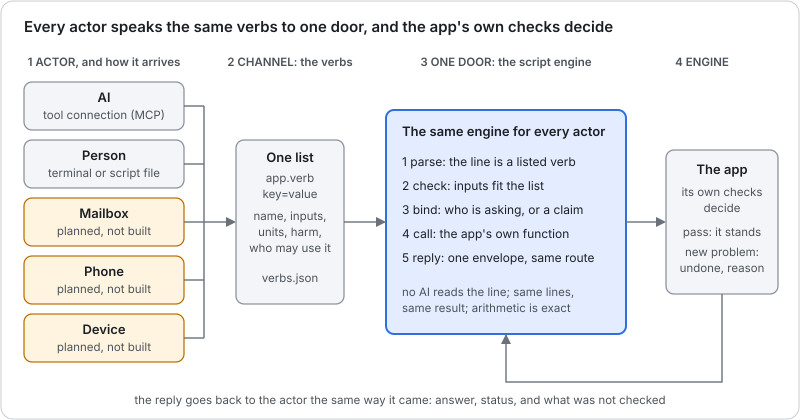

# Fast Script User Guide

**Give the BIM and ERP apps one short command at a time, or a few lines in a file, and get the app's own answer back. The same lines work for you at a terminal and for an AI.**

This is the guide to the **one door**: a small script engine that sits in front of the apps. You write a line such as `modeller.lines building=HospitalGarage`. The door reads it, checks it against a fixed list of verbs, calls the app's own code, and hands the answer back with what was not checked. There is no AI in the door.



Read the picture from left to right.

1. **Actor.** Whoever sends the line, and the way it arrives. Today that is an AI through a tool connection, or a person at a terminal. A mailbox, a phone and a device are planned and **not built yet**.
2. **Channel: the verbs.** One list of everything an actor may say. Each verb has a plain description, its inputs, and a *harm* class. You will find the whole list [below](#the-verbs).
3. **One door: the script engine.** It parses the line, checks the inputs, binds the line to who is asking, calls the app, and replies. Every actor goes through the same door, so the same line gives the same answer.
4. **Engine: the app.** The app's own checks decide. A change that adds a new problem is undone, and the reason comes back.

!!! warning "What a good answer does not mean"
    An answer with no problem **never means safe, compliant or good**. Each answer lists what was not checked, and [What is not checked](#what-is-not-checked) lists it again. A structural engineer has the last word.

**New here, with an AI?** Connecting an AI to the door is in the [AI Proposer Guide](ProposerGuide.md#connect-your-ai). This page is for commands and scripts you write yourself, and for reading what comes back.

## Get the door

You need Node 18 or newer. These steps were run on Node 18.19.

**The Modeller verbs need four files.** Make an empty folder, install the browser engine, and download them:

```bash
mkdir fastscript && cd fastscript
npm init -y
npm install puppeteer@24
curl -O https://red1oon.github.io/bim-ootb/modeller/tools/edit_cli.js
curl -O https://red1oon.github.io/bim-ootb/modeller/tools/bim_mcp.js
curl -O https://red1oon.github.io/bim-ootb/common/door/door.js
curl -O https://red1oon.github.io/bim-ootb/common/door/verbs.json
```

Keep all four in the same folder. `door.js` reads the verb list from `verbs.json` and runs `edit_cli.js`, which opens the live Modeller page with no window. If a file is missing, the door says which one and prints its `curl` line. `bim_mcp.js` is only for connecting an AI; the commands on this page do not use it.

**The Viewer, object and schedule verbs need a full checkout.** They are not in the four files. Get the whole `bim-ootb` repository (`git clone https://github.com/red1oon/bim-ootb`) and run `node common/door/door.js` from its top folder instead of `node door.js`. The [verb table](#the-verbs) says, for each verb, which of the two it needs. A one-file download for the Viewer is not built yet.

## Your first command

One line, one verb, `key=value` pairs with no spaces around the `=`. Ask the HospitalGarage for its grid:

<!-- run: lines cut=700 -->
```text
$ node door.js 'modeller.lines building=HospitalGarage'
{"request":"d-mwb4bnoy-2300084-1","verb":"modeller.lines","actor":"human","status":"ok","answer":{"ok":true,"building":"HospitalGarage","edits":[],"ms":19520,"model":{"grid_source":"column-derived","system":"column-framed","material":"RC","mixed":true,"girders":228,"rotation_deg":-2,"frame":"building","lines":[{"id":"gx0","axis":"x","pos":128.131,"world":132.184},{"id":"gx1","axis":"x","pos":129.223,"world":133.277},{"id":"gx2","axis":"x","pos":133.277,"world":137.334},{"id":"gx3","axis":"x","pos":133.795,"world":137.851},{"id":"gx4","axis":"x","pos":134.811,"world":138.868},{"id":"gx5","axis":"x","pos":145.987,"world":150.051},{"id":"gx6","axis":"x","pos":157.163,"world":161.234},{"id":"gx7…
```

It opens the Modeller and the building, so it takes 10 to 40 seconds. What you see is one line of JSON, an **envelope**. Only the start is shown here; the grid has more lines than fit. The answer is the app's own, unchanged, inside `answer`. Here `gx5` is at 145.987 m and `gx6` at 157.163 m on the building's own grid. `status` is `ok`.

!!! note "Where does the 'request' come from?"
    Every line gets a request id (`"request":"d-…"`) and is written to a journal before it runs, in `~/.cache/bim_door/journal.jsonl`. Send the same id twice and you get the first answer back, so a retry never repeats a change. The door also prints one `§DOOR …` line on the error stream; this guide shows only the standard output.

## One verb for a whole request

A request such as *"make the bay between gx5 and gx6 13 m wide"* is several steps: read the grid, work out the move, try the shift. The verb `modeller.widen_bay` does all three. Its inputs are the two lines and the width you want:

<!-- run: widen -->
```text
$ node door.js 'modeller.widen_bay building=HospitalGarage from=gx5 to=gx6 target=13' > widen.json; echo "exit $?"
exit 3
```

The exit code is the first answer: `0` means ok, `3` means the app gave an answer that is not a plain yes (refused, held or inconclusive), `1` means an error and `2` means a wrong command. Now look inside the file. The whole request comes first, then its two steps, each with its own envelope:

<!-- run: widen_steps cut=200 -->
```text
$ grep -o '"request":"[^"]*","verb":"[^"]*","actor":"[^"]*","status":"[^"]*"' widen.json
"request":"d-mwb4c2w9-2300566-1","verb":"modeller.widen_bay","actor":"human","status":"refused"
"request":"d-mwb4c2w9-2300566-1.1","verb":"modeller.lines","actor":"human","status":"ok"
"request":"d-mwb4c2w9-2300566-1.2","verb":"modeller.try_shift","actor":"human","status":"refused"
```

The first step read the grid. It found the bay now:

<!-- run: widen_read -->
```text
$ grep -o '"id":"gx[56]","axis":"x","pos":[0-9.]*' widen.json
"id":"gx5","axis":"x","pos":145.987
"id":"gx6","axis":"x","pos":157.163
```

So the bay is 157.163 − 145.987 = **11.176 m**. To reach 13 m the line `gx6`, and every line after it, must move **1.824 m**. The door worked that out, and the second step passed it on:

<!-- run: widen_move -->
```text
$ grep -o '"move":[0-9.]*' widen.json | head -1
"move":1.824
```

The app tried the shift, checked it, and **stopped it**:

<!-- run: widen_why -->
```text
$ grep -o '"why":"[^"]*"' widen.json | tail -1
"why":"line 2 (modeller.try_shift): stopped: Beam spans over limit: 91 -> 92 (limit 12 m, RC); bay gx5-gx6 newly over the limit: 13 m"
```

The change was made, judged and undone. Nothing is ever saved. The numbers behind the stop are in the app's report:

<!-- run: widen_bay -->
```text
$ grep -o '"bay":"gx5-gx6"[^}]*' widen.json
"bay":"gx5-gx6","before":11.176,"after":13,"newly_over":true
```

The bay went from 11.176 m to 13 m, over this building's 12 m limit for a concrete beam (`limit` and `material` come from the building itself). That is the whole story of the Garage request: a 13 m bay needs another column line.

## A script: several lines, a named result

A script is a text file with one command per line. A line may start with a **name** and an `=`, which keeps its answer for the lines below. Anything after `--` is a comment. Save this as `bay.door`:

<!-- file: bay.door -->
```text
-- read the grid, then widen the bay between gx5 and gx6 to exactly 12 m
lines = modeller.lines building=HospitalGarage
modeller.try_shift building=HospitalGarage line=gx6 move={12 - (lines.model.lines[gx6].pos - lines.model.lines[gx5].pos)}
```

Run it with `--script`:

<!-- run: script -->
```text
$ node door.js --script bay.door > bay.json; echo "exit $?"
exit 0
```

Text inside `{ }` is arithmetic. It may use numbers, `+ - * /`, brackets, and fields of a named result. `lines.model.lines[gx6].pos` means: in the answer named `lines`, under `model`, the entry of `lines` whose id is `gx6`, its `pos`. Only fields the verb declares can be read; any other name is an error that says so.

The arithmetic is **exact decimal**, not floating point. A computer using floating point gets `12 - 11.176 = 0.8239999999999998`. The door gets this:

<!-- run: script_move -->
```text
$ grep -o '"change":{"kind":"[^"]*","grid":"[^"]*","through":"[^"]*","lines":[0-9]*,"delta":[0-9.]*' bay.json
"change":{"kind":"block-shift","grid":"gx6","through":"gx16","lines":11,"delta":0.824
```

A script runs top to bottom and **stops at the first line that is not ok**. Here both answer `ok`:

<!-- run: script_status -->
```text
$ grep -o '"request":"[^"]*","verb":"[^"]*","actor":"[^"]*","status":"[^"]*"' bay.json
"request":"d-mwahro91-2049711-2","verb":"modeller.lines","actor":"human","status":"ok"
"request":"d-mwahs1lf-2049711-3","verb":"modeller.try_shift","actor":"human","status":"ok"
```

At exactly 12 m the app finds no new problem: the count of beam spans over the limit stays where it was.

<!-- run: script_span -->
```text
$ grep -o '"label":"Beam spans over limit","scope":"[^"]*","state":"JUDGED","before":[0-9]*,"after":[0-9]*,"delta":[0-9]*' bay.json
"label":"Beam spans over limit","scope":"228 walked girders, RC (mixed building)","state":"JUDGED","before":91,"after":91,"delta":0
```

So the same building, asked for 13 m, is stopped, and asked for 12 m, stands. An `ok` is not a promise that the building is good: the same [list of what is not checked](#what-is-not-checked) applies.

### The line grammar

| Part | Rule |
|---|---|
| A command | `app.verb key=value key=value`, one per line |
| A value with spaces | put it in double quotes: `text="a note"` |
| A named result | `name = app.verb …`; later lines read `name.field` |
| Arithmetic | `{ … }` with numbers, `+ - * /`, brackets and result fields; exact decimals |
| A comment | `--` and the rest of the line |
| Units | never written on the line; the verb says metres, hours or days |
| Anything else | not a command: it comes back as a question, not as an action |

The last row is deliberate. Text that matches no verb is **never guessed at**:

<!-- run: question -->
```text
$ node door.js 'please widen the bay'
{"request":"d-mwbb7xxz-2475632-1","verb":null,"actor":"human","status":"refused","answer":{"question":"I could not read that as a command. A command is app.verb key=value … Which one do you mean? Type !help.","verbs":["modeller.lines","modeller.try_shift","viewer.counts","viewer.clashes","viewer.film_path","viewer.schedule_at","viewer.schedule_compare","modeller.widen_bay","modeller.walk","object.describe","object.read","object.history","object.update","object.attach","object.count","object.list","object.sum","object.group","erp.find","erp.actions","erp.describe","erp.read","erp.list","erp.sum","erp.group","erp.new","erp.complete","erp.void","erp.close","erp.reverse","witness.run","witness.last","legacy.status","legacy.query","erp.column","erp.compare","idempiere.where","erp.pack","legacy.up","legacy.refresh","legacy.witness","legacy.check","erp.legacy_plugin"]},"why":"not a command: \"please widen the bay\"","notChecked":[],"ops":[],"next":[],"ms":0}
```

## Reading the reply

Every line, from every actor, gets the same envelope. Read these in order.

| Field | Meaning |
|---|---|
| `status` | `ok`, `refused`, `claim`, `error` or `inconclusive`. Read this first |
| `why` | the reason, when the status is not `ok` |
| `answer` | the app's own answer, unchanged |
| `notChecked` | what the check did not cover. Always pass it on |
| `request`, `verb`, `actor` | which line, which verb, who asked |
| `ops` | what was written, for a verb that writes |
| `next` | reserved; empty today |
| `ms` | how long it took |

The five statuses, each from a real run:

**ok.** The app answered and nothing was held back. The first command on this page is one. Even then, read `notChecked`.

**refused.** The app gave an answer that is not a yes. The 13 m request above is one: it was tried, judged and undone, and `why` says why. A refusal is an answer, not a failure. Text that is not a command is also `refused` (the question above).

**error.** The line itself is wrong: a missing input, an unknown verb, a value of the wrong kind. Nothing ran.

<!-- run: error -->
```text
$ node door.js 'modeller.lines'
{"request":"d-mwb4l54g-2304751-1","verb":"modeller.lines","actor":"human","status":"error","answer":null,"why":"missing input: building","notChecked":[],"ops":[],"next":[],"ms":1}
```

**claim.** The line is understood, but the actor has no proof that allows it, so the door **holds it and does not run it**. This is the safety rule for an AI, and it comes from the verb, not from the actor. See [What is a claim](#what-is-a-claim).

<!-- run: claim -->
```text
$ node door.js --actor ai --request ai-1 'object.update building=Duplex kind=Element uu=abc column=Name value=x'
{"request":"ai-1","verb":"object.update","actor":"ai","status":"claim","answer":null,"why":"actor ai has proof \"local-user\", which allows read/trial verbs; object.update is writes. Held as a claim, not run. A person confirms it with: door.js --confirm ai-1","notChecked":[],"ops":[],"next":[],"ms":1}
```

**inconclusive.** The app could not judge, and says so. It is never turned into an `ok`. Here the Viewer has no clash rule for the pair ARC and ZZZ. This one needs a checkout:

<!-- run: inconclusive -->
```text
$ node common/door/door.js 'viewer.clashes building=Duplex discA=ARC discB=ZZZ'
{"request":"d-mwb4l594-2304771-1","verb":"viewer.clashes","actor":"human","status":"inconclusive","answer":null,"why":"the Viewer could not answer (exit 1): the Viewer says INCONCLUSIVE: no rule for ARC/ZZZ in clash_rules.json","notChecked":[],"ops":[],"next":[],"ms":7256}
```

### What is a claim

Each verb has a **harm class**: `read` (changes nothing), `trial` (a change made on a throwaway copy, judged, never saved), `writes`, `posts` or `sends`. The class is written once, in the verb list, so no actor can talk its way around it.

Each actor has a proof. A person at the terminal is trusted for every class. An **AI** is trusted for `read` and `trial` only: it may look and it may try, but a `writes`, `posts` or `sends` verb from an AI is held as a claim, as the `object.update` line above was. An actor with no proof at all, such as a mail from an unknown sender, may read and nothing else:

<!-- run: claim_email -->
```text
$ node door.js --actor email --request mail-0 'modeller.try_shift building=HospitalGarage line=gx6 move=1.824'
{"request":"mail-0","verb":"modeller.try_shift","actor":"email","status":"claim","answer":null,"why":"actor email has proof \"none\", which allows read verbs; modeller.try_shift is trial. Held as a claim, not run. A person confirms it with: door.js --confirm mail-0","notChecked":[],"ops":[],"next":[],"ms":1}
```

A held claim is not run, not queued and not lost: it is in the journal, under its request id. The door does not confirm anything on anyone's behalf.

### Confirm a claim

A person lets a held claim through **by its request id**, so the line that runs is exactly the line that was proposed. Nobody re-types it. Here a mail asks for a trial move and is held:

<!-- run: confirm_claim -->
```text
$ node door.js --journal claims.jsonl --actor email --request mail-1 'modeller.try_shift building=HospitalGarage line=gx6 move=0.824'
{"request":"mail-1","verb":"modeller.try_shift","actor":"email","status":"claim","answer":null,"why":"actor email has proof \"none\", which allows read verbs; modeller.try_shift is trial. Held as a claim, not run. A person confirms it with: door.js --confirm mail-1","notChecked":[],"ops":[],"next":[],"ms":1}
```

`--claims` lists what is being held:

<!-- run: confirm_list -->
```text
$ node door.js --journal claims.jsonl --claims | grep -o '"actor":"[a-z]*","line":"[^"]*","verb":"[^"]*","harm":"[a-z]*"'
"actor":"email","line":"modeller.try_shift building=HospitalGarage line=gx6 move=0.824","verb":"modeller.try_shift","harm":"trial"
```

`--confirm` runs the recorded line, as you, once:

<!-- run: confirm_run cut=200 -->
```text
$ node door.js --journal claims.jsonl --confirm mail-1
{"request":"mail-1#confirmed","verb":"modeller.try_shift","actor":"human","status":"ok","answer":{"ok":true,"building":"HospitalGarage","edits":[{"tag":"EDIT_REPORT","version":1,"change":{"kind":"bloc…
```

The reply is the ordinary one, and it names the claim it confirmed. Asking again runs nothing: the door answers from its record.

<!-- run: confirm_again -->
```text
$ node door.js --journal claims.jsonl --confirm mail-1 | grep -o '"confirms":"[^"]*"'
"confirms":"mail-1"
```

Three rules hold. Only a person at the terminal may confirm: `--actor ai --confirm …` is refused and the claim stays held. The app still decides at the moment of confirming, so a line that has become wrong since it was proposed is refused with the app's reason. And an AI's tool connection has no confirm command at all.

**What this does not prove.** The door trusts whoever is at the local terminal. An AI that is allowed to run shell commands on your machine could type `--confirm` itself, just as it could type a line as you. Keep an AI's access to its tool connection if that matters.

## Use the door from a script of your own

Everything above is `door.js`, the same file the AI connection uses. From your own program, call it as a command and read its JSON: the exit code (`0`, `3`, `1`, `2`) says whether to read an answer or a problem, and `status` says which. `--actor human` is the default; `--actor ai` makes the door treat the line as an AI's.

## Ask what a thing is: `object.describe`

A verb can also ask the model itself what it holds. `object.describe` is **reflection**: it reads the model's own dictionary and says which properties a kind of object has, which child tabs, and which generic methods are legal for it. It reads dictionary rows only; no element is opened. It needs a checkout, and a building whose model carries its own dictionary (the Duplex does).

<!-- run: describe cut=520 -->
```text
$ node common/door/door.js 'object.describe building=Duplex kind=Element'
{"request":"d-mwb4lkv7-2305335-1","verb":"object.describe","actor":"human","status":"ok","answer":{"kind":"Element","table":"elements_meta","uu":"3027c2ed-8cb6-5ccb-ae8c-fd7df2eca264","key":"elements_meta_uu","highVolume":true,"properties":[{"name":"guid","label":"GUID","type":"string","mandatory":true,"updateable":false,"key":false,"parent":false,"length":255},{"name":"ifc_class","label":"IFC Class","type":"list","mandatory":false,"updateable":true,"key":false,"parent":false,"length":255,"values":["IfcBeam","IfcCo…
```

Which methods may an `Element` use?

<!-- run: describe_methods -->
```text
$ node common/door/door.js 'object.describe building=Duplex kind=Element' | grep -o '"methods":\[[^]]*\]'
"methods":["read","update","attach","history"]
```

An unknown kind is an error that lists the kinds the model has, so a wrong guess teaches the right name.

## Count things: `object.count`

`object.count` answers "how many": how many records of a kind the model holds. The Duplex names its rooms as the kind `Room`. It needs a checkout.

<!-- run: count_rooms -->
```text
$ node common/door/door.js 'object.count building=Duplex kind=Room'
{"request":"d-mwb4llay-2305379-1","verb":"object.count","actor":"human","status":"ok","answer":{"kind":"Room","table":"model_room","filters":[],"count":5,"population":5,"verdict":"OK","summary":"5 Room"},"why":null,"notChecked":[],"ops":[],"next":[],"ms":206}
```

Add `column=value` to narrow the count. The column must be a property of the kind (`object.describe` lists them), and the answer keeps the **population**, the number before narrowing:

<!-- run: count_storey -->
```text
$ node common/door/door.js 'object.count building=Duplex kind=Room storey="Level 1"'
{"request":"d-mwb4llj9-2305400-1","verb":"object.count","actor":"human","status":"ok","answer":{"kind":"Room","table":"model_room","filters":[{"column":"storey","value":"Level 1"}],"count":2,"population":5,"verdict":"OK","summary":"2 Room where storey = Level 1 (of 5)"},"why":null,"notChecked":[],"ops":[],"next":[],"ms":204}
```

A column the kind does not have is an error that names it and lists the real ones. It is never read as "no match":

<!-- run: count_badcol cut=330 -->
```text
$ node common/door/door.js 'object.count building=Duplex kind=Room floor=1'
{"request":"d-mwb4llrc-2305423-1","verb":"object.count","actor":"human","status":"error","answer":null,"why":"the object engine could not answer (exit 1): kind Room has no property \"floor\" (its properties: guid, type, name, parent_guid, object_type, predefined_type, center_x, center_y, center_z, size_x, size_y, size_z, room_gu…
```

A model with no room at all does not answer `0`. It answers `inconclusive`, because nothing was counted. A zero you can trust is a narrowed count inside a population that is not empty.

## What the walker would place: `modeller.walk`

The Modeller has a *walker* that places the fittings of one discipline (sprinklers, lights, outlets) by rules measured from real buildings. `modeller.walk` is a **dry run** of it: it says what the walker would place and changes nothing. The model file is the same, byte for byte, afterwards, and the answer says so. It needs a checkout. The full reply is long, so this shows its main numbers:

<!-- run: walk_fp -->
```text
$ node common/door/door.js 'modeller.walk building=Duplex discipline=FP' | grep -o '"rules":"[^"]*"\|"count":[0-9]*,"placed":[0-9]*,"provisional":[0-9]*\|"byClass":{[^}]*}\|"modelUnchanged":[a-z]*'
"rules":"duplex_rules.db"
"count":46,"placed":0,"provisional":46
"byClass":{"IfcFireSuppressionTerminal":45,"IfcAlarm":1}
"modelUnchanged":true
```

`count` is everything the walk would place. `provisional` are positions the walker itself marks as not final, for example a fitting with no ceiling found above it. `rules` is the rule set the building's class uses: a house walks the residential rules. A walk that places nothing answers `inconclusive` with the walker's reason.

## The dotted form, for people

The same questions can be typed as one dotted phrase: **where it is, then what to take**. It is a shorthand for people at a terminal. It is not a second language: the tool turns the phrase into one door line, shows you that line, and sends only that line through the door. It needs a checkout.

`--compile` shows the door line and runs nothing:

<!-- run: dotted_compile -->
```text
$ node common/door/dotted.js --compile 'viewer(Duplex).Room.count'
{"dotted":"viewer(Duplex).Room.count","lines":["object.count building=Duplex kind=Room"],"field":"count"}
```

Without `--compile` it runs, and `value` is the field you asked for:

<!-- run: dotted_value -->
```text
$ node common/door/dotted.js 'viewer(Duplex).Room.count' | grep -o '"value":[0-9]*'
"value":5
```

There are two shapes, and one verb call per phrase:

| Shape | Example | Becomes the door line |
|---|---|---|
| `app(model).Kind.measure` | `viewer(Duplex).Room.count` | `object.count building=Duplex kind=Room` |
| `app(model).Kind[column=value].measure` | `viewer(Duplex).Room[storey="Level 1"].count` | `object.count building=Duplex kind=Room storey="Level 1"` |
| `app(model).method(inputs).field` | `modeller(Duplex).walk(FP).count` | `modeller.walk building=Duplex discipline=FP`, then reads `count` |
| the same, inputs by name | `viewer(Duplex).schedule_at(day=5).counts.placed` | `viewer.schedule_at building=Duplex day=5`, then reads `counts.placed` |

<!-- run: dotted_filter -->
```text
$ node common/door/dotted.js --compile 'viewer(Duplex).Room[storey="Level 1"].count'
{"dotted":"viewer(Duplex).Room[storey=\"Level 1\"].count","lines":["object.count building=Duplex kind=Room storey=\"Level 1\""],"field":"count"}
```

<!-- run: dotted_walk -->
```text
$ node common/door/dotted.js --compile 'modeller(Duplex).walk(FP).count'
{"dotted":"modeller(Duplex).walk(FP).count","lines":["modeller.walk building=Duplex discipline=FP"],"field":"count"}
```

<!-- run: dotted_sched -->
```text
$ node common/door/dotted.js --compile 'viewer(Duplex).schedule_at(day=5).counts.placed'
{"dotted":"viewer(Duplex).schedule_at(day=5).counts.placed","lines":["viewer.schedule_at building=Duplex day=5"],"field":"counts.placed"}
```

Every name comes from the verb list: a *method* is a verb of that app, a *measure* is a count verb, a *field* is one the verb says it returns. A wrong name is an error that lists the right ones:

<!-- run: dotted_bad -->
```text
$ node common/door/dotted.js 'viewer(Duplex).Room.sum'
{"dotted":"viewer(Duplex).Room.sum","error":"unknown measure \"sum\" (measures: count)"}
```

The door itself does not read the dotted form. Sent raw, it comes back as a question and nothing runs:

<!-- run: dotted_raw cut=230 -->
```text
$ node common/door/door.js 'viewer(Duplex).Room.count'
{"request":"d-mwb4lmqx-2305537-1","verb":null,"actor":"human","status":"refused","answer":{"question":"I could not read that as a command. A command is app.verb key=value … Which one do you mean? Type !help.","verbs":["modeller.li…
```

**Limits.** No arithmetic and no second step inside a phrase; use a script with named results for that. Kinds are read from the Viewer's model, and only the Duplex carries a dictionary today. The dotted form is not offered to an AI: its menu is the verb list, so there is one way for it to be right.

## Lists, sums and groups: `erp.list`, `erp.sum`, `erp.group`

`count` answers "how many". Three more read-only verbs answer "which ones", "how much" and "how many of each". They take any kind of the ERP's dictionary (and the same three exist for a building's model as `object.list`, `object.sum`, `object.group`). They need a checkout.

`erp.list` shows rows. Every column, filter and sort is checked against the dictionary, so a wrong name is an error that lists the real ones. Add `column=value` to narrow the list. The list shows at most 50 rows unless `limit` says otherwise (up to 1000), and the answer always carries the **total**, so a short list is never mistaken for the whole. Page through a long one with `offset`:

<!-- run: list_orders -->
```text
$ node common/door/door.js --list 'erp.list kind=Order docstatus=CO limit=3 columns=DocumentNo,DocStatus,GrandTotal sort=-DocumentNo'
DocumentNo  DocStatus  GrandTotal
80001       CO         100.7
80001       CO         100.7
800002      CO         2160
shown 3 of 14
```

`erp.sum` adds a number column up exactly. Decimals are added as decimals, never as floating point, so money does not drift. `erp.group` counts the records for each value of a column, most common first:

<!-- run: sum_orders -->
```text
$ node common/door/door.js --list 'erp.sum kind=Order column=GrandTotal docstatus=CO'
kind: Order
table: C_Order
column: GrandTotal
filters: [{"column":"DocStatus","value":"CO"}]
n: 14
sum: 19505.9
population: 44
verdict: OK
summary: 19505.9 = sum of GrandTotal over 14 Order
```

<!-- run: group_orders -->
```text
$ node common/door/door.js --list 'erp.group kind=Order by=DocStatus'
DocStatus  count
IP         22
CO         14
DR         6
CL         2
shown 4 of 4
```

A kind with no records at all does not answer `0` or an empty list. It answers `inconclusive`, because nothing was judged.

## Create a record: `erp.new`

`erp.new` makes a record the way the ERP's own window makes it. You name the kind and the columns you know; the engine fills the rest the way the window does (defaults, the choices a partner brings with it, the Document No from the sequence). A column the dictionary does not have is refused and the reply lists the real ones. A mandatory column still empty after that is refused by name, and nothing is written. The reply starts with `number`: the Document No, which is what you use next.

A Sales or Purchase document needs `issotrx=Y` or `N`. A partner or product may be given by name; a name that matches no record, or more than one, is refused. A line names its document by number:

<!-- run: new_order -->
```text
$ rm -f /tmp/fast_guide_new.ops; BIM_OBJECT_OPLOG=/tmp/fast_guide_new.ops node common/door/door.js 'erp.new kind=Order issotrx=Y c_doctypetarget_id=132 c_bpartner_id=112 salesrep_id=101'
{"request":"d-mwf8e9os-409900-1","verb":"erp.new","actor":"human","status":"ok","answer":{"number":"50000","kind":"Order","table":"c_order","id":1500004,"docStatus":"DR","given":["IsSOTrx","C_DocTypeTarget_ID","C_BPartner_ID","SalesRep_ID"],"defaulted":52,"filled":["ad_client_id","ad_org_id","documentno","isselfservice","dateordered","datepromised","bill_bpartner_id","c_bpartner_location_id","bill_location_id","deliveryrule","priorityrule","m_warehouse_id","isdropship","deliveryviarule","freightcostrule","freightamt","ispriviledgedrate","shippingrateinquiry","invoicerule","m_pricelist_id","c_currency_id","c_conversiontype_id","isdiscountprinted","chargeamt","paymentrule","c_paymentterm_id","totallines","grandtotal","docstatus","c_doctype_id","ispayschedulevalid","copyfrom","docaction","posted","isdelivered","dateacct","amountrefunded","isapproved","processed","processing","istaxincluded","isinvoiced","isselected","isprinted","sendemail","istransferred","iscreditapproved","isactive","processedon","amounttendered","volume","weight"],"record":{"c_order_id":1500004,"ad_client_id":11,"ad_org_id":11,"isactive":"Y","created":"2026-11-14 01:09:02","createdby":101,"updated":"2026-11-14 01:09:02","updatedby":101,"issotrx":"Y","documentno":"50000","docstatus":"DR","docaction":"CO","processing":"N","processed":"N","c_doctype_id":0,"c_doctypetarget_id":132,"description":null,"isapproved":"N","iscreditapproved":"N","isdelivered":"N","isinvoiced":"N","isprinted":"N","istransferred":"N","isselected":"N","salesrep_id":101,"dateordered":"2026-11-14 00:00:00","datepromised":"2026-11-14 00:00:00","dateprinted":null,"dateacct":"2026-11-14 00:00:00","c_bpartner_id":112,"c_bpartner_location_id":108,"poreference":null,"isdiscountprinted":"Y","c_currency_id":100,"paymentrule":"P","c_paymentterm_id":105,"invoicerule":"D","deliveryrule":"A","freightcostrule":"I","freightamt":0,"deliveryviarule":"P","m_shipper_id":null,"c_charge_id":null,"chargeamt":0,"priorityrule":"5","totallines":0,"grandtotal":0,"m_warehouse_id":103,"m_pricelist_id":101,"istaxincluded":"N","c_campaign_id":null,"c_project_id":null,"c_activity_id":null,"posted":"N","c_payment_id":null,"c_cashline_id":null,"sendemail":"N","ad_user_id":null,"copyfrom":"N","isselfservice":"N","ad_orgtrx_id":null,"user1_id":null,"user2_id":null,"c_conversiontype_id":114,"bill_bpartner_id":112,"bill_location_id":108,"bill_user_id":null,"pay_bpartner_id":null,"pay_location_id":null,"ref_order_id":null,"isdropship":"N","volume":0,"weight":0,"ordertype":null,"c_pos_id":null,"amounttendered":0,"amountrefunded":0,"link_order_id":null,"m_freightcategory_id":null,"dropship_bpartner_id":null,"dropship_location_id":null,"dropship_user_id":null,"promotioncode":null,"c_ordersource_id":null,"processedon":0,"ispayschedulevalid":"N","c_cashplanline_id":null,"c_order_uu":"f27d9e2f-6161-4b73-b5ef-fd7c338041f6","shippingrateinquiry":"N","ispriviledgedrate":"N","c_opportunity_id":null,"quotationorder_id":null,"c_department_id":null,"c_costcenter_id":null},"ops":[{"op_type":"CRUD_UPDATE","table":"ad_sequence"},{"op_type":"CRUD_CREATE","table":"c_order"}]},"why":null,"notChecked":[],"ops":[{"op_type":"CRUD_UPDATE","table":"ad_sequence"},{"op_type":"CRUD_CREATE","table":"c_order"}],"next":[],"ms":2358}
```

<!-- run: new_line -->
```text
$ BIM_OBJECT_OPLOG=/tmp/fast_guide_new.ops node common/door/door.js 'erp.new kind=C_OrderLine order=50000 m_product_id=137 qtyentered=2'
{"request":"d-mwf8ec9g-409946-1","verb":"erp.new","actor":"human","status":"ok","answer":{"number":null,"kind":"Sales Order Line","table":"c_orderline","id":120002710,"docStatus":null,"given":["M_Product_ID","QtyEntered","C_Order_ID"],"defaulted":31,"filled":["ad_client_id","ad_org_id","c_bpartner_id","c_bpartner_location_id","datepromised","dateordered","line","m_warehouse_id","m_attributesetinstance_id","c_uom_id","qtyordered","qtydelivered","qtyreserved","qtyinvoiced","priceentered","priceactual","pricelist","freightamt","c_tax_id","discount","linenetamt","qtylostsales","processed","createshipment","createproduction","rramt","pricecost","pricelimit","c_currency_id","isactive","isdescription"],"record":{"c_orderline_id":120002710,"ad_client_id":11,"ad_org_id":11,"isactive":"Y","created":"2026-11-14 01:09:06","createdby":101,"updated":"2026-11-14 01:09:06","updatedby":101,"c_order_id":1500004,"line":10,"c_bpartner_id":112,"c_bpartner_location_id":108,"dateordered":"2026-11-14 00:00:00","datepromised":"2026-11-14 00:00:00","datedelivered":null,"dateinvoiced":null,"description":null,"m_product_id":137,"m_warehouse_id":103,"c_uom_id":100,"qtyordered":2,"qtyreserved":0,"qtydelivered":0,"qtyinvoiced":0,"m_shipper_id":null,"c_currency_id":100,"pricelist":3,"priceactual":3,"pricelimit":2.7,"linenetamt":6,"discount":0,"freightamt":0,"c_charge_id":null,"c_tax_id":104,"s_resourceassignment_id":null,"ref_orderline_id":null,"m_attributesetinstance_id":0,"isdescription":"N","processed":"N","qtyentered":2,"priceentered":3,"c_project_id":null,"pricecost":0,"qtylostsales":0,"c_projectphase_id":null,"c_projecttask_id":null,"rrstartdate":null,"rramt":0,"c_campaign_id":null,"c_activity_id":null,"user1_id":null,"user2_id":null,"ad_orgtrx_id":null,"link_orderline_id":null,"pp_cost_collector_id":null,"m_promotion_id":null,"c_orderline_uu":"6cd0a894-e836-44b4-8372-cf4fdcc1d531","createshipment":"N","createproduction":"N","c_department_id":null,"c_costcenter_id":null},"ops":[{"op_type":"CRUD_CREATE","table":"c_orderline"},{"op_type":"CRUD_UPDATE","table":"c_order"}]},"why":null,"notChecked":[],"ops":[{"op_type":"CRUD_CREATE","table":"c_orderline"},{"op_type":"CRUD_UPDATE","table":"c_order"}],"next":[],"ms":2594}
```

The order is a draft until someone completes it. Because the line was given the order's number, the order's totals follow without a second step: `totallines` and `grandtotal` in the record below are the line's amount (6). The list of the order's own lines is not filled in by `erp.read`.

<!-- run: new_read -->
```text
$ BIM_OBJECT_OPLOG=/tmp/fast_guide_new.ops node common/door/door.js --list 'erp.read kind=Order number=50000'
kind: Order
uu: 1500004
record: {"c_order_id":1500004,"ad_client_id":11,"ad_org_id":11,"isactive":"Y","created":"2026-11-14 01:09:02","createdby":101,"updated":"2026-11-14 01:09:02","updatedby":101,"issotrx":"Y","documentno":"50000","docstatus":"DR","docaction":"CO","processing":"N","processed":"N","c_doctype_id":0,"c_doctypetarget_id":132,"description":null,"isapproved":"N","iscreditapproved":"N","isdelivered":"N","isinvoiced":"N","isprinted":"N","istransferred":"N","isselected":"N","salesrep_id":101,"dateordered":"2026-11-14 00:00:00","datepromised":"2026-11-14 00:00:00","dateprinted":null,"dateacct":"2026-11-14 00:00:00","c_bpartner_id":112,"c_bpartner_location_id":108,"poreference":null,"isdiscountprinted":"Y","c_currency_id":100,"paymentrule":"P","c_paymentterm_id":105,"invoicerule":"D","deliveryrule":"A","freightcostrule":"I","freightamt":0,"deliveryviarule":"P","m_shipper_id":null,"c_charge_id":null,"chargeamt":0,"priorityrule":"5","totallines":6,"grandtotal":6,"m_warehouse_id":103,"m_pricelist_id":101,"istaxincluded":"N","c_campaign_id":null,"c_project_id":null,"c_activity_id":null,"posted":"N","c_payment_id":null,"c_cashline_id":null,"sendemail":"N","ad_user_id":null,"copyfrom":"N","isselfservice":"N","ad_orgtrx_id":null,"user1_id":null,"user2_id":null,"c_conversiontype_id":114,"bill_bpartner_id":112,"bill_location_id":108,"bill_user_id":null,"pay_bpartner_id":null,"pay_location_id":null,"ref_order_id":null,"isdropship":"N","volume":0,"weight":0,"ordertype":null,"c_pos_id":null,"amounttendered":0,"amountrefunded":0,"link_order_id":null,"m_freightcategory_id":null,"dropship_bpartner_id":null,"dropship_location_id":null,"dropship_user_id":null,"promotioncode":null,"c_ordersource_id":null,"processedon":0,"ispayschedulevalid":"N","c_cashplanline_id":null,"c_order_uu":"f27d9e2f-6161-4b73-b5ef-fd7c338041f6","shippingrateinquiry":"N","ispriviledgedrate":"N","c_opportunity_id":null,"quotationorder_id":null,"c_department_id":null,"c_costcenter_id":null}
children: [{"kind":"Sales Order Line","rows":[]},{"kind":"Order Tax","rows":[]},{"kind":"Order Payment Schedule","rows":[]},{"kind":"POS Payment","rows":[]}]
```

`erp.new` is a `writes` verb. A person at the terminal runs it. An AI's `erp.new` is held as a claim and nothing is written until a person confirms it (see "What is a claim"). These blocks use a scratch op-log (`/tmp/fast_guide_new.ops`, emptied first), so running them does not touch your own data.

## Work with any table: the `mis.*` verbs

**MIS is the base. ERP is MIS plus a document's life.** Listing, reading, creating, changing, deleting and loading records is the same on every table of the dictionary, a customer, a product, a table you made yourself. Those verbs are called `mis.*`. What only a document has (complete, void, close, reverse) stays `erp.*`. The older names `erp.list`, `erp.read`, `erp.describe`, `erp.sum`, `erp.group` and `erp.new` still work: each is an old name for its `mis.*` verb and gives the same answer, so a script you wrote earlier does not change.

Every `mis.*` verb that writes does what the ERP's own window does. It does not edit the database underneath. Defaults and callouts run, the checks run, a refusal says why, and nothing is written when anything is refused.

**What is still missing?** `mis.new … dry=Y` runs everything but the save and writes nothing. It answers which mandatory columns are still empty after the defaults, so you know what to give:

<!-- run: mis_dry cut=330 -->
```text
$ rm -f /tmp/fast_guide_mis.ops; BIM_OBJECT_OPLOG=/tmp/fast_guide_mis.ops node common/door/door.js --list 'mis.new kind=C_BPartner dry=Y'
dry: true
kind: Business Partner
table: c_bpartner
mandatory: ["Value","Name"]
needs: []
given: []
defaulted: 32
filled: ["ad_client_id","ad_org_id","c_bp_group_id","iscustomer","isvendor","isemployee","isprospect","issalesrep","so_creditlimit","totalopenbalance","istaxexempt","ispotaxexempt","issummary","isactive","c_paymentterm_id","m_pricelist_id","flatdiscount","c_dunning_id","shelflifeminpct","ismanufacturer","is1099vendor","documentc…
ops: []
```

**Create, change, read.** A column that holds another record may be given by its name. `mis.list … names=Y` shows such columns as names, the way the window's grid does:

<!-- run: mis_new cut=330 -->
```text
$ BIM_OBJECT_OPLOG=/tmp/fast_guide_mis.ops node common/door/door.js --list 'mis.new kind=C_BPartner Value=GD100 Name="Guide Partner One"'
number: Guide Partner One
kind: Business Partner
table: c_bpartner
id: 1600010
docStatus: 
given: ["Value","Name"]
defaulted: 32
filled: ["ad_client_id","ad_org_id","c_bp_group_id","iscustomer","isvendor","isemployee","isprospect","issalesrep","so_creditlimit","totalopenbalance","istaxexempt","ispotaxexempt","issummary","isactive","c_paymentterm_id","m_pricelist_id","flatdiscount","c_dunning_id","shelflifeminpct","ismanufacturer","is1099vendor","documentc…
record: {"c_bpartner_id":1600010,"ad_client_id":11,"ad_org_id":11,"isactive":"Y","created":"2026-11-14 01:09:19","createdby":101,"updated":"2026-11-14 01:09:19","updatedby":101,"value":"GD100","name":"Guide Partner One","name2":null,"description":null,"issummary":"N","c_bp_group_id":103,"isonetime":"N","isprospect":"N","isvendor…
ops: [{"op_type":"CRUD_CREATE","table":"c_bpartner"},{"op_type":"CRUD_CREATE","table":"ad_treenodebp"},{"op_type":"CRUD_CREATE","table":"c_bp_customer_acct"},{"op_type":"CRUD_CREATE","table":"c_bp_customer_acct"},{"op_type":"CRUD_CREATE","table":"c_bp_vendor_acct"},{"op_type":"CRUD_CREATE","table":"c_bp_vendor_acct"}]
```

<!-- run: mis_update cut=330 -->
```text
$ BIM_OBJECT_OPLOG=/tmp/fast_guide_mis.ops node common/door/door.js --list 'mis.update kind=C_BPartner number="Guide Partner One" description="first supplier"' | grep -E '^(noop|given|changed|derived):'
noop: false
given: ["Description"]
changed: ["description"]
derived: []
```

<!-- run: mis_list -->
```text
$ BIM_OBJECT_OPLOG=/tmp/fast_guide_mis.ops node common/door/door.js --list 'mis.list kind=C_BPartner value=GD100 columns=Value,Name,Description,C_BP_Group_ID names=Y'
Value  Name               Description     C_BP_Group_ID
GD100  Guide Partner One  first supplier  Standard Customers
shown 1 of 1
```

`mis.update` sends only the columns you give; giving the values a record already has changes nothing and the answer says `noop`. A column the window would not let a person edit (a read-only field, or any column of a completed document) is refused, and the answer names the rule. Clear a column with the value `<null>`.

**Delete.** `mis.delete` is the window's Delete. It refuses what the window refuses, with the engine's own words, and writes nothing. The standard partner is used by other records:

<!-- run: mis_refuse cut=300 -->
```text
$ BIM_OBJECT_OPLOG=/tmp/fast_guide_mis.ops node common/door/door.js --list 'mis.delete kind=C_BPartner id=112'
refused: true
reason: Business Partner Standard is not deleted: Record not deleted - dependent record found; nothing was written
```

<!-- run: mis_delete cut=300 -->
```text
$ BIM_OBJECT_OPLOG=/tmp/fast_guide_mis.ops node common/door/door.js --list 'mis.delete kind=C_BPartner number="Guide Partner One"' | grep -E '^(gone|opSummary):'
gone: true
opSummary: {"delete:c_bp_customer_acct":2,"delete:c_bp_vendor_acct":2,"delete:c_bpartner":1,"delete:ad_treenodebp":1}
```

**Load many from a CSV.** `mis.load` reads a `.csv` (the first line is the column names, one record per line) and runs the ERP's own Migrate Excel Data process on it. That process is all or nothing, so `mis.load` first **checks** (`dry=Y`, the default) and writes nothing: it counts the lines and names each bad one. Next to your file it writes `….rejected.csv` (the bad lines and why) and `….ok.csv` (the good ones):

<!-- run: mis_load cut=330 -->
```text
$ printf 'Value,Name,C_BP_Group_ID\nGD201,Guide Two,Standard Customers\nGD202,Guide Three,Nowhere\n' > /tmp/fast_guide_mis.csv; rm -f /tmp/fast_guide_mis.rejected.csv /tmp/fast_guide_mis.ok.csv; BIM_OBJECT_OPLOG=/tmp/fast_guide_mis.ops node common/door/door.js --list 'mis.load kind=C_BPartner file=/tmp/fast_guide_mis.csv'
kind: Business Partner
table: c_bpartner
file: /tmp/fast_guide_mis.csv
rows: 2
ok: 1
rejected: [{"row":2,"why":["C_BP_Group_ID: no C_BP_Group with Name=\"Nowhere\""]}]
unplaced: []
dry: true
loaded: false
files: {"rejected":"/tmp/fast_guide_mis.rejected.csv","ok":"/tmp/fast_guide_mis.ok.csv"}
summary: Nothing migrated: 1 row error(s). c_bpartner row 3 C_BP_Group_ID: no C_BP_Group with Name="Nowhere"
```

<!-- run: mis_rejected -->
```text
$ cat /tmp/fast_guide_mis.rejected.csv
Value,Name,C_BP_Group_ID,rejected_because
GD202,Guide Three,Nowhere,"C_BP_Group_ID: no C_BP_Group with Name=""Nowhere"""
```

Loading the original with `dry=N` is refused while any line is bad. Fix the bad lines, or load the good ones, which is a separate all-or-nothing load:

<!-- run: mis_load_ok cut=330 -->
```text
$ BIM_OBJECT_OPLOG=/tmp/fast_guide_mis.ops node common/door/door.js --list 'mis.load kind=C_BPartner dry=N file=/tmp/fast_guide_mis.ok.csv'
kind: Business Partner
table: c_bpartner
file: /tmp/fast_guide_mis.ok.csv
rows: 1
ok: 1
rejected: []
unplaced: []
dry: false
loaded: true
files: {}
summary: No worksheets : 1(C_BPartner = 1 records) 
ops: 6
opSummary: {"create:c_bpartner":1,"create:ad_treenodebp":1,"create:c_bp_customer_acct":2,"create:c_bp_vendor_acct":2}
keys: [1600010]
```

An AI's `mis.new`, `mis.update`, `mis.delete` or `mis.load` is held as a claim, like `erp.new`: nothing is written until a person confirms it. Updating existing records in bulk is not offered; use `mis.update` for each, so the window's checks run.

### See and change records as a role

Every `mis.*` verb takes `role=`, the id of a role of the ERP. **Without a role nothing is filtered:** you see every record of every client. With a role you get what that role gets in the window it is granted: the records of its own client and organisations, and only the records and columns its access rows allow. The totals count only those records. The role is stated on the line. It is not a sign-in.

<!-- run: mis_role -->
```text
$ for r in '' ' role=103' ' role=12000'; do BIM_OBJECT_OPLOG=/tmp/fast_guide_mis.ops node common/door/door.js --list "mis.sum kind=C_Order column=GrandTotal$r" | grep -E '^(n|sum):' | tr '\n' ' '; echo; done
n: 43 sum: 74936.76 
n: 8 sum: 9914.07 
n: 27 sum: 55108.62
```

A record outside the role's records answers exactly as a record that does not exist. A column the role may only read cannot be changed. A kind the role has no window for is refused; role 103 has no window that shows Tax:

<!-- run: mis_role_refuse cut=200 -->
```text
$ BIM_OBJECT_OPLOG=/tmp/fast_guide_mis.ops node common/door/door.js --list 'mis.list kind=C_Tax role=103'
refused: true
reason: role 103 (GardenWorld User) is not granted a window that shows Tax (AD_Window_Access)
```

Five rules are not judged yet, and a role that uses one of them is refused instead of half-checked: a personal lock on a record, a table validation rule, a role whose organisations come from the user, a role with a summary organisation in an organisation tree, and "dependent entities" record access. `mis.load` takes no role.

## Make a table of your own: `mis.add_window`

A table you keep in a spreadsheet can become a real window: a table, a form, a menu entry and role access, with no code written for it. Describe its columns in a small `.csv`, one line per column. Only `Column` is required. The key, the client and organisation, the active flag and the audit columns are added for you:

<!-- run: win_sheet -->
```text
$ printf 'Column,Type,Length,Mandatory,Default,List,Help\nName,String,60,Y,,,Its name\nPurchaseDate,Date,,,,,When it was bought\nCost,Amount,,,,,\nCondition,List,,,GOOD,"GOOD=Good,FAIR=Fair,POOR=Poor",\nIsInsured,,,,,,\n' > AST_Asset.csv; cat AST_Asset.csv
Column,Type,Length,Mandatory,Default,List,Help
Name,String,60,Y,,,Its name
PurchaseDate,Date,,,,,When it was bought
Cost,Amount,,,,,
Condition,List,,,GOOD,"GOOD=Good,FAIR=Fair,POOR=Poor",
IsInsured,,,,,,
```

One line makes the window (the sheet is written again here so the line can be run on its own, from the folder that holds `common/`). The table is named after the file. `dry=Y` checks the sheet and writes nothing. A faulty sheet is refused with every fault and its line, and nothing is written:

<!-- run: win_add cut=200 -->
```text
$ printf 'Column,Type,Length,Mandatory,Default,List,Help\nName,String,60,Y,,,Its name\nPurchaseDate,Date,,,,,When it was bought\nCost,Amount,,,,,\nCondition,List,,,GOOD,"GOOD=Good,FAIR=Fair,POOR=Poor",\nIsInsured,,,,,,\n' > AST_Asset.csv; rm -f /tmp/fast_guide_win.ops; BIM_OBJECT_OPLOG=/tmp/fast_guide_win.ops node common/door/door.js --list 'mis.add_window file=AST_Asset.csv' | grep -E '^(table|window|columns|lists|ops):'
table: AST_Asset
window: {"id":7100001,"name":"AST Asset"}
columns: ["Name","PurchaseDate","Cost","Condition","IsInsured"]
lists: [{"column":"Condition","values":["GOOD","FAIR","POOR"]}]
ops: 47
```

The new kind works with every `mis.*` verb at once, and with `mis.js`. A mandatory column is asked for, a default is filled, and a value outside the sheet's list is refused:

<!-- run: win_use cut=200 -->
```text
$ D='BIM_OBJECT_OPLOG=/tmp/fast_guide_win.ops node common/door/door.js --list'; eval "$D 'mis.new kind=AST_Asset Name=Tractor Cost=1200.50'" | grep -E '^(number|filled):'; eval "$D 'mis.new kind=AST_Asset Cost=5'" | grep reason; eval "$D 'mis.new kind=AST_Asset Name=Plough Condition=BAD'" | grep reason; eval "$D 'mis.list kind=AST_Asset columns=Name,Cost,Condition'"; rm -f AST_Asset.csv
number: Tractor
filled: ["ad_client_id","ad_org_id","isactive","condition","isinsured"]
reason: mandatory and still empty after the defaults and callouts: Name (give them as column=value)
reason: Condition Invalid value - BAD - Reference_ID=200277 - FAIR - GOOD - POOR; nothing was written
Name     Cost    Condition
Tractor  1200.5  GOOD
shown 1 of 1
```

The types are String, Quantity, Amount, YesNo, Date, DateTime, Text and List. A column whose name ends in `_ID` is a lookup to that table, and one that starts with `Is` is a yes/no. A detail table under a master comes with a workbook: the next section.

## A whole workbook in one line: `ninja.exec`

One table from a `.csv` is the small case. A **Ninja workbook** holds many tables at once, says which table sits under which, and can carry their first rows. One line makes all of it.

The workbook is an ordinary spreadsheet file (`.xlsx` or `.xls`):

| Sheet | What it holds |
|---|---|
| `1_RO_ModelHeader` | the name of the whole set, in the first cell under `Name` |
| `2_RO_ModelMaker` | one row per table: `Master` (the table it sits under, or empty), `Name` (the table), `ColumnSet` (its columns, separated by commas) |
| a sheet named exactly after a table | rows to load: row 1 holds the column names |

In `ColumnSet` a plain name is text. A prefix gives another type: `D#` a date, `A#` an amount, `Q#` a quantity, `T#` a long text, `Y#` a yes/no, and `L#Name=a/b/c` a list of fixed values. A table whose `Master` is another table of the workbook becomes a tab of that table's window.

A practice workbook ships with the door: `common/door/samples/Ninja_Practice.xlsx` (a patient, the patient's visits, the medicines of a visit, and a room). `dry=Y` reads it, says what it would make and writes nothing:

<!-- run: nx_dry cut=230 -->
```text
$ cp common/door/samples/Ninja_Practice.xlsx . ; rm -f /tmp/fast_guide_ninja.ops; BIM_OBJECT_OPLOG=/tmp/fast_guide_ninja.ops node common/door/door.js --list 'ninja.exec file=Ninja_Practice.xlsx dry=Y' | grep -E '^(bundle|tables|dataSheets|skipped|dry):'
bundle: Practice
tables: [{"table":"PR_Patient","master":null,"columns":4,"lists":["BloodGroup"]},{"table":"PR_Visit","master":"PR_Patient","columns":5,"lists":[]},{"table":"PR_Medicine","master":"PR_Visit","columns":3,"lists":[]},{"table":"PR_Roo…
dataSheets: [{"sheet":"PR_Patient","rows":3},{"sheet":"PR_Room","rows":2}]
skipped: []
dry: true
```

Without `dry=Y` the same line makes it: the windows, the tabs, the list, the menu entries, the role access, and then the rows of the data sheets. Run it a second time and it writes nothing:

<!-- run: nx_run cut=230 -->
```text
$ cp common/door/samples/Ninja_Practice.xlsx . ; D='BIM_OBJECT_OPLOG=/tmp/fast_guide_ninja.ops node common/door/door.js --list'; eval "$D 'ninja.exec file=Ninja_Practice.xlsx'" | grep -E '^(windows|detailTabs|dataSheets|ops):'; eval "$D 'ninja.exec file=Ninja_Practice.xlsx'" | grep -E '^(alreadyStaged|ops|summary):'
dataSheets: [{"sheet":"PR_Patient","rows":3,"loaded":3,"ops":3},{"sheet":"PR_Room","rows":2,"loaded":2,"ops":2}]
windows: [{"id":7100001,"name":"PR Patient"},{"id":7100004,"name":"PR Room"}]
detailTabs: 2
ops: 129
alreadyStaged: true
ops: 0
summary: this workbook is already staged (4 tables); nothing was written
```

Every table works with the `mis.*` verbs at once. A record under a master names the master's id (`mis.read` of the master then shows what sits under it), and a value outside a list is refused:

<!-- run: nx_use cut=200 -->
```text
$ D='BIM_OBJECT_OPLOG=/tmp/fast_guide_ninja.ops node common/door/door.js --list'; eval "$D 'mis.list kind=PR_Patient'"; eval "$D 'mis.new kind=PR_Visit Name=Checkup PR_Patient_ID=1 Fee=50'" | grep -E '^(number|id):'; eval "$D 'mis.new kind=PR_Medicine Name=Paracetamol PR_Visit_ID=1 Qty=10'" | grep -E '^(number|id):'; eval "$D 'mis.list kind=PR_Visit columns=Name,Fee,PR_Patient_ID'"; eval "$D 'mis.update kind=PR_Patient id=1 BloodGroup=Z'" | grep reason; rm -f Ninja_Practice.xlsx
PR_Patient_ID  Name
1              Aminah
2              Boon
3              Chandra
shown 3 of 3
number: Checkup
id: 1
number: Paracetamol
id: 1
Name     Fee  PR_Patient_ID
Checkup  50   1
shown 1 of 1
reason: BloodGroup Invalid value - Z - Reference_ID=200277 - A - AB - B - O; nothing was written
```

**A table that is already there.** When the workbook names a table the system already has, nothing is made twice. If the sheet gives that table a `Master`, the table is reused: the sheet's columns are added to it and it becomes a tab under that master. If the sheet gives it no `Master`, the row is left alone. The answer lists both (`reused`, `leftAlone`). This is what the Ninja of iDempiere does. A reused table keeps its own rules, so a record of it must still fill that table's own mandatory columns.

A table shown in two windows is written through its own window unless you name the other one with `window=` (its name or its id). A refusal for a column that belongs to the other window tells you which window to name.

What it refuses, with nothing written: a second workbook that names tables another workbook made, a workbook whose tables are all already there with no master, and a `ColumnSet` with a prefix it does not know. A sheet whose name is not exactly a table's name is skipped and named in the answer. The answer's `notChecked` lists what was not judged.

### Give a table the document columns: `ninja.workflow`

A feature can be switched on later, for one table, without touching the workbook. `ninja.workflow` gives a table the five document columns (`DocStatus`, `DocAction`, `Processed`, `DocumentNo`, `IsApproved`) with their lists and defaults, shows them on its tabs, and fills the records that are already there. It looks first and adds only what is missing, so a second run writes nothing:

<!-- run: nx_wf cut=200 -->
```text
$ cp common/door/samples/Ninja_Practice.xlsx . ; rm -f /tmp/fast_guide_wf.ops; D='BIM_OBJECT_OPLOG=/tmp/fast_guide_wf.ops node common/door/door.js --list'; eval "$D 'ninja.exec file=Ninja_Practice.xlsx'" | grep -E '^ops:'; eval "$D 'mis.new kind=PR_Visit Name=Before PR_Patient_ID=1'" | grep -E '^number:'; eval "$D 'ninja.workflow table=PR_Visit'" | grep -E '^(added|fields|rowsFilled|ops):'; eval "$D 'ninja.workflow table=PR_Visit'" | grep -E '^(alreadyDone|ops):'; eval "$D 'mis.new kind=PR_Visit Name=After PR_Patient_ID=1'" | grep -E '^docStatus:'; eval "$D 'mis.list kind=PR_Visit columns=Name,DocStatus,DocAction,Processed'"; eval "$D 'erp.complete kind=PR_Visit id=1'" | grep reason; rm -f Ninja_Practice.xlsx
ops: 129
number: Before
added: ["DocStatus","DocAction","Processed","DocumentNo","IsApproved"]
fields: 5
rowsFilled: 1
ops: 11
alreadyDone: true
ops: 0
docStatus: DR
Name    DocStatus  DocAction  Processed
Before  DR         CO         N
After   DR         CO         N
shown 2 of 2
reason: Complete was not done: PR Visit has the document columns but no document class yet, so nothing says what Complete does on it (DocStatus stays DR)
```

It does not yet say what *Complete* does on such a table: the answer's `notMade` names what is still missing, and `erp.complete` is refused in plain words until then. A table that came with the system is refused.

## Cheatsheet: practise the MIS lines

Everything here is practice on **your own copy**: the first line names a file that keeps what you do, and nothing reaches a real company's books. Delete that file to start again from nothing. Run the lines from the folder that holds `common/` (a `bim-ootb` checkout).

| Step | Type this | What you get |
|---|---|---|
| Set up | `export BIM_OBJECT_OPLOG=~/practice.ops` | every line below now keeps its work in that file |
| Start over | `rm -f ~/practice.ops` | an empty practice again |
| Shorten the typing | `alias d='node common/door/door.js --list'` | then a line is `d '<verb> <inputs>'` |
| Ask what exists | `d '!help all'` | every verb with its inputs |
| Make four tables | `cp common/door/samples/Ninja_Practice.xlsx . ; d 'ninja.exec file=Ninja_Practice.xlsx'` | patients, visits, medicines, rooms, with 3 patients and 2 rooms loaded |
| Try before making | `d 'ninja.exec file=Ninja_Practice.xlsx dry=Y'` | what it would make; nothing written |
| Make one table | `d 'mis.add_window file=AST_Asset.csv'` | one window from a `.csv` of its columns (section above) |
| List | `d 'mis.list kind=PR_Patient'` | the rows |
| List some columns | `d 'mis.list kind=PR_Visit columns=Name,Fee'` | only those columns |
| What can it hold | `d 'mis.describe kind=PR_Patient'` | its columns, types and lists |
| Add | `d 'mis.new kind=PR_Patient Name=Devi BloodGroup=O'` | a new record and its id |
| Add under a master | `d 'mis.new kind=PR_Visit Name=Checkup PR_Patient_ID=1 Fee=50'` | a visit of patient 1 |
| Add one level further | `d 'mis.new kind=PR_Medicine Name=Paracetamol PR_Visit_ID=1 Qty=10'` | a medicine of visit 1 |
| Read one with what is under it | `d 'mis.read kind=PR_Patient id=1'` | the patient and the visits |
| Change | `d 'mis.update kind=PR_Patient id=1 BloodGroup=AB'` | the changed record |
| See a refusal | `d 'mis.update kind=PR_Patient id=1 BloodGroup=Z'` | refused: `Z` is not in the list |
| Delete | `d 'mis.delete kind=PR_Room id=2'` | the record is gone |
| Add up | `d 'mis.sum kind=PR_Visit column=Fee'` | the total |
| Count by a column | `d 'mis.group kind=PR_Patient by=BloodGroup'` | a count per value |
| Load many rows | `d 'mis.load kind=PR_Room file=rooms.csv'` | a preview; add `dry=N` to load |
| Work on a screen | `node common/door/mis.js kind=PR_Patient` | a list you move in with the keys; `+` adds, Enter edits |
| As another role | add `role=102` to a line | what that role may see and do |
| Give a table the document columns | `d 'ninja.workflow table=PR_Visit'` | a status on every visit (`DR`), old and new |
| Work in another window | add `window=<name or id>` to `mis.new`, `mis.update` or `mis.delete` | the fields of that window's tab, for a table shown in two windows |

A workbook of your own: copy the practice file, change the rows of `2_RO_ModelMaker` to your tables (a prefix of your own, such as `MY_`, keeps them apart from the tables that are already there; a name the system already has is reused, not made twice), and run `ninja.exec` on it with `dry=Y` first. The lines of this table are the verbs shown run in the sections above; the table itself is not re-run by this page's test, the grey blocks are.

## Work at the terminal: `mis.js`

If you would rather pick than type, `mis.js` shows a list with a pointer. It is a front end only: every key compiles into **one** of the door lines above, runs through the same door (journalled, claim-checked), and the screen prints the line before it runs. Up and Down move the pointer. Left and Right move along the buttons on the pointed row (`[U Edit] [D Delete] [C Copy]` for a record; for a document, the actions the engine allows now, such as `[C Complete] [V Void]`, and no Delete once it is completed). Enter runs the highlighted button. `+` starts a new record, Delete asks `y/N`, and Esc backs out and writes nothing.

At a terminal it draws with arrow keys. With `--plain` it reads key names from a pipe, so a script, a screen reader and an AI see exactly what a person sees:

<!-- run: mis_screen cut=150 -->
```text
$ printf 'Down Right Esc\n' | BIM_OBJECT_OPLOG=/tmp/fast_guide_mis.ops node common/door/mis.js kind=C_BPartner name=Standard limit=3 --plain 2>/dev/null
-> mis.describe kind=C_BPartner
-> mis.list kind=C_BPartner columns=C_BPartner_ID,Value,Name,Logo_ID,C_BP_Group_ID names=Y limit=3 offset=0 name=Standard
C_BPartner (name=Standard)   shown 1-2 of 2   [+ New]   no role: nothing is filtered
   C_BPartner_ID  Value     Name      Logo_ID  C_BP_Group_ID     
 > 112            Standard  Standard           Standard Customers >[U Edit]< [D Delete] [C Copy]
   1300112        Standard  Standard           Standard Customers
the line it will run: mis.read kind=C_BPartner id=112
 Up/Down row   Left/Right chip   Enter run   + new   PageDown next   Esc quit
key Down
C_BPartner (name=Standard)   shown 1-2 of 2   [+ New]   no role: nothing is filtered
   C_BPartner_ID  Value     Name      Logo_ID  C_BP_Group_ID     
   112            Standard  Standard           Standard Customers
 > 1300112        Standard  Standard           Standard Customers >[U Edit]< [D Delete] [C Copy]
the line it will run: mis.read kind=C_BPartner id=1300112
 Up/Down row   Left/Right chip   Enter run   + new   PageDown next   Esc quit
key Right
C_BPartner (name=Standard)   shown 1-2 of 2   [+ New]   no role: nothing is filtered
   C_BPartner_ID  Value     Name      Logo_ID  C_BP_Group_ID     
   112            Standard  Standard           Standard Customers
 > 1300112        Standard  Standard           Standard Customers [U Edit] >[D Delete]< [C Copy]
the line it will run: mis.delete kind=C_BPartner id=1300112
 Up/Down row   Left/Right chip   Enter run   + new   PageDown next   Esc quit
key Esc
C_BPartner (name=Standard)   shown 1-2 of 2   [+ New]   no role: nothing is filtered
   C_BPartner_ID  Value     Name      Logo_ID  C_BP_Group_ID     
   112            Standard  Standard           Standard Customers
 > 1300112        Standard  Standard           Standard Customers [U Edit] >[D Delete]< [C Copy]
the line it will run: mis.delete kind=C_BPartner id=1300112
 Up/Down row   Left/Right chip   Enter run   + new   PageDown next   Esc quit
```

Add `role=103` to the command and every line the screen sends carries that role; the head line names it. With no role the head line says that nothing is filtered.

A form asks only for what the engine cannot fill (the dry run above). Typing fills the field, Tab or Enter moves on, and Enter on the last field shows the one line it will run. A line that starts with `=` is typed text. Here the whole session, reduced to the door lines it ran:

<!-- run: mis_form cut=200 -->
```text
$ printf '+\n=GD300\nTab\n=Guide Four\nEnter\ny\nEsc\n' | BIM_OBJECT_OPLOG=/tmp/fast_guide_mis.ops node common/door/mis.js kind=C_BPartner value=GD300 --plain 2>/dev/null | grep '^->'
-> mis.describe kind=C_BPartner
-> mis.list kind=C_BPartner columns=C_BPartner_ID,Value,Name,Logo_ID,C_BP_Group_ID names=Y limit=10 offset=0 value=GD300
-> mis.new kind=C_BPartner dry=Y
-> mis.new kind=C_BPartner Value=GD300 Name="Guide Four"
-> mis.list kind=C_BPartner columns=C_BPartner_ID,Value,Name,Logo_ID,C_BP_Group_ID names=Y limit=10 offset=0 value=GD300
```

Edit works the same way: it shows only the columns the window lets a person edit, with lookups as names, and sends only what you changed. Copy starts a new record from the pointed one, so you must change what must be unique (a duplicate is refused and your typing is kept). Set `MIS_SESSION_FILE=session.door` and a terminal session records the lines it ran, one per line, as a script you can read and run again.

## Choose how the answer is shown, and keep it

The reply is the JSON envelope unless you ask otherwise. Three switches show the rows of an answer as something a person or a spreadsheet can read; the envelope is still what the door records:

- `--list`: an aligned table, ending `shown N of TOTAL`. A reply that is one record shows `field: value` lines.
- `--csv`: the rows as CSV (RFC 4180: a cell with a comma, a quote or a new line is quoted; numbers are exactly as the engine returned them).
- `--out FILE` writes the chosen form to a file in the current folder instead of the screen. A line that is refused, held or inconclusive writes no file and says so.

<!-- run: csv_orders -->
```text
$ node common/door/door.js --csv 'erp.list kind=Order docstatus=CO limit=3 columns=DocumentNo,DocStatus,GrandTotal sort=-DocumentNo'
DocumentNo,DocStatus,GrandTotal
80001,CO,100.7
80001,CO,100.7
800002,CO,2160
```

In a script, end a line with `> file` to send that line's answer to a file in the script's folder (`>> file` adds to it). The form follows the name: `.csv` is CSV, `.json` is the envelope, anything else is the list. A path that leaves the script's folder is refused.

These switches live in a fifth file, `render.js`; put it beside `door.js` when you use them from a download:

```text
curl -O https://red1oon.github.io/bim-ootb/common/door/render.js
```

## Ask the door: `!help`

Type `!help` to see the common commands, each as a line you can run. `!help erp` lists every verb of one app, `!help erp.find` shows one verb whole (what it does, each input, what it may change, who may run it), and `!help all` lists everything. Help is generated from the same verb list as the table below, reads nothing, runs nothing and is not recorded in the journal.

<!-- run: help_verb -->
```text
$ node common/door/door.js '!help erp.find'
erp.find — Find a document

Find a document by its number, the way a window's Find does (DocumentNo, else Name or Value). Returns every match with its key, DocStatus and DocAction. Nothing is changed. Kinds: any document table of the dictionary (34).

Inputs:
  kind (required, string) e.g. Order — The kind of document, as the dictionary names it (an AD_Table with a DocAction column), e.g. "Order". 34 kinds exist; an unknown kind or a table that is not a document is refused naming the reason.
  number (required, string) e.g. 50000 — The document number (DocumentNo) as shown in the window; if two documents carry it, name one with id.

Harm: read (reads only)
Who may run it: human, ai
Example: erp.find kind=Order number=50000
```

## For developers: check the twin against legacy

These verbs are for the person who keeps the ERP twin equal to the real iDempiere. They need a bim-ootb checkout, and for the first four the legacy test stack running (a docker Postgres and the pilot server) and the iDempiere source beside it. When a part is missing they answer `inconclusive` and say which part: they never answer an empty list or "same" for something they could not look at.

`legacy.status` asks whether the stack is up. It starts nothing; when something is down it prints the commands that start it:

<!-- run: legacy_status -->
```text
$ node common/door/door.js --list 'legacy.status'
verdict: UP
postgres: {"container":"postgres","database":"idempiere_pilot","state":"ready"}
pilot: {"url":"http://localhost:8088/webui/","http":200,"state":"up"}
summary: legacy UP: postgres ready, pilot up
next: []
```

`erp.column` answers "who fills this column", from the twin's dictionary and legacy's side by side: the column default, the validation rule, the field default, and the login default (iDempiere puts the `IsDefault` row of a referenced table into the context at login). When the two sides disagree it says `DIFFERENT` and which part:

<!-- run: column_docaction -->
```text
$ node common/door/door.js --list 'erp.column kind=Order column=DocAction'
kind: Order
table: C_Order
column: DocAction
twin: {"found":true,"table":"C_Order","column":"DocAction","reference":28,"mandatory":"Y","updateable":"Y","defaultValue":"CO","validationRule":null,"fieldDefaults":[],"loginDefault":null,"filledBy":"the column default CO"}
legacy: {"found":true,"table":"C_Order","column":"DocAction","reference":28,"mandatory":"Y","updateable":"Y","defaultValue":"CO","validationRule":null,"fieldDefaults":[],"loginDefault":null,"filledBy":"the column default CO"}
differs: []
verdict: SAME
notChecked: []
summary: C_Order.DocAction: SAME; twin fills it by the column default CO; legacy by the column default CO
```

`idempiere.where` finds a name in the iDempiere source and answers the file, the line and the line's text, so a claim about legacy behaviour can quote where it comes from. It shows 25 lines unless `limit` says otherwise and always gives the total; `in=callout` keeps only files whose path contains that text:

<!-- run: where_invoicerule -->
```text
$ node common/door/door.js --list 'idempiere.where symbol=InvoiceRule in=CalloutOrder limit=2'
symbol: InvoiceRule
hits: [{"file":"org.adempiere.base.callout/src/org/compiere/model/CalloutOrder.java","line":50,"text":"*\t\t- InvoiceRule/DeliveryRule/PaymentRule"},{"file":"org.adempiere.base.callout/src/org/compiere/model/CalloutOrder.java","line":131,"text":"mTab.setValue (\"InvoiceRule\", X_C_Order.INVOICERULE_Immediate);"}]
shown: 2
total: 20
files: 1
verdict: OK
summary: InvoiceRule: 20 lines in 1 files (showing 2)
```

Three more verbs sit beside these. `legacy.query table=c_order ad_client_id=11 limit=5` reads rows from a legacy table (read only; the table and every column are checked against legacy's dictionary, and the total is always given). `erp.compare kind=Order number=50000 legacy=50981` reads one record on the twin and the matching one on legacy and compares them cell for cell; a cell where legacy is empty and the twin holds a default is labelled `NULL-VS-DEFAULT` and nothing is said about why. `witness.run name=erp_new` runs a witness from the tree, keeps its whole log, and answers its own verdict line (PASS, FAIL or INCONCLUSIVE); a witness that prints no verdict line is an error, because an exit code is not evidence, and `witness.last` reads the last recorded run without running it again.

### Make a plugin for a legacy iDempiere (OSGi and 2Pack)

For the person who puts an ERP data model on a real iDempiere server. The data model is a workbook (Excel): one sheet per Application Dictionary table (`AD_Table`, `AD_Column`, `AD_Window`, `AD_Tab`, `AD_Field`, `AD_Menu`, and so on), one row per record, the first row the AD column names, and a `Key` column that names each row. A cell that points at another row of the workbook reads `ref:<Key>`; one that points at a row the server already has reads `existing:AD_Table:C_ProjectTask`. A sheet `Plugin` carries the plugin id, version and description. The worked example is the BIM Document model, `erp/plugins/models/BIM_Document.xlsx` in the `bim-ootb` repository.

Two things are made from the one workbook, and they are kept apart:

| Made | What it holds | Where it goes |
|---|---|---|
| **The 2Pack zip** | Metadata only: the dictionary rows, and the class *names* of any process. No program code. A pack version is applied once and never changed, so the same version with different rows is refused | The plugin's `META-INF` folder, where iDempiere's own pack activator picks it up when the plugin starts |
| **The Java model classes** | `I_<Table>` and `X_<Table>` for each table the workbook creates, in the shape iDempiere's own generator writes | The plugin's `src` folder |

What the workbook cannot make is the rules: the document action of the table, and any process's code. Those are written by hand in the plugin's `src` folder, as in any iDempiere plugin.

The door verb `erp.pack book=<workbook.xlsx> version=<x.y.z> out=<plugin>/META-INF` writes just the zip, and answers its sha256, the rows per dictionary table and the names of the process classes it points at. Run again with the same version and the same rows it answers `unchanged`; the same version with an edited workbook is refused, because a released pack is never changed. Add `java=<plugin>/src package=<java package>` and the Java model classes are written too. A person runs it; an AI's call is held as a claim until a person confirms. The script underneath is still `node erp/tools/xlsx_pack.js`, which prints a `§XLSX-PACK` line for each file it writes. The second verb, `erp.legacy_plugin book=<workbook.xlsx> version=<x.y.z>`, is the whole route on the local legacy test instance in one line. It runs five lines, and the first one that is not ok stops it: `legacy.up` (start the shared docker Postgres if it is stopped), `erp.pack` (make the zip), `legacy.refresh` (rebuild the test database from the base seed, install the plugin, start the server and wait until the pack is installed, about two minutes), `legacy.check` (read every row of the workbook back from the test database by SQL) and `legacy.witness` (run the in-server check over the server's console and answer its verdict and counts). Every step can be run alone. The instance, its database and the scripts are fixed: nothing is taken from the caller, and the pilot's databases are refused. A person runs it; an AI's call is held as a claim until a person confirms.

`legacy.check` is the read-only one, and it answers how many rows of each kind were found against how many the workbook holds:

<!-- run: legacy_check -->
```text
$ node common/door/door.js --list 'legacy.check book=erp/plugins/models/BIM_Document.xlsx'
database: idempiere_bimdoc
book: erp/plugins/models/BIM_Document.xlsx
checks: [{"what":"AD_Table rows","expected":1,"found":1,"ok":true},{"what":"physical tables","expected":1,"found":1,"ok":true},{"what":"AD_Column rows","expected":32,"found":32,"ok":true},{"what":"AD_Window rows","expected":1,"found":1,"ok":true},{"what":"AD_Tab rows","expected":2,"found":2,"ok":true},{"what":"AD_Menu rows","expected":1,"found":1,"ok":true},{"what":"AD_Process rows with the same class name","expected":2,"found":2,"ok":true},{"what":"AD_Reference rows","expected":4,"found":4,"ok":true}]
pack: {"compared":false,"note":"no version given: the installed pack was not compared with a fresh one"}
missing: []
verdict: ALL-FOUND
summary: test DB idempiere_bimdoc: ALL-FOUND (8/8 kinds of row); no version given: the installed pack was not compared with a fresh one
```

Give it `version=<x.y.z>` as well and it compares the 2Pack installed in the plugin with the pack just made from the workbook, and says plainly when they differ: the refresh installs the plugin bundle as it is committed, so the two can drift apart until the bundle is rebuilt.

## Viewer questions from a plain download

Two Viewer verbs, `viewer.counts` and `viewer.clashes`, also work without a checkout. Put two more files beside the four:

```text
curl -O https://red1oon.github.io/bim-ootb/viewer/tools/viewer_verbs.js
curl -O https://red1oon.github.io/bim-ootb/viewer/tools/viewer_driver.js
```

With no page files on your disk, the tool opens the live Viewer page with the building the site serves, in a hidden browser on the processor, and asks the Viewer's own Find panel. `page` in the answer says which page was used:

<!-- run: viewer_flat -->
```text
$ node door.js 'viewer.counts building=Duplex' | grep -o '"summary":"[^"]*"\|"page":"[a-z]*"'
"summary":"1119 elements: MEP 904, ARC 196, STR 19"
"page":"live"
```

It takes about half a minute. The numbers are the served building's, so they can differ from an older copy in a checkout. The schedule verbs, `viewer.film_path`, the object verbs and `modeller.walk` still need a checkout; the table says which.

## The verbs

This table is **generated from the vocabulary file** (`common/door/verbs.json`) and a test checks that it matches, verb for verb. It is the same list the AI's tool menu is built from. *Harm* is explained above; *Needs* says which of the two downloads runs the verb.

<!-- GEN:verbs -->
| Verb | What it does | Inputs | Harm | Who may use it | Needs |
|---|---|---|---|---|---|
| `modeller.lines` | Read the grid | `building` | read | human, ai | the 4-file download |
| `modeller.try_shift` | Try shifting a grid line | `building`, `line`, `move` (metres) | trial | human, ai | the 4-file download |
| `viewer.counts` | Count elements | `building`, `by` (optional) | read | human, ai | the 4 files + the 2 Viewer files |
| `viewer.clashes` | List clashes between two disciplines | `building`, `discA`, `discB` | read | human, ai | the 4 files + the 2 Viewer files |
| `viewer.film_path` | Film path visibility | `db`, `path` (optional) | read | human, ai | a bim-ootb checkout |
| `viewer.schedule_at` | Schedule state at a day | `building`, `day` (day number) | read | human, ai | a bim-ootb checkout |
| `viewer.schedule_compare` | Schedule engine against its reference | `building`, `shift_hours` (hours) (optional) | read | human, ai | a bim-ootb checkout |
| `modeller.widen_bay` | Widen a bay to a target width | `building`, `from`, `to`, `target` (metres) | trial | human, ai | the 4-file download |
| `modeller.walk` | What the walker would place | `building`, `discipline` | read | human, ai | a bim-ootb checkout |
| `object.describe` | Describe an object kind | `building`, `kind`, `uu` (optional) | read | human, ai | a bim-ootb checkout |
| `object.read` | Read an object | `building`, `kind`, `uu` | read | human, ai | a bim-ootb checkout |
| `object.history` | History of an object | `building`, `kind`, `uu` | read | human, ai | a bim-ootb checkout |
| `object.update` | Change one property of an object | `building`, `kind`, `uu`, `column`, `value` | writes | human, ai | a bim-ootb checkout |
| `object.attach` | Attach a file or note to an object | `building`, `kind`, `uu`, `file` (optional), `text` (optional) | writes | human, ai | a bim-ootb checkout |
| `object.count` | Count the records of a kind | `building`, `kind`, further `column=value` filters (optional) | read | human, ai | a bim-ootb checkout |
| `object.list` | List records of a kind | `building`, `kind`, `columns` (optional), `sort` (optional), `limit` (optional), `offset` (optional), further `column=value` filters (optional) | read | human, ai | a bim-ootb checkout |
| `object.sum` | Add up a column | `building`, `kind`, `column`, further `column=value` filters (optional) | read | human, ai | a bim-ootb checkout |
| `object.group` | Count by a column | `building`, `kind`, `by`, further `column=value` filters (optional) | read | human, ai | a bim-ootb checkout |
| `witness.run` | Run a witness and read its verdict | `name` | trial | human, ai | a bim-ootb checkout |
| `witness.last` | Read the last recorded witness run | `name` | read | human, ai | a bim-ootb checkout |
| `legacy.status` | Is the legacy test stack up | none | read | human, ai | a bim-ootb checkout |
| `legacy.query` | Read rows of a legacy table | `table`, `columns` (optional), `sort` (optional), `limit` (optional), further `column=value` filters (optional) | read | human, ai | a bim-ootb checkout |
| `mis.column` | Who fills a column: twin and legacy side by side | `kind`, `column` | read | human, ai | a bim-ootb checkout |
| `legacy.compare` | Compare one record on the twin and on legacy | `kind`, `number`, `legacy` (optional) | read | human, ai | a bim-ootb checkout |
| `idempiere.where` | Find a name in the iDempiere source | `symbol`, `in` (optional), `limit` (optional) | read | human, ai | a bim-ootb checkout |
| `mis.pack` | Make the 2Pack zip from a data-model workbook | `book`, `version`, `out` (optional), `java` (optional), `package` (optional) | writes | human, ai | a bim-ootb checkout |
| `legacy.up` | Start the shared docker Postgres for the legacy test stack | none | writes | human, ai | a bim-ootb checkout |
| `legacy.refresh` | Refresh the legacy test instance from the base seed | none | writes | human, ai | a bim-ootb checkout |
| `legacy.witness` | Run the in-server witness on the legacy test instance | none | trial | human, ai | a bim-ootb checkout |
| `legacy.check` | Check a workbook's rows in the legacy test database | `book`, `version` (optional) | read | human, ai | a bim-ootb checkout |
| `legacy.plugin` | Put a data-model plugin on the legacy test instance and check it there | `book`, `version` | writes | human, ai | a bim-ootb checkout |
| `erp.find` | Find a document | `kind`, `number` | read | human, ai | a bim-ootb checkout |
| `erp.actions` | What can be done to a document | `kind`, `id` (optional), `number` (optional), `role` (optional) | read | human, ai | a bim-ootb checkout |
| `erp.complete` | Complete a document | `kind`, `id` (optional), `number` (optional), `role` (optional) | posts | human, ai | a bim-ootb checkout |
| `erp.void` | Void a document | `kind`, `id` (optional), `number` (optional), `role` (optional) | writes | human, ai | a bim-ootb checkout |
| `erp.close` | Close a document | `kind`, `id` (optional), `number` (optional), `role` (optional) | writes | human, ai | a bim-ootb checkout |
| `erp.reverse` | Reverse - Correct a document | `kind`, `id` (optional), `number` (optional), `role` (optional) | posts | human, ai | a bim-ootb checkout |
| `mis.describe` | Describe a kind of ERP record | `kind`, `role` (optional) | read | human, ai | a bim-ootb checkout |
| `mis.read` | Read an ERP record | `kind`, `id` (optional), `number` (optional), `role` (optional) | read | human, ai | a bim-ootb checkout |
| `mis.list` | List records | `kind`, `columns` (optional), `sort` (optional), `limit` (optional), `offset` (optional), `names` (optional), `role` (optional), further `column=value` filters (optional) | read | human, ai | a bim-ootb checkout |
| `mis.sum` | Add up a column | `kind`, `column`, `role` (optional), further `column=value` filters (optional) | read | human, ai | a bim-ootb checkout |
| `mis.group` | Count by a column | `kind`, `by`, `role` (optional), `window` (optional), further `column=value` filters (optional) | read | human, ai | a bim-ootb checkout |
| `mis.new` | Create a record | `kind`, `dry` (optional), `role` (optional), `window` (optional), further `column=value` filters (optional) | writes | human, ai | a bim-ootb checkout |
| `mis.update` | Change a record | `kind`, `id` (optional), `number` (optional), `role` (optional), `window` (optional), further `column=value` filters (optional) | writes | human, ai | a bim-ootb checkout |
| `mis.delete` | Delete a record | `kind`, `id` (optional), `number` (optional), `role` (optional), `window` (optional) | writes | human, ai | a bim-ootb checkout |
| `mis.load` | Load records from a CSV | `kind`, `file`, `dry` (optional) | writes | human, ai | a bim-ootb checkout |
| `mis.add_window` | Add a window from a CSV | `file`, `table` (optional), `workflow` (optional), `dry` (optional), `master` (optional) | writes | human, ai | a bim-ootb checkout |
| `ninja.exec` | Run a Ninja workbook | `file`, `dry` (optional), `data` (optional) | writes | human, ai | a bim-ootb checkout |
| `ninja.workflow` | Give a table the document columns | `table`, `dry` (optional) | writes | human, ai | a bim-ootb checkout |
| `erp.column` | Who fills a column: twin and legacy side by side (old name of mis.column) | `kind`, `column` | read | human, ai | a bim-ootb checkout |
| `erp.compare` | Compare one record on the twin and on legacy (old name of legacy.compare) | `kind`, `number`, `legacy` (optional) | read | human, ai | a bim-ootb checkout |
| `erp.pack` | Make the 2Pack zip from a data-model workbook (old name of mis.pack) | `book`, `version`, `out` (optional), `java` (optional), `package` (optional) | writes | human, ai | a bim-ootb checkout |
| `erp.legacy_plugin` | Put a data-model plugin on the legacy test instance and check it there (old name of legacy.plugin) | `book`, `version` | writes | human, ai | a bim-ootb checkout |
| `erp.describe` | Describe a kind of ERP record (old name of mis.describe) | `kind`, `role` (optional) | read | human, ai | a bim-ootb checkout |
| `erp.read` | Read an ERP record (old name of mis.read) | `kind`, `id` (optional), `number` (optional), `role` (optional) | read | human, ai | a bim-ootb checkout |
| `erp.list` | List records (old name of mis.list) | `kind`, `columns` (optional), `sort` (optional), `limit` (optional), `offset` (optional), `names` (optional), `role` (optional), further `column=value` filters (optional) | read | human, ai | a bim-ootb checkout |
| `erp.sum` | Add up a column (old name of mis.sum) | `kind`, `column`, `role` (optional), further `column=value` filters (optional) | read | human, ai | a bim-ootb checkout |
| `erp.group` | Count by a column (old name of mis.group) | `kind`, `by`, `role` (optional), `window` (optional), further `column=value` filters (optional) | read | human, ai | a bim-ootb checkout |
| `erp.new` | Create a record (old name of mis.new) | `kind`, `dry` (optional), `role` (optional), `window` (optional), further `column=value` filters (optional) | writes | human, ai | a bim-ootb checkout |
<!-- /GEN:verbs -->

**Coverage today.** The list is small on purpose: 49 verbs cover the Modeller's grid edits and its walker, a few Viewer questions, the schedule, generic object reading, counting and writing, and the first ERP document verbs. The Viewer has 64 actions a person can press, and the door offers 5 Viewer verbs. The ERP has 1157 documents and processes, and the door offers 6 ERP verbs for a document's life and 12 MIS verbs that work on any table, and keeps 10 old names so earlier lines still run. So this is a start, not the whole menu.

## What is not checked

A reply lists what its check did not cover. For the Modeller's edit report the list is:

<!-- run: notchecked cut=520 -->
```text
$ grep -o '"notChecked":\[[^]]*\]' widen.json | tail -1
"notChecked":["duplicate ids","elements changed outside the edit's own list","floating or unsupported elements","grid lines placed on top of each other","invalid coordinates","real beams: only girders walked from columns are span-checked","unknown element types","wrong units or absurd sizes, unless they hit something","zero-size elements","load capacity","beam and column rules (Regulatory Report only)"]
```

The same words apply to any answer: overlaps are bounding boxes first, a check covers only what moved, and **load capacity is never checked**. A reply with no red never means safe.

## Troubleshooting

| What you see | What to do |
|---|---|
| `edit_cli is not at …` | One of the four files is missing. The message prints the `curl` line |
| `puppeteer not found` | Run `npm install puppeteer@24` in the same folder |
| `unknown verb` | The message lists every verb. Check the spelling against the [table](#the-verbs) |
| `missing input: …` | The verb needs that key. The table lists the inputs |
| `The Viewer tools need a bim-ootb checkout` | Run it as `node common/door/door.js` from a full checkout |
| `exit 1` with a Chrome message | Chrome's system libraries are missing on Linux. Puppeteer's troubleshooting page lists them |

**Limits to plan for.** Each Modeller call opens the whole building: about 10 to 40 seconds on the HospitalGarage. This is a measuring tool, not a service with uptime. A script with several Modeller lines opens the building once per line.

## How this page stays true

Every command in a grey block above was run, and the output under it is what the command printed. A test, **W-FAST-SCRIPT-GUIDE** in the `bim-ootb` repository, runs them again from a clean four-file download, checks every number on this page against the runs, and checks that the verb table equals `verbs.json`. If a number here goes stale, that test fails.

Related: the [AI Proposer Guide](ProposerGuide.md) (connect an AI to the same door, and what an AI did with the checks), and the [Modeller guide](ModellerGuide.md).
