# HalalTrace — farm-to-fork track and trace on a local-first, AD-defined data model

*Technical paper, 2026-10-21. Status: design plus a working prototype. All names, certificate numbers and quantities in the screens are invented sample data.*

## 1. Abstract

A shopper scans one QR code on a pack of frozen meat. The phone shows whether the pack is halal, which certificate covers it, where it has been, which container carried it, and whether it stayed cold. Veterinary officers, customs officers and halal auditors use the same records to trace a lot backward to the farms and forward to the shops.

The design rests on one premise: **each player shares only what the next player needs**, namely product types, volume and a certificate reference. Everything else stays in the player's own local ledger, committed by hash and revealed only to an authority that asks. The data model is defined in the ERP Application Dictionary (AD), so any player's app can grow into a spatial ERP with no second model.

This paper states the design, the prior art we could and could not read, the data model, the rules, and the prototype's screens. It is a technical demonstration, not a business plan.

## 2. The problem

Halal assurance today is a chain of paper and logos. A shopper cannot tell a valid certificate from a copied logo. An auditor cannot easily see what else shared a container with halal meat. A veterinary or customs officer who must recall a lot has to ask each party in turn.

What is needed is a record that follows the goods, tells each party only what it must know, and lets an authorised party go further on request.

## 3. Prior art, and what we actually read

| Source | What it shows | How we know |
|---|---|---|
| [GS1 New Zealand, 2014](https://www.gs1nz.org/assets/Resources/Case-Studies/Supply-chain-traceability-Halal-meat-products.pdf) | 109 cartons of halal beef products from a New Zealand plant to Kuala Lumpur over 11 nodes. Carton = serialised GTIN in an RFID tag, container = GIAI, places = GLN, events in EPCIS. Where RFID was impractical, events were typed in. | **Read in full** |
| Same paper, limits | RFID struggles near moisture and metal; tags fail and must be pre-tested; site networks are unreliable. It recommends adding barcodes, 2-D codes and manual entry "to promote increased and faster user adoption". | **Read in full** |
| [Precision Halalization, Chulalongkorn Halal Science Center with CICOT and HSIT, 2018](https://www.scitepress.org/Papers/2018/99410) | Thai halal certification, forensic lab, a management standard (HAL-Q), raw-material ID (IQRAH) and SPHERE, a digital exchange of halal data. | **Abstract only**; it does not say whether SPHERE has QR or consumer lookup |
| [NTUST thesis](https://etheses.lib.ntust.edu.tw/thesis/detail/33369e85e1abb8e0d5cacee9d78e263a/?seq=5) (EPCIS halal-meat design) | Conceptual design, untested in a real chain | Search summary only; **not read** (server refused) |
| [Indonesian QR + EPC study](https://e-journal.unair.ac.id/JESTT/article/view/28971) | QR label with EPC code as a consumer guarantee | Search summary only; **not read** |
| [HalalChain, Dubai, 2018](https://www.foodnavigator.com/Article/2018/05/17/First-of-its-kind-blockchain-technology-to-trace-Halal-food-launched-in-Dubai/) | IoT and QR; current status unverified | News report only |

**Reading.** The identifiers and event standards exist (GS1 GTIN, SSCC, GLN; EPCIS). The one real pilot we read used RFID and recommends cheaper capture. We found no source that joins certificate, veterinary and customs data behind a single scan; that only means two searches found none.

## 4. Design principles

1. **Each player owns a local ledger.** No central database holds everyone's records.
2. **A hand-off is the only thing shared**, as a signed manifest that travels with the goods.
3. **The manifest carries need-to-know only.**
4. **Private values are committed, not published.** Lot, animals and farms appear as salted hashes.
5. **Trace is federated.** An authority asks the next hop; each player answers for its own step.
6. **QR and barcode capture first.** No RFID, no ERP integration required to join.
7. **The result of every rule is shown.** A rule that did not run says so.

## 5. Players and parts

Eleven parties appear in the chain. Authorities see more than players, but only by asking, and every reveal is logged.

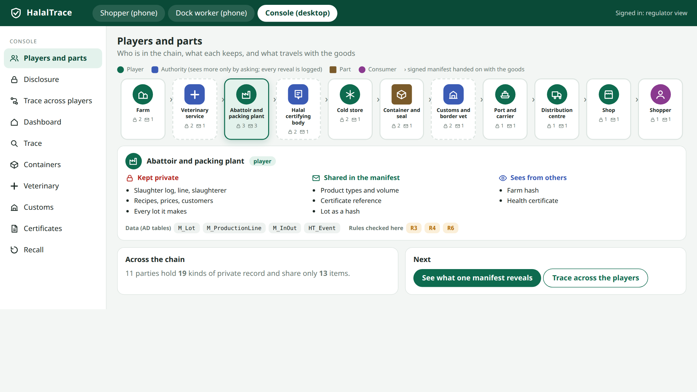

The card for each party shows how many kinds of record it keeps private and how many items it shares. Selecting one lists what it keeps, what it shares, and what it sees:

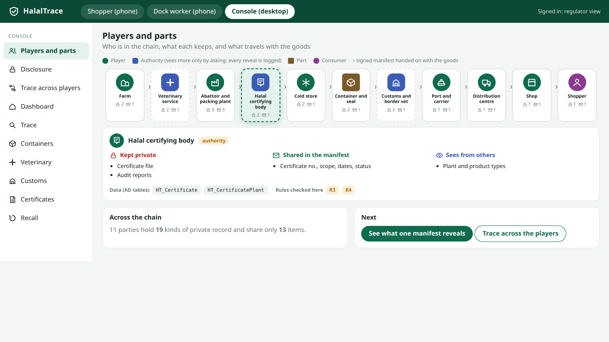

Across the chain the eleven parties hold 19 kinds of private record and share 13 items.

## 6. Identifiers

| Thing | Identifier | Carried by |
|---|---|---|
| Consumer pack | GTIN + lot + serial | QR, as a GS1 Digital Link `https://<domain>/01/<GTIN>/10/<LOT>/21/<SERIAL>` |
| Carton | GTIN + lot | linear barcode |
| Pallet | SSCC | pallet label |
| Container | ISO 6346 number + seal number | the door and the seal |
| Place | GLN | site register |
| Animal | national ear-tag number | tag |
| Certificate | certificate number | certificate registry |

A plain phone camera opens the link, so the consumer needs no app.

## 7. The manifest and minimal disclosure

At each hand-off the sender signs one manifest. It contains only:

```json
{ "v":1, "container":"MSKU 481236 9", "seal":"HT-0048213",
  "lines":[{ "type":"Beef - frozen", "class":"halal", "cartons":240, "kg":2400 }],
  "cert":{ "no":"HC-26-001843", "issuer":"Southern Cone Halal Certification Board" },
  "lot":"sha256:…", "prev":"sha256:…", "from":"…", "to":"…", "at":"2026-08-29" }
```

`lot` is `sha256(lot ‖ salt)`. `prev` is the hash of the previous manifest, so the manifests form a chain. Prices, customers, recipes, other lots and internal locations never appear.

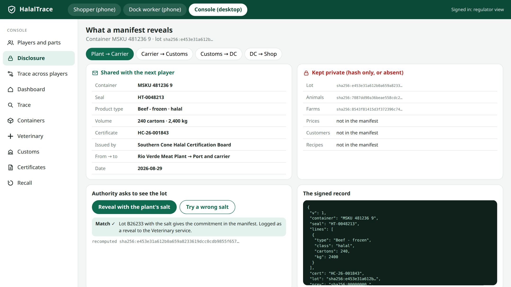

An authority that needs the lot asks the owner, who reveals the salt. The recomputed hash either matches the manifest or it does not; a wrong salt discloses nothing.

## 8. Federated trace

A trace walks the chain by asking each hop for its own step. In the prototype, six hops answer from the shop back to the farms. If one player is silent, the trace stops there and nothing beyond it is guessed.

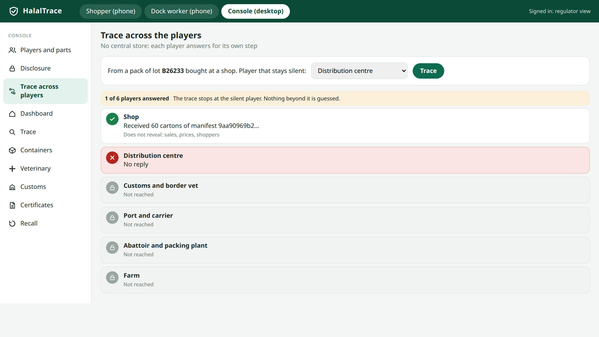
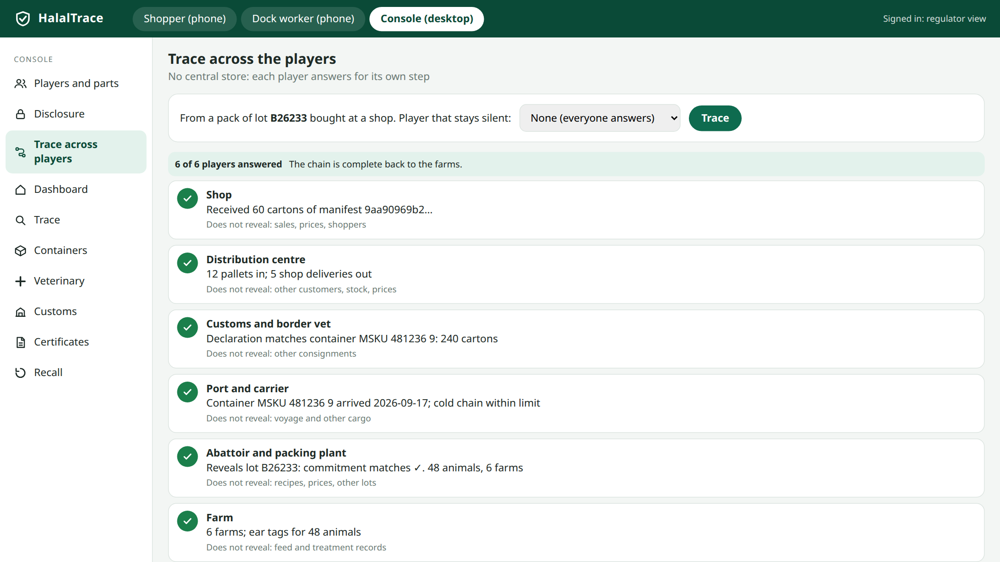

## 9. Data model in the AD

Every table is defined in `AD_Table` and `AD_Column`, so it opens in the generic window with no per-window code. Core tables below were checked in the ERP's AD seed.

| Concept | AD table | Columns used |
|---|---|---|
| Player, site | `C_BPartner`, `C_BPartner_Location` | — |
| Product type | `M_Product` | — |
| Lot, serial, best-before | `M_Lot`, `M_AttributeSetInstance` | `Lot`, `SerNo`, `GuaranteeDate` |
| A hand-off | `M_InOut`, `M_InOutLine` | the manifest derives from these lines |
| Carton, pallet, container | `M_Package`, `M_PackageLine` | `TrackingNo`, `Weight`, `Qty`, `M_Product_ID` |
| Cold-store room, dock, rack | `M_Warehouse`, `M_Locator` | **`X`, `Y`, `Z`** |
| Internal move, count | `M_Movement`, `M_Inventory` | — |
| Carcass to cuts to packs | `M_ProductionLine` | — |

Extension tables, also AD-defined: `HT_Certificate`, `HT_CertificatePlant`, `HT_Event` (EPCIS-shaped), `HT_Reading` (sensor values), `HT_Hold`, `HT_Manifest`, `HT_Commitment`, `HT_Reveal`, `HT_Scan`, `HT_Review`, `HT_Rule`.

**Spatial hook.** `M_Locator.X/Y/Z` places a pallet in a cold-store room, and `HT_Event` places an event at a site by GLN. A spatial ERP draws the room from the same rows. A plant that runs the app already holds its stock, locations and shipments, so track and trace is a view of data it keeps anyway.

## 10. The rules

| Rule | Checks | If it fails |
|---|---|---|
| R1 | every item loaded in a container has a valid certificate for its class | the dock scan is **blocked** and logged |
| R2 | a halal container's listing is halal only | the container cannot be sealed |
| R3 | the certificate covers this plant and product | pack shows "not verified" |
| R4 | the certificate was valid on the production date | pack shows "not verified" |
| R5 | a container that last carried non-halal cargo has a cleaning record | seal refused |
| R6 | a named, certified slaughterer was on that line and date | lot cannot be created |
| R7 | cold-chain readings stay within the limit | the excursion is shown and the lot flagged |
| R8 | a veterinary or customs hold stops downstream use | pack shows "on hold" |

## 11. The shopper's phone

**Scan.** The camera reads the pack's QR code.

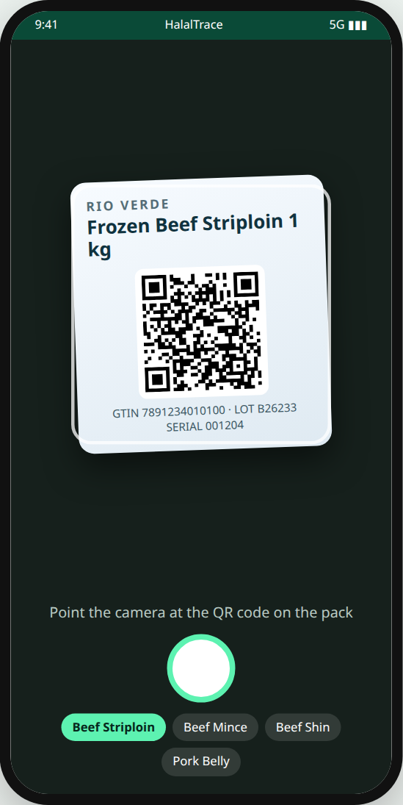

**Verdict.** The page states the verdict, the certificate, the issuer, the validity dates and the plant. The phone checks the signature itself.

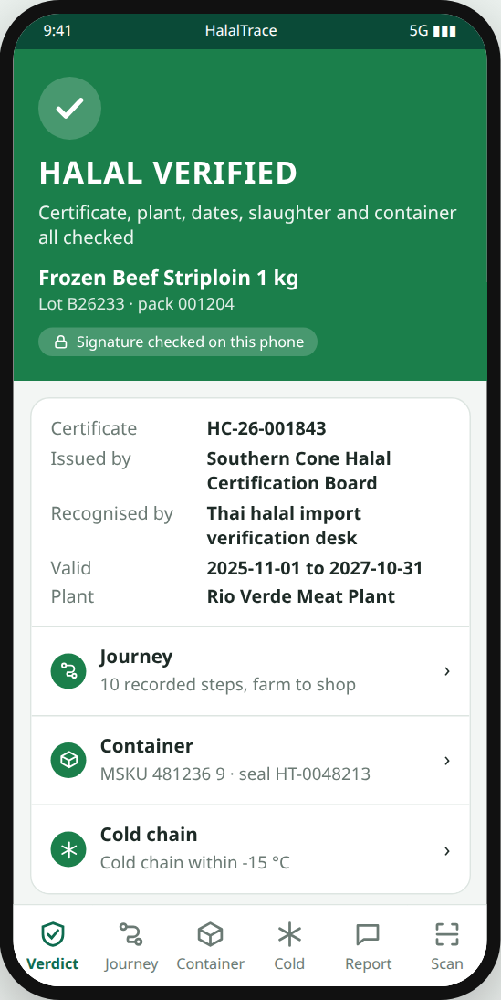

**Tracking card.** Like a parcel tracker: the status and a six-step bar at the top, then a scrollable list, newest first, of every handling step. Tapping a step shows who handled it and the evidence.

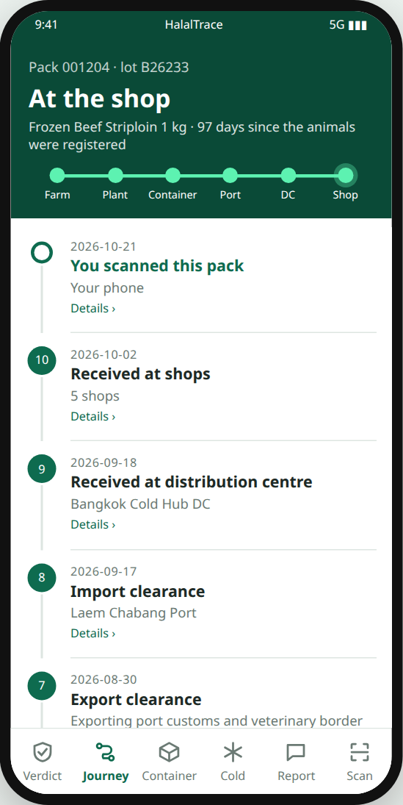
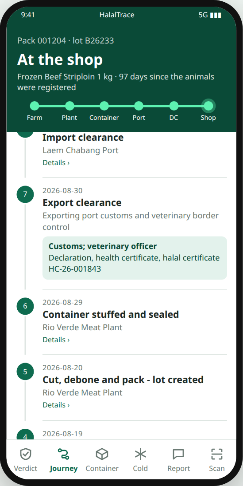

**Container and cold chain.** The container number, seal, previous cargo and cleaning record, the content listing with each line's certificate, and a temperature chart for each leg against the limit.

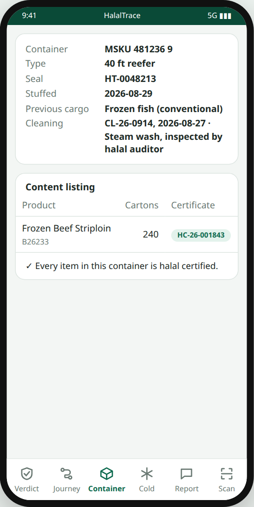
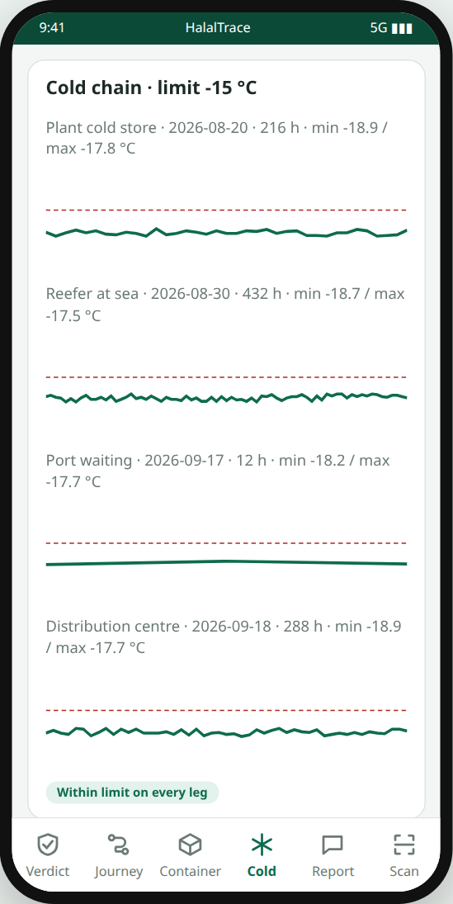

**Report or review, with a photo.** The shopper photographs the pack, rates it, picks a type and the shop, and writes a note. The message carries the pack link and the verdict shown at scan time. It is sent through the phone's own share sheet (WhatsApp, LINE, email or any installed app), with `mailto:` and `wa.me` links as fallbacks, or saved. The report is stored on the phone first and works offline. HalalTrace sees nothing unless the shopper sends it there. The status stops at "Shared", because a share sheet cannot tell us more.

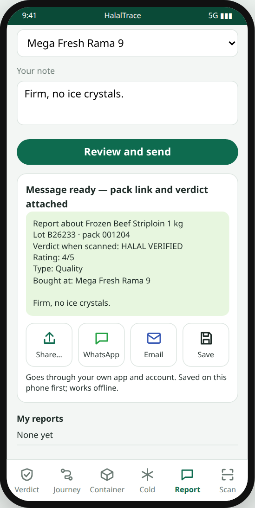

## 12. The dock worker's phone

Each carton is scanned onto the container. Rule R1 checks it on the spot.

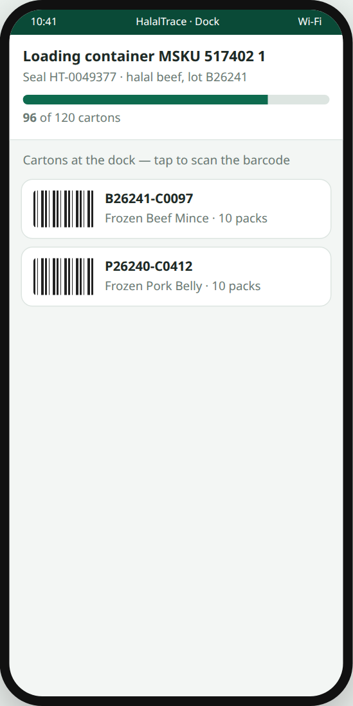
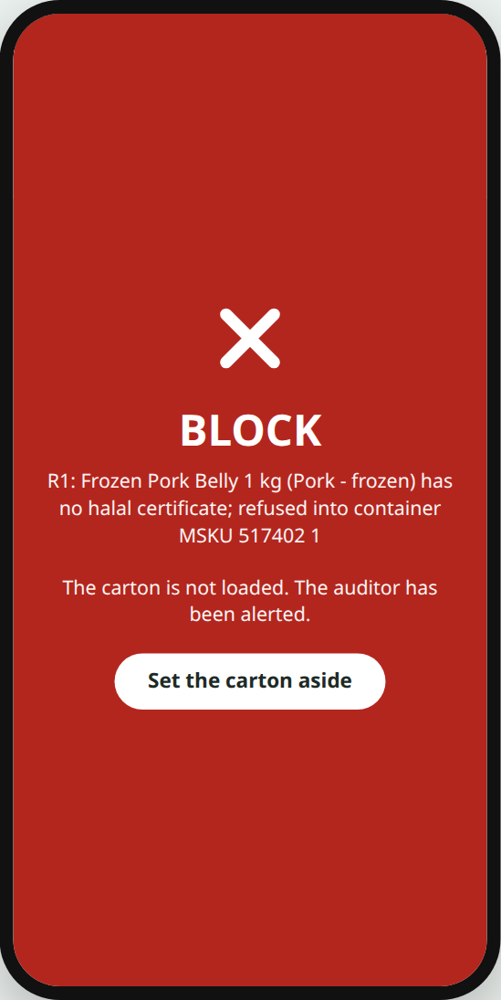

## 13. The console

The plant's own app and the authority views share the generic grid. The dashboard shows alerts, including the blocked scan above.

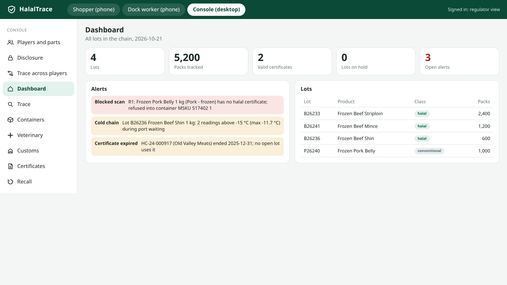
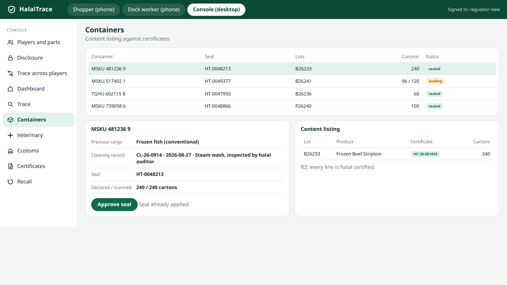
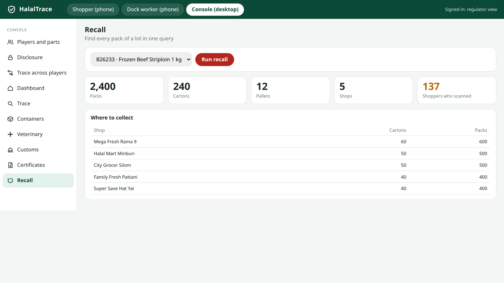

## 14. Local-first mechanics

The signed, hash-chained, sealed-to-recipient event pattern is reused from our ThaiGoldPawn prototype: append-only events, device-bound keys that cannot be exported, tokens sealed to the recipient's key, state as a fold over the chain, and an offline queue that syncs on reconnect. Here the author is the player key, the recipient is the next player's key, and the token is the manifest.

## 15. What the checks prove

Twenty-three scripted checks run against the prototype. All passed on 2026-10-21; the log is `witness_ui.log`.

| Check | Issue it proves or disproves |
|---|---|
| W-HT-MIN | the manifest has only the agreed fields; lot, animals, farms, price, customer are absent in clear |
| W-HT-COMMIT | the right salt reproduces the commitment; a wrong salt fails |
| W-HT-CHAIN | each manifest's `prev` equals the previous manifest's hash |
| W-HT-FED | a silent player stops the trace; later hops are "not reached" |
| W-HT-AGG | 2,400 packs trace to 48 animals on 6 farms and add up |
| W-HT-R1 | a pork carton is refused; a beef carton is loaded |
| W-HT-TRACK | the tracking card has 11 steps, six stages, and scrolls |
| W-HT-REV | a review is saved locally with its photo, rating, link and verdict |
| W-HT-PLAYERS | 11 players fit the window |
| W-HT-NOOVERFLOW, W-HT-NOERR | no console view scrolls sideways; no page errors |

These prove the prototype is consistent with the design. They do not prove the design works in a real chain.

## 16. Limits and open questions

- **No real integration.** Certificate lookup against a Thai certifying body's registry is assumed. Whether such a registry can be queried by number is unknown.
- **Key trust.** Who vouches that a signing key belongs to a plant is open; a certifying body could, if it agrees.
- **Multi-hop trace** needs each player online or its answers cached. The cache rule is undefined.
- **Cold-chain data** is trustworthy only if sensors capture it; typed values would be labelled lower trust.
- **Hosting** of the public record for a plant with no web presence.
- **Thai text** for religious wording must be reviewed by a qualified native speaker before consumer use.
- **Unread sources:** the NTUST thesis and the Indonesian study.
- **No field trial.** The only comparable pilot we read used RFID over 109 cartons.
