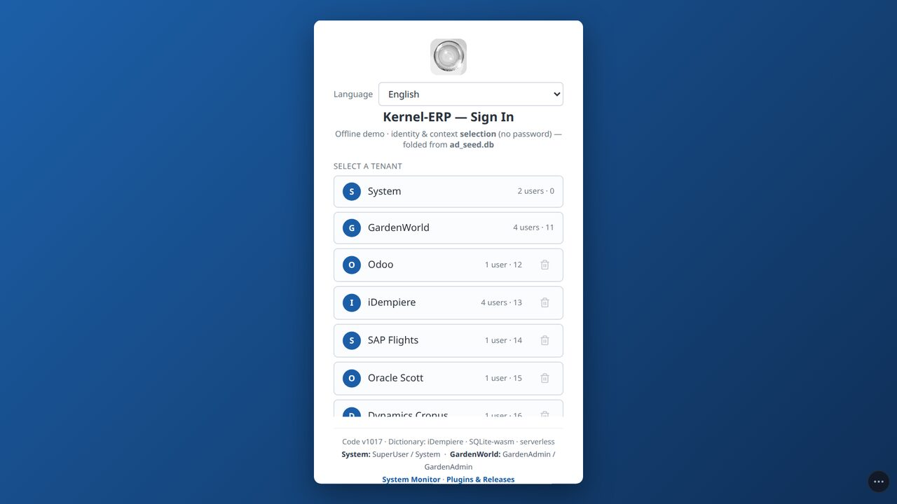
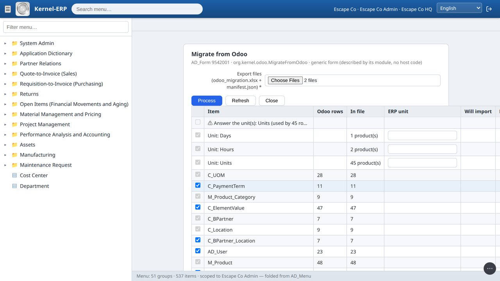
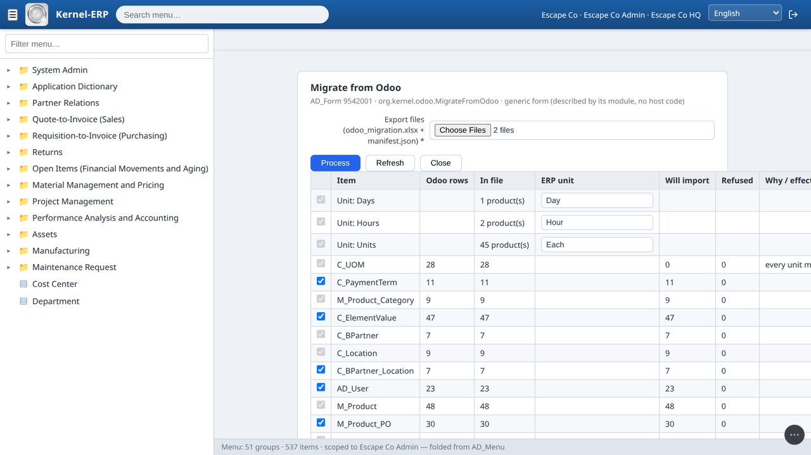
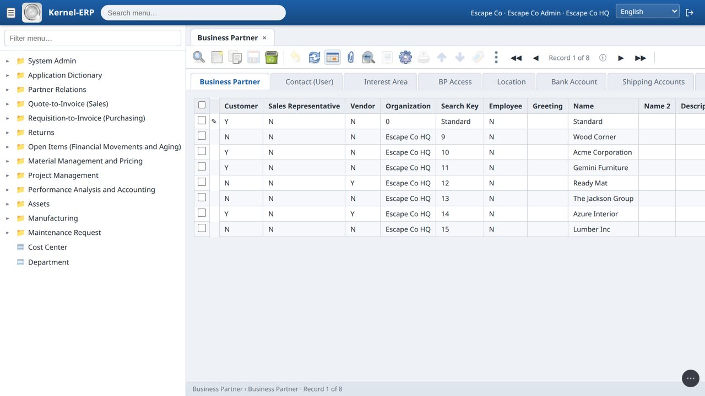
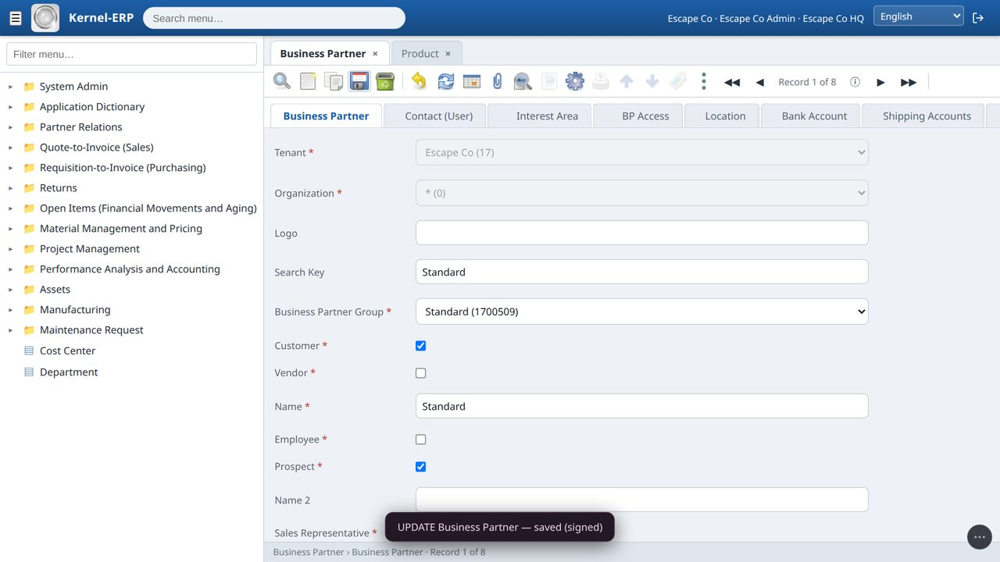
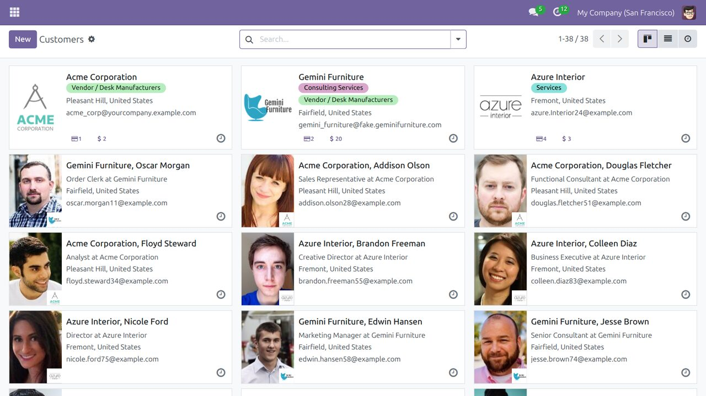
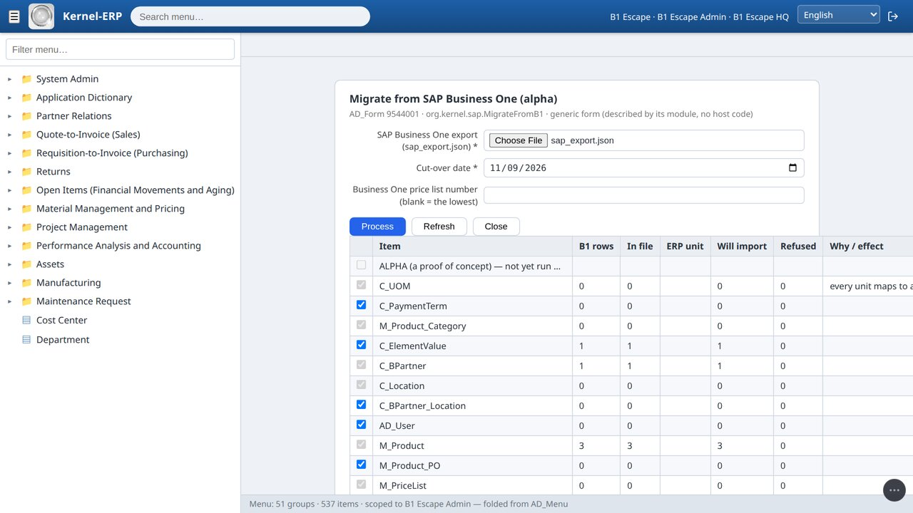
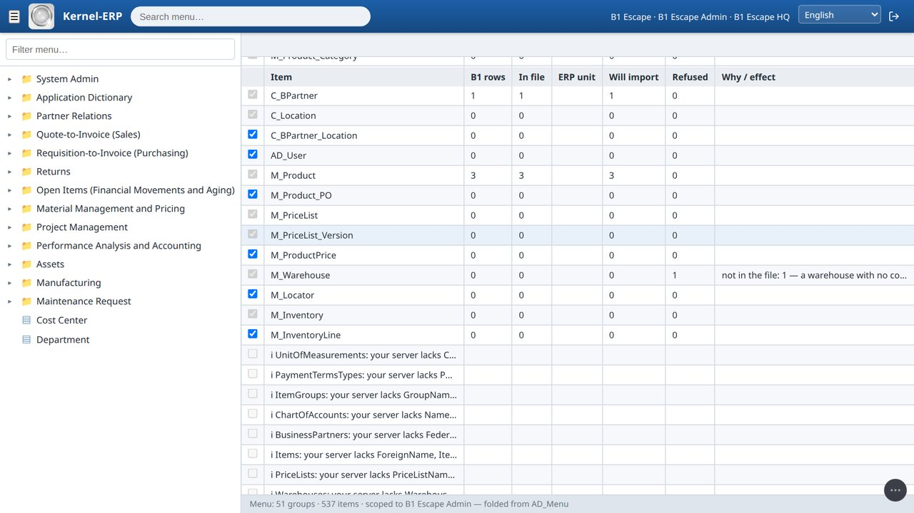
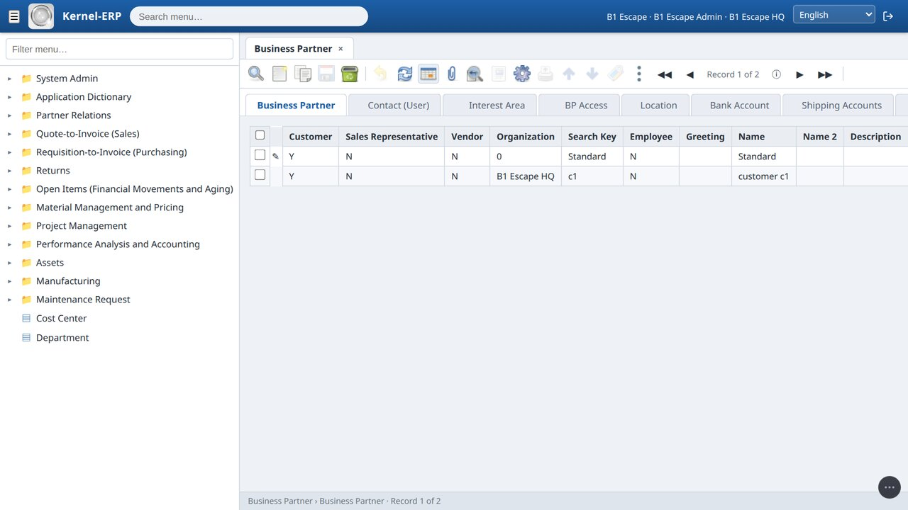

# Migration User Guide — move your company into the Kernel ERP

> **One guide for every source.** You run a small tool next to your old system, or export a file from it. The ERP reads that file in your browser, shows you a
> summary before anything is written, and then loads it all at once or not at all. Nothing is uploaded, and your old system is only ever **read**.
> How it works and what is proven: [Moving from Odoo — how it works](OdooMigration.md) · the main guide: [Kernel-ERP User Guide](ERPUserGuide.md).

## Choose your source

| From | How the data leaves it | Status | Film |
|---|---|---|---|
| **Odoo 17** | the Odoo agent reads your Odoo and writes `odoo_export/` | **tested** on Odoo 17's demo company: masters, opening stock **with its cost**, trial balance, open invoices and bank | *How to escape from your Odoo* |
| **Dynamics 365 Business Central** | Business Central's own Excel export (a configuration package), masters and, with the ledger tables added, the opening balances | **alpha**: tested on Microsoft's demo company and on test-supplied ledgers, never run on a real company | *How to escape from your Business Central* |
| **SAP Business One** | the SAP agent reads your Service Layer and writes `sap_export.json` (masters) and, with `--cutover`, `sap_open.json` (opening balances) | **alpha**: tested only on the example records in SAP's own guide and on test-supplied ledgers, never run on a real company | *How to escape from your SAP Business One* |
| **iDempiere** | opening balances: the iDempiere agent's `open_reader.js` writes `idempiere_open.json`. Masters and metadata: `node migrate_agent.js --masters` writes `ad_masters.db`, see [the ERP guide, §2](ERPUserGuide.md#2-bring-your-data-in-the-diy-box-help-run-it-yourself) | **tested** on the GardenWorld client of a local iDempiere: the balances. Not yet on a real company's books | — |

**What moves (all sources):** master data and opening stock, at a cut-over date: customers and vendors with contacts and addresses, products, units, categories,
payment terms, prices, the chart of accounts, warehouses and locators. **Opening balances at the cut-over** come from **Odoo** and **iDempiere** (tested) and from **SAP Business One** and **Business Central**
(alpha): the trial balance as one opening journal, every open customer and vendor invoice, and the bank balances (see *Opening balances, every source* below).
**Not yet:** open orders and closed history, from any source.

**Alpha** means the route was built from what the vendor publishes, and has not yet run on a real company's data. This holds for the **SAP Business One** and **Business Central** routes as a whole,
**including their opening balances**: those were tested only on ledgers made for the test, and must not be run on a real company until a tester's run has closed that gap. Every alpha run writes an **alpha report**: counts
and field names only, with every value masked. Please send it back. That is what turns an alpha into a tested route.

---

## The same three steps for every source

### Step 1 — Get your data out of the old system

This is the only step that differs per source. See [Odoo](#odoo), [Business Central](#business-central-alpha) or [SAP Business One](#sap-business-one-alpha) below.

### Step 2 — Your own company in the ERP, and the plugins (once)

1. Log in as **System** → **Plugins & Releases** → press **Start** on **Ninja data migration (Migrate Excel Data)** and on the migration for your source
   (**Migrate from Odoo**, **Migrate from iDempiere (opening balances)**, **Migrate from Business Central (alpha)** or **Migrate from SAP Business One (alpha)**).
2. Still as System: menu **Initial Tenant Setup** → fill in the company details → **Create tenant**. It is set up the way iDempiere's Initial Client Setup sets one
   up (trees, accounting, a default partner group and tax category, the standard warehouse). The new company appears on the login screen. It holds **no sample invoice**: the
   only invoices it will have are the ones in your file.
3. Every company's roles get the migration screens when the plugins start (as iDempiere does after installing a plugin). **Created the company while the plugins
   were already running?** Reload the page once: the plugins start again and the new company's roles are included.



### Step 3 — Migrate, in the ERP

1. Log in as your new company's administrator → menu **Data Import → Migrate from …** (your source).
2. Pick the file(s) from Step 1, and the **cut-over date** where the form asks for one. The browser reads them on your machine.
3. **Units:** where the source's units have no ERP code, pick the ERP unit for each from the list in its cell (for example Units → `Each`, Hours → `Hour`). When the
   source gives an international code, the matching ERP unit is suggested. **A unit the ERP does not have?** Leave *ERP unit* empty and type a short code (up to 4
   characters) in **New unit code**: the unit is created with that code and its products use it.

   

4. Press **Refresh**. The **summary** is a dry run of the real import: for every table, how many rows the source has, how many will import, how many would be
   refused and why, including rows the conversion itself could not use ("not in the file: …"). Notes about your data are listed under the tables. Nothing is written
   yet. Untick what you do not want; a table another ticked table needs stays ticked.
   **Already there:** a new company starts with a few records of its own (the payment term *Immediate*, a *Standard* partner, category and price list, its chart of
   accounts). A row of yours with the same key is counted under *Already there* and not loaded; your other rows use the company's own record. A key that appears
   twice in your own data is still refused: fix it in the source.

   

5. Press **Process**. Everything goes in at once, or nothing does: one signed change set. The form says what it migrated.
6. **Check it:** open **Business Partner** and **Product** from the menu (the Find window opens first: press OK). Your records are there, in the ERP's own windows.

   

**Working offline, and with your team.** The ERP and your data live in this browser, so it keeps working with the internet off (in the recorded runs a record was
edited and saved with the network cut, and the page made 0 network requests). To share with colleagues, open the **Team** panel and press **Start a team**; each device
then sends only its signed changes through a relay (a post box, not a server). See the [team guide](https://red1oon.github.io/bim-ootb/erp/team_guide.html).



**Opening balances, every source.** One mechanism serves all four: the trial balance goes in as **one opening journal**, each open invoice or credit note as its own document (the unpaid
amount), each bank or cash balance as one opening bank statement. Stage 2 completes them and then checks the ERP's books against the source's rows (account by account, the open amount per partner, the bank
balance per account); the three clearing accounts must end at zero, or the form says which one is off and by how much. **Not brought in, from any source:** open items in a **foreign currency** and payments
**not yet matched to an invoice**; they stay on the clearing accounts and the summary counts them.

**Your stock keeps its cost (Odoo).** The unit cost Odoo holds (`standard_price`) comes across with the opening stock through a Cost Adjustment, so the first shipment after the move
posts at that cost. In the witnessed run, a shipment of 3 units at Odoo's cost of 14.00 posted 42.00 to cost of goods sold and to the inventory asset, and each of the 21 costed products had exactly its Odoo cost.

**A migrated company can trade.** On the migrated company the test paid a migrated open customer invoice (it shows paid, the partner's open balance falls by the amount, the books stay balanced), ran a
new sales order through shipment, invoice and payment on the migrated products, customers and price list, and paid a migrated vendor bill (witness `witness_migration_trade.js`, 26 of 26 checks).

**Refused in the ERP (all sources):**

- **"Answer the unit(s)"**: a unit a product uses has no ERP unit picked yet (Step 3.3).
- **"The manifest is for … / Sheet … has N rows; the manifest says M"**: the files do not belong together. Pick them from the same export.
- **"… ambiguous"**: a lookup matches two rows in your company (for example two price-list discount schemas of type P). Today the run is refused.
- **Process again on the same file** says *Nothing to do: all rows are already in this company*; nothing is loaded twice.
- **A refused second stage (the opening balances)** can be fixed in place: correct the source, export again, and Process the new file in the same company. The ERP replaces the rows the refused run left waiting, loads the rest, and checks its books again; a journal left in *Drafted* is completed. You do not need a new company.
- **A different cut-over file in a company that already has opening balances** is refused in plain words (it names the cause and what to do). One company holds one cut-over; a later cut-over, or the other Odoo company, goes into its own ERP company.

---

## Odoo

**Before you start:** any computer with **Node.js 16 or newer** that can reach your Odoo (the Odoo machine itself, or your laptop for Odoo.sh / Odoo Online). An Odoo
login that can read accounting and stock (an administrator). If your Odoo asks for a 2-step code, make an **API key** (your Odoo profile → Account Security → New API
Key) and use it as the password.

1. Download `odoo_agent.zip` from the ERP (**About → DIY**, the Odoo agent) and unzip it.
2. Run:
   ```bash
   cd odoo_agent
   node export.js --host localhost --port 8069 --db yourdb --login admin --cutover 2026-12-31
   ```
   For **Odoo.sh / Odoo Online** (or any Odoo on https): `node export.js --url https://mycompany.odoo.com --db mycompany --login me@mycompany.com`.
   It asks for the password or API key (it is never a flag). `--cutover` is the date your opening stock is counted at (default: today).
   - **Several companies in one Odoo?** The export moves the company your login opens on, and ends by printing the command for each other company (`--company 2` …).
     Each one becomes its own ERP company.
   - **Your Odoo version** is checked first: the export is written for Odoo 17; on another version it stops, names the field it misses and writes nothing.
3. When it ends with **PASS** you have `odoo_export/odoo_export.json`: your Odoo rows as Odoo returned them, read only, each set with the number of rows Odoo
   counted (the proof nothing was dropped). If it ends with FAIL, nothing is written and it says why.
4. In Step 3, pick `odoo_export.json`. The ERP turns the rows into its own tables on your screen and shows the summary before anything is written. Odoo's units have
   no ERP code: pick each one. *(An export made by an older agent — `odoo_migration.xlsx` and `manifest.json` — still loads: pick those two.)*

**What the move settles for you** (shown on the summary): **archived** customers, products and locations come along **inactive**; **repeated codes**: the older
keeps it, the other becomes `CODE-<odoo id>`; a code longer than the ERP field is shortened and keeps `~<odoo id>`; an address with **no country** gets your Odoo
company's country.



**Refused in the export:** **"FAIL auth"**: check the login, the password (an API key with a 2-step code) and `--db` · **"FAIL access: the Odoo user cannot read …"**:
use an administrator · **"FAIL version: Odoo … has no …"**: this Odoo version is not supported yet · **"FAIL company: no company with id …"**: it lists the companies;
run again with one of their ids.

**Open balances at the cut-over (Odoo).** The same file carries your trial balance and every open customer and vendor invoice and credit note at the `--cutover`
date. The ERP brings them in as **one opening journal** and **one document per open invoice** (its own number and date, the unpaid amount, no tax), completes and
posts them, and then checks its books against your Odoo rows: each account's balance, the open amount per partner, the bank balance per bank account, and three
clearing accounts that must end at zero.
If anything differs it says which account and by how much.

- **Open the period first.** The cut-over date's period must be open, and today's too if you migrate later than the cut-over. On a new company: untick *Automatic
  Period Control* on the Accounting Schema, then open the period (Calendar Year and Period → Open/Close All). The summary tells you when this is missing.
- **Where the amounts land.** Receivables and payables land on the ERP's own customer and vendor accounts; every other account keeps its Odoo number.
- **Your bank and cash balances come in as opening bank statements.** Each Odoo bank or cash journal becomes a bank account in the ERP, and its balance at the
  cut-over is entered as one completed opening statement. The clearing account `BANK-CLEAR` must end at zero, and the form checks that. Odoo has no bank routing
  number: the bank is created with a dash there, and the account number is the journal's code when Odoo holds none. Correct both on the Bank window afterwards.
- **Not brought in:** payments not yet matched to an invoice, manual journal entries on the receivable or payable account, and open items in a foreign currency. The
  summary counts them, and their total stays on the clearing account.
- **Stock cost.** The opening stock carries Odoo's cost (see *Your stock keeps its cost* above).

**Not moved yet:** open orders, lots and serial numbers (stock is summed per product and location),
vendor price breaks, instalment payment terms, closed history. Odoo apps outside trade and accounting (manufacturing, HR, POS …) arrive as plugins.

---

## iDempiere (opening balances)

> Tested against a local legacy iDempiere (the GardenWorld client): the ERP's books matched that iDempiere's trial balance account by account, its open invoices per partner and its bank balances
> (witness `witness_idempiere_open.js`, 45 of 45 checks). **Not yet run on a real company's books.** The master-data route is separate, see [the ERP guide, §2](ERPUserGuide.md#2-bring-your-data-in-the-diy-box-help-run-it-yourself).

**Before you start:** a computer with **Node.js** that can read your iDempiere's Postgres (directly, or through its Docker container). **Freeze the books at the cut-over date first:** the reader refuses with
`source-not-frozen` when the books hold postings after that date, because an invoice's open amount is read as of today.

1. Download `idempiere_agent.zip` from the ERP (**About → DIY**, the iDempiere agent) and unzip it.
2. Run (the password is never a flag; set `PGPASSWORD`):
   ```bash
   cd idempiere_agent
   PGPASSWORD=... node open_reader.js --cutover 2026-12-31 --db idempiere --client 11
   ```
   Use `--container NAME` for a Postgres in Docker, or `--host` and `--port`. It reads one client and its primary accounting schema, and writes **`idempiere_open.json`**.
3. Step 2 above, then in the ERP: **Data Import → Migrate from iDempiere (opening balances)**. Pick `idempiere_open.json`, read the summary (what comes across, what is refused and why, what stays on the clearing accounts), press **Process**.
   The same file is a whole migration of the balances: the accounts, partners and bank accounts the documents need are created with it.

Open the cut-over period first, as under Odoo. **Not moved:** other accounting schemas of the client (named in the summary), foreign-currency open items and unmatched payments (see above).

---

## Business Central (alpha)

> Built without a running Business Central. Everything it knows was read from Microsoft's published source ([microsoft/BCApps](https://github.com/microsoft/BCApps),
> MIT licence): every table, field, length and option it reads, and the exact layout of Business Central's Excel export. Tested on Microsoft's own demo company (all
> 575 rows loaded), **not yet on a file exported by a real Business Central**.

**Step 1 in Business Central** — one configuration package, exported to Excel. No extension, no credentials, no API: this is Business Central's own **RapidStart** tool.

1. Search for **Configuration Packages** → **New**. Give it a code (for example `TO-KERNEL`). Leave **Language ID** empty (English captions and plain ISO dates read best).
2. In **Tables**, add these **Table ID**s (or use **Get Tables**):

   | Table ID | Table | Needed for |
   |---|---|---|
   | 18 | Customer | customers |
   | 23 | Vendor | vendors |
   | 222 | Ship-to Address | extra customer addresses |
   | 27 | Item | items and their sale price |
   | 5722 | Item Category | item categories |
   | 204 | Unit of Measure | units |
   | 99 | Item Vendor | vendor item numbers |
   | 3 | Payment Terms | payment terms |
   | 15 | G/L Account | chart of accounts |
   | 14 | Location | warehouses |
   | 7354 | Bin | bins |
   | 32 | Item Ledger Entry | opening stock |
   | 79 | Company Information | the country of addresses that have none, the address of locations that have none |
   | 98 | General Ledger Setup | the currency (**required**) |

3. Choose **Export to Excel**. Keep the file. In Step 3, pick it and set the **cut-over date** (opening stock is the item ledger up to it). A unit whose *International
   Standard Code* matches an ERP unit is suggested (for example `PCS`, code `EA` → **Each**).

**What it settles for you** (in the summary): a customer and a vendor sharing a number → the vendor becomes `<No.> (Vendor)`; an address with no country → the
company's country; a location with no address → the company address; an item with no category → your company's default category (as iDempiere's own product import
does); text longer than the ERP field is cut the way iDempiere cuts it, a cut code keeps `~<n>`; stock with no location → a warehouse named `BC-NOLOC`; a bin whose
location is not in the package is refused, and listed.

**Opening balances (alpha).** Add the ledger tables to the same package: **17** G/L Entry, **21** Cust. Ledger Entry, **25** Vendor Ledger Entry, **271** Bank Account Ledger Entry, and the tables they need:
**270** Bank Account, **92** Customer Posting Group, **93** Vendor Posting Group, **277** Bank Account Posting Group, **379** Detailed Cust. Ledg. Entry, **380** Detailed Vendor Ledg. Entry (with the tables above).
If the package carries any ledger table but lacks one of these, the form names the missing tables and reads **no** balances; nothing is guessed. The open amount of each invoice is the sum of its detailed entries up to the
cut-over date, so the file needs no frozen books. The balances then load as for every source (see *Opening balances, every source*). Tested only on test-supplied ledgers (`witness_sapbc_open.js`), **never on a real Business Central**.

**Not yet:** open orders, price list lines and discounts, item variants and lot numbers, dimensions, closed history.

**Alpha report:** lines starting with `§BC-ALPHA` in the browser console (F12 → Console): the tables your file held and their row counts, which column headers were
recognised and which were **not** (for example a non-English caption), rows per ERP table, what was refused and why, every value masked as `"…"`.

---

## SAP Business One (alpha)

> SAP publishes no openly licensed data model for Business One, so this route reads the model from the one place it is published: **your own server**. The agent
> asks your Service Layer for its own description (`$metadata`) and checks every field against it before reading; a field your server does not have is named, never
> guessed. Tested only against a local stand-in answering with the example records printed in SAP's guide *Working with SAP Business One Service Layer* (one customer,
> three items, one warehouse, one account), **not yet on a real Business One**. Released early on purpose: please run it and send the report back.

**Why this route (checked before it was built, 2026-11-09):**

- **Business Central** could be read from source, because Microsoft publishes its application code under the MIT licence. **SAP Business One** has no such thing: no
  openly licensed data model was found. SAP's sample repositories on GitHub are integration examples with no tables. The copies of the Service Layer model that people
  have posted were dumped from SAP servers and carry no licence.
- **SAP DB was open source** (GPL, October 2000 to 2007, later named MaxDB), but it is a **database engine**, not an application. Its source holds no business
  tables, and Business One never ran on it: Business One runs on Microsoft SQL Server or SAP HANA.
- What every Business One server **does** publish is its own model: the Service Layer's `$metadata`. A tool you run against **your** server reads it there, so nothing
  SAP-licensed ships from us, and the field list is your server's own, version and add-ons included.
- The engine point still helps: the Service Layer is a layer over the company database's tables (SAP's guide prints its own SQL: `OCRD`, `OITM`, `ORDR`). That is where
  the one thing the Service Layer does not say, an account's asset, liability or equity class, can be read next.

**What is proven so far** (witness logs, `erp/tests/witness_sap_migrate.js` and `witness_sap_migrate_live.js`):

- The agent logs in, reads the model, counts each set and pages through it to the end. Every call is a read; the test server refuses any call without the session cookie.
- When the test server lacks a field, the agent names it and does not ask for it.
- On a new company, Process writes exactly what the summary predicted, in all 17 tables: 1 customer, 3 items and 1 account from SAP's examples, in one signed change set.
  The refused warehouse shows on the summary with its reason. The alpha report contains none of the values. On the real page: 11 of 11 checks.
- **Not judged yet (10 rules):** addresses, contacts, vendors and leads, payment terms, units by international code, item groups, price list and currency, bins, opening
  stock, revenue and expense accounts. SAP's guide prints no record they apply to, so a real company's run judges them.

**Before you start:** a computer with **Node.js 18 or newer** that can reach your **Service Layer** (no `npm install`: the agent has no dependencies). A Business One
user that can read business partners, items, accounts and warehouses.

1. Download `sap_agent.zip` from the ERP (**About → DIY → SAP B1 (alpha)**, or [red1oon.github.io/bim-ootb/erp/sap_agent.zip](https://red1oon.github.io/bim-ootb/erp/sap_agent.zip))
   and unzip it.
2. Run:
   ```bash
   cd sap_agent
   node agent.js --url https://your-server:50000 --company YOURCOMPANYDB --user manager --insecure
   ```
   - `--url`: your Service Layer address (the agent adds `/b1s/v1`).
   - `--company`: the company database you log in to.
   - `--insecure`: only if your Service Layer uses Business One's self-signed certificate.
   - The password is asked for (hidden), or set `SAP_PASSWORD`. It is never a flag.
3. It logs in, reads, logs out, and writes **`sap_export.json`**. **Read only:** every call it made is listed in the file (`manifest.calls`) and `manifest.read_only`
   says `true` when nothing but reads (and the log in / log out) was sent. It prints `§SAP-AGENT` lines (counts per set) and `§SAP-FIELD` lines (fields your server lacks).
4. In Step 3, pick `sap_export.json` and set the **cut-over date**. Optionally type the Business One **price list number** to load (blank = the lowest number).



**Opening balances (alpha, never run on a real company).** Run the agent again with `--cutover 2026-12-31` (add `--openfile NAME` to rename): it also writes **`sap_open.json`**, the trial balance, the open invoices
and credit notes (`DocTotal - PaidToDate`) and the house-bank balances, read with GET only. `PaidToDate` is as of today, so the agent raises `source-not-frozen` when the books hold postings after the cut-over:
freeze them first. In **Migrate from SAP Business One (alpha)** pick `sap_open.json` (alone it brings the balances and the accounts, partners and price list they need), and `sap_export.json` as well for the master data,
and set the same cut-over date; a different date, or another source's file, is named as one problem and nothing loads. Documents in a foreign currency, partners without an address and payments on account are not brought in.
Tested only against a mock Service Layer with test-supplied rows (`witness_sapbc_open.js`: 97 of 97 checks, and it prints the real-company check as INCONCLUSIVE).

**What it reads:** units of measure, payment terms, item groups, chart of accounts, business partners (with addresses and contact persons), items (with prices and
stock per warehouse), price lists, warehouses, bin locations.

**What it settles for you** (in the summary): a **lead** (card type L) is not a customer or vendor and is refused, counted; a **frozen** or not-valid partner or item
comes along inactive; an item **without an inventory unit** gets your company's default unit (as iDempiere's own product import does); an item without an item group
gets the default category; labour and travel items are services; fixed-asset items are refused (assets are not core); a warehouse with **no country**, when the company
country cannot be read, is refused with its reason rather than stopping the load.



**Known limits (alpha):**

- **Balance-sheet accounts** get the ERP default type: the Service Layer's account record says revenue, expense or *other*, not asset, liability or equity. That class
  lives in the company database's account table; reading it is the next step.
- **Stock** is the stock **now** (the Service Layer gives no stock at a date), dated at the cut-over.
- **One** sale price list per run. No open orders or history.
- **Opening balances are a second, opt-in file, and alpha.** See below.

**Alpha report:** the agent's own `§SAP-AGENT` / `§SAP-FIELD` lines, and the `§SAP-ALPHA` lines in the browser console (F12 → Console) after Refresh: the sets your server
gave, their counts, the fields it lacked, rows per ERP table, refusals, every value masked. Copy and send them.


