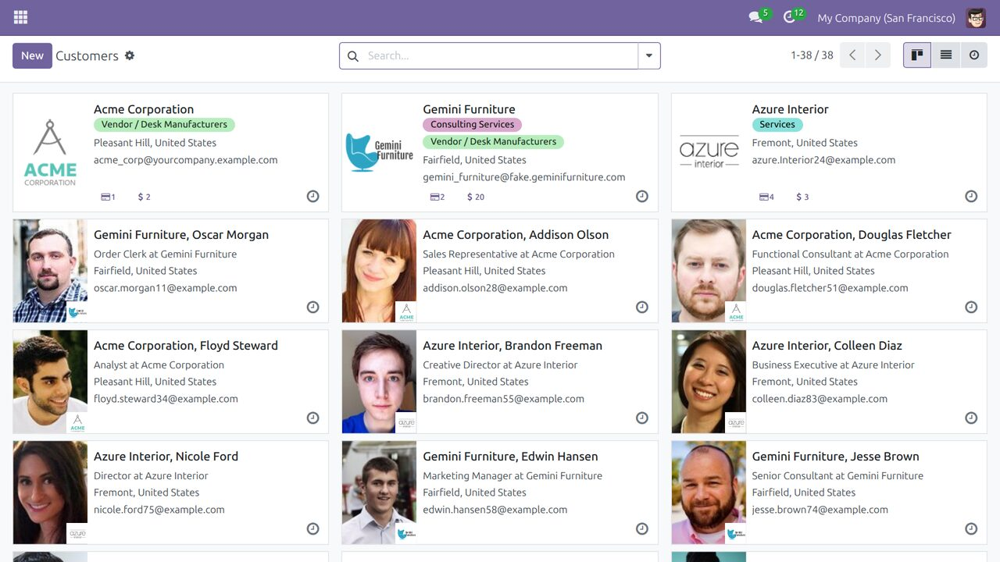
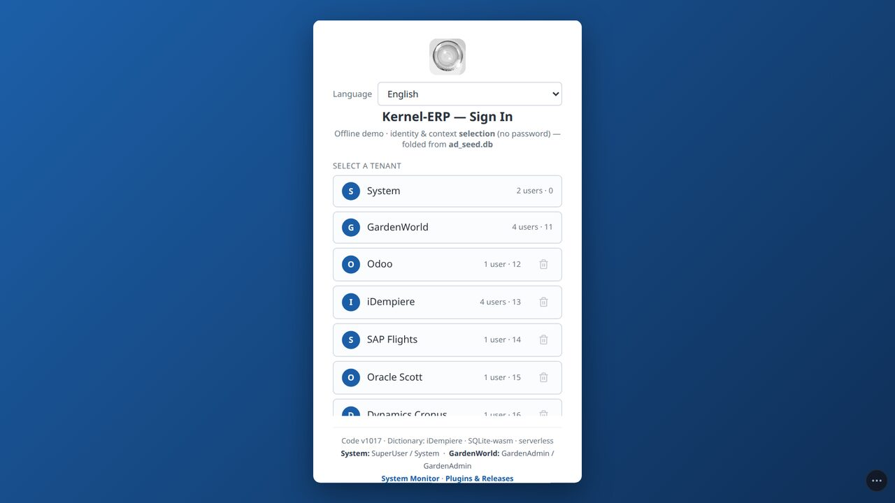
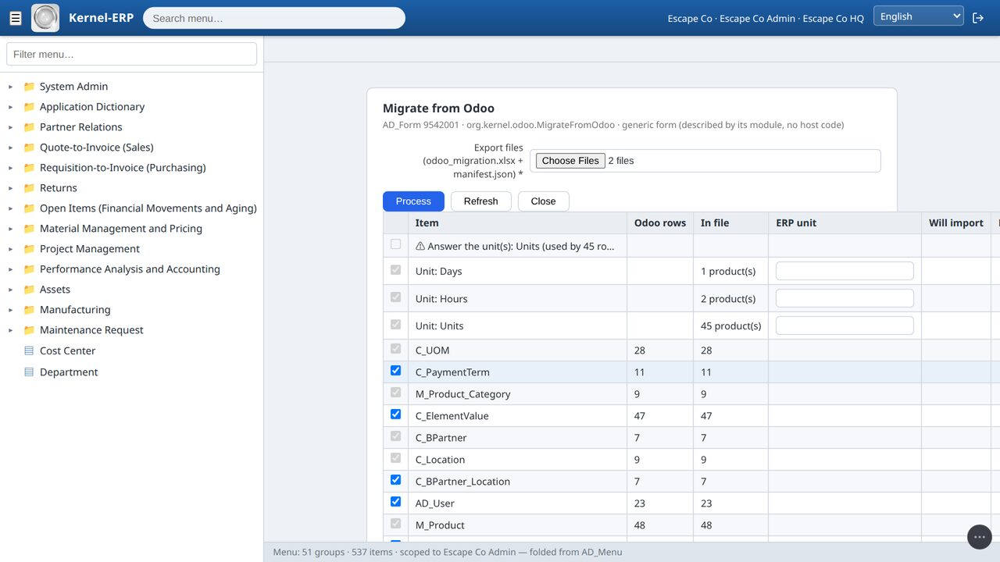
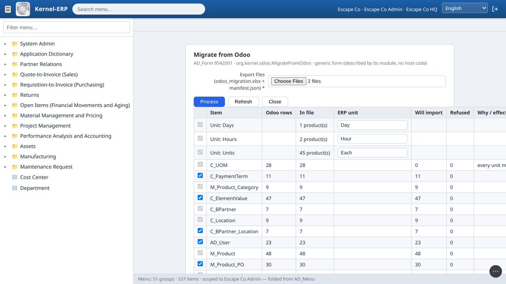
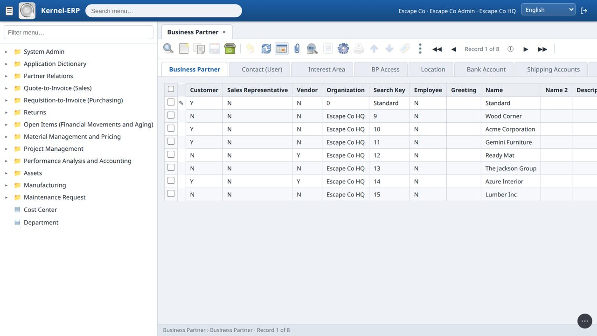
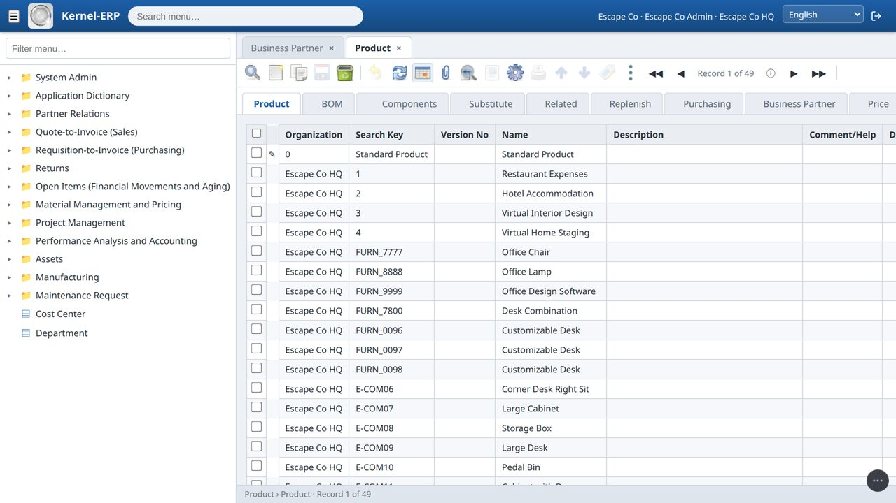
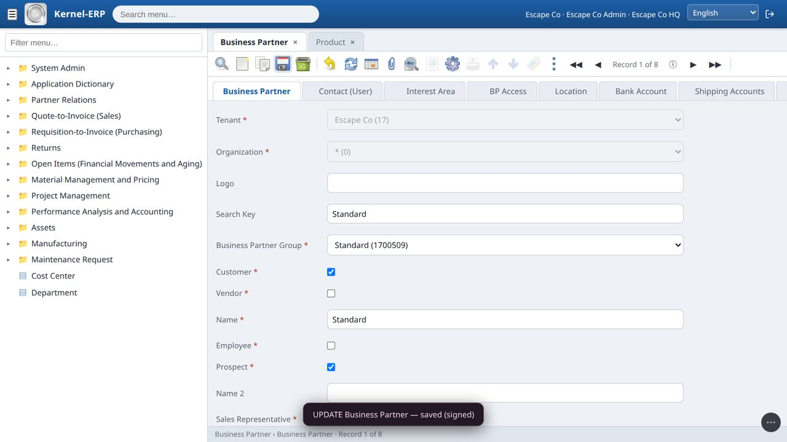
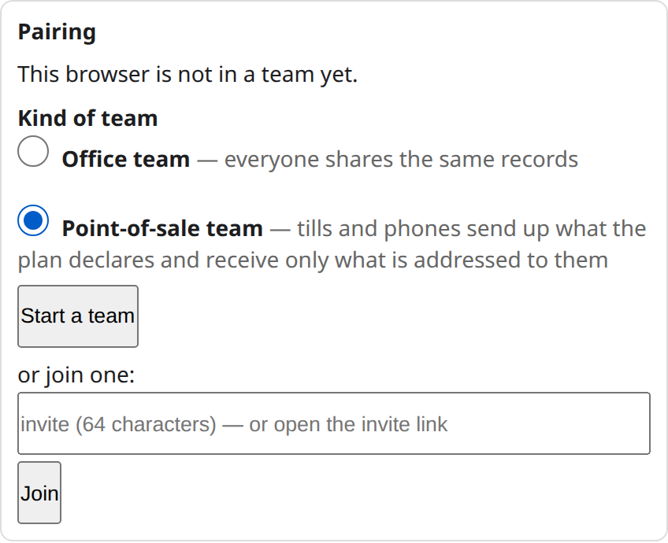

# Move from Odoo to the Kernel ERP — user guide

> **What this moves today:** your customers and suppliers (with their contacts and addresses), products and vendor prices, sale prices, payment terms, product categories,
> chart of accounts, warehouses, locations and opening stock. **Not yet:** balances, open invoices and open orders (see the end). Every screenshot below is from one real run
> with Odoo 17's demo company. How it works and what is proven: [Moving from Odoo — how it works](OdooMigration.md). The film: *How to escape from your Odoo*.

## Before you start

- Any computer with **Node.js 16 or newer** that can reach your Odoo — the Odoo machine itself, or your own laptop for Odoo.sh / Odoo Online
  (no other install).
- An Odoo login that can read accounting and stock — an administrator. The export only **reads**; it never changes Odoo. If your Odoo asks
  for a 2-step code when you log in, make an **API key** (your Odoo profile → Account Security → New API Key) and use it as the password.
- The Kernel ERP open in your browser, and the System Administrator login.

## Step 1 — Export, next to your Odoo

1. Download `odoo_agent.zip` from the ERP (About → DIY, the Odoo agent) and unzip it.
2. Run:
   ```bash
   cd odoo_agent
   node export.js --host localhost --port 8069 --db yourdb --login admin --cutover 2026-12-31
   ```
   For **Odoo.sh / Odoo Online** (or any Odoo on https): `node export.js --url https://mycompany.odoo.com --db mycompany --login me@mycompany.com`.
   It asks for the password or API key (it is never a flag). `--cutover` is the date your opening stock is counted at (default: today).
   - **Several companies in one Odoo?** The export moves the company your login opens on, and ends by printing the command for each other
     company (`--company 2` …). Each one becomes its own ERP company.
   - **Your Odoo version** is checked first: the export is written for Odoo 17; on another version it stops, names the field it misses and writes nothing.
3. When it ends with **PASS** you have a folder `odoo_export/` with three files: `odoo_migration.xlsx` (one sheet per ERP table), `manifest.json` (how many rows
   Odoo has of each — the proof nothing was dropped) and `provenance.json` (each row → its Odoo record). If it ends with FAIL, nothing is written and it says why.
4. What the export settles for you, and lists in `manifest.json` so you can check it:
   - **Archived** customers, products and locations come along **inactive** — kept for history, not offered on new documents.
   - **Repeated codes** (two products with one internal reference, two customers with one reference): the older keeps it, the other
     becomes `CODE-<odoo id>` (`renamed`). A code longer than the ERP field is shortened and keeps `~<odoo id>`.
   - An address with **no country** gets your Odoo company's country (`patches`).



## Step 2 — Your own company in the ERP

1. Log in as **System** → menu **Initial Tenant Setup** → fill in the company details → **Create tenant**. It is set up the way iDempiere's Initial Client Setup
   sets one up (trees, accounting, a default partner group and tax category, the standard warehouse).
2. The new company appears on the login screen.



## Step 3 — Start the two plugins (once)

As **System**: open **Plugins & Releases** and press **Start** on **Ninja data migration (Migrate Excel Data)** and on **Migrate from Odoo**. Do this before you create
the company in Step 2 if you can — the new company's administrator then gets the menu entry automatically.

**Created the company first?** Still as System, run **Role Access Update** (menu: System Admin → General Rules → Security → Role Access Update) with *Reset Access* = **No** —
the same process iDempiere uses after installing a plugin. Every role then gets the new screens its level allows.

## Step 4 — Migrate from Odoo

1. Log in as your new company's administrator → menu **Data Import → Migrate from Odoo**.
2. **Export files:** pick `odoo_migration.xlsx` and `manifest.json` from the `odoo_export/` folder. Nothing is uploaded — the browser reads them on your machine.
3. **Units:** Odoo's units of measure have no ERP code. Pick which ERP unit each one is from the list in its cell (for example Units → `Each`, Days → `Day`,
   Hours → `Hour`). Units no product uses are left out.

   

4. Press **Refresh**. The **summary** is a dry run of the real import: for every sheet, how many Odoo rows there are, how many will import, how many would be refused and why.
   Nothing is written yet. Untick what you do not want; a sheet another ticked sheet needs (for example the product categories, needed by the products) stays ticked.

   

5. Press **Process**. Everything goes in at once, or nothing does — one signed change set. The form says what it migrated.

   

## Step 5 — Check it

Open **Business Partner** and **Product** from the menu (the Find window opens first: press OK). Your Odoo customers and products are there, in the ERP's own windows.




## Working offline, and with your team

The ERP and your data live in this browser, so it keeps working with the internet off — in the run above a customer was edited and saved with the network cut, and the page
made 0 network requests.



To share with colleagues, open the **Team** panel and press **Start a team**; each device then sends only its signed changes through a relay (a post box, not a server), and the
others pick them up at their next **Visit**. See the [team guide](https://red1oon.github.io/bim-ootb/erp/team_guide.html) and the team film (youtu.be/-LQwoPuQ1QU).



## If something is refused

**In the export (Step 1):**
- **"FAIL auth"** — Odoo did not accept the login: check the login, the password (an API key if your Odoo uses a 2-step code) and `--db`.
- **"FAIL access: the Odoo user cannot read …"** — use a login that can read accounting and stock (an administrator).
- **"FAIL version: Odoo … has no …"** — your Odoo version uses other field names; this version is not supported yet.
- **"FAIL company: no company with id …"** — it lists the companies; run again with one of their ids.

**In the ERP (Step 4):**

- **"Answer the unit(s)"** — a unit a product uses has no ERP unit typed yet (Step 4.3).
- **"The manifest is for … / Sheet … has N rows; the manifest says M"** — the files do not belong together. Pick both files from the same `odoo_export/` folder.
- **"… ambiguous"** — a lookup matches two rows in your company (for example two price-list discount schemas of type P). Today the run is refused; a choice on the screen is coming.
- **A second Process is refused** — the data is already there (unique names and codes).

## Not moved yet

Balances and the trial balance at the cut-over date, open invoices and open orders, lots and serial numbers (stock is summed per product and location), vendor price breaks,
instalment payment terms, closed history. Odoo apps outside trade and accounting (manufacturing, HR, POS …) arrive as plugins.
