# uniCenta-style Till & Kitchen Screen — User Guide *(SQLite, local-first)*

> **⚠ DEMONSTRATOR — NOT OFFICIAL.** Every screenshot in this guide is taken on the **GardenWorld demo
> tenant** with demo products and demo prices. Treat every figure as a sample (`SAMPLE — NOT OFFICIAL`),
> not as a certified point-of-sale or accounting system.

**What this is.** A cash-register screen that looks and behaves like **uniCenta oPOS 5.0**, so a cashier who knew
uniCenta needs no new learning, running on the same SQLite twin of iDempiere as the rest of Kernel-ERP. It is a
**separate page**, not a pill inside the ERP. It runs on the till's own browser, with no server, and it keeps
working when the connection drops.

> **The till deposits; it never completes.** Each sale is written on the till as *import rows* (`I_Order` lines
> and `I_Payment` tenders — the same legacy import tables iDempiere has). Each ticket and, at **Close Cash**, the shift
> go to the **branch relay**, a small box on the shop's own network. The branch's **main till** collects them and sends the whole
> branch to head office **once**, at end of day (EODA). Head office later turns the rows into orders, invoices and receipts.
> The till itself writes **no** order, shipment, invoice, payment or posting, and it never talks to head office or the internet.

**Two ways to start:** *Try it now* (below, nothing to install) or *Install at a shop (air-gapped)* (the real set-up, further down).

## Try it now (no install)

Open these in any browser. The first open downloads the shop's data and takes about 15 seconds; the top line of the page counts the seconds
(*Starting… loading the shop's data*), and says what to do if it stalls or fails.

- Till: <https://red1oon.github.io/bim-ootb/erp/till.html>
- Kitchen screen: <https://red1oon.github.io/bim-ootb/erp/kitchen.html>
- Branch POS admin: <https://red1oon.github.io/bim-ootb/erp/branch_admin.html>
- Head office (the ERP page): <https://red1oon.github.io/bim-ootb/erp/idempiere.html>

**What a trial shows:** the screens of this guide on the GardenWorld demo data: ringing a sale, discounts, tenders, receipts, Configuration, Close Cash,
and the empty states of the kitchen and the branch admin. Each page says in its top line that it is a trial.

**What a trial cannot show:**

- It is **one browser**. Each address keeps its data in that browser only; another browser or another PC sees nothing of it.
- The data is the **GardenWorld demo tenant**, with demo products and prices. Nothing you do reaches a real head office.
- There is **no branch relay**, so there is no main till, no collection of other tills' sales and no end-of-day send. Those need the shop set-up:
  *Install at a shop (air-gapped)*.

Related guides: [Kernel-ERP User Guide](ERPUserGuide.md) · [Kernel-ERP — Your First Setup](ERP_FirstSetup.md) ·
[Distributed ERP](DistributedERP.md).

This is a task-oriented manual. **Cashier:** read *If you know uniCenta 5*, *Ringing a sale* and *The kitchen*.
**Branch manager:** read *Install at a shop (air-gapped)*, *Configuration*, *Shifts and Close Cash* and *The branch POS admin*.
**Head-office clerk:** read *Head office*. Everyone: *Troubleshooting* at the end.

---

## If you know uniCenta 5

The 25 things a uniCenta 5.0 cashier (and manager) does, and where each one is here. Labels are uniCenta's own. The till's own parity check passes **25 of 25** rows (`till_registry.js`, rows 1-25).

| # | In uniCenta 5 | Here | What differs, and why |
|---|---|---|---|
| 1 | Login (user button / card) | **Login** screen: one button per active user of the tenant | You tap a name. There is no card or password step on this till. |
| 2 | Register menu: Sales, Edit Sales, Customer Payment, Payments, Close Cash | Same five buttons, in that order | Three more buttons follow them: **Check In/Out**, **Voucher**, **Pickup Reset**. |
| 3 | Sales screen | **Sales** screen, same six regions | **Scale**, **Mooring**, **Split Sale**, **Customer**, **Search product**, **Edit line**, **Choose attributes** and **Check Stock** are shown greyed out ("not in this release", with the reason as a tooltip). |
| 4 | Number pad | Same pad and same grammar (`3` then a product = 3 units, `n*`, `+`/`-` on the selected line, `=` to pay) | Re-read against uniCenta 5.0, not 3.81: on a refund ticket `+`/`-` add −1, and `n -` no longer makes the price negative. |
| 5 | Catalog: categories, sub-categories, product tiles | Same, tiles 107 x 60, now **with the product picture** and the name and price over its bottom | Tiles are the products that have a price on the till's price list, sorted by product key. A product with no picture shows a grey "no image" mark. See *Product pictures*. |
| 6 | Ticket button bar | **Total discount**, **Line discount**, **Print preview**, **Open drawer**, **Virtual Keyboard** | Refund item, Service charge, Line note, Set person are **not** on the bar, as in uniCenta 5.0's default (they are commented out there). |
| 7 | Shared tickets | **Add New Ticket**, **Tickets awaiting completion**, **Delete**, **Reprint Ticket**, **Quick LogOff** | — |
| 8 | Payment dialog, 8 tenders | Tabs **Cash, Cheque, Voucher, Card, Free, Debt, Bank, Slip**; Add / Delete Part Payment; Print Receipt | **Voucher, Free, Debt and Slip are disabled.** Legacy iDempiere has no payment tender type for them, and the till may only send what legacy can import. Cash, Cheque, Card, Bank are live. |
| 9 | Receipt and change pop-up | **Receipt** screen (uniCenta's 42-column ticket), **Change** pop-up | Card: you key the terminal's reference and approval code; the card number is never typed or stored. |
| 10 | Edit Sales | **Edit Sales** | Edit is allowed only on a sale of the open shift that has not been refunded or sent to head office. |
| 11 | Refund | **Edit Sales → Refund** | Tabs Refund, Cheque, Voucher (disabled), Card. |
| 12 | Customer Payment | **Customer Payment** | Tabs Cash, Cheque, Voucher (disabled), Bank, Card, Slip (disabled). The till writes no debt of its own. |
| 13 | Payments (cash in / out) | **Payments** | Stays on the till (see *What never leaves the till*). |
| 14 | Close Cash (Z), Print, reprint a past Z | **Close Cash**, **Print**, **Reprint a past Z** | No counted-cash box — uniCenta 5.0 has none either. The Z goes to the **branch POS admin**, not to head office. |
| 15 | Send Order (remote printer) | **Send Order** → the kitchen screen | uniCenta's remote display has no states and nothing comes back. Here the kitchen can mark done / void and the cashier sees it. |
| 16 | Restaurant map | `till.html?mode=restaurant` (or **Tickets = restaurant** in Configuration) → floor map | Floors and tables come from the branch POS admin; until it sets any, uniCenta's own seed floor of 24 tables is shown. |
| 17 | Reservations | **Reservations** (restaurant mode) | The table is chosen at **check-in**, not when booking. |
| 18 | Reprint Last Ticket | **Reprint Last Ticket** | — |
| 19 | Voucher issue / redeem | **Voucher** screen | A till-local ledger only. The Voucher *tender tab* stays disabled. |
| 20 | *(none in uniCenta)* | **Kitchen screen** | New: a separate page with waiting / done / void, Recall, changed-line marks and a Ready notice back to the till. |
| 21 | Check In / Check Out | **Check In/Out** | — |
| 22 | Pick-up number reset | **Pickup Reset** | — |
| 23 | Configuration: General, Locale, System Options, Ticket Setup, Company | **Configuration** (gear button on the status strip) | Only the 50 settings that apply to a browser till (49 of uniCenta's plus *Look and Feel*) are shown; hardware, Swing and database settings are left out. |
| 24 | Tickets mode: simple / standard / restaurant | **Configuration → General → Tickets** | The choice applies at the next start. |
| 25 | Floor tabs over the shared table map | Floor tabs on the restaurant map | Open tables are shared by every till of the branch, with a lock; a table is saved when the waiter leaves it. |
| 26 | Look and Feel (theme) | **Configuration → General → Look and Feel** | uniCenta's *Look and Feel* choice, as two themes: **Classic (2011)**, the default, and **Modern**. Applies when you press **Save**. |
| 27 | About | **About** in the left menu panel (System) | The company logo and details, then the application name and version. |
| 28 | Left collapsible menu panel | the panel at the left of the Sales screen | Main, Administration and System sections; the **‹** button hides it. |

---

## Getting started (for the cashier)

1. **Open the till page** — <https://red1oon.github.io/bim-ootb/erp/till.html>. The strip at the top shows
   *Till*, *online/offline*, *paired / not paired*, who is signed in, *deposited N*, and a **Visit head office** button (it exchanges only with the branch relay; a till never reaches head office). Under the strip, one status line says what the page is doing: *Starting… loading the shop's data (N s)* while it loads, then what to do next (*Choose your name below to sign in*) and the branch relay it is using. If a page cannot start or fails, that line says what went wrong, what to do, and offers **Retry**.
2. **Tap your name.**

   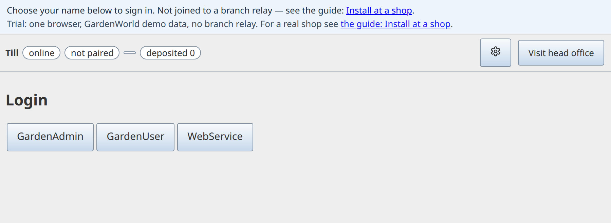

3. **Pick a panel** on the Register menu: *Sales, Edit Sales, Customer Payment, Payments, Close Cash*, and below
   them *Check In/Out, Voucher, Pickup Reset*.

   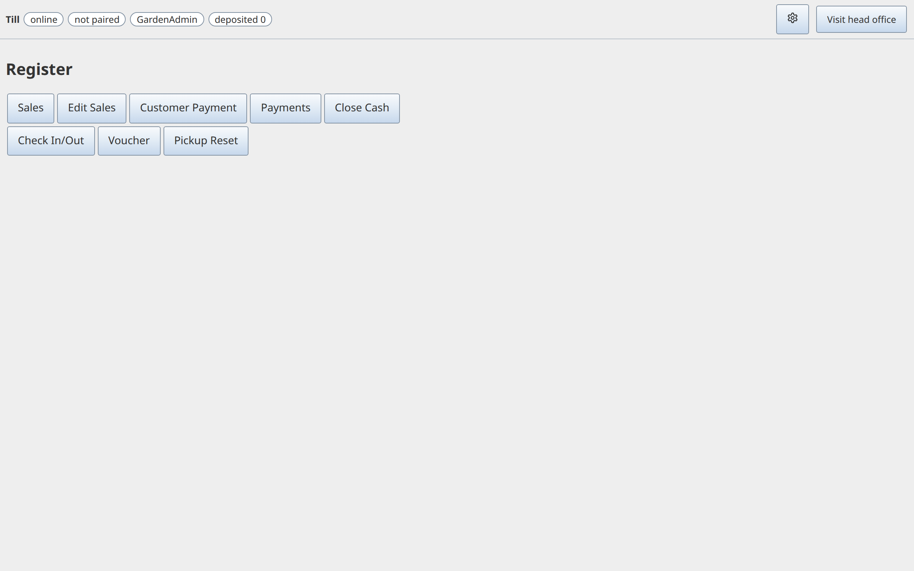

4. **Tap Sales.** Pick a category, then tap product tiles. The back arrow returns to the parent category.

   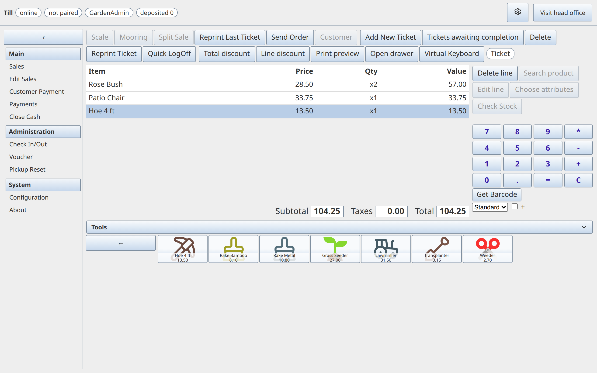

   The look is the original 2011 screen: pale grey window, blue-grey buttons, white fields, a light-blue selected line, blue number keys. The **menu panel** at the left has three
   sections, *Main* (Sales, Edit Sales, Customer Payment, Payments, Close Cash), *Administration* (Check In/Out, Voucher, Pickup Reset) and *System* (Configuration, About). The **‹** button at
   its top hides the panel (the ticket takes the room) and **›** brings it back; the choice is remembered on this till. On a phone-width screen the panel is not shown.

   The screen is laid out as uniCenta's: buttons across the top, the **ticket** in the middle (it takes whatever height is left), and the **catalog** at the bottom at the
   *category panel height* set at the branch admin (320 px by default). Product tiles are 107 x 60 with the picture and the name and price over its bottom edge. The thin
   bar above the tiles shows the open category; press it to **fold the catalog away** (the ticket grows into the space) and press it again to bring the products back.
   The choice is remembered on this till.

   *Sample sale on the GardenWorld demo tenant: 1 x Patio Chair 33.75, 1 x Hoe 4 ft 13.50, 2 x Rose Bush 57.00 — Subtotal 104.25, Taxes 0.00, Total 104.25 (the demo tax rate is 0 %).*
   The arrow button at the bottom left goes back to the category tiles:

   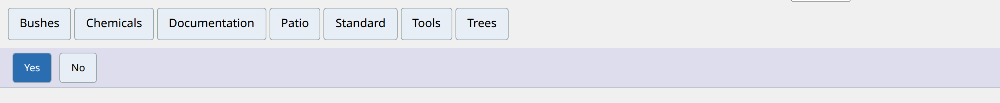

---

## Common tasks

### Ringing a sale

1. On **Sales**, tap a product tile: one unit is added. Tap it again and the line's quantity goes up (the same
   product is merged into its line, as in uniCenta).
2. For several units, type the number on the pad first (`3`), then tap the tile: three units.
3. Tap a line to select it. On the pad, `+` adds one unit, `-` takes one away (a sale line at zero is removed),
   and `n` `*` then `+` sets the line to *n* units. **C** clears the pad. **Delete line** removes the selected line.
4. A typed barcode followed by **Enter** (or **Get Barcode**) adds the product with that barcode or product key.
   An unknown code answers "*code* - no such product".

   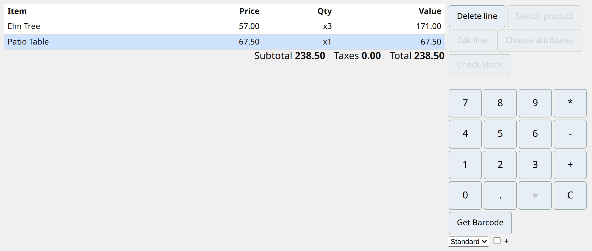

5. Totals (Subtotal, Taxes, Total) are worked out with the ERP's own tax functions, so they equal what head office
   will import.

### Discounts

1. Select the line. Type the percentage on the pad **as digits**: `10` means 10 %.
2. **Line discount** inserts a negative "Line Discount 10%" line under the selected line. **Total discount**
   lowers the price of every line by that percentage.

   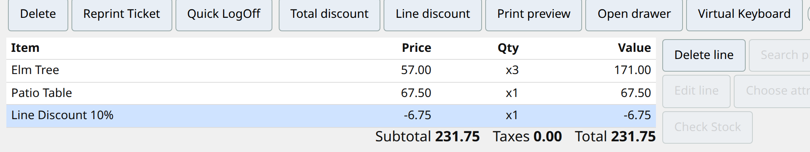

3. If the discounted price would fall below the price list's **price limit**, the till refuses it first, because head
   office would refuse the ticket anyway.

   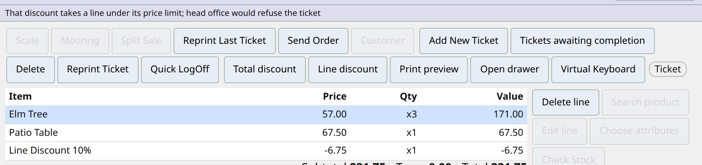

### Taking payment

1. Press **=** on the pad (or the space key). With no lines on the ticket the till just beeps.
2. The **Payment** dialog opens with the total and what remains. Voucher, Free, Debt and Slip are greyed.

   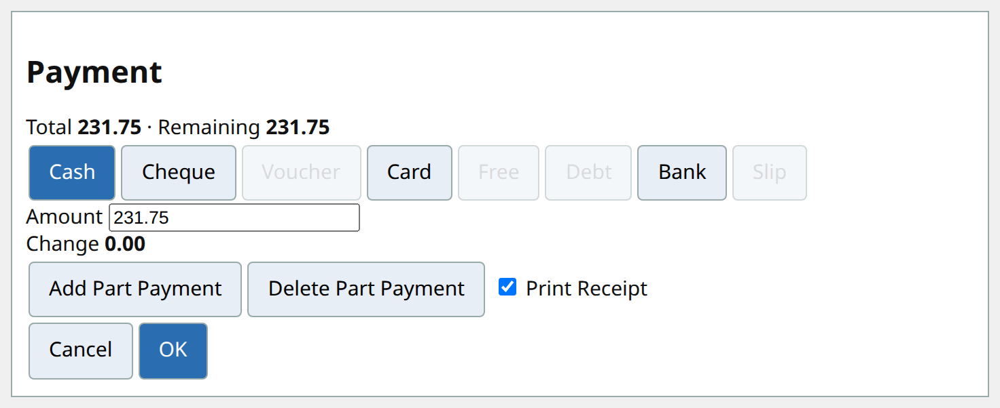

3. For a **split tender**: choose a tab, type the amount, tap **Add Part Payment**. For **Card**, key the *Terminal ref*
   and *Approval code* from the card terminal first. Only **Cash** may be more than what remains (the extra is change).
   **Delete Part Payment** removes the last part.

   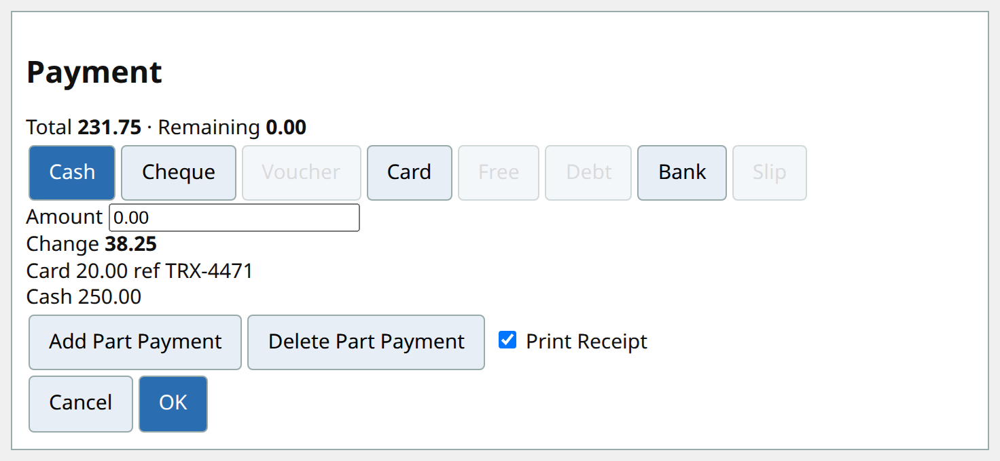

4. Tick or untick **Print Receipt**, then **OK**. The sale is saved on the device and the **Receipt** screen opens.
5. If the **first** tender was cash and there is change, a **Change** pop-up shows the amount. Tap **OK** to return.

   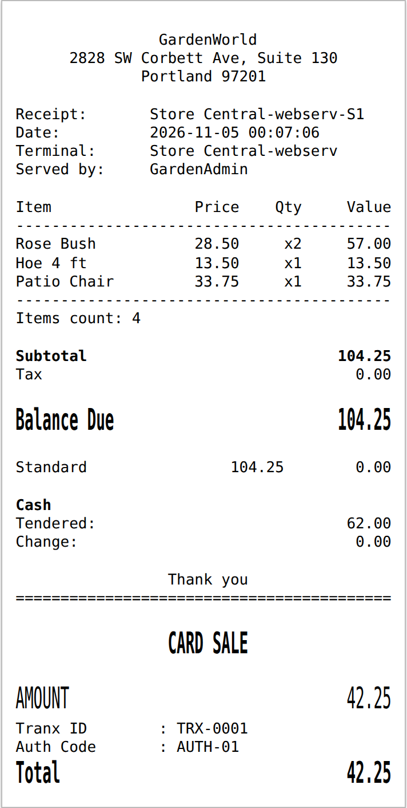

   **The receipt is laid out exactly as uniCenta's standard ticket** (`Printer.Ticket.xml`), on a fixed 42-character grid in a monospace font, black on white in both themes. Top to bottom:

   - **Header:** the logo (when the company has one), then up to six centred lines: the company name, address, tax id, phone, e-mail, or the header lines typed in *Configuration*. With neither, the receipt starts at *Receipt:*.
   - **Receipt:** (or *Refund:*) the ticket number, **Date:**, **Terminal:**, **Served by:**, and **Customer:** / **Table:** when the ticket has them.
   - **Item grid:** a heading *Item / Price / Qty / Value*, a dashed line, one row per ticket line (the name is cut at 17 characters, price, *x* quantity and value right-aligned), a dashed line, then *Items count:*.
   - **Totals:** **Subtotal**, **Tax**, a large bold **Balance Due**, then one row per tax with its base and tax amount. Line values are before tax; the tax is worked out once for the whole ticket, so Subtotal plus Tax always equals Balance Due to the cent.
   - **Tenders:** cash shows *Tendered* and *Change*; cheque and bank show their amount.
   - **Footer:** your footer line 1 centred, an `=` rule, then footer lines 2 to 6.
   - **Card block** (card sales): *CARD SALE*, the amount, the terminal's *Tranx ID* and *Auth Code*, and the card part of the total. **No card number is ever printed.**

   Tap **Print** on the Receipt screen to print it on an 80 mm roll (or save it as a PDF of the same width) through the browser's print dialog. **Reprint Last Ticket** and **Reprint Ticket** open the same receipt, so the same Print button applies.

### Holding tickets and quick log-off

- **Add New Ticket** keeps the current ticket (if it has lines) and opens an empty one.
- **Tickets awaiting completion** lists the held tickets; tap one to recall it (a recalled ticket is removed from the list).
- **Quick LogOff** holds the current ticket and returns to Login.
- **Delete** asks "Are you sure you want to Delete the current Order?".

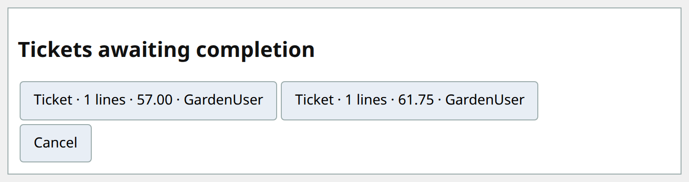

### Reprinting

**Reprint Last Ticket** reprints the last ticket of this till. **Reprint Ticket** lists the tickets of this till; tap one.

### Finding and editing a past ticket; refunds

1. Register menu → **Edit Sales**. Choose *Sales* or *Refund*, type the ticket number and press **Find**, or press
   **Finder** to list them and tap one.
2. **Print** reprints it. **Edit** reopens the lines on the Sales screen and saves under the **same ticket number**.
3. **Refund** opens a list of the original lines: **Add** the lines to refund (or **Add all lines**), then **Refund**.
   The Sales screen shows a refund ticket; **=** pays it with the Refund / Cheque / Card tabs.

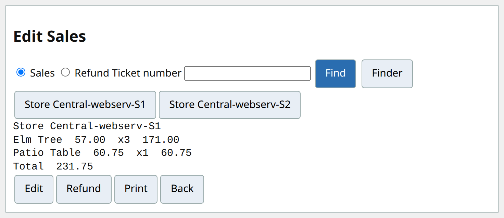

The buttons switch on and off by rule, and the line under the ticket says why:

| Situation | What the screen says |
|---|---|
| Already refunded | *This ticket has been refunded* (Edit and Refund off) |
| The ticket is itself a refund | *A refund ticket* (Edit and Refund off) |
| Sold in a shift that has since been closed | *Closed cash: Edit is not available* |
| Already sent to head office | *Already sent to head office: use Refund* |

### Customer Payment

Register menu → **Customer Payment** → type a name or key → **Find** → tap the customer. The card shows **Name**,
**Credit Limit**, **Current Debt**; **Amount** starts at the current debt. **Pay** opens the Payment dialog
(Cash, Cheque, Bank, Card live). A customer payment is a payment row with no sale lines; head office imports it
with **Import Payment**, not with Import POS Sales.

### Cash in / cash out, vouchers, check in, pick-up numbers

- **Payments**: choose *Cash (In)* or *Cash (Out)*, type the amount and notes, **Save**. Cash out is stored negative and both
  show in the shift's Close Cash totals.

  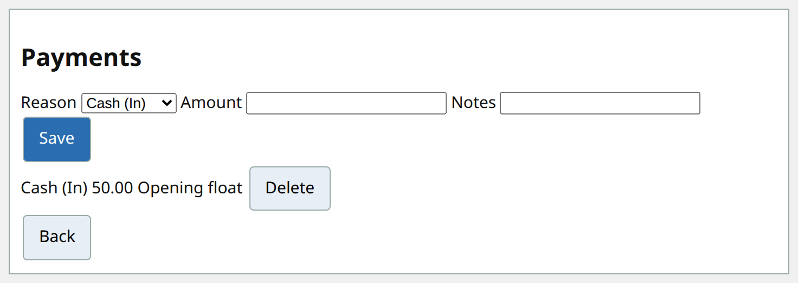

- **Voucher**: **Issue** a numbered voucher (V000001...) for a customer and amount, or **Redeem** a number
  ("No such voucher" / "Voucher already used" / "Voucher redeemed ..."). It is a ledger on this till only.

  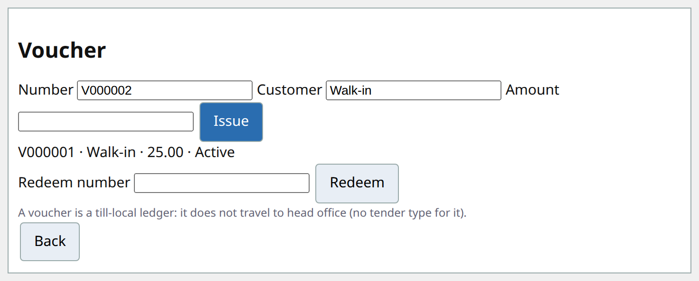

- **Check In/Out**: **Check In** / **Check Out** for the signed-in user; the line shows "*name* has Checked In at ...".
- **Pickup Reset**: shows the next pick-up number. **Reset** asks "Do you really want to reset the Order Pickup number to 0?".
  Pick-up numbers are given at the first **Send Order** or sale of a ticket that has no table.

### Product pictures

Each product tile shows the product's **picture** with its name and price over the bottom of it. Where it comes from:

1. The picture is a web address in the product's **Image URL** field (`M_Product.ImageURL`). The picture file itself sits in
   the shared object-storage bucket (`.../b/bim-ootb/o/erp/product-icons/<name>.svg`), never inside the till's database.
2. A head-office clerk sets it with the **ordinary Product edit** (Image URL field). The change reaches the tills in the
   morning SODA batch (see *The branch POS admin*): a changed Image URL travels like a changed price, and an unchanged one never travels.
3. A product with **no** Image URL shows a grey "no image" mark and its name. The shipped demo data carries no pictures
   until the head-office edit is made.
4. The tile size is the branch's setting (default 107 x 60), set at the branch POS admin.

**Offline.** The pictures are kept in the browser's own **picture cache on the device's disk** (`erp-media-v1`), not in memory
and not in the till's database. When the till starts online and the products have Image URLs, it fetches only the pictures it
does not hold yet and drops pictures whose product is gone or whose address changed; the cache is capped at 50 MB. A software
update does not empty it. So a picture shows offline only if the till loaded it online at least once; a tile whose picture was
never fetched shows the "no image" mark. The till logs `§TILL_MEDIA` with the file count.

### Restaurant mode

Set **Tickets = restaurant** in *Configuration* (below) and restart, or open `till.html?mode=restaurant`. **Sales** then opens
the **floor map**: one tab per floor, one button per table. A table with an open ticket is shaded and shows the waiter, the table
name and seats, *Guests* and *Waiting*. The floor is drawn as uniCenta's 960 x 600 plan: each table is drawn from its own record (round when its width equals its height, otherwise a rectangle) with one chair per seat, and an open table shows the people icon. With *Transparent table button* ticked in *Configuration*, the floor's own picture is used instead and the tables are invisible buttons over it. **Reload**, **Reservations** and **Tables** are on the sales screen.

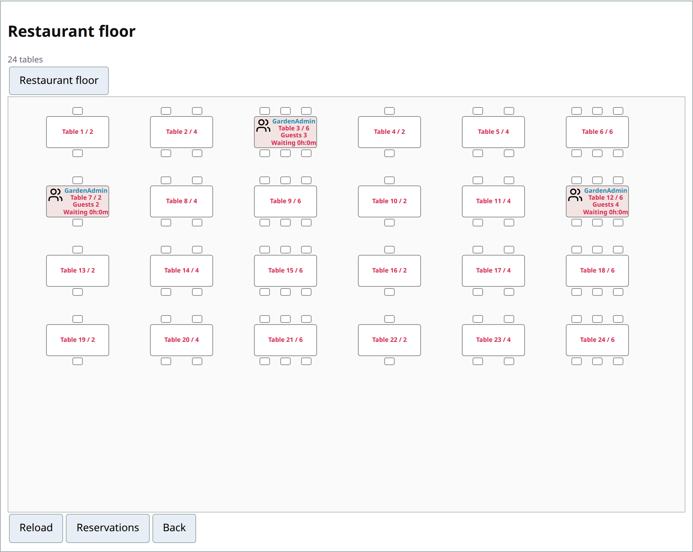

- **Who sets up floors and tables:** the **branch POS admin** (Floors, Tables and till settings, below), as uniCenta's back office does. Until it sets
  any, the till shows uniCenta's seed floor of Table 1 ... Table 24 (nothing is written for it).
- **Open tables are shared by the whole branch.** Tap a table to open or recall its ticket; while you work on it the table is
  **locked** to your till. Another till that taps it is told "Table is in use by *till*" and cannot open it.
- **Saving.** The ticket is saved when you **leave** the table (back to the map, or **Tables**), not on each tap: one save and one
  branch update. Taps inside the table cost nothing.
- **On a table's sales screen** the controls are uniCenta's: **Tables** (back to the map), **Move**, **Guests** and **Delete**.
  - **Guests** opens *Enter Number of Guests*; the button then shows the count, and it is saved with the table when you leave it.
  - **Move**: the ticket is saved and the map says *Moving table N. Select another Table or the original Table*. Tap a **free** table and the ticket moves there.
    Tap an **occupied** table and the till asks *Merge Tables: This will Merge tables. Are you sure you want to do this?*; **Yes** adds the lines and guests to that
    table and clears the first, **No** returns to the original table. Tapping the original table cancels the move.
  - **Delete** (Delete Current Order): when the branch has an **override PIN** (set at the branch admin) the till first asks *Enter PIN Number*; a wrong PIN says
    *PIN Number Incorrect* and deletes nothing. Then *Are you sure you want to Delete the current Order?*; **Yes** clears the table.
  - **A table another till is using** can be taken over the same way: tap it, and when the branch has a PIN the till asks *Enter PIN Number*.
- **Reservations.** **Reservations** → *Select Person, Persons, Booking Time, Notes* → **Save**. The reservation has **no table
  yet**. At check-in, choose the table in the **Table** list (the first entry is "(table at check-in)") and press **Check-In Now**:
  that table opens for the customer. A reservation is **Done** afterwards. Reservations stay in the branch and are not an ERP record.
- Floors, tables and reservations never go to head office.

### Configuration and the display modes

Press the **gear** button on the status strip. The **Configuration** screen has five tabs, as in uniCenta:
*General, Locale, System Options, Ticket Setup, Company*. Press **Save**; a changed **Tickets** mode applies at the next start.

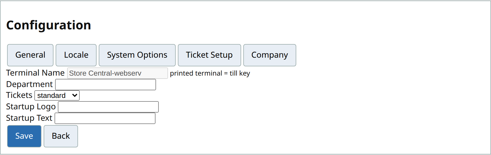

- **Look and Feel** (General) chooses the till's colours: **Classic (2011)**, the default, takes the colours of the original 2011 screen, or **Modern**, the till's earlier look.
  The choice is this till's own and is kept across restarts; the product pictures and the layout do not change with it.
- **Tickets** (General) is the display mode: **simple**, **standard** (the default, the sales screen above) or **restaurant** (floor map and
  reservations). An address option `?mode=restaurant` still forces restaurant.
- **Per device** (this till's own settings): Department, Startup Logo and Text, auto log-off after a sale and its timer, the table-plan
  colours and refresh, the 00 key, the input box above the keypad, pick-up number length, receipt print off, and the receipt Header 1-6 / Footer 1-6 / logo path.
- **Grey (read only), with a note beside them:** *Terminal Name* is the till key; the *Locale* formats come from the branch client so every
  till of a branch prints the same receipt; **Auto log-off timer** and **Allow price updates** are the branch's `C_POS` settings, edited in the ERP;
  **Use Override?** and **PIN** are set at the branch POS admin.
- **Enable Service Charge** exists on the screen but stays off, as uniCenta 5.0's default (the button is not on the ticket bar).

---

## The kitchen

### Sending an order

1. On **Sales**, ring the lines and tap **Send Order**. Every sale line of the ticket goes out as one new
   *generation* of the order (discount lines and zero quantities are not kitchen lines).
2. The order's name is the **table** if the ticket has one, otherwise the **pick-up number**, given on the first send.
3. The till says "Order *n* sent to the kitchen" and shows a **Kitchen: waiting** chip on the ticket bar.
4. Send again after changing the ticket: the new send **replaces** the old one on the kitchen screen. Sending an
   empty ticket after an earlier send tells the kitchen the order was cancelled.
5. When the kitchen marks the order done or void, the till shows "**Kitchen: order *n* is READY**" or "...is VOID" once,
   and the chip changes. While an order is waiting, the till checks for news every 10 seconds
   (`?poll=<seconds>` on the till URL changes it).

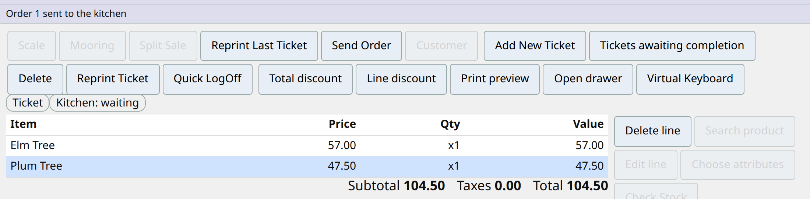

Send Order only works on a *sale* ticket ("Send Order is for a sale ticket").

### The kitchen screen

Until a till sends an order the screen is not blank: the top line says what it is connected to, and the area says *No orders yet. Orders appear here when a till presses Send Order.*

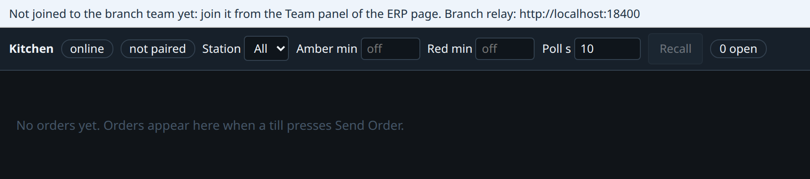

Open <https://red1oon.github.io/bim-ootb/erp/kitchen.html> on the kitchen's own device (set up as in *Install at a shop*, step 7 and the note at its end). Each waiting order is a card: order name and a running clock (MM:SS) on top, the lines below, **Bump** and **Void** at
the bottom.

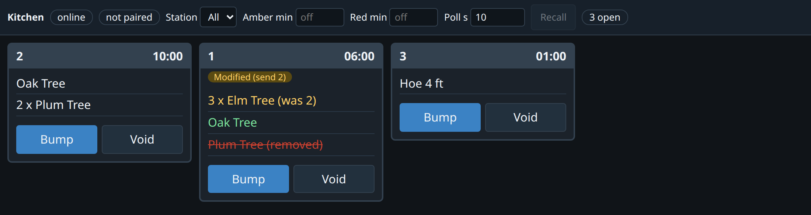

| What you see | Meaning |
|---|---|
| **Bump** | The whole order is done; the card leaves the screen and the till is told *READY*. |
| **Void** | The whole order is void; the till is told *VOID*. |
| Tap a line | Crosses that line off (done). Tap again to undo. |
| *Modified (send N)* | The till re-sent the order. Lines in **green** are new, **amber** "(was n)" changed quantity, **red struck-through** "(removed)" were taken off. |
| *Cancelled by the till* | The till sent an empty ticket after an earlier send. |
| **Recall** | Brings back the most recently bumped or voided card. Grey when there is none. |
| *N open* | How many cards are waiting. |
| **Station** | Filters by station. The till sends every line to station 1. |
| **Poll s** | How often the kitchen looks for news (default 10 seconds). |

### Elapsed colours: off until the branch sets them

The card header colours by waiting time **only when both** **Amber min** and **Red min** are filled in. Blank boxes
(placeholder "off") mean no colour, and nothing is assumed. With, say, 5 and 8: green until the 5th minute,
amber from the 6th, red from the 9th (whole minutes over the limit). The two numbers are saved on that kitchen device.

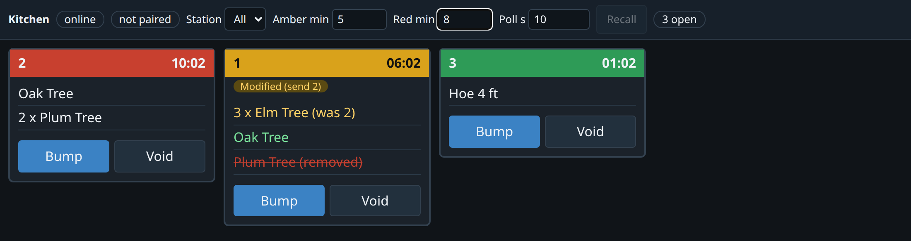

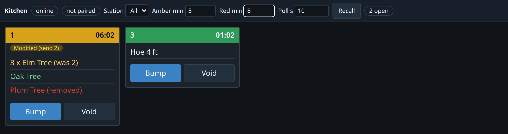

The kitchen orders and their done / void marks are **branch-local**: they go only to the till and kitchen devices
of that branch Org. They are not legacy tables and head office does not read them.

---

## Install at a shop (air-gapped)

For the branch manager. At the end every till PC runs its own copy of the app from `localhost`, the tills talk only to a small **branch relay** on the shop's own network,
and one device, the **main till**, is the only one that ever needs the internet (for the end-of-day send and the morning prices). If the internet or the relay goes down, every till keeps selling.

```
 till PC 1 (main) ─┐
 till PC 2         ├──  branch relay (one box, python3)  ──  only the main till  ──  internet  ──  head office
 till PC 3         ┘          shop network (LAN)                  (EODA up, SODA down)
```

Each numbered step below was **executed** on one test machine before it was written (log lines `§GUIDE_STEP n ok`); *What was proven, and what only a real shop can confirm* at the end of this section says exactly how far that goes.

**You need:** python3 on every PC that will run a till, a browser on each, one PC or box on the shop network for the branch relay, and the internet **once** per PC (step 1) plus on the main till.

### 1. Put the app on each till PC, once (the self-host path)

On the PC with internet, either use the app's **Self-host** installer (it saves a small install script for your system) or type the same three commands:

```
curl -sL -o app.zip https://github.com/red1oon/bim-ootb/archive/refs/heads/main.zip
unzip -qo app.zip && cd bim-ootb-main
python3 -m http.server 8080
```

*What this downloads:* **one zip, about 230 MiB** (the whole app: viewer, ERP, till, kitchen, branch admin, the 27 MB seed database and the bundled libraries; about 530 MB once unpacked) and nothing else.
After it, the PC needs no internet to run a till. *Executed:* downloaded and unpacked; the till, branch admin, branch relay and seed database were all inside (`§GUIDE_STEP 1`).
(The Windows installer does the same with `curl` and PowerShell and installs python through `winget` if it is missing.)

### 2. Start the till's own server, every morning

On each till PC, in the folder `bim-ootb-main`: `python3 -m http.server 8080`. The till is then at `http://localhost:8080/erp/till.html`. It has to be `localhost` (not the PC's network name): that is what lets
the page keep its offline cache and call the relay over plain `http`. *Executed with three servers on `localhost` ports 8081, 8082 and 8083 standing in for three PCs; each answered the till page (`§GUIDE_STEP 2`).*

### 3. Start the branch relay on one box of the shop network

On the box (any PC that stays on; it needs the same unpacked folder, or just the one file `erp/branch_relay.py`):

```
python3 erp/branch_relay.py --port 8787 --dir ./branch_box
```

It prints `§RELAY_UP port=8787 box=...` and is then a mailbox on `http://<box address>:8787`: it stores and lists files, nothing else. Everything it holds is in the folder `branch_box`. Use the box's network address
(for example `http://192.168.1.20:8787`) where this guide says `<relay>`. *Executed on this machine: it printed `§RELAY_UP`, and a file could be written, read back and listed (`§GUIDE_STEP 3`).*

### 4. Start each till on `localhost` and point it at the relay

Open the till with the relay in its address, and **bookmark that address**:

```
http://localhost:8080/erp/till.html?login=<station user>&pipe=<relay>/pipe&relay=<relay>&team=1&teamplan=pos
```

There is no relay field on the Configuration screen: the relay is the `pipe=` and `relay=` in the bookmark. `login=` names the till's **station user**; the till's key (the prefix of its ticket numbers) is the branch plus that user,
so **every till needs its own station user** (the demo tenant has 50001, 102 and 101). When the page is ready its top line says `Branch relay: <relay>`; if the address has no `relay=` it says
`Not joined to a branch relay` and links here. *Executed: the first till booted at `localhost:8081` and logged `§LAN_BOOT ... relay=http://localhost:8787 ... main=false` (`§GUIDE_STEP 5`).*

### 5. Designate the main till (the branch supervisor, on that till)

Exactly one till of the branch is the **main till**: it collects the other tills' sales from the relay, answers the stock question, and makes the one send to head office. **The branch decides which; head office neither sets nor checks it.**

1. On the till you chose, sign in as a **supervisor** (a user whose role has client-level authority, the twin of uniCenta's Administrator or Manager role).
2. Press the gear (**Configuration**), tab **System Options**, tick **This is the branch main till**, press **Save**.

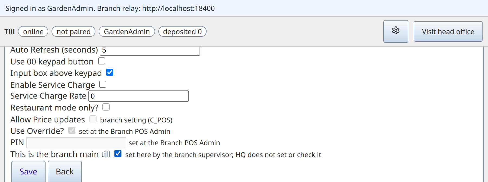

A cashier who opens the same screen sees the box greyed, with the note *the branch supervisor sets this*; the setting cannot be changed from their sign-in. It is kept on that PC (its own device store), survives a restart, and stays
until a supervisor unticks it. On any other till, every main-till operation is refused with *This is not the branch main till: ... is run at the main till.* The same rule as uniCenta: the Configuration screen opens only for roles
whose permissions list it (`JPrincipalApp.java:458`, `Role.Administrator.xml` and `Role.Manager.xml`). *Executed: the cashier saw it greyed, the supervisor ticked and saved, the till reported itself main, and PC2 refused a collection (`§GUIDE_STEP 6`, `§GUIDE_STEP 8`).*

### 6. Open the branch POS admin on the main till PC

On the **same PC** (the page shares the till's device store, which is how it finds the flag), open:

```
http://localhost:8080/erp/branch_admin.html?login=<station user>&lan=<relay>&relay=<relay>&team=1&teamplan=pos
```

(no `pipe=`: the main till's internet side is the Team panel's relay, which head office set up; when you rehearse with your own internet relay stand-in, add `&pipe=<its address>`). It logs `§LAN_ADMIN main=true`. **This is the
device that does the EODA and the SODA, and the only one of the shop that needs the internet.** *Executed: `§LAN_ADMIN main=true` (`§GUIDE_STEP 7`); the internet side was a second relay on this machine standing in for the real one.*

### 7. Join the devices to the branch team (head office approves)

Every device joins the head-office team once, so its rows are signed and accepted.

1. **Head office:** on the ERP page press the **Team** pill, **Turn on team mode** if offered, **Kind of team: Point-of-sale team**, **Start a team**, copy the invite.

   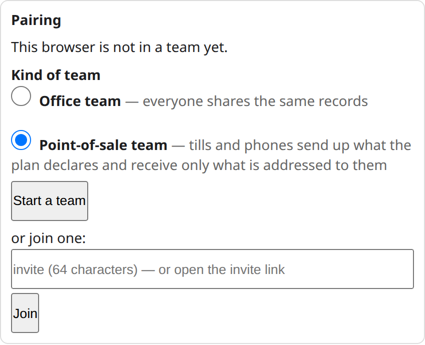

2. **Each shop PC:** open the ERP page on the PC's own address with the relay in it (`http://localhost:8080/erp/idempiere.html?team=1&pipe=<relay>/pipe`; the main till PC uses `&lan=<relay>` as in step 6), press the **Team** pill, paste the invite, **Join**. The device shows a **device code**. (The till and branch admin pages of the same PC share this identity.)
3. **Head office:** Team pill, **Check join requests**, match the code, role **Web Service Execution (50004)**, **Bound to** the branch Org, **Approve**.
4. **Visit** on each device. The strip changes from *not paired* to *paired*.

The tills' requests reach head office through the branch relay and the main till; the main till passes them on, so the ordinary tills never need an internet address. *Executed by calling the same Team functions the panel's buttons call (not by clicking the panel): all three
devices enrolled while PC2 and PC3 made 0 requests to the internet relay (`§GUIDE_STEP 9`).*

### 8. A normal day

- Each till rings its own sales. Each ticket is written on the till first, then put on the relay; the till never waits for it. At **Close Cash** the shift's Z goes to the relay too.
- On the main till's branch admin the day's tills appear; **Refresh** collects (it also collects by itself while the page is open). When every till has closed, **Send EODA** makes the branch's one send.
- In the morning the main till pulls head office's SODA (prices, products, and the branch's stock figure, which only the main till keeps).

*Executed: three tills rang 2 + 2 + 3 tickets and closed; the relay's folder held 7 ticket files and 3 shift files; the main till collected 7 lines; after Send EODA head office held 7 order rows and 7 payment rows
(`§GUIDE_STEP 10`, `§GUIDE_STEP 11`).*

### 9. When something is down

| What is down | What happens | What to do |
|---|---|---|
| **The branch relay** (the box is off, or the network) | Every till keeps selling and keeps its tickets in its own store (log `§LAN_HOLD`). Nothing is lost. The main till cannot collect. | Start the relay again (step 3, same folder). A till sends what it queued at its next sale or Close Cash, or when its page is reopened; the main till then collects it; no ticket is doubled. |
| **The internet** | Tills are unaffected: they never use it. The main till's send does not reach head office. | Nothing. Once every till has done Close Cash, press **Send EODA** (or **Send status now**) again when the internet is back; head office gets one batch, nothing doubled. |
| **The main till PC** | Ordinary tills keep selling. Nothing collects. | Start it again. The relay holds every ticket until then. (Moving the main role to another PC part-way through a day has not been tried.) |

*Executed: with the relay stopped PC2 still rang a sale and queued it; after the restart it was sent and the main till held all 8 lines. With the internet relay stopped PC3 still rang a sale, the main till's send did not reach
head office (still 7 order rows), and after the relay returned and the send was pressed again head office had 9 (`§GUIDE_STEP 12`, `§GUIDE_STEP 13`).*

### 10. What to back up

- **The relay's folder** (`branch_box`): copy the whole folder, any time. It holds every ticket not yet collected and the shared stream.
- **Each till PC's browser profile.** A till keeps its tickets, its shift and its settings (including the main-till flag) in the browser's own storage for that address. Do not clear site data for `localhost`; back the profile up with the PC.
- **The `bim-ootb-main` folder** need not be backed up: it is the downloaded app and can be fetched again.

*Executed: the whole `branch_box` folder (36 files) copied identically; the device store of the main till showed its till, relay and flag keys (`§GUIDE_STEP 14`).*

### What was proven, and what only a real shop can confirm

**Proven on one machine** (the steps above, 15 of 15 ok, no page errors): the download and its contents, three `localhost` servers, the real branch relay, tills pointed at it, the supervisor-only main-till setting and the refusals on the other tills, the
join/approve/visit sequence, a three-till day through the relay to head office, the relay and internet outages above, and the backup copy.

**Not proven here; a real multi-PC shop must confirm:**

- **Access-point or client isolation.** Many shop routers stop Wi-Fi devices from seeing each other. Everything above was loopback on one machine. At the shop, from a second PC open `http://<relay>/pipe/list?prefix=` in the browser: a list (even `[]`) means the relay is reachable; no answer means the network blocks it.
- **Tablets and phones.** A tablet can open the till page from a PC's server, but a tablet that cannot run `python3 -m http.server` has no `localhost` of its own, so it cannot be a stand-alone till by this method. Use a PC as the till.
- **The real internet side.** The internet relay here was a second relay on the same machine standing in for the real one, so the main till's use of the live head-office relay (omit `pipe=`) was not exercised.
- **Firewalls** on the relay box: the port (8787) must be open to the shop network.
- **The kitchen screen** is joined the same way (`kitchen.html?pipe=<relay>/pipe&relay=<relay>&team=1&teamplan=pos`, same role and Org as step 7); it was not part of this walkthrough.

## Shifts and Close Cash

A **shift** is numbered from 1 on each till and stays open until **Close Cash**.

1. Register menu → **Close Cash**. The page shows the Z for the open shift, read from the tickets of this shift:
   *Sequence, Start Date, End Date, Transactions, Units, Sales, Cash/payments, By tender, Net, Taxes,
   Lines removed, No Sale - Drawer Openings*. **Print** refreshes it.

   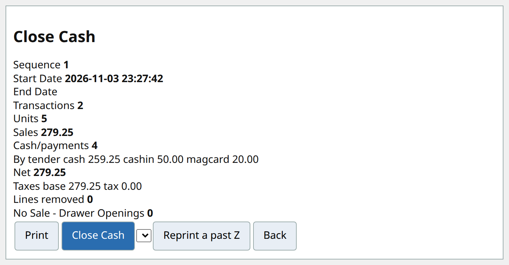

2. Press **Close Cash**, then confirm with **Yes, close the cash**.

   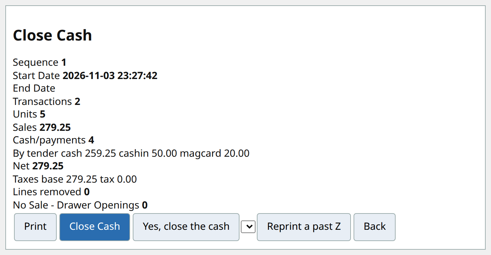

3. The page says **Cash Closed OK** and a new shift starts. A past Z can be reprinted from the drop-down and
   **Reprint a past Z**.

   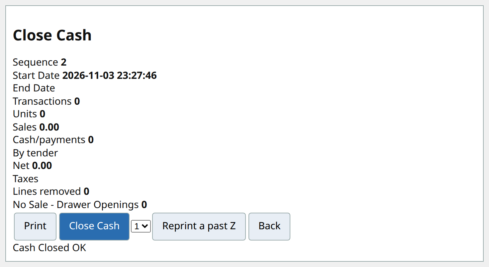

**Where the shift goes.** Each ticket, as it is rung, and at Close Cash the shift's one **Z declaration**, are put on the **branch relay** (the small box on the shop network; see *Install at a shop*).
**A till never sends anything to head office or the internet.** The branch's **main till** collects every till's lines from the relay and sends the branch's day to head office as **one batch** (see *The branch POS admin*).
A manual **Visit head office** or a **Send Order** only exchanges with the branch (kitchen, shared tables, price updates passed on), never ticket rows with head office.
If the relay is down, keep selling: the till holds the tickets and sends them at its next sale or Close Cash, or when its page is reopened.

### What never leaves the till

These live only in that till's browser, because legacy has no import shape for them:

- **Payments** cash in / out, the **Voucher** ledger, **Check In/Out**, pick-up numbers and their reset;
- restaurant floors, tables and reservations (they are shared inside the branch, never sent to head office); **held** tickets; the drawer-opening count and the removed-lines audit;
- discount lines as separate lines (they are folded into the product line's price);
- links beyond the "Refund of *number*" line note; the closed-shift list and past Z records (re-derived on the till from the sale rows).

The Z declarations go to the branch POS admin, and head office reads the branch's totals from the admin's statement (see *Day Close* below). Clearing the browser's site data on a till loses these local items.
The sales themselves are in the device's engine, and numbering resumes after the highest number already deposited.

---

## The branch POS admin

The **branch POS admin** (`erp/branch_admin.html`) is uniCenta's back office for one branch. It is a page of its own, opened **on the main till's PC** (the till the branch supervisor designated, see
*Install at a shop*, step 5). It reads what every till of the branch put on the branch relay, shows the end of day, and makes the
branch's **one** send to head office. The rhythm is **EODA** (end of day, branch to head office) then **SODA** (start of day, head office to branch):
nothing trickles during the day.

### The EODA screen: Send EODA and Send status now

1. Open `branch_admin.html`. The strip shows online/offline, paired, and the branch Org. Choose the **Business day**.
2. **Tills** lists the expected till keys (type them comma separated); tills that handed over a shift are added as well. Press **Refresh**.
3. The table has one row per till: **State** (*closed* after a Close Cash for that day, otherwise *open*), **Tickets**, **Series** (first..last and count for sale,
   refund and customer-payment numbers), **Gaps** (numbers missing between 1 and the highest), **Z by tender**, **Z by tax**, **Gross**; a **Branch total** row closes the table.
4. **Send EODA** is enabled when every till is closed. If a till is still open it needs an **Override reason** (type it first); the reason is stored with the batch.
   One press assembles every not-yet-sent ticket's import rows plus a statement of the Z totals each till declared, and makes **one** Visit to head office.
5. **Send status now** is the same send marked *partial*, for an intense period. It is **only a pressed button**, never timed. A later EODA includes everything,
   so nothing is doubled; head office judges the latest batch of the day, and imports a partial one only if the clerk ticks *IncludePartial* in Branch Day Close.

Limit: a second shift of a till that already closed once is not visible to the admin.

### SODA: prices, products, and Receive stock

In the morning, head office's **SODA** batch (process `FO_Branch_SODA`, run after Branch Day Close) writes **one** batch for the branch. The admin's SODA line says
how many prices, products and taxes arrived ("*n* batch(es): ...").

- **Pass prices to tills** hands the batch rows to the tills, in one Visit. A till applies a row only if it arrived; **only price changes travel, and old prices stay.**
  A changed product row (name, key, barcode, picture address, category, tax category) travels the same way; unchanged rows never do.
- **Receive stock** is the branch's **Move Confirmation** of the in-transit stock movement head office sent (replenishment). The button shows "*n* movement(s) to receive";
  pressing it opens the movement's lines, as legacy's Move Confirmation window shows them: **Move Line**, **Product**, **Target Quantity**, **Confirmed Quantity**,
  **Difference** and **Scrapped Quantity**. Confirmed starts at the target and Scrapped at 0 (a full receipt). For a short receipt type what arrived and what was scrapped;
  **Difference** is worked out for you (target - confirmed), as legacy does. Example: target 5, confirmed 3, scrapped 1 gives difference 2. Press **Confirm receipt**.
  The receipt is kept and goes up inside the **next EODA**, never as a send of its own; head office then completes the movement and the difference documents.

### Floors, tables and till settings

Under the EODA table, **Floors, tables and till settings** edits (all kept at the branch, never sent to head office): **Add floor** (name, optional background image address),
**Add table** (name, floor, seats, X, Y, width, height), and the catalog **tile width / height**, **category panel height** and the **override PIN** (**Save settings**).
The tills pick these up on their next Visit.

---

## Head office

Everything below is **opt-in**. Until the plugins are started, the ERP menu is exactly the legacy menu.

### Switching it on (System Administrator, once)

1. Sign in with tenant **System** → **SuperUser**.
2. Open the ⋯ rail and press the **plug** pill — **Plugin Engine**.
3. **POS integration** (`org.kernel.pos-integration`) is listed as *INSTALLED* but not started. Press **Start**.
4. Under *Friendly operations* press **Install** — this adds **Branch Day Close**.

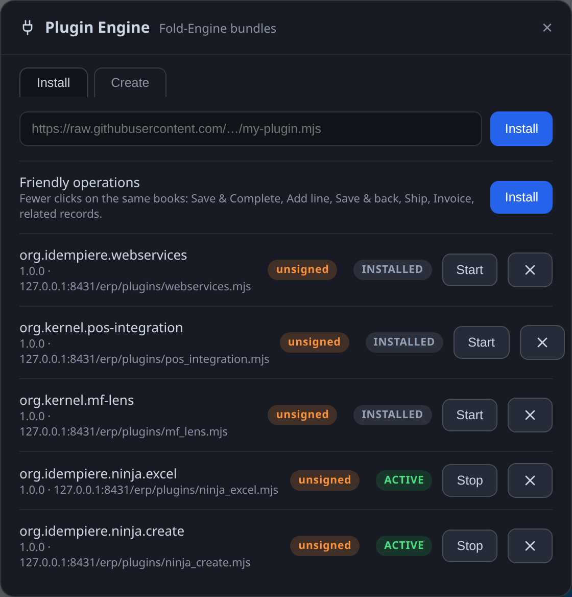

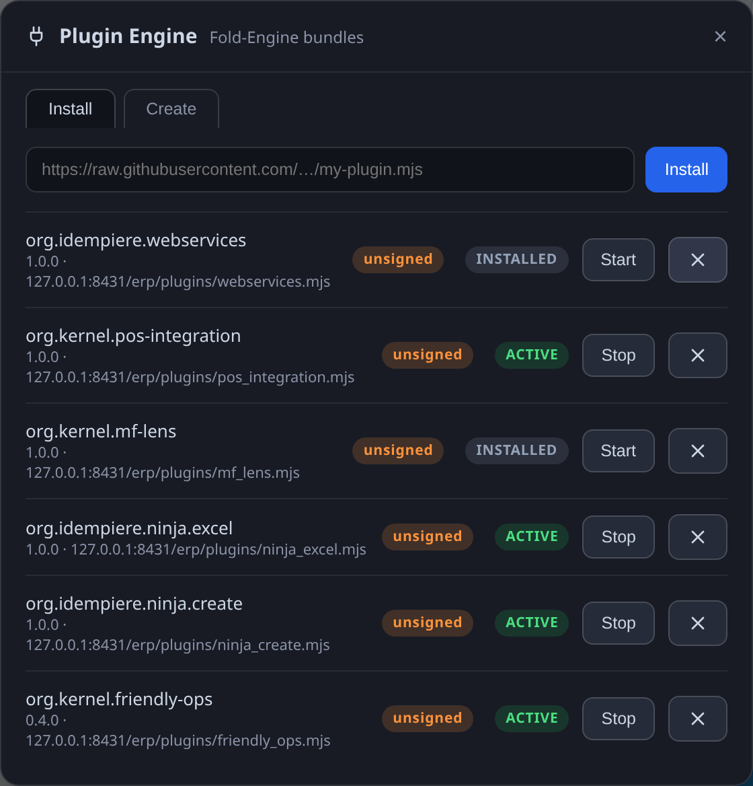

*Stop* on a bundle removes everything it added. The plugin rows (menus, processes, access) are visible to the System Administrator and
the **GardenWorld Admin** role, which is the head-office clerk. No other role gets them.

### Import POS Sales

Menu → **Data Import**:

- **Import POS Sale** (a read-only window): one row per till ticket, with *Ticket No, Business Partner Key, Date Ordered,
  Lines, Tenders, Lines Total, Tenders Total, Difference (Tenders - Lines), Imported, Import Error Message, Order*.
  A mismatch shows here before you import. On a price list that excludes tax the Difference is the tax; the exact check is done by the import.

  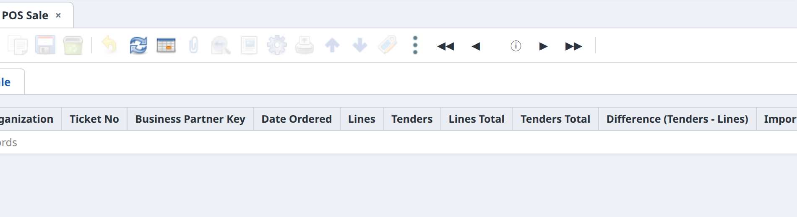

- **Import POS Sales** (the process): *Tenant, Organization, Bank Account (required), Ticket No (one ticket only)*.

  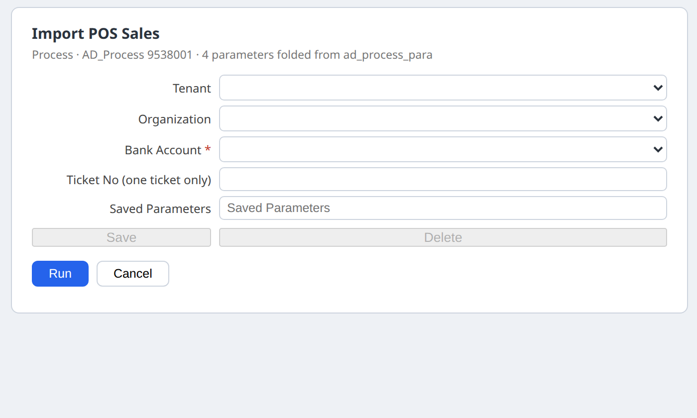

Each ticket is imported **all or none**: legacy Import Orders makes one completed order and its invoice; the tenders must equal
the invoice total to the cent; legacy Import Payment makes the completed receipts on that invoice; then the invoice
must be paid. Any failure rolls the whole ticket back, marks its rows with an error and the reason, and leaves it for
you to correct and run again. A customer payment (no lines) is refused here ("no ticket lines"); import it with **Import Payment**.

### Products with a BOM

When a till sells a product that has a **Bill of Materials**, head office explodes it when it imports the sale, as legacy iDempiere does: the order gets a comment line and
the component lines (quantity multiplied), and the **components** leave stock, not the parent. It goes **one level only**: a BOM inside a BOM stays a priced line, as in legacy.
The component prices at head office must add up to the till's price for the parent, or the ticket is caught by the tender check. A BOM sold from stock (production route) is not covered.

### Company details and logo (head office)

The till shows the company's name, address, tax id, phone and e-mail, and its logo, in three places: the **About** screen, the name beside *Till* on the status strip, and the top of
every receipt. They are **not typed at the till**: they come from the ordinary legacy records of the till's own branch organisation, and travel in the morning SODA batch like a price.

- **Name:** the organisation's name (*Organization* window). **Address:** the *Location* of **Organization Info**. **Tax id, phone, e-mail, receipt footer:** *Organization Info*.
- **Logo:** in *Organization Info* choose an **Image** whose **Image URL** is the picture's web address (for the shared bucket: `https://objectstorage.ap-kulai-2.oraclecloud.com/n/ax3cp6tzwuy2/b/bim-ootb/o/erp/<your-logo>.png`).
  Only the web address travels; the picture itself is fetched once and kept on the till's disk like the product pictures, never in the till's database. With no logo set, the screens show the first letter of the company name.
- Change a detail, save, and it reaches the branch's tills with the next SODA batch. A detail that did not change is not sent again.
- Header lines typed in *Configuration → Company* replace the company lines at the top of the receipt, as in uniCenta (its header lines are the cashier's own text).
- The GardenWorld demo tenant has **no logo** set, so its tills show the letter placeholder until one is set.

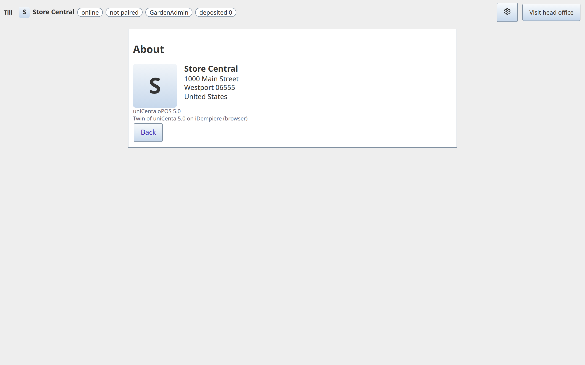

### Product pictures and prices (head office)

Set a product's picture in the ordinary **Product** window (Image URL), and change prices in the price list as usual; the next SODA batch carries them to the branch.
**Import Product** can create new products with their Image URL, but, as in legacy, it does **not** change the Image URL of an existing product: use the Product edit.

### Branch Day Close

Menu → **Data Import → Branch Day Close**. One run closes the business day for one branch (**Organization**) or several
(**Branch Orgs**, comma-separated Org ids; leave both empty for every Org that has pending till rows).

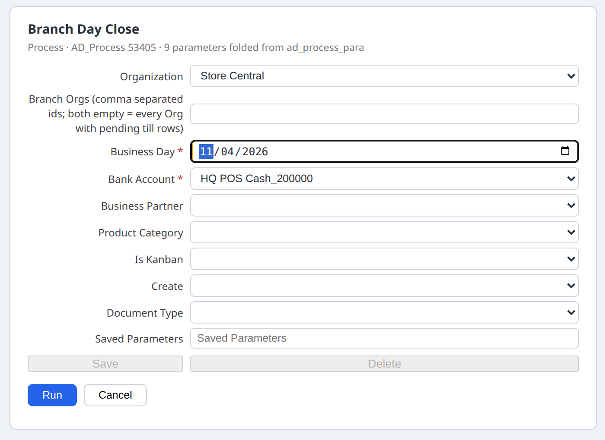

| Parameter | Use |
|---|---|
| Organization / Branch Orgs | which branch(es) |
| Business Day (required) | the date of the tickets |
| Bank Account (required) | needed by Import Payment |
| Business Partner, Product Category, Is Kanban | the Replenish Report's own filters |
| Create (Inventory Movement / Production / Purchase Order / Requisition), Document Type | only if you want the replenishment documents made |

It runs, in legacy order and stage by stage over the branches: **1.** Import (Import POS Sales per cleared ticket),
**2.** Replenish Report for each warehouse of the branch, **3.** the replenish *create* only if you chose **Create**
("SKIPPED not requested" otherwise). Each step is reported on its own line. A failing step stops the whole close, is named with its
branch, and earlier steps stay.

**Where the rows come from.** They arrive in the branch's **EODA batch** (one per branch, from its POS admin). Day Close checks that batch against the
**statement** the admin sent with it (below). A partial status batch is withheld unless **IncludePartial** is ticked.

**The audit gate.** Before importing, each till and day is checked on what head office really holds:

- **Gaps:** a till numbers its tickets from 1, so a missing number (S2 absent between S1 and S3) means a ticket never arrived.
- **Balance:** each ticket's tenders must equal the total the till itself computes (tax included or excluded, following the price list).
- **Statement:** when the EODA statement is present, per till and day the count and first/last number of each series, and the gross, net, tax, tax-by-id and tender totals
  recomputed from the rows at head office, must equal what the till declared. A till with rows but no statement line is withheld too. Reasons are named
  (`statement-count`, `range`, `totals`, `undeclared`, `partial`). With no statement at all (an old direct send) only the first two checks run.

A till/day with a gap or an unbalanced ticket is **withheld whole**: none of its tickets are imported, it is named
("WITHHELD: gap S2" / "unbalanced ... expected=55.00 tenders=54.99"), and the other tills still close. The Z is checked only through the branch statement. Customer payments are named and left for Import Payment. A branch with
nothing pending for the day is skipped, so running the close twice makes nothing new.

If **POS integration** is not started, the close falls back to Import Orders + Import Payment. Those cannot be limited to
single tickets, so the close is **blocked** (nothing imported) whenever a till was withheld or other days or branches
are pending; start POS integration for per-ticket control.

---

## Under the hood

- **A ticket number** is `<Org key>-<till user key>-<S|R|P><n>`: S sale, R refund, P customer payment, *n* counting from 1 per series. It is the
  `DocumentNo` of every row of the ticket.
- **Rows sent per ticket:** `I_Order` (one per product line: product, quantity, price actually paid, unit, date, shift tag
  "POS shift *till*/*seq*") and `I_Payment` (one per tender applied: amount, tender type, date, same shift tag). Over-payment is change and is never deposited.
- **Tender map:** Cash → `X`, Cheque → `K`, Card → `C`, Bank → `A`. Card rows carry the terminal reference and approval code, never the number.
- **Refunds:** negative quantity and negative payment under an `R` key, with "Refund of *original number*" on the line.
- **Prices and taxes** come from the ERP's own price list and tax functions; the till holds no tax formula.
- **Kitchen:** two branch-local tables (kitchen order, kitchen status). The till and kitchen look at the branch's shared box with one
  cheap list request per poll and run a full Visit only when another device wrote.
- **Hand-off and batch:** the till puts each ticket's rows (`d/`) and the shift's Z (`h/`) on the branch relay; the main till collects them and its branch admin writes `POS_BranchDayStatement` rows and the real
  `I_Order` / `I_Payment` rows to head office. Floors, tables, reservations and picture settings are branch-local rows, never sent up.
- **Same twin rule as the ERP:** where uniCenta 5.0 and legacy iDempiere disagree on what can be sent, legacy wins, which is why four tenders are disabled.

## Troubleshooting

| What you see | Meaning and fix |
|---|---|
| *That discount takes the line under its price limit; head office would refuse the ticket* (also "...takes a line under its price limit...") | The discounted price is below the price list's limit. Use a smaller percentage. |
| *Select a line and type the discount % first* | Select a line, type the percentage digits, then press the discount button. |
| *Enter an amount* | Type an amount before Add Part Payment / Save / Issue. |
| *Only cash gives change: the amount is more than remaining* | Over-tender is allowed on Cash only. |
| *Card: the terminal reference and approval code are needed (the card number is never keyed here)* | Key both from the card terminal. |
| *The ticket is already covered* / *The ticket is not covered yet: Add Part Payment* | Remaining must be zero before OK. |
| *This tender is not in this release* | Voucher, Free, Debt, Slip are disabled (no legacy tender type). |
| *A free-price or negative line has no legacy import mapping in this release (Import Orders needs a product)* | Ring a real product instead of a typed price. |
| *... - no such product* | The barcode or key matches no product on the till's price list. |
| *A refund takes lines of the original ticket (Edit Sales, Refund)* | On a refund ticket you cannot add products. |
| *Add at least one line to refund* | Tap **Add** on at least one line. |
| *The ticket does not exist* | Wrong number or series (Sales / Refund). |
| *Could not save the sale on this device: ...* | The device engine refused the save. Nothing was sent; retry. |
| *Send Order is for a sale ticket* / *Nothing to send* | Open a sale ticket with lines. |
| *Could not send the order: ...* | The kitchen row could not be saved on this device; retry. |
| Kitchen shows no cards | Till and kitchen must be paired to the **same** branch Org; press **Visit**. |
| Cards have no colour | By design until both Amber min and Red min are set. |
| Table: *Table is in use by ...* | Another till of the branch has the table open (locked). Wait until it leaves the table. |
| Reservation: *Choose a table in the list, then Check-In Now* | Pick the table in the **Table** list first. |
| Tile shows a grey "no image" mark | The product has no Image URL, or the picture was never fetched while online. |
| Admin: *Not every till is closed: give an override reason to send* | A listed till has not closed its shift; close it or type a reason. |
| Admin: *No till has closed a shift for ...: nothing to send* | No hand-off for that business day. |
| Admin: Send EODA greyed | An open till and no override reason typed. |
| Admin: *Could not hand the shift to the branch admin* (on the till) | The shift hand-off was not saved; nothing was lost, press Close Cash again after fixing. |
| *Visit failed: ...* | The branch relay (or, on the main till, the internet) cannot be reached, or the device is not joined; keep working and press **Visit** later. |
| Top line: *Starting… loading the shop's data (N s)* for more than a minute, then *Still starting* | The first download of the shop's data is slow, or the device went offline before the first install. Check the connection, press **Retry**. |
| Top line: *Problem: ...* with a **Retry** button | The page could not start or a step failed; the message says which and what to do. Press **Retry**; if it repeats, reopen the page once while online. |
| Top line: *Not joined to a branch relay* | The address has no `relay=` (and the device has none stored). Use the bookmark of *Install at a shop*, step 4. On the public address it is the one-browser trial. |
| *This is not the branch main till: ... is run at the main till.* | The operation belongs to the branch's main till. Do it there, or have the supervisor designate this till (*Install at a shop*, step 5). |
| Configuration: *This is the branch main till* is greyed | Only a supervisor may change it; sign in as one. |
| Strip says **not paired** | The device has not joined or is not approved yet (see *Install at a shop*, step 7). |
| Team panel: *No key: open the Team panel and use the system default, or save your own repository and key* | The team's relay key is missing on this browser; use the system default or save your own repository and key. |
| *Choose what this device is bound to first: ...* | Pick the branch Org in **Bound to** before Approve. |
| Import row error *ERR=no tenders: ...* | The ticket has lines but no payment rows. |
| *ERR=Tenders total X <> invoice total Y* | The tenders do not add up to the invoice; correct the rows and run again. |
| *ERR=Import Orders imported n of m ticket lines* | Some lines refused (product, price limit...); the reason follows. |
| Day Close: *WITHHELD: gap ...* / *unbalanced ...* | A till/day failed the audit gate. Find the missing ticket or fix the tender, then close again. |
| Day Close: *STOPPED at step "..." (Org ...)* | The named step failed; earlier steps stay. Fix the reason and run again. |
| Day Close: *BLOCKED, nothing imported* | POS integration is not started and the gate held a till or other days are pending. |
| *Branch Day Close: nothing pending for ...* | No unimported till rows for that day. |
| Branch Day Close not in the menu | Friendly operations is not installed (see *Switching it on*). |
