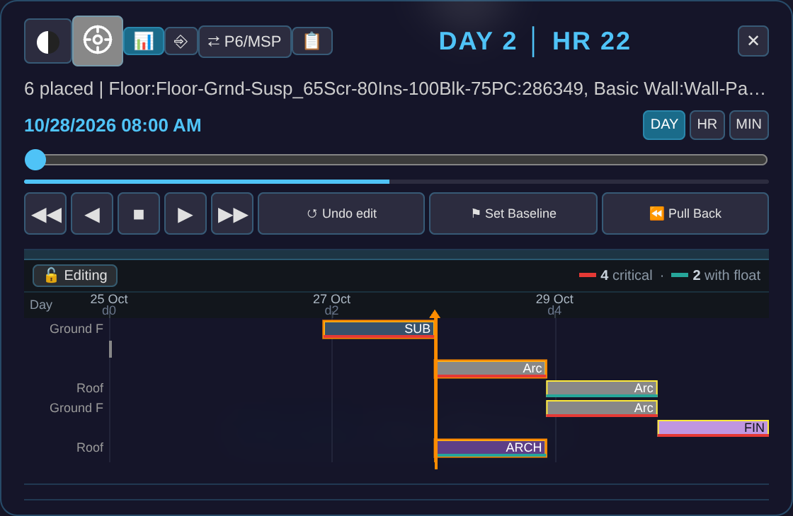

# Time Machine — the 4D construction timeline

> **See also:** [4D/5D Analysis](4D5DAnalysis.md) (the cost/analytics dashboard) ·
> [Kernel-ERP User Guide](ERPUserGuide.md) · [BIM Viewer Guide](BIMUserGuide.md)
> **How the schedule behind this page gets generated:** [The 4D Generator](4DGenerator.md) — the failure
> catalogue and AI-agent process findings behind the generator that produces the timelines you see here.

The **Time Machine** is where a building's construction schedule lives — playback, editing, import / export, and
the link back into the ERP's 5D cost, all on **one signed, IFC-native set of tables**. There is no separate
scheduling tool and no re-linking step: a date you drag here is the same fact the 4D playback, the 5D cost
roll-up, and the ERP's Project windows all read.

**Open it** in the **BIM Viewer**: **Inspect** drawer → **Time Machine**, or press **`T`**. A small panel appears at
the bottom-centre (measured on SampleHouse, 2026-10-24). Its header row holds, left to right: the **day / night**
cycle, **Drone Pilot** (the cinematic camera), **📊 Gantt chart**, **⎆ What-if**, **⇄ P6/MSP**, **📋 Dashboard**, and
**✕ Close**; a **box-cube LOD** pill and a **⚖ Budget vs Actual variance** button are in the panel too but stay
hidden until the building or the data calls for them. Under the header: the **DAY / HR** counter, the status line
(`61 placed | idle`), the date and slider with **DAY · HR · MIN**, the transport row **◀◀ ◀ ■ ▶ ▶▶**, and the three
edit buttons **↺ Undo edit · ⚑ Set Baseline · ⏪ Pull Back**.


You can also reach it from the **Kernel-ERP**: push a selection into the ERP first (**`› ERP`** on a Find selection) —
**[the ERP-side entry point](ERPUserGuide.md#spatial-bim-erp-find-a-selection-project-order-live)**. Picking an element in
3D (or a red **Zoom Across** pill on an ERP record) jumps the Time Machine straight to that element's construction moment.

---

## The schedule appears when you open it — there is no wizard *(CHANGED, 2026-08)*

Earlier versions of this page described a **✎ Author 4D Schedule** wizard (*Generate first draft*, *Start blank*,
*Schedule now ▶*, the `−5d / +5d` steppers, *Apply to 4D ▶*). **That wizard is retired.** It went when the Gantt
drawer became the editing surface (a user ruling on 2026-08-05: *"prefer to edit right in the gantt chart
itself"*). Checked on the live viewer on 2026-10-24: the panel has **no ✎ button** (`#tm-author` is absent), and
although the wizard's code is still loaded, nothing opens it.

What happens now:

1. **Open the Time Machine on a building that has no schedule.** It writes a native one from the model's own
   elements — no button, no side panel. The first draft **starts today** (the real wall-clock date); you can shift
   the whole project later by dragging the ruler.
   On SampleHouse (60 elements) it wrote six tasks, each one day, chained finish-to-start: **Substructure** (Ground
   Floor, 1 element) → **Architecture Envelope** (Ground Floor 24 elements; Roof 12) → **Architecture Closeup**
   (Ground Floor, 3) → **Finishes** (Ground Floor, 17), plus a roof task labelled *Architecture* (1 element); the
   Gantt legend then reads **4 critical · 2 with float**.
2. **Edit it in the Gantt drawer** — see [Editing the Gantt directly](#editing-the-gantt-directly-on-the-time-machine-panel-live).
3. **A schedule that was imported** (Primavera / MS Project, Bonsai, or IFC-native) is **never regenerated** — it is
   shown and edited exactly as imported.

The link between an element and its task is **identity by construction** — it survives renaming the phase or the
element, where name-matching schedulers would re-bind or break. The **📋 Dashboard** carries the time and cost
pies, phase progress, site resources and the S-curve (its elements exist on the live panel; their values were
not re-measured in this refresh).

> **Zoom-Across knows where the Time Machine is.** When the Time Machine is open and you pinpoint an
> element (from **Find**, or a **Zoom-Across** from a record in the ERP), the timeline **jumps to that
> element's construction moment** instead of only lighting it in 3D — the Time Machine *consumes* the
> pinpoint. With the Time Machine closed, the pinpoint goes to **Find** as before (cost/location first).

## Playing back a large building — the box-cube LOD toggle *(LIVE)*

On a big model (LTU-scale, 100K+ elements), scrubbing or playing the Time Machine forward keeps
every already-built element rendered at full detail forever, even the parts nowhere near your
camera — that's real GPU cost paid on every frame for geometry you can't currently see. The
box-cube pill trims exactly that, without ever hiding or degrading anything you're actually
looking at.

*(Not re-checked on a 50,000+ element building in the 2026-10-24 refresh; on SampleHouse the pill is hidden, as described below.)*

**Where the button is:**

1. Open a building with more than **50,000 elements** and open the **Time Machine** (Inspect drawer, or press **`T`**).
2. A small **cube-wireframe pill** appears in the panel's header row, next to the Day/Night and
   Drone-Pilot icons — it only shows up at all on large buildings; smaller ones never need it.
3. Click it to turn the proxy **on**. Click again to go back to today's full-detail rendering.

**What it does:**

- Anything **currently under construction** (the active build) or **just finished** (the short
  amber "just placed" glow) always renders in full — the toggle never touches those.
- Anything else that's already built stays **full detail (LOD400)** as long as it's **close to the
  camera and inside your view** — so whatever you're actually looking at never loses quality.
- Anything already built that's **far away or off to the side of what you're looking at** collapses
  to a lightweight **wireframe box** in its discipline's colour — the same "not yet detailed" visual
  language the model already uses while a building is still streaming in.


- Boxes are **never pickable** as real elements — clicking one does nothing, the same as clicking
  an ordinary loading placeholder.
- Turning it off is instant and exact: every element goes back to its normal full-detail rendering,
  nothing about the model itself ever changes — it's a display choice only, made per-session, never
  saved into the model or the schedule.

## What-if schedule — slip a phase, watch the chain re-fold *(LIVE)*

Once a building is folded into a project, you can ask **"what if this phase slips?"** without touching the
real plan.

**Where the button is** — on the **Time Machine** (the same hub that owns the 4D/5D):

1. Open a building and the **Time Machine** (Inspect drawer, or press **`T`**).
2. Press **`⎆`** (What-if) on the panel.

**It needs a project for the open building.** What-if opens on the ERP project whose value equals the active
building, and there is no fall-through to some other project (the viewer's source says so). Push one from the
viewer's **Find** panel with **`› ERP`** first. Without one, the status line answers *"What-if: no folded project
yet — push one to ERP first"* (measured on SampleHouse, 2026-10-24). *This page used to say it opened on a
built-in Hospital project with no push — that is no longer true.*

*(The screenshot and numbers below are from an earlier build with a pushed project; they were not re-run in the
2026-10-24 refresh because that needs an ERP project.)*


The project's phases are a **finish-to-start chain** — each phase starts when the one before it finishes
(that is exactly how the fold laid them out). So when you **slip one phase** with the **`−` / `+`** steppers,
*every downstream phase re-folds with it*, in **blue**, beside the grey official plan:

- **Grey bars** = the official planned schedule (untouched).
- **Blue bars** = the what-if — the rippled schedule. Upstream phases (before your slip) stay put; the
  slipped phase and everything after it shift together.
- The header reads the impact straight off the fold: the new **finish date** (and the day slip), and how
  **planned value (PV)** moves. The **budget (BAC) never changes** — a slip moves *dates*, not scope.

Then decide:

- **Accept — re-baseline** writes the rippled dates back onto the project as the new official plan (and
  saves it), so the schedule now reflects the slip.
- **Discard** drops the what-if entirely — the official plan was never touched.

This is the **[Blue Future](ERPUserGuide.md#15-blue-future-the-speculative-branch-built-in-pre-release-test-harness)**
branch model applied to the schedule: the what-if lives on a speculative blue branch over the same signed
op-log, so it is real (not a mock) yet completely reversible until you accept it. The same engine that
unifies a planner, a cost tool, and a 4D/5D viewer onto one log gives you free what-if — no separate
scheduling tool, no drift.

## Editing the Gantt directly on the Time Machine panel *(LIVE)*

The Time Machine's own Gantt drawer is a **direct-manipulation editor** — press **📊** to open it (it is collapsed until you do), and it appears below the transport row —
the same touch/mouse gestures as arranging shapes in a slide or a drawing tool, applied to schedule
bars. Every gesture writes straight into the same IFC-native `tasks` / `task_sequences` tables the
rest of the 4D/5D stack reads, so nothing needs re-linking after an edit.

**A lock keeps this deliberate.** The drawer opens **locked** — a **🔒 Locked** chip, bars visible, the timeline
still scrubs live, but nothing is draggable (a real mouse drag on a bar changed nothing — 0 tasks moved, measured
on SampleHouse). Click the chip to unlock: it reads **🔓 Editing** and its tooltip says *drag to move/resize, drag onto
another bar to link, double-click for typed edit*. The timeline also locks itself automatically while a 4D movie
is recording, so a live capture can never be edited out from under itself.



| Gesture | What it does |
|---|---|
| **Drag a bar's body** | Moves that one task. If the move would overlap a task chained after it, that successor gets **pushed later** just enough to clear it — dependents never overlap. Nothing upstream is ever touched. *Measured on SampleHouse:* a ~60 px drag of the first task moved it **+1 day** (snapped to whole days) and pushed all five tasks chained after it by the same **+1 day**. |
| **Pinch an edge** (grab the left/right edge of a bar) | Resizes that one task's **duration** only — its start (or finish) stays put, the other end moves. *Measured through the app's own commit path:* a +2-day right-edge resize left the task's start unchanged (0) and moved its finish +2 days, with its successors pushed +2. A real mouse edge-drag could not be reproduced at SampleHouse's scale (one-day bars, about 35 px wide) and is unverified. |
| **Marquee-select** (drag from empty canvas across several bars; *not reproduced at SampleHouse scale, unverified*) | Selects a cluster, MS-Word/file-manager style. Drag any selected bar and the **whole group** moves together by the same amount. Click empty canvas to clear the selection. |
| **Drag a bar's link handle onto another bar** | Adds a dependency between the two tasks (choose the type — finish-to-start, start-to-start, etc.). A link that would create a loop is refused. |
| **`↺ Undo edit`** | Reverts the **single most recent** edit (drag, resize, link, group-move, or Pull Back — see below), including the elements it retimed. It is **one level only**: after a move and a resize, one click undid the resize (task 3/5 → 3/3 days) and further clicks changed nothing. |
| **`⚑ Set Baseline`** | Snapshots every task's current dates as the baseline for schedule **variance** — a different axis from the ERP's own Budget-vs-Actual **cost** variance. Re-running it overwrites the prior baseline; it does not version it. *(Clicking it showed no confirmation message on SampleHouse; its effect was not measured.)* |

**Why a drag only ever pushes, never pulls.** Moving one bar earlier could, in principle, let
everything chained after it also move earlier — but that would make a single drag silently
re-plan the whole downstream programme, which is a much bigger, less predictable action than
"move this one task." So a drag stays deliberately narrow: it can only ever **push** a violated
successor later, never pull one earlier. That leaves earlier-availability sitting unclaimed in the
schedule whenever a predecessor finishes ahead of where its successor happens to be parked — see
**Pull Back**, next.

### ⏪ Pull Back — reschedule as early as possible *(LIVE)*

**What it's for.** Say Foundation finishes Jan 10, and Framing (which only needs Foundation
finished) is sitting at Jan 20 — ten days of pure, unclaimed gap, left over from an import or a
chain of earlier edits. A drag alone can't close that: you'd have to find every such gap yourself
and drag each bar left by hand, one at a time.

**What it does.** One click on **`⏪ Pull Back`** walks every task in the schedule and pulls each
one to the **earliest start its own dependencies actually allow** — closing exactly that kind of
gap, across the whole programme, in one pass:

- A task with **no predecessors** is an anchor — it never moves.
- A task **with** predecessors moves up to (but never past) the latest date its own predecessor
  chain requires — the same earliest-start math the critical-path computation already uses, just
  run forward and applied.
- A task already sitting at its earliest possible date is left alone.
- **Nothing is ever moved later.** This is a compression action only, the explicit opposite number
  to a drag's push-only behaviour — it is a deliberate button, not something that happens as a
  side effect of dragging.

The tooltip reports what happened — e.g. *"Compressed N tasks"* with the project finish date
pulled forward, or *"Nothing to compress — schedule is already at earliest float"* if there was no
gap to close (that exact sentence appeared on SampleHouse, twice, including right after a move and a
resize — the chain had no gap to close). Like every other edit here, it is gated by the same edit lock, undoable with
**`↺ Undo edit`**, and survives a reload.

**This is not the same kind of action as the row above it.** Drag / resize / marquee-group-move
are all "**you** choose what moves and how far." Pull Back is "the tool computes what's **allowed**
to move, and moves all of it" — no selection needed.

![*Earlier-build screenshot, not re-shot (needs that steel-framed model and a mid-playback state).* The Time Machine mid-construction on a real steel-framed structure, Gantt drawer and dashboard both open at once — left: the **locked** Gantt (padlock icon), per-level rows across phases, critical path in red (3 critical), float in teal (39 with float), **Undo edit / Set Baseline / Pull Back** on the transport row; right: the dashboard reading **Day 33 | Hr 10, $63K / 39% spent**, **Phase Progress** (Substructure 100%, Superstructure 58%, MEP Rough-in 6%, Architecture 67%, MEP Final 0%, Finishes 0%), **Site Resources** (Steel Erector, HVAC Tech, Pipefitter, one Mobile Crane 20 Tonne — 7 workers / 1 machine), and the **S-Curve**, footer *Day 33/313 — 12% complete*; the 3D view shows the steel frame mid-build with green MEP rough-in ducting/piping threaded through it and a **"Now building · 7 items · MEP Rough-in"** callout. **Known residual, shown plainly, not cropped out:** a few diagonal/vertical steel members near the top-right of the frame read as disconnected — floating above the slab/frame below them instead of visibly landing on it. This is the support-relation edge case tracked in `4D_MODEL_INTEGRITY.md` (a handful of elements whose true physical support isn't yet detected by the sequencing pass) — a known, minor, already-named limitation still being tracked, not a rendering bug and not hidden here.](figs/time_machine_steel_playback.png)

## The ⇄ P6/MSP box — and what happened to the Schedule Editor *(CHANGED, 2026-08-24)*

Earlier versions of this page described a separate **Schedule Editor** tab (the **↗ Editor** button, the page
`viewer/schedule_editor.html`) with an expandable WBS, a dependency list and a **Compute CPM** button. **That tab was
retired on 2026-08-24** (§TM_P6_FOLD): the page now answers **404** on the live site, and the button was repurposed
— **⇄ P6/MSP** toggles an extra section **inside the Time Machine panel**. Nothing opens a new tab (checked).

Where its jobs went:

- **Editing the schedule graph** — in the Gantt drawer itself: drag a bar, drag its link handle onto another bar,
  double-click a bar for a typed edit (the unlocked tooltip says so). A link that would create a **cycle** is refused.
- **Critical path** — annotated automatically, with no button to press: the drawer's legend reads, for example,
  **4 critical · 2 with float** on SampleHouse. *(The old "Compute CPM" button and its "project 90d · critical 3/3"
  readout are gone.)*
- **Primavera / MS Project interop** — the new box, below.

**The box.** Press **⇄ P6/MSP**; a row opens under the transport buttons:

| Control | What it does |
|---|---|
| **⇩ P6/MSP file** | Import a Primavera **`.xer`**, **`.xml`** (PMXML) or MS Project **`.xml`** (MSPDI) — see below |
| **☑ auto-bind** | **Ticked by default.** Resolves `@disc:class` tokens in activity names against the model on import |
| **⇧ MSP · ⇧ PMXML · ⇧ XER** | Export the current schedule as MSPDI, PMXML or XER |
| **⚖ Diff vs Model** | Grades an *imported* programme per phase against the model's own quantity + rate estimate |


The interop engines load the first time the box is opened, so an upload in the first few seconds can answer
*"Interop module not loaded — reopen the P6/MSP section"*; wait a moment (or close and reopen the box) and retry.

**Export.** Each button downloads one file and the box reports *"Exported N tasks / N links to …"* plus a note that some
fields (WBS code, EPS-level activity codes, resource assignments, global calendars, baselines) are not carried. Measured on
SampleHouse: **PMXML** 4,719 bytes (`<APIBusinessObjects …>`), **MSPDI** 2,477 bytes (`<Project xmlns="http://schemas.microsoft.com/project">`),
**XER** 2,059 bytes (`ERMHDR 19.12 …`). The PMXML and MSPDI files are both named `<building>_schedule.xml`, so save them one
at a time or rename the first. *Round-trip caveat, not investigated:* after importing the 14-activity demo, the export
reported 6 tasks / 6 links (7 tasks for MSPDI) — the model's own native schedule, not the imported programme.

**⚖ Diff vs Model** answered *"compares an IMPORTED P6/MSP schedule against our real-quantity estimate — import one first"*
even straight after a successful import in the same session; why was not determined.

> **Where it stops — on purpose.** The Gantt computes from the graph *you* author; **⏪ Pull Back** is an explicit,
> deliberate compression; nothing reschedules or levels resources by itself. Automatic schedule optimisation is a
> decades-deep rabbit hole and a place for drift; the line here is deliberate — deterministic compute, your plan.
>
> **One signed log.** Open-source 4D (Bonsai) can build a schedule and run CPM but its Gantt is a generated picture
> you edit through side panels; MS Project gives you the interactive Gantt but has no model, no cost, and no ERP. The
> Gantt drawer is a real drag-on-the-chart editor **on one signed op-log that the model, the 4D playback, the 5D cost,
> and the ERP all fold from** — so a date you drag here is the same fact the enterprise reads.

---

## Import a Primavera / MS Project programme — adopt an existing plan *(LIVE: P6)*

You don't have to author from scratch. If the schedule already lives in **Primavera P6** or **MS
Project**, bring it in: open **⇄ P6/MSP**, press **`⇩ P6/MSP file`**, pick the export file, and its
**WBS, dependencies and dates land straight into the same IFC-native tables** the rest of the 4D/5D
stack reads. Measured on SampleHouse (2026-10-24), the demo programme imports as **6 WBS / 14 activities / 14 links** in
all three formats, and the result line says so. The imported plan then uses the same drag-Gantt, the automatic
critical-path legend, What-if (once a project is pushed) and the 5D cost fold — nothing special-cased.

**How the two worlds meet.** The 3D model comes from **Autodesk** (Revit/Navisworks → IFC → the BIM
Viewer). The programme comes from **Primavera / MS Project**. The importer is a thin reader that turns
either side's export into our one signed schedule — and the two are stitched together by **binding**:


**The formats** — each is a separate reader behind one mapper, so the result is identical whichever you
feed in:

| Source | File | Status |
|---|---|---|
| Primavera P6 | **`.xer`** (the interchange planners email around) | **LIVE** |
| Primavera P6 | **`.xml`** — P6 XML / **PMXML** (the open, structured export) | **LIVE** |
| MS Project | **`.xml`** — **MSPDI** (Project's XML export) | **LIVE** |

All three demo files imported cleanly on 2026-10-24: XER, PMXML and MSPDI each → *6 WBS / 14 activities / 14 links*.

*(Both `.xml` flavours are auto-detected by content — you don't pick the format, just the file.)*

**The honest boundary — why import isn't yet 4D.** A P6 or MS Project file carries the *plan* (tasks,
logic, dates) but **no model geometry** — it has activity codes, not your building's element GUIDs. So a
freshly imported schedule is a real, editable programme, but its tasks aren't yet tied to
anything you can see — on SampleHouse the Gantt drawer listed no bars after the import, which is exactly this boundary.
You make it **4D** by **binding** each task to the elements it builds (rename-proof — the link survives a model
re-export). The hand-binding **✎** wizard this page used to describe is retired; the way to bind that was verified in this
refresh is **auto-bind by convention**, next. Once bound, the 5D cost folds up from the assigned elements and the
Time Machine scrubs the model along your imported dates. *(Whether the drawer's typed-edit panel can also assign
elements by hand was not checked.)* *This binding
step is exactly the thing a P6 reporting tool cannot do — it has no model to bind to.*

**Auto-bind by convention — skip the manual first pass.** Because the planner controls the activity
*name* in P6/MS Project, they can write the binding **into the file** as a short token appended to the
name:

```
@<discipline>:<IfcClass>[|<IfcClass>…][:<storey>]
```

For example `Columns @STR:IfcColumn`, `Structural Framing @STR:IfcMember|IfcBeam`, or
`Internal Finishes @ARC:IfcCovering:Level 3`. On import, **auto-bind** — **ticked by default**, beside the
**⇩ P6/MSP file** button — makes the importer parse each token **off** the name (the WBS still shows the clean
label, e.g. `Columns`), resolves it against your model — *all* elements whose `discipline`/`IfcClass`/`storey`
match — and pre-binds the task. You get a reviewable first pass instead of clicking every task. It is
**coarse on purpose**: `@STR:IfcColumn` binds *all* columns to one task; refine to per-level sub-tasks with
**break-down by storey** in the editor. Two honest constraints make this safe, not a guess: the token is a
**declared predicate we execute** — *not* an embedded GUID (which would rot the moment the model is
re-exported) and *not* a fuzzy name match (which guesses). A selector survives a re-export where a baked
GUID list would bind nothing; anything a selector can’t resolve is *reported* (“N selector(s) matched
nothing — review”), never silently dropped. The pre-bind is the same signed, rename-proof `task_elements`
link as a manual bind — you can adjust or clear it per task.

> **Demo files (self-binding).** Alongside the plain demo programmes, the tokened variants
> `Hospital_GW_Programme.bound.xer` / `.bound.xml` (and `Hospital_GW_MSProject.bound.xml`) in the **bim-ootb** repo's
> `tests/fixtures/` carry the `@disc:class` tokens, so the import is self-binding with auto-bind on — no sidecar needed.
> Imported onto SampleHouse (a different building) the result line read *"Pre-bound 51 elements across 6 activities by
> convention (8 selector(s) matched nothing — review)"* — the unresolved-selector report working as described.

> **Demo files.** The same ready GW-Hospital programme ships in all three formats —
> `Hospital_GW_Programme.xer` (P6 XER), `Hospital_GW_Programme.xml` (P6 PMXML) and
> `Hospital_GW_MSProject.xml` (MS Project MSPDI), in the bim-ootb repo's `tests/fixtures/` — so you can try the import
> end-to-end. Every format maps to the same rows (confirmed: 6 WBS / 14 activities / 14 links in all three). *The
> earlier claims that CPM reproduces the plan's 300-day critical path and that 525 real elements bind and fold to 5D
> cost were measured on the Hospital model and were **not re-run** on 2026-10-24.*

**Does it survive a *real* P6 file?** *(Earlier measurement, not re-run in the 2026-10-24 refresh.)* The Hospital demo above is *ours* — useful to learn the flow, but it
can't prove fidelity against quirks only a real export carries (a tool can't grade its own homework). So
the import is also verified against a **genuinely Primavera-emitted** `.xer` (a public, cited sample, 52
tasks / 61 links). The result: every record parses with **zero unmapped links and zero dangling
references**, and our critical path
**exactly matches P6's own** (`driving_path_flag`, 52/52). The one honest gap: the imported *dates* land a
few days early on long chains because we count **calendar days** while P6 follows a **working calendar**
(skipping weekends/holidays). We report that offset rather than hide it — it's a **smaller, named gap**
than before, and modelling the working calendar is a clean follow-up for a later project.
